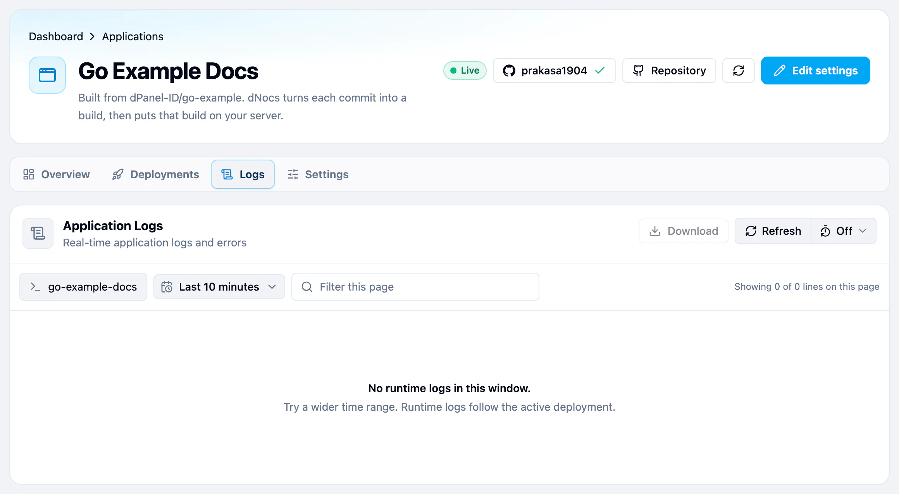
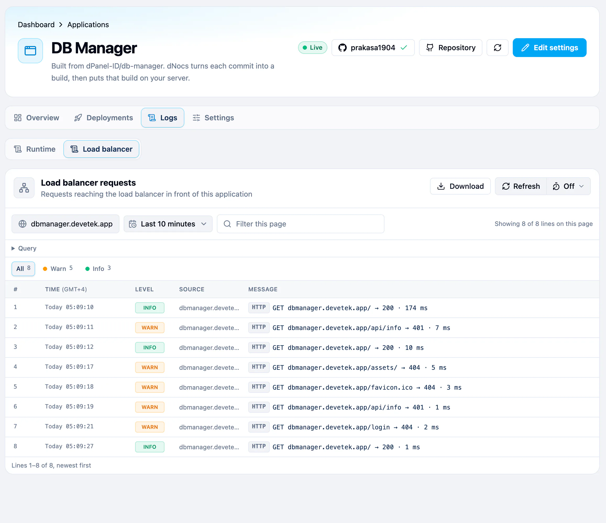

dPanel shows two kinds of log for an application: what the running service prints (its runtime logs), and every HTTP request that reached it through a load balancer. Open the application and go to **Logs**, or press **View logs** on the Overview tab.

## Two sources

| Source        | What it shows                                                                                                             |
| ------------- | ------------------------------------------------------------------------------------------------------------------------- |
| Runtime       | What the service writes to its output while it runs. The table is titled **Application Logs**.                            |
| Load balancer | Every request that reached the load balancer in front of the application. The table is titled **Load balancer requests**. |

**Load balancer** only appears when a load balancer serves this application. Without one, the tab opens straight onto the runtime logs.

Runtime logs follow the active deployment. If the application has no run command or no server yet, the tab says there are no runtime logs.

## Find what you need

1. Pick a **Time range**. The tab opens on **Last 10 minutes**; go back as far as 10 days.
2. Type in **Filter this page** to keep only lines that contain your text.
3. Select a level chip, such as **error**, to keep only that level.
4. Select a line to open it in full in the **Log entry** panel.

The controls are the same in every log view. See [Time range and refresh](../logs/time-range-and-refresh.md) and [Download logs](../logs/download-logs.md).

## Build logs are somewhere else

The output of a build, such as a failing compile, is not in this tab. For the server's own log files, such as `auth.log` or the web server, see [Reading logs](../logs/reading-logs.md#server-logs). Open **Deployments**, find the build, and press **Logs**. See [Deployments and rollback](./deployments-and-rollback.md#read-a-builds-logs).

:::tip[Nothing in the window?]
**No runtime logs in this window.** means nothing was printed in that period. Pick a wider time range first. If it stays empty, check that the service is running on the **Deployments** tab, under **On servers**.
:::
