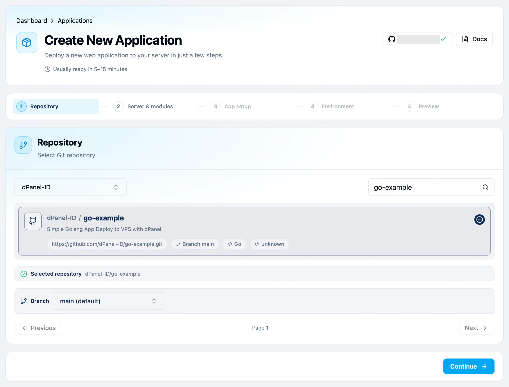
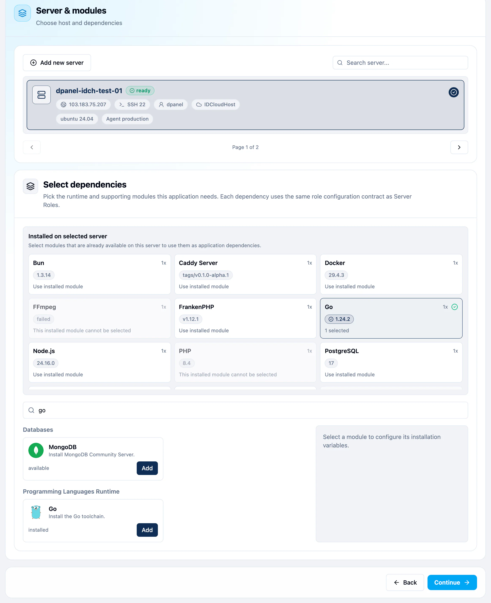
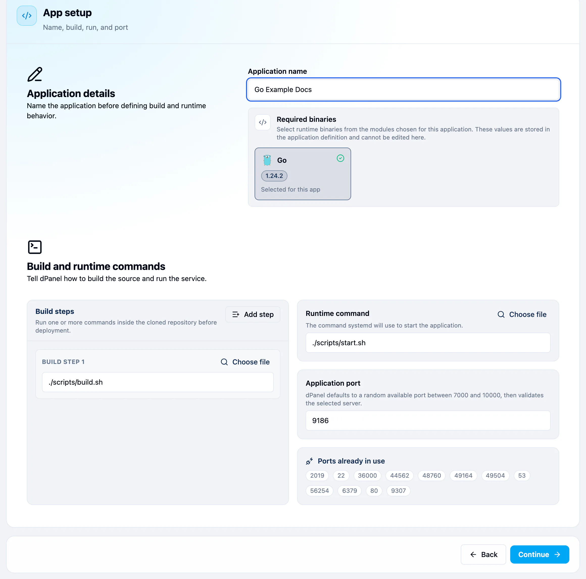

This walkthrough deploys [dPanel-ID/go-example](https://github.com/dPanel-ID/go-example), a small Go web service. Any repository works the same way. Expect it to take 5 to 15 minutes, most of it the first build.

## What you need first

- A server that is **Ready** in this workspace.
- GitHub connected. The GitHub button at the top of the page shows your login with a tick.
- The commands that build and start your code. For go-example they are `./scripts/build.sh` and `./scripts/start.sh`.

Open **Applications** and press **Create Application**. The form has five steps. The stepper at the top marks each one done, and the bar at the bottom says what is still missing before **Continue** unlocks.

## Step 1: Repository

1. Open **GitHub team** and pick the account or organization that owns the repository. **Add GitHub account** at the end of the list connects another one.
2. Type in **Search repositories** and press Enter.
3. Select the repository. dPanel reads its details, and shows it under **Selected repository**.
4. Check **Branch**. It defaults to the repository's default branch.
5. Press **Continue**.

## Step 2: Server & modules

1. Under **Select Server**, select the server that will run the application. Use **Search server...** if you have many.
2. Under **Select dependencies**, add what the application needs to build and run. Type in **Search modules**, then press **Add** on a module. For go-example that is **Go**.
3. The module's options open beside the list. Required fields are marked. Check them, then press **Save options**.
4. Press **Continue**.

If a module is already on the server, it appears under **Installed on selected server**. Select it there to reuse it instead of installing it again.

## Step 3: App setup

1. **Application name**: how the application appears in dPanel. Use letters, numbers and spaces only.
2. **Required binaries**: the language runtime from the modules you picked. It is selected for you.
3. **Build steps**: one or more commands run inside the cloned repository. **Choose file** picks a script from the repository; **Add step** adds another command.
4. **Runtime command**: the command systemd uses to start the application.
5. **Application port**: dPanel suggests a free port between 7000 and 10000. **Ports already in use** lists the ports you cannot take.
6. Press **Continue**.

:::warning[Letters, numbers and spaces]
dPanel rejects a name with hyphens or other symbols, such as `go-example`. The field turns red and explains why, and the flow stays incomplete until you fix it. Use a name like `Go Example`.
:::

:::tip
The form starts with `./scripts/build.sh` as the build step and `./scripts/start.sh` as the runtime command. Replace them if your repository uses other commands.
:::

## Step 4: Environment

Add variables the build or the service needs, one `KEY=value` per line. **Build-time variables** are used only while building; **Runtime variables** are given to the running service. Both are optional. See [Environment variables](./environment-variables.md).

## Step 5: Preview

Check the summary: application, repository, branch, server, commands, port, and whether each environment is **Configured**. Press **Deploy application**.

## What happens next

A dialog confirms **Successfully created your app!** Press **OK** to go back to the list. dPanel then:

1. Creates a playbook for this application, and installs the modules you picked.
2. Clones the branch on the server and runs the build steps.
3. Installs the result and starts it as a service.

The application shows **Building** until the release finishes, then **Running**. Open it to follow the build, and see [Deployments and rollback](./deployments-and-rollback.md).

:::note[Give it a public address]
A new application listens on its port on the server. To serve it on a domain with HTTPS, put a load balancer in front of it. See [Load balancers](../networking/load-balancers.md).
:::
