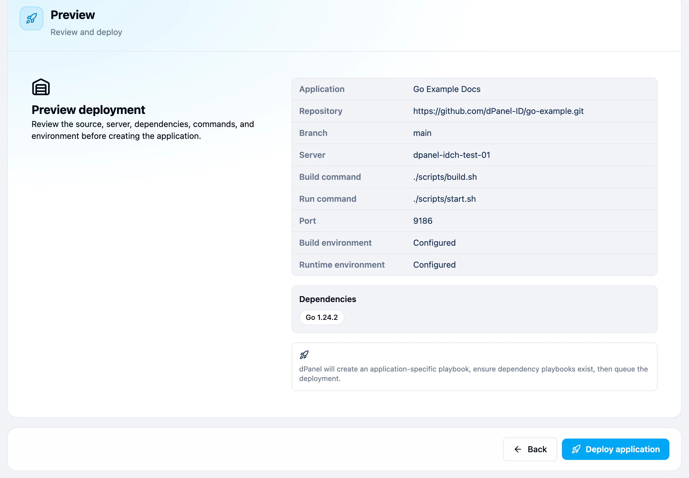

To deploy an app from GitHub with dPanel, you fill in a five-step form: the repository and branch, the server and runtime, the build and start commands, the environment, and a final preview. dPanel then clones, builds and starts your code as a systemd service on your server.

This walkthrough deploys [dPanel-ID/go-example](https://github.com/dPanel-ID/go-example), a small Go web service. Any repository works the same way. Expect it to take 5 to 15 minutes, most of it the first build.

## What you need first

- A server that is **Ready** in this workspace.
- GitHub connected. The GitHub button at the top of the page shows your login with a tick.
- The commands that build and start your code. For go-example they are `./scripts/build.sh` and `./scripts/start.sh`.

Open **Applications** and press **Create Application**. The form has five steps. The stepper at the top marks each one done, and the bar at the bottom says what is still missing before **Continue** unlocks.

## Step 1: Repository

1. Open **GitHub team** and pick the account or organization that owns the repository. **Add GitHub account** at the end of the list connects another one.
2. Type in **Search repositories** and press Enter.
3. Select the repository. dPanel reads its details, and shows it under **Selected repository**.
4. Check **Branch**. It defaults to the repository's default branch.
5. Press **Continue**.

## Step 2: Server & modules

1. Under **Select Server**, select the server that will run the application. Only servers that are **Ready** are listed; use **Search server...** if you have many. If none is ready, the list says **No ready servers found**: add a server, or wait for one to finish setup.
2. Under **Select dependencies**, add what the application needs to build and run. Type in **Search modules**, then press **Add** on a module. For go-example that is **Go**.
3. The module's options open beside the list. Required fields are marked. Check them, then press **Save options**.
4. Press **Continue**.

A **module** is a piece of software dPanel installs on the server for you, such as a language runtime or a database. See the [Glossary](../getting-started/glossary.md).

If a module is already on the server, it appears under **Installed on selected server**. Select it there to reuse it instead of installing it again. Databases you created inside MariaDB or PostgreSQL, such as **PostgreSQL Database**, are not listed: they belong to their database server, not to the application. To give the application a database, create one on the server first, then pass its details as runtime variables in step 4. See [Create a database for an application](../servers/install-software.md#create-a-database-for-an-application).

## Step 3: App setup

1. **Application name**: how the application appears in dPanel. Use letters, numbers and spaces only.
2. **Required binaries**: the language runtime from the modules you picked. It is selected for you.
3. **Build steps**: one or more commands run inside the cloned repository. **Choose file** picks a script from the repository; **Add step** adds another command.
4. **Runtime command**: the command systemd (the part of Linux that keeps programs running) uses to start the application. It must keep running and not return to the prompt, so do not end it with `&` or start a background manager such as `pm2 start`.
5. **Application port**: the numbered door your program listens on. dPanel gives it to your program as the `PORT` environment variable; your program must use that number, or visitors get an error even though the build passed. dPanel suggests a free port between 7000 and 10000. **Ports already in use** lists the ports you cannot take.
6. Press **Continue**.

:::warning[Letters, numbers and spaces]
dPanel rejects a name with hyphens or other symbols, such as `go-example`. The field turns red and explains why, and the flow stays incomplete until you fix it. Use a name like `Go Example`.
:::

:::tip
The form starts with `./scripts/build.sh` as the build step and `./scripts/start.sh` as the runtime command. Replace them if your repository uses other commands.
:::

## Step 4: Environment

Add variables the build or the service needs, one `KEY=value` per line. **Build-time variables** are used only while building; **Runtime variables** are given to the running service. Both are optional. See [Environment variables](./environment-variables.md).

## Step 5: Preview

Check the summary: application, repository, branch, server, commands, port, and whether each environment is **Configured**. Press **Deploy application**.

## What happens next

A dialog confirms **Successfully created your app!** Press **OK** to go back to the list. dPanel then:

1. Creates a playbook for this application (the list of setup steps its worker runs), and installs the modules you picked.
2. Clones the branch on the server and runs the build steps.
3. Installs the result and starts it as a service.

The application shows **Building** until the release finishes, then **Running**. Open it to follow the build, and see [Deployments and rollback](./deployments-and-rollback.md).

You can also ask **Ask dPanel** to do this for you; see [Prompt cookbook](../ai/prompt-cookbook.md).

:::note[Give it a public address]
A new application listens on its port on the server. Until you add a load balancer, it has no public address, so **Running** on the Overview tab is how you know it started. To serve it on a domain with HTTPS, put a load balancer in front of it. See [Load balancers](../networking/load-balancers.md).
:::

## Frequently asked questions

### Which languages and frameworks can I deploy?

Any that run on Ubuntu. You pick the runtime, such as Go, as a module in step 2, and give the commands that build and start your code in step 3. dPanel runs them as you wrote them.

### My build needs more than one runtime

Add every runtime as a module in step 2, such as PHP and Node.js for a Laravel app that builds its front end with `npm`. Step 3 selects all of them under **Required binaries** and stores them on the application. Only selected runtimes are on the build's path, so a missing one fails with `command not found`. You can add one later under the application's settings. See [Deploy Laravel with PostgreSQL](../tutorials/deploy-laravel.md).

### Why does the form refuse my application name?

The name may only contain letters, numbers and spaces. `my-app` or `my_app` is refused; use `My App` instead.

### Why is my server not in the list?

Only servers that are **Ready** can host an application. A server that is still being set up, failed setup or was deleted is not listed. See [Your server page](../servers/your-server-page.md).

### Can I deploy from a GitHub organisation?

Yes. Install the dnocs-id GitHub App on the organisation with **Add GitHub account**, and it appears under **GitHub team**. See [Connect GitHub](../getting-started/connect-github.md#add-a-github-organisation).

### Where is my database in the dependency list?

It is not a dependency. Pick the database server, such as **MariaDB** or **PostgreSQL**, if the application needs it on the same server. The databases you created inside it are not listed; connect to them with runtime variables. See [Create a database for an application](../servers/install-software.md#create-a-database-for-an-application).

### How long can a build take?

20 minutes by default. A slow build can get up to 3 hours. See [Build timeout](./build-timeout.md).

### How do I give the application a domain with HTTPS?

Create a [load balancer](../networking/load-balancers.md) that routes your domain to the application. dPanel adds the DNS record and a Let's Encrypt certificate.
