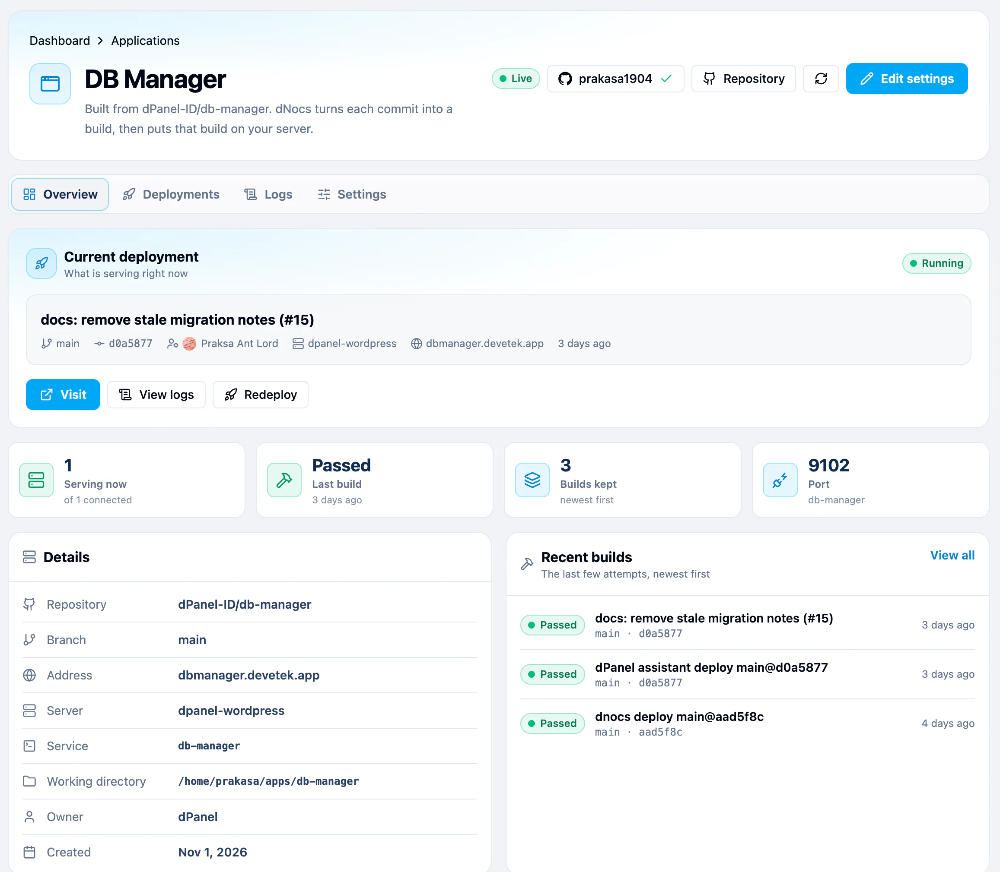
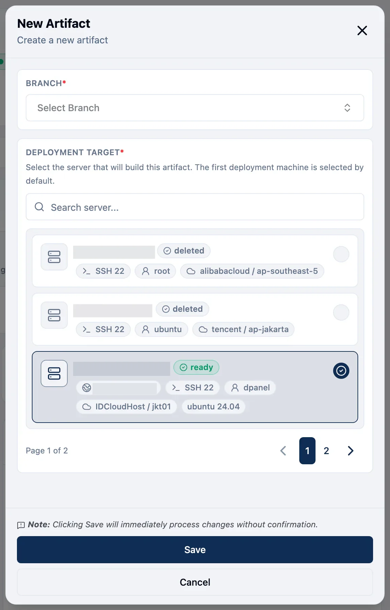
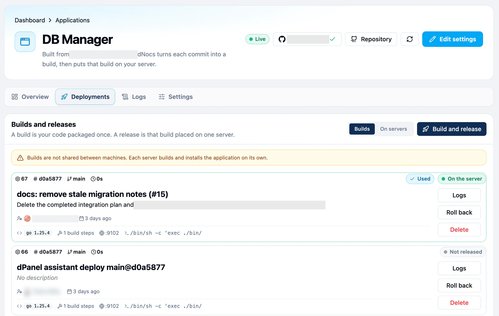
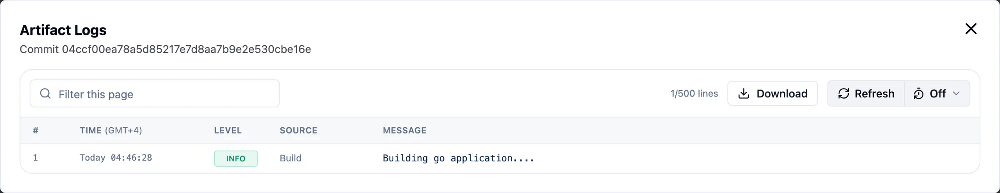

Two words matter here. A **build** is your code packaged once, from one commit. A **release** is that build placed on one server.

## What is running now

Open the application. The **Overview** tab starts with **Current deployment**: the commit, branch and server that are serving right now, and the release status.

| Button    | What it does                                             |
| --------- | -------------------------------------------------------- |
| Visit     | Opens the application's public address, when it has one. |
| View logs | Opens the **Logs** tab.                                  |
| Redeploy  | Builds and releases again.                               |

Below it, **Serving now**, **Last build**, **Builds kept** and **Port** sum up the application, and **Recent builds** lists the last few attempts.

## Build and release a new version

Use this after you push a commit, or after you change a setting.

1. Press **Redeploy** on the Overview tab, or **Build and release** on the Deployments tab.
2. In the **New Artifact** panel, pick the **Branch**. dPanel builds its latest commit.
3. Under **Deployment target**, check the server. The first one is selected for you.
4. Press **Save**.

The build appears at the top of the list as **Building**, then **Passed** or **Failed**. A passed build is released to the server, and its release reads **On the server**.

## The Deployments tab

**Builds and releases** has two views.

- **Builds**: every build, newest first, with its build ID, commit, branch and how long it took.
- **On servers**: each server the application is released to, with its service state.

### Read a build's logs

Press **Logs** on a build. **Artifact Logs** opens with that build's output: the clone, each build step, and the service start. See [Reading logs](../logs/reading-logs.md#build-logs).

### Roll back

1. Find the build you want to go back to, and press **Roll back**.
2. In **Rollback Deployment**, tick the servers to roll back.
3. Press **Rollback**.

dPanel releases that build again on those servers. Nothing is rebuilt.

### Manage releases on a server

In **On servers**, each release has **Start**, **Restart** and **Stop** for its service, and **Delete**. A deleted release can be brought back with **Restore**, or removed for good with **Delete permanently**.

### Delete a build

Press **Delete** on a build to remove it from the list. dPanel asks you to confirm first.

## Statuses

| Build     | Release       | Meaning                              |
| --------- | ------------- | ------------------------------------ |
| Building  | Releasing     | Work in progress.                    |
| Passed    | On the server | Built and running.                   |
| Failed    | Failed        | Something stopped it. Read the logs. |
| Cancelled | Cancelled     | Stopped before it finished.          |

When a build fails, start with its **Logs**. The last lines usually name the step and the error. See also [Troubleshooting](../troubleshooting/faq.md).
