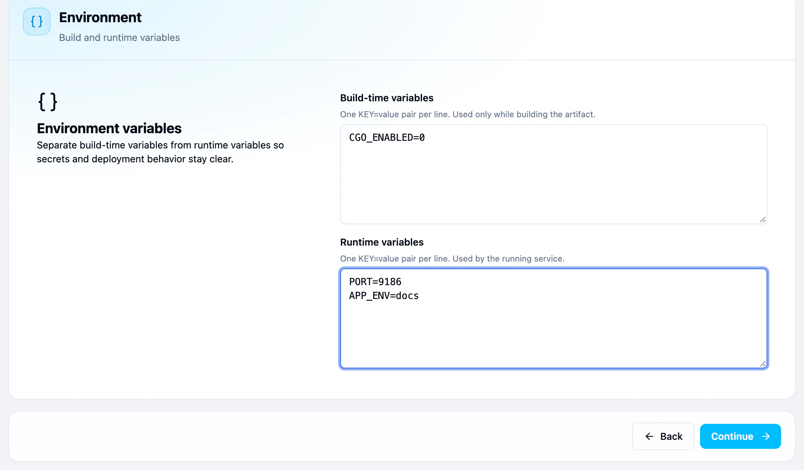

dPanel passes environment variables to your application from two separate lists, so a setting only the build needs never reaches the running service, and secrets such as API keys stay out of your Git repository.

An **environment variable** is a named setting, such as `PORT=9307`, that your program reads when it starts instead of having the value written into the code. See the [Glossary](../getting-started/glossary.md).

| List                 | Used                           | Typical contents                       |
| -------------------- | ------------------------------ | -------------------------------------- |
| Build-time variables | Only while the build steps run | `CGO_ENABLED=0`, `NODE_ENV=production` |
| Runtime variables    | By the running service         | A port, a database address, API keys   |

## Set them when you create the application

In step 4, **Environment**, type one `KEY=value` pair per line in **Build-time variables** or **Runtime variables**.



```bash
PORT=9307
APP_ENV=production
```

:::tip[Match the port]
If your code reads its port from a variable, as go-example reads `PORT`, set it to the same value as **Application port** in step 3. Otherwise dPanel and your service expect different ports.
:::

## Change them later

1. Open the application and go to **Settings**.
2. Under **Build** or **Run**, find **Environment variables** and press **Edit**.
3. Add, change or remove variables, then press **Save**.
4. Release again with **Build and release** or **Redeploy**, so the service starts with the new values. See [Deployments and rollback](./deployments-and-rollback.md).

You can also change both lists in **Edit settings**, the full form. See [Update or delete an application](./update-or-delete.md).

You can also ask **Ask dPanel** to do this for you; see [Prompt cookbook](../ai/prompt-cookbook.md). Secret values are never typed in the chat: the approval card asks for them, and the assistant only sees the names.

## Keeping secrets safe

- dPanel never shows a variable's value after you save it. **Settings** lists the names only, with the value masked.
- Keep secrets in **Runtime variables** unless the build really needs them.
- Do not commit secrets to the repository. dPanel passes these variables in for you.

## Frequently asked questions

### Do I need to redeploy after changing a variable?

Yes. The running service keeps the values it started with. Release again with **Build and release** or **Redeploy** so it starts with the new ones.

### Can I see a secret after I saved it?

No. dPanel masks every value once it is saved. Keep your own copy in a password manager, or set a new value.

### Should a database password be a build-time or a runtime variable?

Runtime. Only the running service connects to the database, so the build never needs it.

### Can I put variables in a .env file in my repository?

You can, but anything committed to Git can leak. Keep secrets in dPanel's **Runtime variables** instead.
