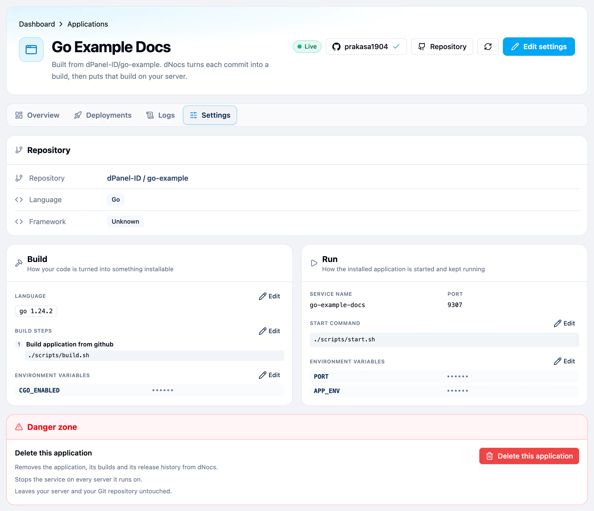
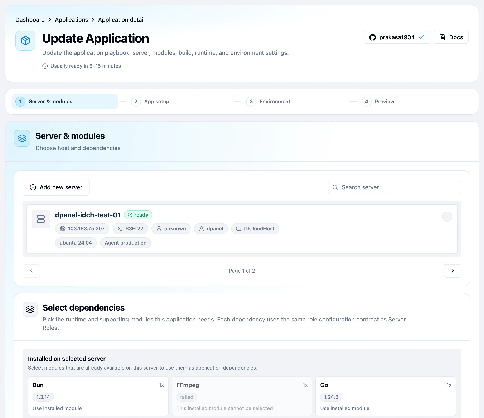

You can change how a dPanel application is built and run at any time, from one setting to the whole form, or delete it. Changes take effect from the next release.

## Review the setup

Open the application and go to **Settings**. **How this application is set up** shows four blocks.

| Block      | Shows                                                                                 |
| ---------- | ------------------------------------------------------------------------------------- |
| Repository | The repository, its language and framework.                                           |
| Deployment | The build time limit and the description.                                             |
| Build      | The language runtime, the build steps, and the build-time environment variables.      |
| Run        | The service name, the port, the start command, and the runtime environment variables. |

## Make a quick change

Each item with an **Edit** button opens a panel for just that part.

| Edit next to                               | Opens                      | Change                                    |
| ------------------------------------------ | -------------------------- | ----------------------------------------- |
| Deployment                                 | Edit application           | The build time limit and the description. |
| Language                                   | Edit Setup Configuration   | The language and its version.             |
| Build steps, Environment variables (Build) | Edit Build Configuration   | The build steps and build-time variables. |
| Start command, Environment variables (Run) | Edit Runtime Configuration | The start command and runtime variables.  |

Press **Save** in the panel. The change applies from the next release, so release again with **Build and release** or **Redeploy**.

## What stays fixed

Four settings are set when you create the application and cannot change: the **Repository**, the **Work directory** (the folder the application lives in on the server), the **Port** and the **Service name**. Servers keep the application in that folder and run it as that service, and load balancers send traffic to that port. The **Edit application** panel lists them under **Fixed settings**.

To use other values, create a new application, release it, point your load balancer at it, then delete the old one.

## Change everything at once

**Edit settings** at the top of the application opens **Update Application**. It is the same five-step form you created the application with, filled in with the current values: server and modules, name, commands, port and environment. The port is read-only here; see [What stays fixed](#what-stays-fixed).

1. Press **Edit settings**.
2. Walk through the steps and change what you need.
3. On **Preview**, tick **Run bootstrap playbooks** if you changed modules or the server's dependencies need to be applied again.
4. Press **Save changes**.

dPanel updates the application definition (the saved description of how to build and run it) and submits the playbook inputs for it.

## Delete an application

The **Danger zone** sits at the bottom of **Settings**.

1. Press **Delete this application**.
2. Confirm in the **Delete Application** dialog.

:::danger[This cannot be undone]
Deleting removes the application, its builds and its release history from dPanel, and stops the service on every server it runs on. Your server and your Git repository are left untouched.
:::

## Frequently asked questions

### Do my changes apply straight away?

No. They apply from the next release. Press **Build and release** or **Redeploy** after saving.

### Can I change an application's port?

No. The port, the service name, the work directory and the repository are fixed once the application exists. Create a new application with the new port instead. See [What stays fixed](#what-stays-fixed).

### When should I tick Run bootstrap playbooks?

When you added or changed modules, such as a new runtime version. dPanel then installs them on the server again before the next build.

### Does deleting an application delete my repository or server?

No. Your Git repository and your server stay. dPanel stops the service and removes the application, its builds and its release history.

### Can I delete an application from the terminal?

`dnocs application delete` deletes an application that has no deployments. Delete its releases first, or use **Delete this application** in the web UI.
