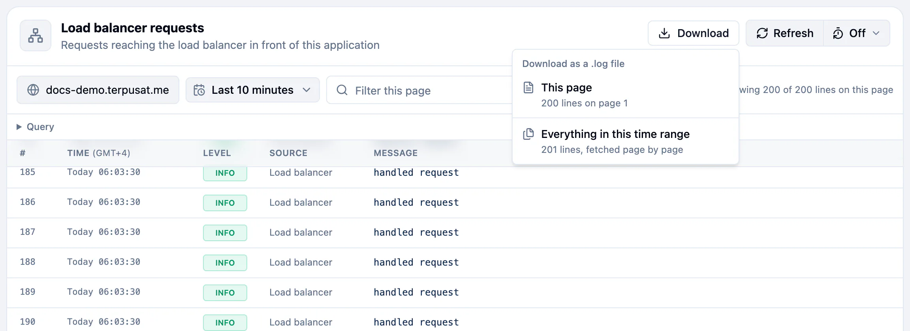

dPanel downloads application and load balancer logs as a plain `.log` file, either the page you are on or every line in the time range, up to 100,000 lines. Download a log when you need to search it with your own tools, or attach it to a support request.

## Application and load balancer logs

1. Set the time range you want. See [Time range and refresh](./time-range-and-refresh.md).
2. Press **Download**. The menu reads **Download as a .log file**.
3. Choose what to save:
   - **This page**: the lines on the page you are on.
   - **Everything in this time range**: every page, fetched one after another.

The file name says what is in it: the name of the log and the time window, such as `db-manager_2026-11-05T01-00Z_to_2026-11-05T01-10Z.log`, with `_page-2` added for a single page. Lines are saved oldest first, as plain text you can open in any editor. Each line holds the time in UTC, the level, and the line exactly as it was written.

:::note[Request details are not in the file]
A load balancer writes each request as the short message `handled request`, with the method, path and status kept as separate fields. The download saves that message, not the readable `GET … → 200` line. To save request details, use `dnocs load-balancer log --id <load balancer ID> --json`.
:::

A long download shows its progress, such as **Downloading 12,000 / 40,000 lines**. Press **Cancel download** to stop it.

:::warning[Up to 100,000 lines at once]
**Everything in this time range** stops at 100,000 lines. For a bigger range, the option says **More than 100,000 lines** and is unavailable. Narrow the time range, or download page by page.
:::

## Build logs

In **Artifact Logs**, press **Download**. The file is named after the commit, such as `build-04ccf00a1b2c.log`, and holds the lines shown, up to the newest 500.

## Before you share a log

A log can hold anything your code printed, including tokens or personal data. Read it before you send it anywhere.

## Frequently asked questions

### How many lines can I download?

Up to 100,000 lines at once with **Everything in this time range**. Narrow the time range, or download page by page, for more.

### Can I download server logs?

Not as a file. Server logs show the newest 20 to 500 lines of one file. Select a line and use **Copy raw line**, or read it over SSH. See [Connect over SSH](../servers/connect-over-ssh.md).

### What format is the file?

Plain text with a `.log` extension, one line per log entry, oldest first.
