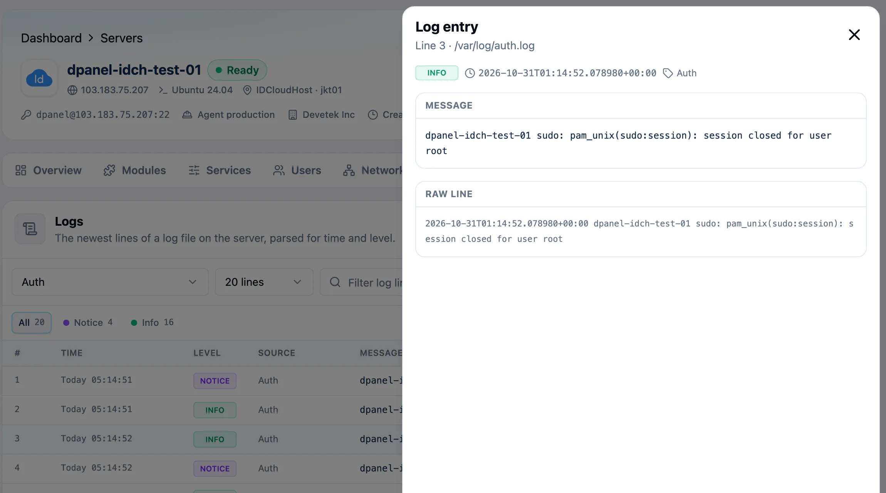
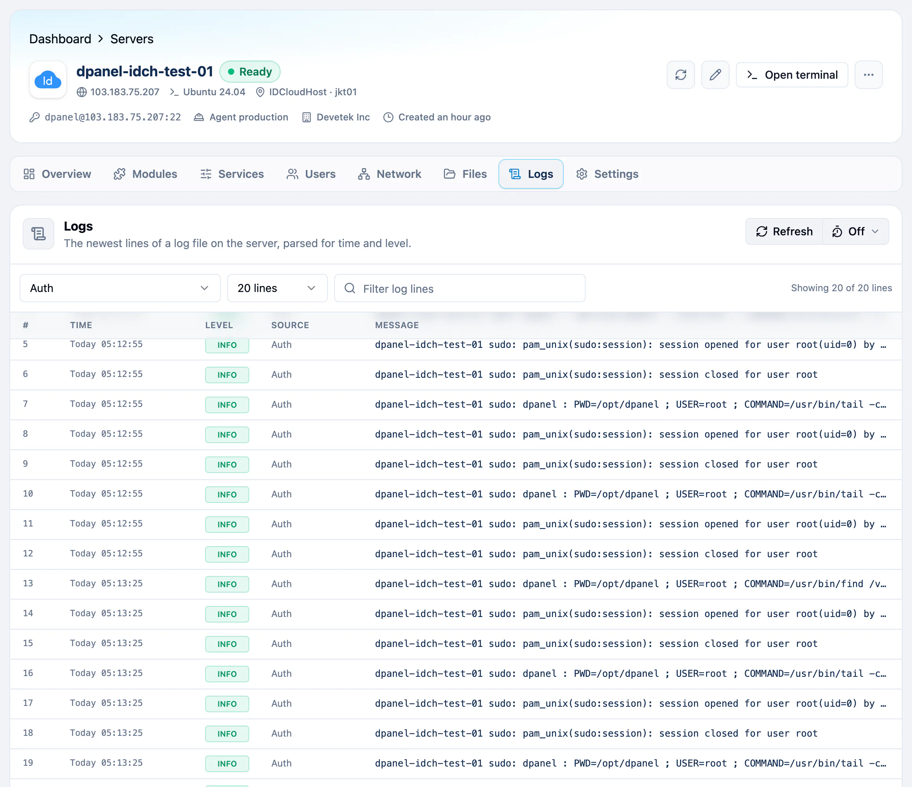

dPanel shows four kinds of log in the browser, so you don't need SSH, `journalctl` or `tail -f`: server log files, application runtime logs, load balancer request logs and build logs. They share one table, so once you can read one you can read them all.

A **log** is a program's running record of what it did, one line per event, such as "started", "request served" or an error. See the [Glossary](../getting-started/glossary.md).

## Where logs live

| Log                      | Where to find it                                                                           | What it covers                                                                                  |
| ------------------------ | ------------------------------------------------------------------------------------------ | ----------------------------------------------------------------------------------------------- |
| Server logs              | Server page, **Logs** tab                                                                  | Log files on the machine: system, security, provisioning, the dPanel agent, and the web server. |
| Application runtime logs | Application page, **Logs** tab, **Runtime**                                                | What your service prints while it runs.                                                         |
| Load balancer logs       | Application page, **Logs** tab, **Load balancer**; or the load balancer's own **Logs** tab | Requests reaching the load balancer.                                                            |
| Build logs               | Application page, **Deployments**, **Logs** on a build                                     | The output of one build: clone, build steps, service start.                                     |

## The log table

Each row is one line, with these columns:

| Column  | Shows                                                                                                                          |
| ------- | ------------------------------------------------------------------------------------------------------------------------------ |
| #       | The line's number in the time range.                                                                                           |
| Time    | When it was written, in your time zone.                                                                                        |
| Level   | debug, info, notice, warn, error or fatal, when the line says.                                                                 |
| Source  | The file, service or domain it came from.                                                                                      |
| Message | The text. A **JSON** badge means the line carries structured data; an **HTTP** badge means it is a request to a load balancer. |

Page 1 holds the newest lines. Inside a page, lines read from top to bottom in the order they were written, with the newest at the bottom, and the table scrolls to the newest line for you. The footer says so, for example **Lines 1–200 of 1,250, newest first**.

**Query** above the table folds open to show the exact search dPanel ran for this page. You only need it when you report a problem.

## Load balancer requests

Load balancer logs show each request as one readable line, marked **HTTP**:

`GET dbmanager.devetek.app/api/info → 401 · 7 ms` reads as: the method, the domain and path asked for, the status code sent back, and how long it took. The level follows the status code: `5xx` is **error**, `4xx` is **warn**, the rest is **info**. Open the entry to see every field, such as the visitor's IP address, the protocol and the request headers.

A TCP or UDP load balancer (L4, which forwards raw connections such as a database port instead of web pages) logs connections, not requests. The command-line tool prints each as a line such as `TCP 203.0.113.10 -> 10.0.0.12:5432 · in 78 B, out 199 B · 3ms`: the client, the upstream it reached, the bytes each way, and how long the connection lasted.

## Narrow it down

- **Filter this page** keeps the lines that contain your text. Upper and lower case do not matter, so `error` also finds `ERROR`. It searches the lines already loaded, not the whole time range. For a request, it also matches the readable line, so `→ 500` finds server errors.
- **Level chips** sit above the table, one per level present, with a count. Select **error** to see only errors; select **All** to go back. The chips are hidden when every line has the same level.
- When nothing matches, **Clear search** removes both filters.

## Open one entry

Select a row, or its **Open entry** button. The **Log entry** panel opens beside the table with:

- **Message**: the full text, never cut off.
- **Structured payload**: any JSON in the line, pretty-printed.
- **Context**: time, level and source, shown at the top of the panel.
- **Raw line**: exactly what was written. **Copy raw line** copies it.

## Server logs

The server's **Logs** tab reads the newest lines of one log file.

1. Open the server and go to **Logs**.
2. Pick a file in **Log source**. They are grouped as Overview, System, Security, Provisioning, dPanel and Network. **Auth** is selected first; **All VM logs** reads them together.
3. Pick how many lines to read: 20, 50, 100, 200 or 500.

:::note[No time range on server logs]
Server logs read the newest lines of a file, not a time window. The time range, paging and download described in [Time range and refresh](./time-range-and-refresh.md) apply to application and load balancer logs.
:::

## Build logs

**Artifact Logs** opens over the page with the newest 500 lines of that build. It has **Filter this page**, the level chips, **Download**, and **Refresh** with **Auto-refresh**, which is handy while a build is still running. Select a line to expand it in place.

## Frequently asked questions

### How far back can I read logs in dPanel?

Application and load balancer logs go back 10 days. Server logs show the newest 20 to 500 lines of a file, and build logs the newest 500 lines of a build.

### Does Filter this page search the whole time range?

No. It searches the lines already loaded on the current page. To look further back, go to an older page or narrow the time range. See [Time range and refresh](./time-range-and-refresh.md).

### Can I follow logs live?

Yes. Turn on **Auto-refresh** next to **Refresh**, every 30 seconds, minute or 5 minutes. It pauses while you read an older page.

### Can I save logs to a file?

Yes. Application and load balancer logs have **Download**, for one page or the whole time range. See [Download logs](./download-logs.md).

### Can I read load balancer logs from the terminal?

Yes. `dnocs load-balancer log --id <load balancer ID>` prints each request as `GET host/path → 200 · 148ms`, newest first. Use `--since` to look back up to `240h`, `--page` and `--limit` (up to 500) to page, and `--json` for every field. Find the ID with `dnocs load-balancer list`. See [AI in the terminal](../ai/ai-in-the-terminal.md) to install dnocs.

### Is the filter case-sensitive?

No. **Filter this page** and every search box in dPanel ignore upper and lower case.
