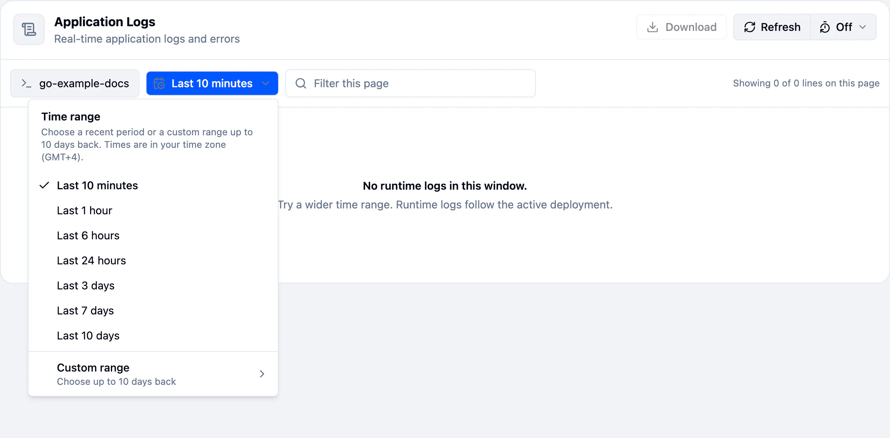
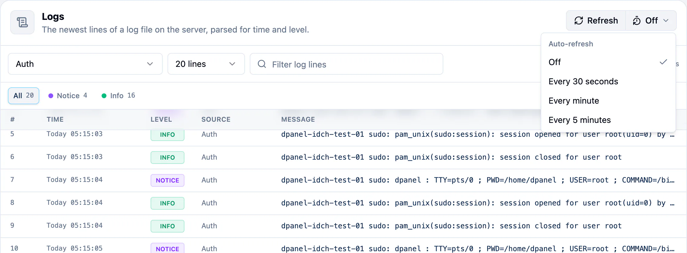

In dPanel you can read application and load balancer logs from the last 10 minutes up to 3 days back, scroll up for older lines, and refresh them by hand or automatically. These controls are on application runtime logs and load balancer logs; see [Reading logs](./reading-logs.md) for where each log lives.

## Choose a time range

The view opens on **Last 10 minutes**.

1. Open the time range menu, left of **Filter loaded lines**.
2. Pick a preset: **Last 10 minutes**, **Last 1 hour**, **Last 6 hours**, **Last 24 hours** or **Last 3 days**.

### A custom range

1. In the same menu, choose **Custom range**.
2. Set **From** and **To**. Times are in your time zone, shown as an offset such as UTC+07:00.
3. Press **Apply**.

The form tells you what is wrong before it runs the search:

| Message                                  | Fix                            |
| ---------------------------------------- | ------------------------------ |
| Enter both a start and an end.           | Fill in both fields.           |
| The start must be before the end.        | Swap them.                     |
| Logs are only kept for the last 3 days.  | Move the start forward.        |
| The end can't be in the future.          | Set the end to now or earlier. |

:::info[3 days back]
Logs can be read up to 3 days back. dPanel holds every range to that limit, so an older start is moved up to the edge of the window.
:::

## Scroll up for older lines

Runtime and load balancer logs read like a terminal. The list opens on the newest line, at the bottom of the selected time range.

- **Scroll up** to load older lines. They arrive 200 at a time, before you reach the top, and the line you are reading stays where it is.
- The list ends at **Start of the time range**. To read further back, pick a wider range.
- After you scroll up, **Jump to latest** takes you back to the newest lines.

The footer says what is loaded, such as **Lines 1–200 of 1,250 loaded, newest at the bottom**. Line 1 is the newest line.

**Filter loaded lines** and the level chips work on the lines currently loaded. To search further back, scroll up or narrow the time range.

:::info[All servers on one list]
Runtime logs of an application on several servers merge every server into one list. That list scrolls back up to 5,000 lines. For older lines, narrow the time range or pick one server in the **Server** menu.
:::

## Refresh

Press **Refresh** to load the newest lines. The table keeps showing the current lines while it loads.

## Auto-refresh

The button beside **Refresh** sets **Auto-refresh**. It is **Off** by default.

1. Open the menu next to **Refresh**.
2. Pick **Every 30 seconds**, **Every minute** or **Every 5 minutes**. The button shows the interval, such as **30s**.
3. Pick **Off** to stop.

Auto-refresh only runs while you are at the bottom of the list, following the newest lines. After you scroll up it pauses, so the lines do not move under you. It picks up again when you go back to the bottom or press **Jump to latest**.

The server **Logs** tab and the **Log output** tab of **Artifact Logs** have the same **Refresh** and **Auto-refresh** controls.

## Frequently asked questions

### Why are older lines missing?

dPanel keeps application and load balancer logs for 3 days. Anything older is gone. Download what you need to keep. See [Download logs](./download-logs.md).

### Why does the newest line sit at the bottom?

Logs read like a terminal, in the order they were written. The list opens at the bottom, so the newest line is in view, and older lines are above it.

### Does a long session slow my browser down?

No. The list keeps at most 1,000 lines on screen, however long you watch or scroll. Lines far away are unloaded and come back when you scroll to them.

### Which time zone are the times in?

Yours, from your browser. The column header shows the offset, such as **Time (GMT+4)**.

### Does auto-refresh cost anything?

No. It only reads the logs again at the interval you pick.
