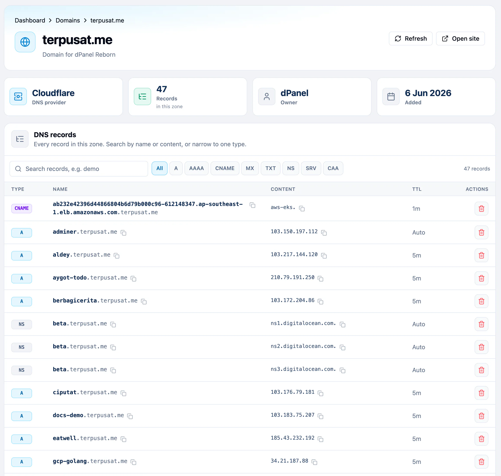

Every domain in dPanel has its own page listing all of its DNS records (the entries that point a name at an address), read live from Cloudflare or DigitalOcean. You can search the records by name or content, narrow them to one record type, copy a name or value, and delete a record, without opening your DNS provider's console.

## Open a domain's records

1. Open **Domain & DNS** in the sidebar.
2. Select the domain, or press **Details** on its row.
3. Scroll to **DNS records**. The count beside the search box, such as **47 records**, is the size of the zone.

Each row shows the record's **Type**, **Name**, **Content** and **TTL** (time to live: how long other computers may remember the answer before asking again). A name at the zone apex reads **root**, and a Cloudflare TTL of 1 second reads **Auto**. Records come 20 to a page; use the page buttons below the table for more.

## Find a record

1. Type part of a name or a value in **Search records, e.g. demo**. The list updates as you type, upper and lower case do not matter, and the text that matched is highlighted.
2. To narrow the list to one record type, press a chip: **A**, **AAAA**, **CNAME**, **MX**, **TXT**, **NS**, **SRV** or **CAA**. Press it again, or **All**, to see every type.
3. The count changes to the number of matches, such as **2 matches**.

When nothing matches, the table says so, for example **No A records match "demo".**, and **Clear search and filter** shows every record again.

## Copy a name or a value

On a record's row, press **Copy name** or **Copy content**. dPanel confirms with **Copied** and the value. Use it to paste a record into a support ticket, or to check what an old name pointed at.

## Delete a record

1. On the record's row, press **Delete**.
2. Confirm **Delete Domain Record**.

:::warning[It takes effect at once]
Deleting a record removes it at your DNS provider straight away. Anything that still uses that name stops resolving.
:::

There is no form to add a record by hand. dPanel creates the `A` record itself when a [load balancer](./load-balancers.md) uses a **Managed** domain.

## Frequently asked questions

### Can I search DNS records by IP address?

Yes. The search matches a record's content as well as its name, so typing an IP address finds every record that points at it.

### Why does a record show TTL Auto?

Cloudflare uses a TTL of 1 second to mean "automatic", and lets Cloudflare pick the real value. dPanel shows it as **Auto**.

### Are the records up to date?

Yes. dPanel reads the zone from your DNS provider each time you open the page, search, or press **Refresh** at the top of the page.

### What should I clean up after deleting a load balancer?

Check whether its `A` record is still in the zone. Search for the host name and delete the record if you no longer need the name.

### Is the search case-sensitive?

No. `Demo`, `DEMO` and `demo` find the same records.
