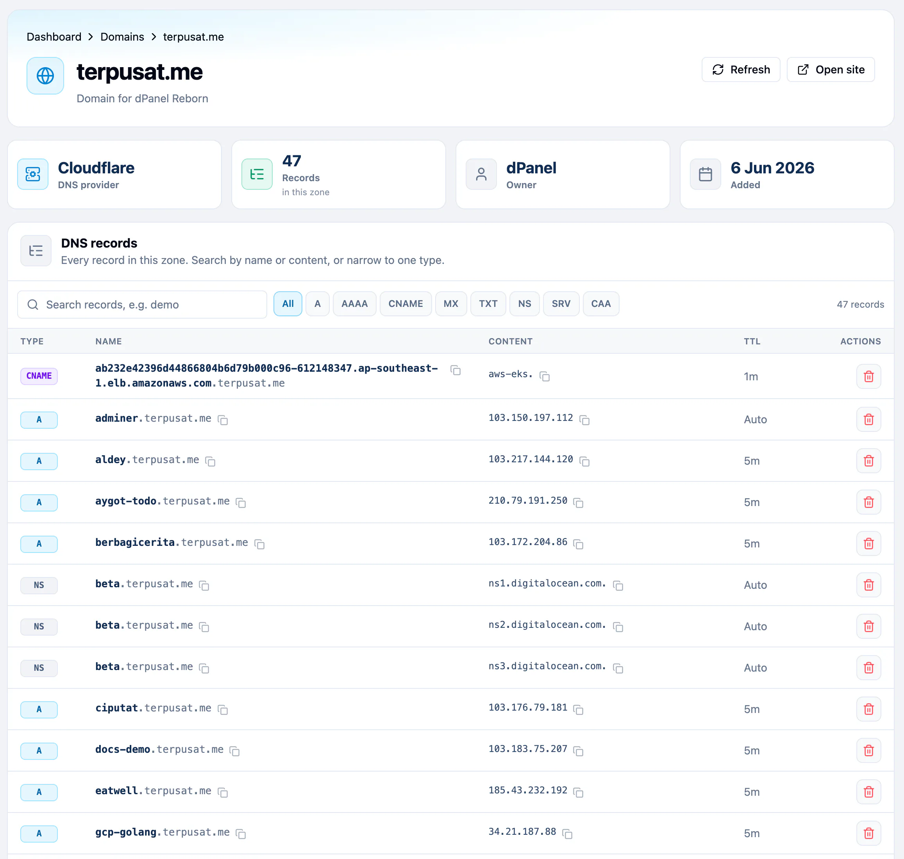

dPanel manages DNS for domains you already own. Add a domain hosted at Cloudflare or DigitalOcean with an API token, and dPanel reads its records, lets you search them, and creates the `A` record that points a name at your server when a load balancer uses the domain.

dPanel does not sell or transfer domains, and it never changes your registrar. You keep buying domains where you do today. What dPanel needs is access to whoever answers DNS for the domain.

## What you need first

- A domain whose DNS is hosted at **Cloudflare** or **DigitalOcean**.
- An API token from that provider that can read and edit DNS records for the zone.

:::tip
Use a scoped token. At Cloudflare, a token limited to "DNS edit" on that one zone is enough.
:::

## Add a domain

1. Open **Domain & DNS** in the sidebar.
2. Press **Add a domain**.
3. **Domain**: the zone you want dPanel to manage, such as `example.com`. A subdomain works too.
4. **Description**: optional. A note for your teammates, such as "Production marketing domain".
5. **Provider**: pick where the zone is hosted.
6. **API token**: paste the provider token.
7. When the review reads **Ready to add**, press **Add domain**.

## What happens next

dPanel reads the zone first and lists the records already there. Nothing is changed until you use the domain somewhere, for example as a **Managed** domain on a load balancer.

## The domain page

Select a domain in the list, or press **Details** on its row, to open its own page. It shows:

- **DNS provider**, the number of **Records** in the zone, the **Owner** workspace and when the domain was **Added**.
- **Refresh**, which reads the zone again, and **Open site**, which opens `https://` and the domain in a new tab.
- **DNS records**: every record in the zone, which you can search, filter by type and delete. See [DNS records](./dns-records.md).

## Use the domain on a load balancer

On a load balancer, choose **Managed** under **Domain Name**, type a **Subdomain** and pick the domain. dPanel creates an `A` record from that name to the gateway server's public address. It refuses a name that already has a record, so existing records stay untouched. See [Load balancers and HTTPS](./load-balancers.md).

## Share or delete a domain

- A domain added in a team workspace is shared with that team. A domain stays in the workspace it was added in; it cannot be moved to another one.
- To remove a domain from dPanel, open the **More** (⋯) menu on its row, choose **Delete**, and confirm **Delete Domain**. This only removes it from dPanel; the zone and its records stay at your DNS provider.

## Frequently asked questions

### Which DNS providers does dPanel support?

Cloudflare and DigitalOcean. Your domain can be registered anywhere, as long as its DNS is hosted at one of them.

### Do I have to move my domain to dPanel?

No. dPanel never sells, registers or transfers domains. It only uses an API token to read and write DNS records at your DNS provider.

### Can I add a DNS record by hand in dPanel?

Not yet. dPanel creates records itself when a load balancer uses the domain. You can search, copy and delete records on the domain page.

### Is my DNS API token safe?

The token is sent once, when you add the domain, and never shown again. The review never displays it, and dPanel shows **Stored securely** in its place.
