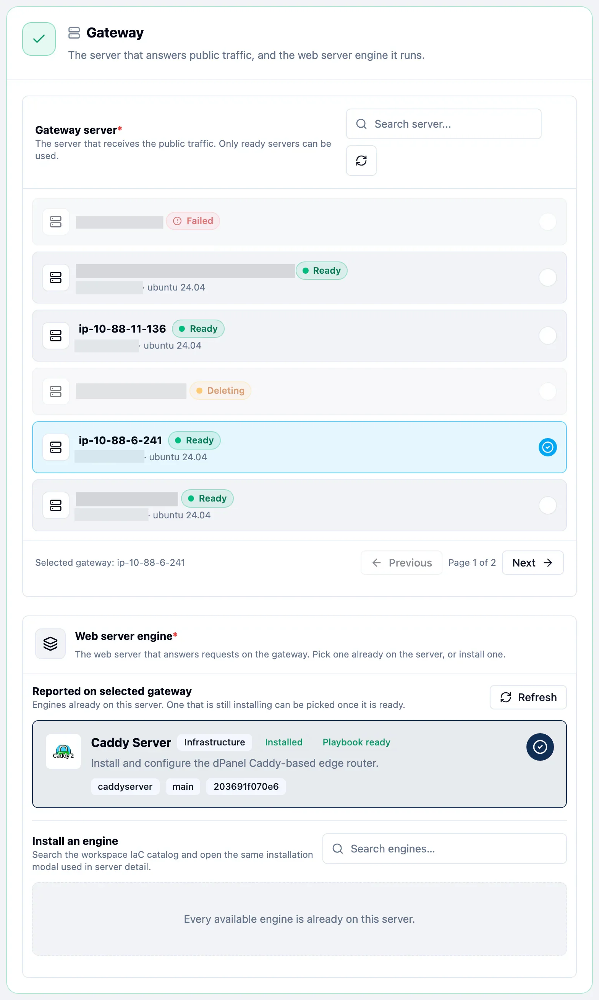
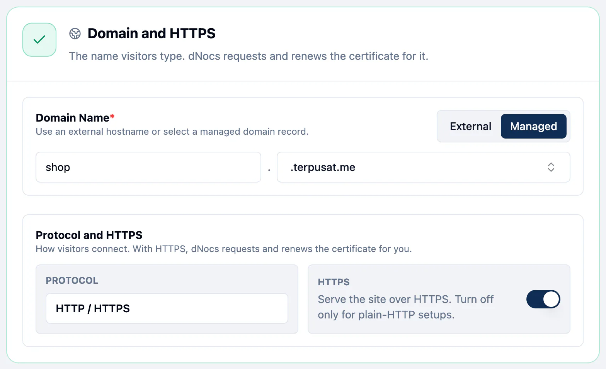

A load balancer in dPanel publishes your application on a domain with HTTPS. It takes the traffic arriving at the domain, gets and renews a free Let's Encrypt SSL certificate, and forwards each request to an application or to a port on a server. With a domain managed in dPanel, it also creates the DNS record for you.

**HTTPS** is the encrypted form of a web address, the padlock in a browser. It needs a **certificate**, a file that proves the site is yours. An **A record** is the DNS entry that points a name at a server's IP address.

dPanel builds the load balancer on one of your own servers, the **gateway**, and runs a web server engine there: Caddy, Apache APISIX or HAProxy. Nothing runs outside your servers.

## What you need first

- **A ready server** to act as the gateway, with ports 80 and 443 reachable from the internet. Servers dPanel launches have them open. See [Servers](../servers/overview.md).
- **A domain.** Either add the zone to dPanel under **Domain & DNS** so dPanel can create the record ([Domains and DNS](./domains-and-dns.md)), or use a hostname you manage yourself.
- **Something to send traffic to**: a dPanel [application](../applications/overview.md), or a service listening on a port.

:::warning[Pick a name nobody uses]
With a managed domain, dPanel creates a new DNS record. It refuses a name that already has a record that cannot share it, so existing records are never overwritten; `MX` and `TXT` records do not get in the way. Use a fresh name, such as `app`.
:::

## Engines

Every engine serves the same load balancer: HTTPS with free certificates, path routing, Cloudflare proxying and the `server: dPanel` header. Pick the one you know or prefer.

| Engine            | What it is                                       | L4 TCP | L4 UDP | Static files and PHP |
| ----------------- | ------------------------------------------------ | ------ | ------ | -------------------- |
| **Caddy**         | The default. dPanel Router, a pinned Caddy build | Yes    | Yes    | Yes                  |
| **Apache APISIX** | An API gateway, pinned version                   | Yes    | Yes    | No                   |
| **HAProxy**       | HAProxy 3.2 LTS, pinned version                  | Yes    | No     | No                   |

- **One engine per server.** Every engine answers on ports 80 and 443, so a gateway runs one engine. Every load balancer on that server uses it.
- **What an engine cannot do, it refuses.** Static file and PHP (FastCGI) rules work on Caddy only, and UDP does not work on HAProxy. An engine that cannot do it refuses it with a clear error instead of a silent gap.

## Create a load balancer

You can also ask the assistant to set one up, for example "Put my app on app.example.com with HTTPS"; see [Put an app on a domain](../ai/prompt-cookbook.md#put-an-app-on-a-domain). To do it yourself, open **Load Balancers** in the sidebar and press **Create a load balancer**. The form has four steps: **Gateway**, **Domain**, **Routing** and **Review**. The **Load balancer** review panel on the right reads **Start with a gateway server** until you pick one, then counts what is still missing.

### Step 1: Gateway

1. Under **Gateway server**, pick the server that will answer public traffic. Each row shows the server's name, status, address and operating system. Only ready servers can be picked; any other row says **Only ready servers can run a load balancer.**
2. Under **Web server engine**, pick Caddy, Apache APISIX or HAProxy. An engine already on the server is listed under **Reported on selected gateway** as **Installed**. If the server has none, find one under **Install an engine** and press **Install**. You can continue once the engine is installed.



### Step 2: Domain

1. Under **Domain Name**, pick the mode:
   - **Managed**: type a **Subdomain**, then **Select domain** from your domains in **Domain & DNS**. dPanel creates the DNS record for you.
   - **External**: type a hostname you manage yourself.
   - To serve the domain itself, such as `example.com` with nothing in front, create the load balancer from the terminal with `--domain-id` and `--subdomain @`.
2. Check the DNS record below the domain. It is an `A` record from your host to the gateway's address:
   - With **Managed**, the box reads **Record dNocs creates at** your DNS provider, such as Cloudflare.
   - With **External**, it reads **Record to add at your DNS provider**. Add that record before traffic arrives. The certificate is issued once the name resolves to the gateway.
3. For a domain at Cloudflare, choose **Proxy through Cloudflare**. It is off by default.
   - **Off** (**DNS only**): visitors reach the gateway directly. The certificate is issued over HTTP-01, one of the ways Let's Encrypt checks that you control the name.
   - **On** (**Proxied**): traffic goes through Cloudflare, which hides the gateway's address. The certificate is issued over DNS-01. It works with any Cloudflare SSL/TLS mode; **Full (strict)** also encrypts the hop from Cloudflare to the gateway.



### Step 3: Routing

1. Under **Routing mode**, pick **L7** for websites and HTTP APIs. It routes by path, such as `/api`. **L4** forwards raw TCP or UDP ports, for databases and other non-HTTP services, without looking at paths. L4 runs on every engine; UDP is not available on HAProxy.
2. Under **Protocol and HTTPS**, the protocol is **HTTP / HTTPS** for websites and APIs. Leave **HTTPS** on. dPanel requests the certificate and renews it for you. Turn it off only for a plain-HTTP setup.
3. Under **Routes**, set up the first **Rule**:
   - **Type**: **Application** sends traffic to a dPanel application. **Proxy Pass** sends it to an address and port.
   - **Matching Path**: `/*` takes every request. A path ending in `/*` shows a **Wildcard** badge.
   - **Application**: pick the application. dPanel uses the application's server and port.
4. Under **How the gateway reaches this application**, choose how the gateway connects to the application. The application's port must be reachable from the gateway, so allow it in the dPanel firewall if that is on, and in your provider's firewall. This matters when the application runs on another server, or at another provider:
   - **Registered address** (the default): the server address registered in dPanel. It works across providers.
   - **Private network**: the server's private IP. Use it only when the gateway and the server share one network.
   - **Custom targets**: type IP addresses, or an origin URL such as `https://origin.example.com` for an app another domain already serves. With a URL, the gateway connects over HTTPS and asks for that domain. Leave the port empty to use 443 for `https`, 80 for `http`, or the app's port for an IP.

   An application deployed on the gateway server itself is reached on `localhost`.

5. Press **Add New Rule** to send other paths elsewhere, such as `/api/*`.


With **L4**, you set a **Service** (such as PostgreSQL or Redis), the **Listen port**, the **Allowed sources** and the **Balancing**, then the upstream addresses (where connections are forwarded to). **Allowed sources** is required for databases. HTTPS is not used: connections pass through, so a database keeps its own TLS end to end.

### Redirect a domain

A route can send visitors to another URL instead of an application or address, on Caddy, HAProxy and Apache APISIX. In **Routing**, set the rule's **Type** to **Redirect**, then fill in **Redirect to** and choose **302 Temporary** or **301 Permanent**. Browsers remember a 301, so use 302 until the destination is final. The requested path and query are kept unless you turn off **Keep the requested path and query**.

From the terminal:

```bash
dnocs load-balancer create --name old --domain old.example.com --https --server-id 12 --redirect-to https://new.example.com --redirect-code 301
```

### Step 4: Review

The **Review** step and the review panel list every answer: gateway server, engine, domain, HTTPS, routing mode and routes. Press **Edit** on a step to change it. When the panel reads **Ready to create**, press **Create load balancer**.


## What happens next

You land on the list with **Load balancer created successfully.** The row reads **In Progress** while dPanel:

1. Creates the DNS record. For a managed domain this is an `A` record from the host to the gateway's public address.
2. Installs the engine on the gateway if it is not there yet.
3. Publishes the routes and requests the HTTPS certificate.

This usually takes about a minute. The first load balancer on a fresh server also installs the engine, which takes about 10 minutes. The row then reads **Ready**, and the counters at the top move it to **Serving traffic**.


## Check that it is live

Open the host in a browser, or check it from a terminal:

```bash
curl -sI https://app.example.com
```

A live load balancer on Caddy answers like this:

```text
HTTP/2 200
alt-svc: h3=":443"; ma=2592000
content-type: text/html; charset=utf-8
server: dPanel
```

What a healthy one shows:

| Check       | What you should see                                                       |
| ----------- | ------------------------------------------------------------------------- |
| DNS         | The host resolves to the gateway server's public address                  |
| Plain HTTP  | A permanent redirect to the `https://` address                            |
| HTTPS       | `HTTP/2 200`, served by your application, with `server: dPanel`           |
| Certificate | Issued by Let's Encrypt for your host, valid for 90 days, renewed for you |
| Protocols   | HTTP/2. Caddy also advertises HTTP/3 (QUIC) in `alt-svc`                  |

:::tip[A new name can take a minute to resolve]
If `curl` says it cannot resolve the host right after creation, your own resolver may have cached the "not found" answer. Wait a few minutes, or test against a public resolver such as `dig @1.1.1.1 app.example.com`.
:::

## The detail page

Select a load balancer in the list to open its page. The header shows the domain, the status, when it was last updated and **Open site**, then five facts: **Status**, **Routes** (with the routing mode), **Gateway server**, **Engine** and **Certificate**.

The **Certificate** tile shows the issuer and the days left, such as **Let's Encrypt · 85 days left**, with its state:

| State              | Meaning                                                                 |
| ------------------ | ----------------------------------------------------------------------- |
| **Valid**          | The certificate is in date. dPanel renews it for you                    |
| **Expiring soon**  | The certificate is close to its end date                                |
| **Expired**        | The certificate has run out; visitors see a warning                     |
| **Not issued yet** | No certificate yet. It is issued once the name resolves to the gateway  |
| **Not used**       | The load balancer serves plain HTTP                                     |
| **Unavailable**    | dPanel could not read the certificate from the gateway. Try again later |

| Tab           | Use it to                                                                                             |
| ------------- | ----------------------------------------------------------------------------------------------------- |
| **Graph**     | Follow the request path from the domain to the load balancer, the gateway, the routes and the targets |
| **Upstreams** | See every backend in order, with its match path, destination and port. **Add backend** adds one       |
| **Logs**      | Read the requests the gateway handled                                                                 |
| **Config**    | Turn **Enable SSL** or **Enable Cloudflare proxy** on or off                                          |


Changes on **Upstreams** and **Config** are drafts until you press **Save changes**. Saving updates the routing definition and runs the gateway setup again. **Reset draft** throws the draft away.


## Load balancer logs

The **Logs** tab lists the requests reaching the gateway, titled **Load balancer requests**. The same requests appear on the application's **Logs** tab under the **Load balancer** source. See [Application logs](../applications/application-logs.md).


- **Time range**: the last 10 minutes by default. Pick a preset up to **Last 3 days**, or a **Custom range** within the last 3 days.
- **Scrolling**: the list opens on the newest request, at the bottom. Scroll up to load older requests, until the start of the time range. After scrolling up, **Jump to latest** brings you back.
- **Download**: **Loaded lines**, or **Everything in this time range**, as a `.log` file.
- **Refresh** loads the newest lines. **Auto-refresh** is off by default; turn it on for every 30 seconds, minute or 5 minutes.

Each row reads as the request it records: the method, the domain and path, the status and the time taken, such as `GET app.example.com/api/info → 200 · 148 ms`. A row with a 4xx status is shown as a warning and a 5xx status as an error, so failing requests stand out. Select a row to see everything about the request, such as the client address, the response size and the headers.

The shared controls are explained in [Time range and refresh](../logs/time-range-and-refresh.md) and [Download logs](../logs/download-logs.md).

### From the terminal

The same requests are available in the [dnocs CLI](../ai/ai-in-the-terminal.md):

```bash
dnocs load-balancer log --id 31                 # the last 10 minutes
dnocs load-balancer log --id 31 --since 24h     # up to 72h (3 days)
dnocs load-balancer log --id 31 --page 2 --limit 500
dnocs load-balancer log --id 31 --json          # each line with its parsed fields
```

## Delete a load balancer

1. In the list, open the **More** (⋯) menu on the load balancer's row and choose **Delete**.
2. Confirm **Delete Load Balancer**.

dPanel removes the routes from the gateway, and the row reads **Deleted**. Your application and the gateway server keep running. A load balancer stays in the workspace it was created in; it cannot be moved to another one.

:::warning[Check the DNS record]
Check at your DNS provider whether the record dPanel created is still there after a delete, and remove it from the domain's [DNS records](./dns-records.md) if you no longer need the name.
:::

:::note
A server that still hosts a load balancer cannot be deleted. Delete the load balancer first.
:::

## Frequently asked questions

### Is the SSL certificate free?

Yes. dPanel gets a Let's Encrypt certificate for your host and renews it before it expires, at no cost. It is valid for 90 days at a time.

### Do I need Cloudflare?

No. dPanel can create the DNS record at Cloudflare or DigitalOcean, or you can point any hostname at the gateway yourself with **External**. **Proxy through Cloudflare** in the **Domain** step, and **Enable Cloudflare proxy** on the **Config** tab, are only for domains hosted at Cloudflare.

### Can one load balancer serve several applications?

Yes. Add one route per path, such as `/*` for the website and `/api/*` for the API, each sending traffic to a different application or address.

### Which web server does dPanel use?

The engine you pick on the gateway: Caddy (the default), Apache APISIX or HAProxy. dPanel installs it on the gateway server the first time. With every engine, the response header reads `server: dPanel`.

### Can the application run on another server or provider?

Yes. In the **Routing** step, under **How the gateway reaches this application**, pick **Registered address**, **Private network** or **Custom targets**. A custom target can be an IP address or an origin URL that already serves the app.

### Why can't I pick my server as the gateway?

Only servers that are ready can run a load balancer. A server still being set up, or one whose setup failed, is shown but cannot be picked.
