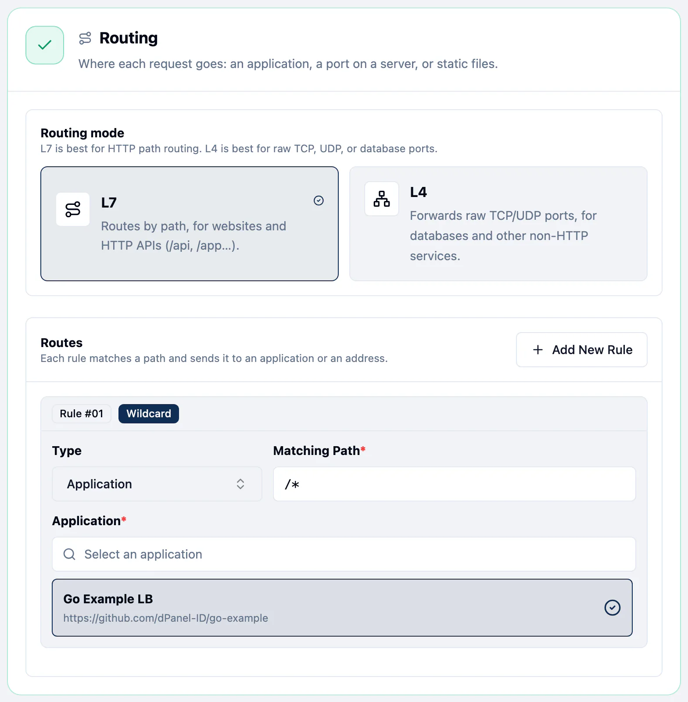
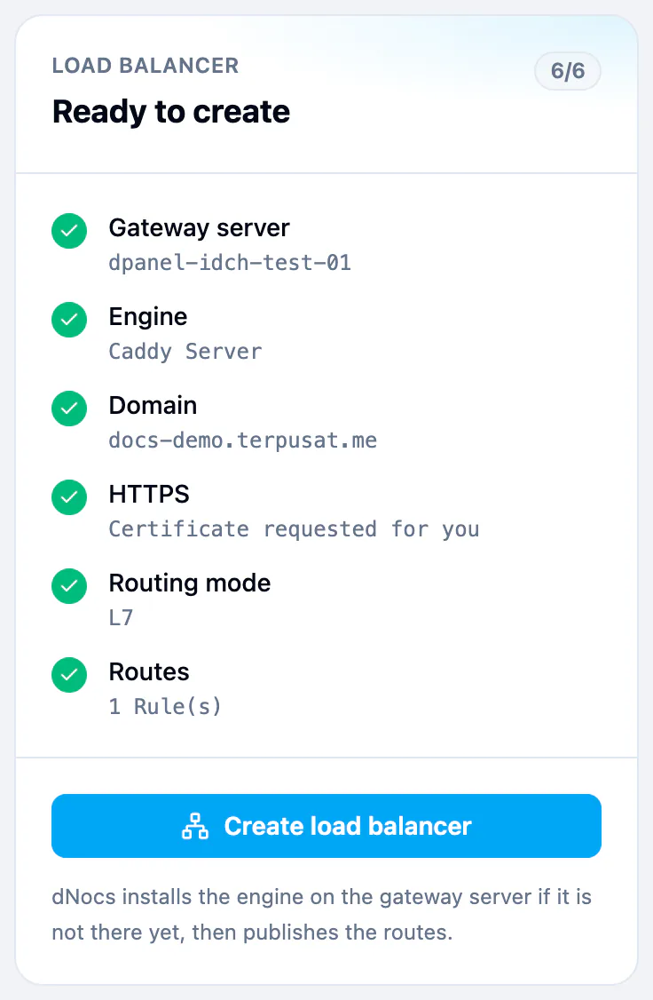
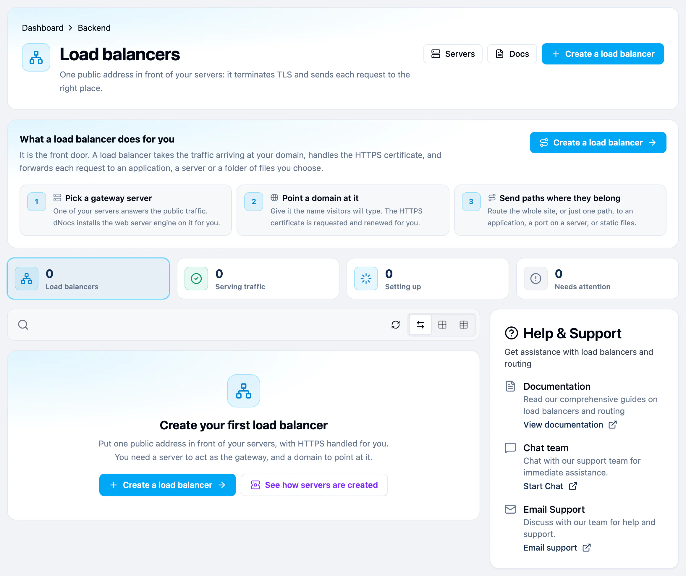
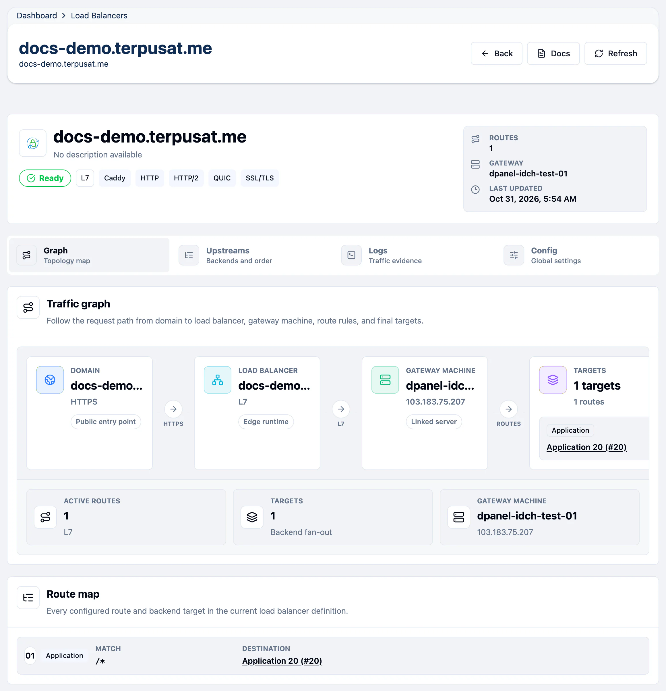
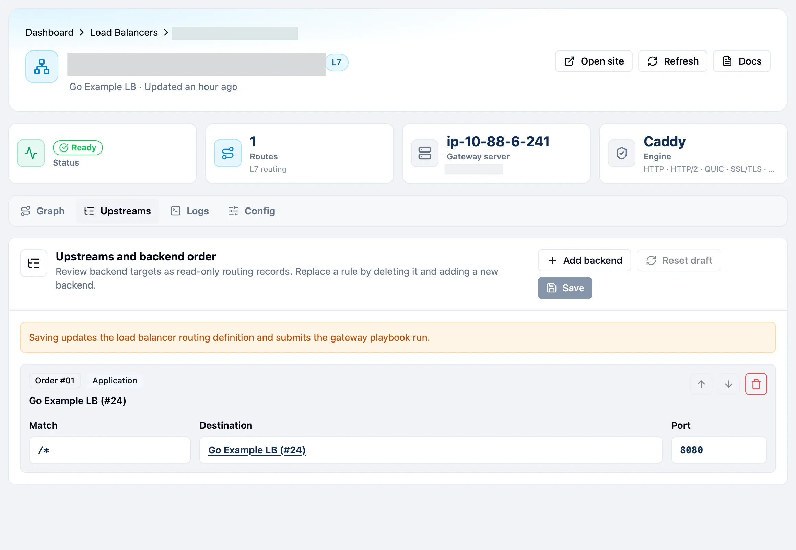
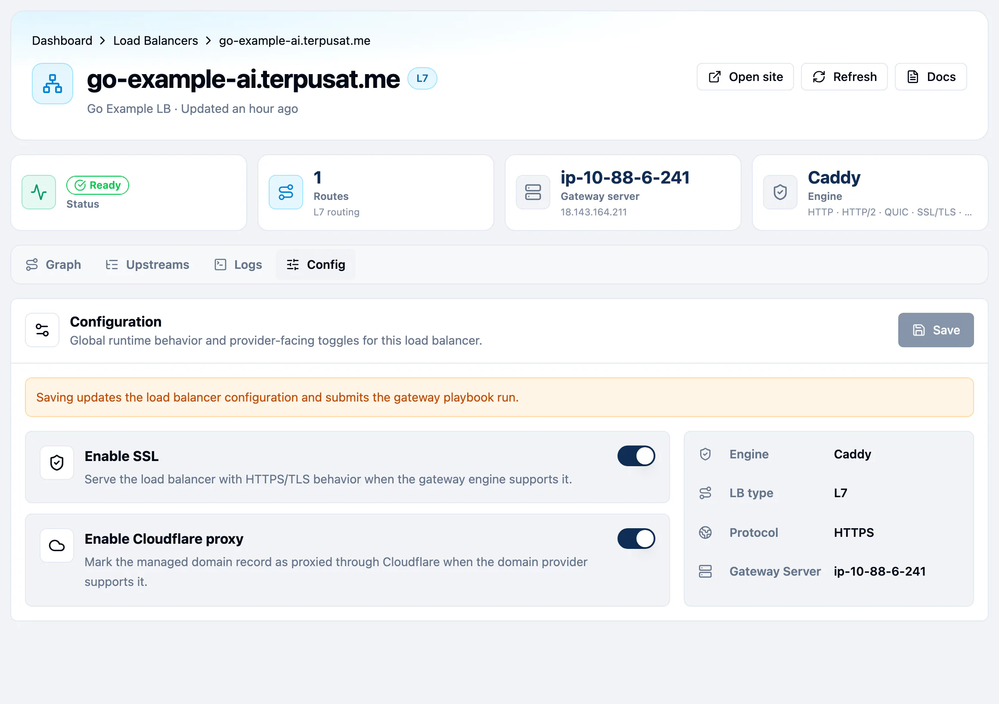
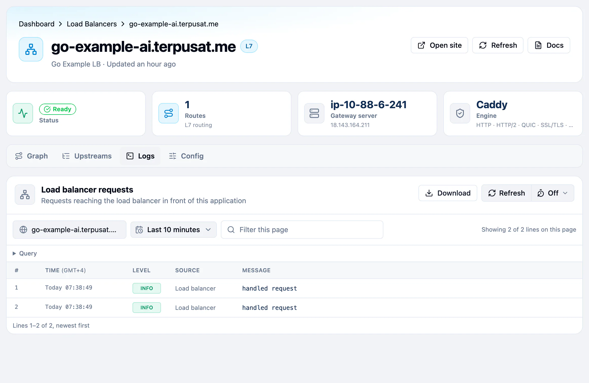

A load balancer is the front door. It takes the traffic arriving at your domain, handles the HTTPS certificate, and forwards each request to an application or to a port on a server.

dPanel builds it on one of your own servers, the **gateway**, and installs the web server engine (Caddy) there.

This page follows a real run: the demo application **Go Example Docs**, published at `docs-demo.terpusat.me` through the gateway `dpanel-idch-test-01`.

## What you need first

- **A ready server** to act as the gateway, with ports 80 and 443 reachable from the internet. Servers dPanel launches have them open. See [Servers](../servers/overview.md).
- **A domain.** Either add the zone to dPanel under **Domain & DNS** so dPanel can create the record ([Domains and DNS](./domains-and-dns.md)), or use a hostname you manage yourself.
- **Something to send traffic to**: a dPanel [application](../applications/overview.md), or a service listening on a port.

:::warning[Pick a name nobody uses]
With a managed domain, dPanel creates a new DNS record. It refuses a subdomain that already has one, so existing records are never overwritten. Use a fresh name, such as `docs-demo`.
:::

## Create a load balancer

Open **Load Balancers** in the sidebar and press **Create a load balancer**. The form has three numbered steps. The **Load balancer** review panel on the right counts what is still missing.

### Step 1: Gateway

1. Under **Gateway Server**, pick the server that will answer public traffic. Only servers marked **ready** can serve.
2. Under **Web Server Engine**, pick **Caddy Server**. If the server already reports it, it is listed under **Reported on selected gateway** as **Installed**. If not, find it under **Install infrastructure modules** and install it.


### Step 2: Domain and HTTPS

1. Under **Domain Name**, pick the mode:
   - **Managed**: type a **Subdomain**, then **Select domain** from your domains in **Domain & DNS**. dPanel creates the DNS record for you.
   - **External**: type a hostname you manage yourself, and point its DNS at the gateway's address.
2. Under **Protocol & Features**, keep **HTTP / HTTPS** for websites and APIs.
3. Leave **SSL Enabled** on. dPanel requests the certificate and renews it.


### Step 3: Routing

1. Under **LB Type Allocation**, pick **L7** for websites and APIs. It routes by URL path. **L4** forwards raw TCP or UDP ports, such as a database, without looking at paths.
2. Under **Upstream Rules Configuration**, set up **Rule #01**:
   - **Type**: **Application** sends traffic to a dPanel application. **Proxy Pass** sends it to an address and port.
   - **Matching Path**: `/*` takes every request. A path ending in `/*` shows a **Wildcard** badge.
   - **Application**: pick the application, here **Go Example Docs**. dPanel uses the application's server and port.
3. Press **Add New Rule** to send other paths elsewhere, such as `/api/*`.



### Create it

When the review panel reads **Ready to create**, 6/6, press **Create load balancer**.



## What happens next

You land on the list with **Load balancer created successfully.** The card reads **In Progress** while dPanel:

1. Creates the DNS record. For a managed domain this is an `A` record from the host to the gateway's public address.
2. Installs Caddy on the gateway if it is not there yet.
3. Publishes the routes and requests the HTTPS certificate.

In our run this took about a minute. The card then reads **Ready**, and the counters move it to **Serving traffic**.



## Check that it is live

Open the host in a browser, or check it from a terminal:

```bash
curl -sI https://docs-demo.terpusat.me
```

A live load balancer answers like this:

```text
HTTP/2 200
alt-svc: h3=":443"; ma=2592000
content-type: text/html; charset=utf-8
server: dPanel
```

What a healthy one shows:

| Check       | What we saw                                                                             |
| ----------- | --------------------------------------------------------------------------------------- |
| DNS         | `docs-demo.terpusat.me` resolves to the gateway, `103.183.75.207`                       |
| Plain HTTP  | `308 Permanent Redirect` to the `https://` address                                      |
| HTTPS       | `HTTP/2 200`, served by the application                                                 |
| Certificate | Issued by Let's Encrypt for `docs-demo.terpusat.me`, valid for 90 days, renewed for you |
| Protocols   | HTTP/2, plus HTTP/3 (QUIC) advertised in `alt-svc`                                      |

:::tip[A new name can take a minute to resolve]
If `curl` says it cannot resolve the host right after creation, your own resolver may have cached the "not found" answer. Wait a few minutes, or test against a public resolver.
:::

## The detail page

Select a load balancer in the list to open its page. The header shows the status, the layer, the engine, the protocols, the number of routes, the gateway and the last update.

| Tab           | Use it to                                                                                       |
| ------------- | ----------------------------------------------------------------------------------------------- |
| **Graph**     | Follow a request from the domain to the load balancer, the gateway, the routes and the targets  |
| **Upstreams** | See every backend in order, with its match path, destination and port. **Add backend** adds one |
| **Logs**      | Read the requests the gateway handled                                                           |
| **Config**    | Turn **Enable SSL** or **Enable Cloudflare proxy** on or off                                    |





Changes on **Upstreams** and **Config** are drafts until you press **Save**. Saving updates the routing definition and runs the gateway setup again. **Reset draft** throws the draft away.



## Load balancer logs

The **Logs** tab lists the requests reaching the gateway, titled **Load balancer requests**. The same requests appear on the application's **Logs** tab under the **Load balancer** source. See [Application logs](../applications/application-logs.md).



- **Time range**: the last 10 minutes by default. Pick a preset up to **Last 10 days**, or a **Custom range** within the last 10 days.
- **Paging**: 200 lines per page, newest first. The footer reads, for example, **Lines 1–200 of 201, newest first**, with the page buttons.
- **Download**: **This page**, or **Everything in this time range**, as a `.log` file.
- **Refresh** loads the newest lines. **Auto-refresh** is off by default; turn it on for every 30 seconds, minute or 5 minutes.

The shared controls are explained in [Time range and refresh](../logs/time-range-and-refresh.md) and [Download logs](../logs/download-logs.md).

## Move or delete

From the ⋯ menu on the card in the list:

- **Migrate Ownership** moves the load balancer to another workspace.
- **Delete** asks you to confirm **Delete Load Balancer**.

Deleting runs in two stages. The first removes the routes from the gateway, and the card reads **Deleted**. While it is deleted you can **Restore** it, or delete it again to remove it for good, together with its generated playbook. Your application and the gateway server keep running.

:::warning[Verify the DNS record]
Check at your DNS provider whether the record dPanel created is still there after a delete, and remove it from [Domains and DNS](./domains-and-dns.md) if you no longer need the name.
:::

:::note
A server that still hosts a load balancer cannot be deleted. Delete the load balancer first.
:::
