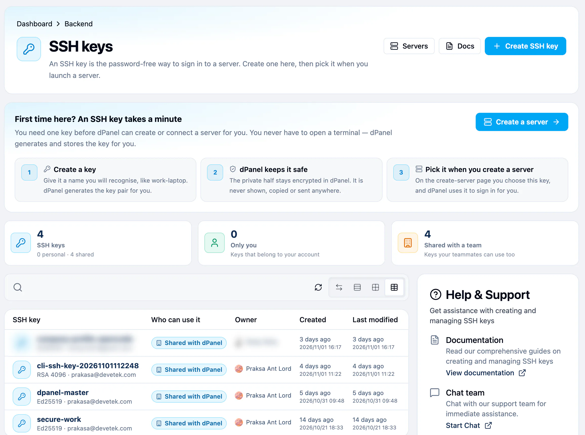

dPanel needs two things before your first server, and reuses both for every server after it: an SSH key to sign in to the machine, and, only if dPanel should launch a new VPS for you, a connected cloud account.

## An SSH key

An SSH key is a pair of files that replaces a password when a computer signs in to a server. One half is public and is written onto the server. The other half is private and never leaves dPanel.

You don't have to make one by hand.

1. In the sidebar, under **Backend**, open **Secret Managers**. It opens the **SSH keys** page.
2. Press **Create SSH key**.
3. Type a **Key name** you will recognise, such as `work-laptop`, and pick the **Key type**.
4. Press **Generate SSH key**.

- **For current servers** is the right choice unless something refuses it. It is shorter and faster, and every current Linux accepts it.
- **For older servers** is the fallback. It also asks for a key size.

The private half is never shown again. dPanel keeps it encrypted and uses it for you. The key's page shows the public half, which is safe to copy anywhere, and a fingerprint you can compare with what a server reports.

## A cloud account

You need this only to launch a new machine. To [connect your own server](./connect-your-own-server.md), the SSH key is enough.

A cloud account is dPanel's link to your account at a cloud provider. It holds the credentials that let dPanel create machines for you.

1. In the sidebar, open **Cloud Projects**. The page is titled **Cloud accounts**.
2. Press **Connect a cloud account**.
3. Pick your provider and paste the credentials it gives you.

How to create a least-privilege credential, step by step, is on each provider's page: [AWS](./cloud-providers/provider-aws.md), [Google Cloud](./cloud-providers/provider-gcp.md), [IDCloudHost](./cloud-providers/provider-idcloudhost.md), [DigitalOcean](./cloud-providers/provider-digitalocean.md), [Alibaba Cloud](./cloud-providers/provider-alibabacloud.md) and [Tencent Cloud](./cloud-providers/provider-tencent.md). Read [Cloud credentials and security](./cloud-providers/cloud-credentials-security.md) before you paste a key.

:::info[Who pays for the machine]
The machine is created inside your own cloud account, so your provider bills you directly. dPanel does not resell machines.
:::

## What happens next

Go to [Create a cloud server](./cloud-providers/create-a-cloud-server.md). More on keys and accounts, including sharing them with a team, is in [SSH keys and cloud accounts](../getting-started/ssh-keys-and-cloud-projects.md).

## Frequently asked questions

### Can I use an SSH key I already have?

dPanel creates the key pair for you so the private half never leaves dPanel. To sign in from your own computer as well, add your own public key to the server; see [Connect over SSH](./connect-over-ssh.md).

### Do I need a cloud account to try dPanel?

No. [Connect your own server](./connect-your-own-server.md) needs only an SSH key and a machine you can reach over SSH.

### Can my team use the same key and cloud account?

Yes. Keys and cloud accounts created in a workspace can be used by its members. See [SSH keys and cloud accounts](../getting-started/ssh-keys-and-cloud-projects.md).
