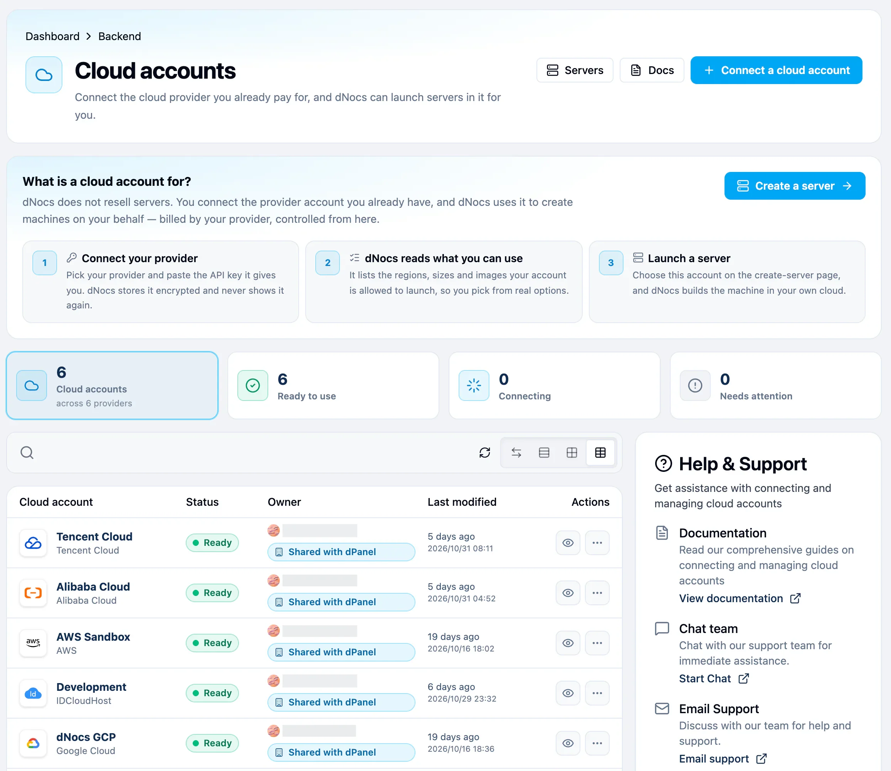

To launch servers for you, dPanel holds a credential for your cloud account. This page says plainly what that means, so you can decide how much to trust it and how to limit the damage if something goes wrong.

## The risk, in one paragraph

A cloud credential lets whoever holds it spend your money and touch your infrastructure. When you connect one, you trust dPanel's operators, its servers and its code with it. If dPanel's database and its encryption key were both stolen, or dPanel had a bug or a malicious change, an attacker could use your credential to launch machines on your bill, or delete the ones dPanel can reach. dPanel can't remove that risk for you. You can make it small: give dPanel a credential that can only manage VMs, in an account or project that holds nothing else, with a spending limit.

## What dPanel stores

| What                         | How                                                                                                                                                |
| ---------------------------- | -------------------------------------------------------------------------------------------------------------------------------------------------- |
| The credential               | In dPanel's database, each field encrypted with AES using a key that dPanel's server reads from a key file. The key is not stored in the database. |
| Connection name and provider | In plain text.                                                                                                                                     |
| Who owns it                  | The workspace it was created in. Everyone in that workspace can launch servers with it. Nobody can read it back.                                   |

Once saved, the credential is never sent back to a browser. The page shows the account, never the key.

dPanel decrypts the credential in two places:

1. **On dPanel's server**, to fill the launch form: listing regions, sizes, images and networks, and checking whether a server name is taken.
2. **On dPanel's worker**, to create or delete a VM. The credential travels with the job and is used by the provider's Ansible modules, which run with logging of secrets turned off.

:::warning[Verify]
The encryption is AES in CFB mode, with a symmetric key held next to the application rather than in a cloud KMS or HSM. It protects a stolen database backup. It does not protect against someone with access to dPanel's running server and its key file. We could not confirm from the code how long the worker keeps the job's credential file after a run.
:::

## What each credential can do

| Provider     | With the minimum we recommend                                                                                 | With a broad credential                           |
| ------------ | ------------------------------------------------------------------------------------------------------------- | ------------------------------------------------- |
| AWS          | Create and terminate EC2 instances it tagged, and their network and security groups, in the regions you allow | Everything your IAM user or root user can do      |
| Google Cloud | Create and delete VMs, disks and firewall rules in one project                                                | Everything in every project the account can reach |
| IDCloudHost  | Everything your IDCloudHost user can do; we could not confirm scoped keys (verify)                            | The same                                          |
| DigitalOcean | Create, read and delete Droplets and SSH keys; read regions, sizes, images and VPCs                           | Everything in the team                            |

The minimum for each one is on its page: [AWS](./provider-aws.md#minimum-iam-policy), [Google Cloud](./provider-gcp.md#minimum-permissions), [IDCloudHost](./provider-idcloudhost.md#1-create-the-api-key), [DigitalOcean](./provider-digitalocean.md#1-create-a-custom-scoped-token).

## Least privilege, in practice

:::danger[Never use root or owner credentials]
Don't connect your AWS root user, an AWS administrator, a Google Cloud owner, or a DigitalOcean **Full Access** token. If that credential leaks, everything in the account goes with it.
:::

1. **Use a dedicated account or project.** An AWS account, a Google Cloud project, or a DigitalOcean team that holds only what dPanel launches. A leak then can't reach your databases, storage or other servers.
2. **Use a dedicated identity.** A separate IAM user, service account or token named `dpanel`, so you can see what it did and revoke it alone.
3. **Grant the minimum.** Use the policy, role or scopes on the provider's page.
4. **Cap the spend.** Set a budget alert at the provider: [AWS Budgets](https://docs.aws.amazon.com/cost-management/latest/userguide/budgets-create.html), [Google Cloud budgets](https://cloud.google.com/billing/docs/how-to/budgets), [DigitalOcean billing alerts](https://docs.digitalocean.com/platform/billing/). On IDCloudHost, keep only the credit you mean to spend in the billing account.
5. **Limit regions.** On AWS, the policy's `aws:RequestedRegion` condition keeps launches to the regions you name.
6. **Watch the audit log.** AWS CloudTrail, Google Cloud Audit Logs and the DigitalOcean security history show every call made with the credential.

## Rotating a credential

dPanel has no button to replace the key inside an existing cloud account, and it won't let you disconnect an account while servers still use it. Rotation therefore takes a few steps:

1. Create a new key at the provider for the same identity. AWS allows two access keys per user, and Google Cloud several keys per service account. On DigitalOcean and IDCloudHost, create a second token.
2. In dPanel, connect a new cloud account with the new key. Use it for every new server.
3. Keep the old key working until the servers launched with the old account are deleted. dPanel needs it to destroy those VMs.
4. When the old account has no servers left, press **Disconnect cloud account** on it in dPanel, then delete the old key at the provider.

If the old key has leaked, don't wait: revoke it now and read the next section.

## If you revoke a credential

Revoking means deleting or deactivating the key at the provider. Here is what happens to servers launched with it:

- **They keep running.** dPanel reaches a server over SSH and through its agent, not through the cloud credential. Applications, logs, the terminal and modules all keep working.
- **New launches fail.** The launch form can't list regions or sizes, and creation fails at the provider.
- **Deleting a server only half works.** dPanel can't destroy the VM at the provider. The server stays in **Deleting** or **Deleted**, dPanel won't remove its record until the provider confirms, and **the VM keeps running and billing** at the provider. Delete it yourself in the provider's console.
- **The cloud account can't be disconnected** while servers still reference it.

## Removing a cloud account from dPanel

1. Delete every server launched with it. See [Delete a server](./delete-a-server.md).
2. In the sidebar, open **Cloud Projects**.
3. On the account, open the menu and choose **Disconnect cloud account**, then confirm.

dPanel deletes the stored credential. That does not revoke the key at the provider: delete it there too.

