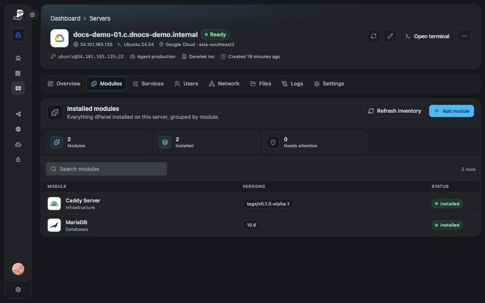

Three providers are covered here because they are the ones tested end to end. The others appear in the form and work the same way, and each gets its own section once it has been through the same testing.

Whichever you pick, the form asks the same questions and the finished server behaves identically: same agent, same tabs, same modules.

## Google Cloud

- Location is asked in two parts: a region, then a zone inside it.
- Size is a machine type, such as e2-small.
- dPanel creates dpanel-network in the region on first use and opens SSH and the web ports.
- The login user is ubuntu.

## AWS

- Location is a region, and dPanel picks a subnet inside it.
- Size is an instance type, such as t3.small.
- dPanel creates its own network and security group on first use, so a new account needs no preparation beyond credentials.
- The login user is ubuntu.

## DigitalOcean

- Location is a single choice: the datacenter region.
- Size is a droplet size.
- The login user is dpanel, which is the one difference you notice when you open a terminal.
