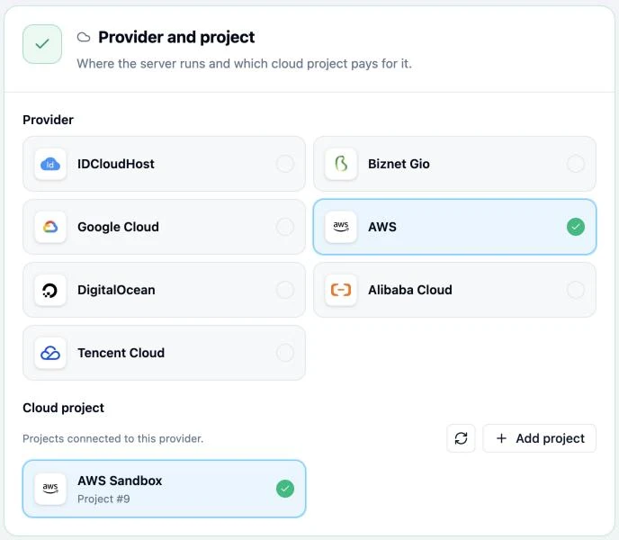
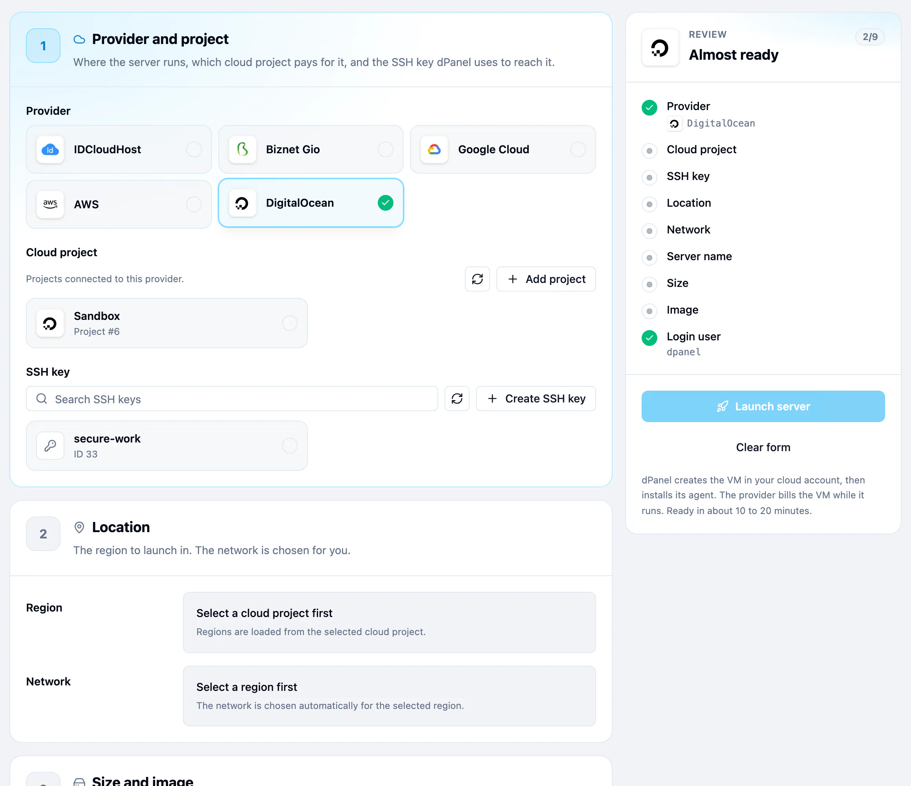

The launch form offers **AWS**, **Google Cloud**, **DigitalOcean**, **IDCloudHost** and **Biznet Gio**. Whichever you pick, the form asks the same questions, and the finished server behaves the same: same agent, same tabs, same modules.

What changes is how location and size are named, and the Linux user dPanel signs in as. The **Review** panel shows that user as **Login user** before you launch.

## Google Cloud

- Location comes in two parts: a region, then a zone inside it.
- Size is a machine type, such as `e2-small`.
- dPanel creates `dpanel-network` in the region on first use, with SSH, HTTP and HTTPS open.
- The login user is `ubuntu`.

## AWS

- Location is a region. dPanel picks a subnet inside it.
- Size is an instance type, such as `t3.small`.
- dPanel creates its own network and security group on first use, so a new account needs nothing beyond credentials.
- The login user is `ubuntu`.

## DigitalOcean

- Location is one choice: the datacenter region.
- Size is a droplet size.
- The login user is `dpanel`.

## IDCloudHost

- Location is a datacenter, such as `jkt01`.
- The login user is `dpanel`.

:::note
Biznet Gio appears in the form and follows the same steps. Check its **Login user** in the Review panel before you launch.
:::
