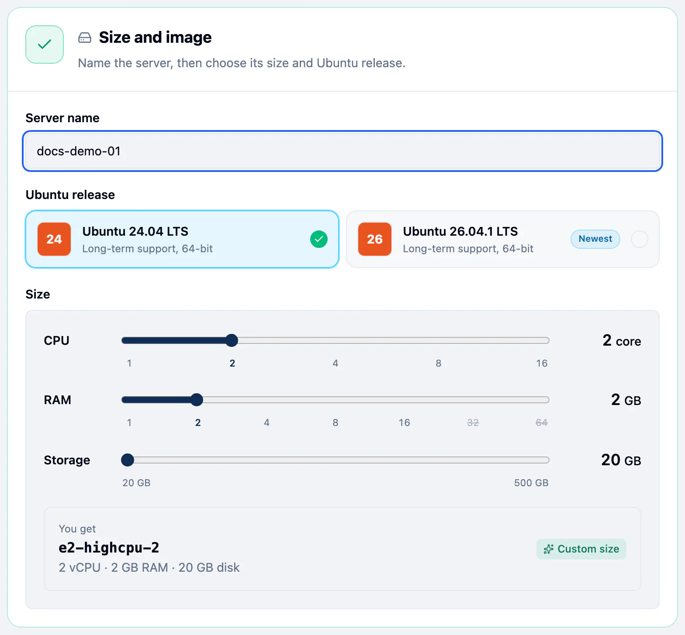

dPanel launches a new Ubuntu server (a VM) in your own cloud account from one form: pick the provider, the region, the size and the Ubuntu release, and dPanel creates the machine and opens SSH, HTTP and HTTPS. The machine installs the dPanel agent when it first starts and joins dPanel by itself, so dPanel does not need to put an SSH key on it. It is ready in about 10 to 20 minutes.

This walkthrough uses Google Cloud. The other providers ask the same questions in the same order. The differences are on [Cloud providers](./index.md), with a page for each provider.

## What you need first

- A cloud account in dPanel, and an SSH key only if the server should join over SSH. See [Before you start](../before-you-start.md).
- Enough quota at your provider for one more machine.

## Open the form

Open **Servers**, then **Create Server**, then **Launch a server**.

The form is one page with four numbered steps. The **Review** panel on the right fills in as you answer. Its counter, such as **3/9**, is how many answers dPanel has so far.

## Step 1: Provider and project

1. **Provider**: pick where the machine runs.
2. **Cloud project**: pick which of your cloud accounts pays for it. **Add project** connects another.

## Step 2: Location

- **Region** is the part of the world the machine runs in. Pick one close to your users.
- **Zone** is one data centre inside that region. Any of them is fine. Google Cloud, Alibaba Cloud and Tencent Cloud ask for one.
- **Network** is filled in for you. On most providers dPanel creates `dpanel-network` the first time it launches in a region, then reuses it. On AWS, Google Cloud, Alibaba Cloud and Tencent Cloud, dPanel opens only TCP ports 22 (SSH), 80 (HTTP) and 443 (HTTPS) at the provider. On DigitalOcean and IDCloudHost it creates no provider firewall, so turn on the dPanel [firewall](../firewall.md) or add one at the provider.

## Step 3: How dPanel connects

- **dPanel agent** is selected and recommended. The machine installs the dPanel agent when it first starts and connects out to dPanel. No dPanel SSH key goes on the machine.
- **SSH** is the alternative: dPanel puts the **SSH key** you pick on the machine and logs in to set it up. **Create SSH key** makes one here. SSH needs a public IP.
- **Public IP** is on by default, so the machine can serve websites. Turn it off for a machine that only works inside your network. Without a public IP the machine joins through the agent only, and it still needs to reach the internet: on `dpanel-network` dPanel adds a NAT (on AWS a NAT gateway, which AWS bills while it exists, and which dPanel removes with the last machine that uses it). On a network you pick yourself, make sure it already gives machines internet access, or the agent cannot connect.

DigitalOcean always gives a Droplet a public IP, and IDCloudHost keeps it on because a VM without one cannot reach the internet. Biznet Gio and Alibaba Cloud join over SSH for now, so they always ask for an SSH key and keep the public IP on.

## Step 4: Size and image

1. **Server name** is how the machine appears in dPanel and at your provider.
2. **Ubuntu release**: 24.04 LTS is selected by default; 26.04 LTS is marked **Newest**. LTS means years of security updates.
3. **Size**: move the **CPU** and **RAM** sliders to the size you want, and **Storage** to the disk size in GB.

The card under the sliders says exactly what you will get:

- **You get**: providers that take any CPU and memory pair, such as Google Cloud and IDCloudHost, launch exactly that size.
- **Cheapest match**: providers with fixed instance types, such as AWS, DigitalOcean, Alibaba Cloud and Tencent Cloud, launch the cheapest type with at least that much CPU and memory. **Rounded up from** says when the type is bigger than you asked for, and the card shows the monthly price when the provider gives one.

| Slider  | Range                                                                                                       |
| ------- | ----------------------------------------------------------------------------------------------------------- |
| CPU     | 1, 2, 4, 8 or 16 vCPU. A value the provider cannot serve is crossed out.                                    |
| RAM     | 1 to 64 GB. Moving CPU moves RAM to the nearest pair the provider sells.                                    |
| Storage | 20 to 500 GB in 10 GB steps (40 to 500 GB on Alibaba Cloud). DigitalOcean and Tencent Cloud set it for you. |

On a provider with fixed types, **Choose the instance type yourself** opens the provider's full list instead of the sliders. **Use the size sliders instead** goes back. Biznet Gio keeps its own **Product** and **Billing Cycle** pickers.

:::tip[Start small]
1 vCPU and 2 GB RAM is enough to try dPanel with one small application. You can launch a bigger server later and move your applications to it.
:::

## Launch

When the Review panel says **Ready to launch**, every answer is in.

1. Press **Launch server**.
2. In the window that opens (**Your server is booting** for the agent, **Your server is being created** for SSH), press **Open server** to watch it come up, or **Launch another**.

**Clear form** starts over.

## What happens next

A blue banner says dPanel is setting the server up. Expect 10 to 20 minutes:

1. The provider creates the machine.
2. With the dPanel agent, the machine installs the agent when it first starts, and the server turns **Ready** once the agent connects, usually 1 to 5 minutes after the machine is up. With SSH, dPanel logs in, installs its agent and reads what is on the machine.
3. dPanel opens the ports it needs.

When the banner goes and the badge reads **Ready**, the server is yours to use. Next, [install software](../install-software.md) on it or [create an application](../../applications/create-an-application.md).

:::warning[If setup fails]
A red banner says so and offers **See what happened**, with the reason the provider or the setup gave. The usual causes are a cloud account without enough quota, and credentials that have expired. If the provider never created the machine, **Reinstall** cannot help: fix the cause shown, delete the server in dPanel and launch it again. If the machine exists and only setup failed, use **Reinstall** on the server's **Settings** tab. See [Common problems](../../troubleshooting/faq.md#servers).
:::

:::tip[Your provider bills from now]
The machine is billed by your provider while it exists, even while setup runs. [Delete it](../delete-a-server.md) when you are done.
:::

## Frequently asked questions

### How long does it take to launch a server?

About 10 to 20 minutes from **Launch server** to **Ready**. Most of it is the provider creating the VM and the dPanel agent being installed.

### Which Ubuntu versions can I launch?

Ubuntu 24.04 LTS and 26.04 LTS. dPanel picks the provider's current image for the release you choose.

### How much does a server cost?

Your provider bills you at its own prices, because the server runs in your account. On providers with fixed instance types, the size card shows the provider's monthly price when it is available.

### Can I choose an exact instance type, such as t3.small?

Yes, on AWS, DigitalOcean, Alibaba Cloud and Tencent Cloud. Press **Choose the instance type yourself** under the sliders and pick from the provider's list.

### Which login user does the server get?

`ubuntu` on AWS, Google Cloud and Tencent Cloud, `root` on Alibaba Cloud, and the **Default User** you set (`dpanel` by default) on DigitalOcean and IDCloudHost. See [Connect over SSH](../connect-over-ssh.md).
