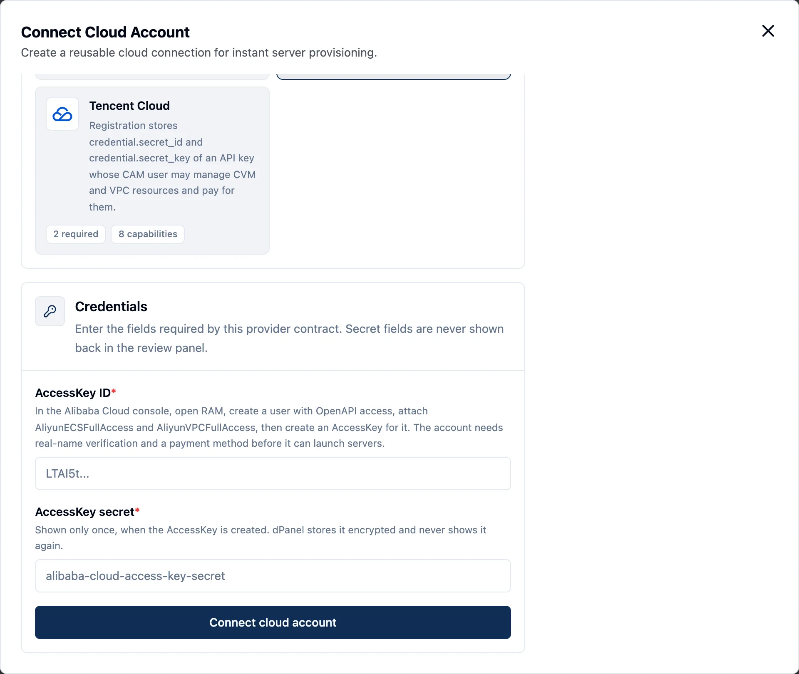
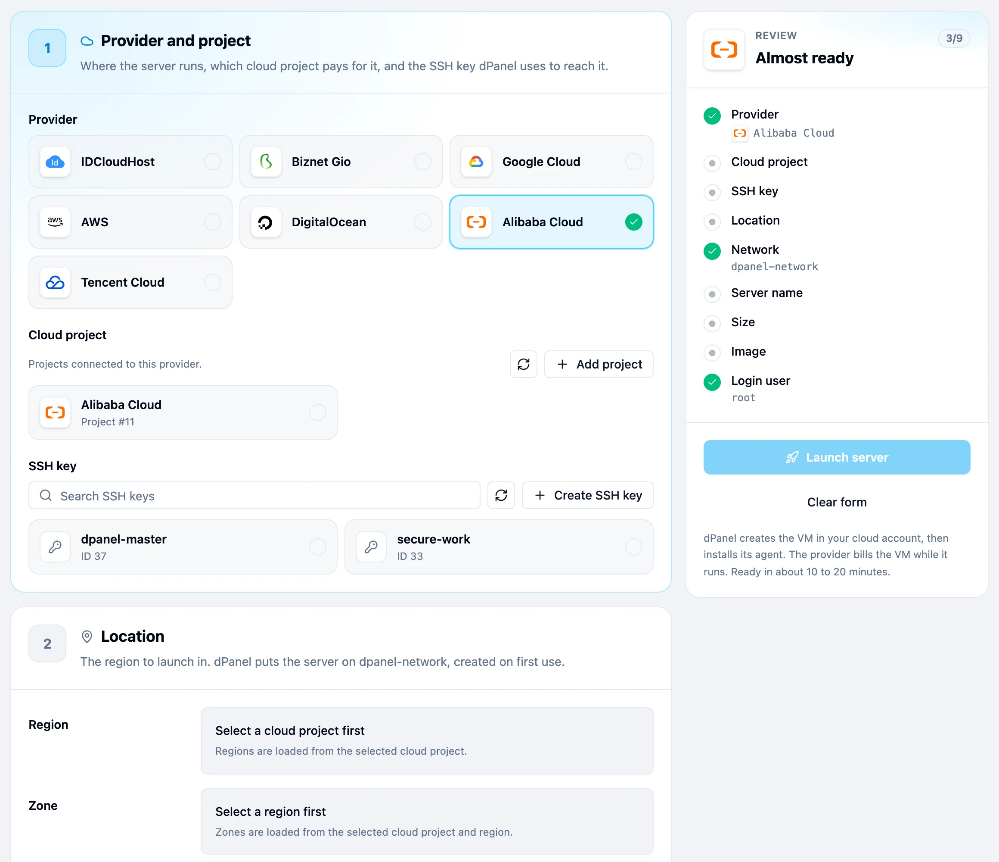

dPanel launches Ubuntu ECS instances in your own Alibaba Cloud account. It signs in with an AccessKey that belongs to a RAM user you create for it, with only the ECS and VPC permissions listed on this page.

## What you need first

- An Alibaba Cloud account that can buy pay-as-you-go servers: real-name verification done and a payment method added. See [the account must be allowed to buy](#the-account-must-be-allowed-to-buy).
- Permission in that account to create RAM users.
- An SSH key in dPanel. See [Before you start](../before-you-start.md).

## 1. Create a RAM user for dPanel

Never give dPanel the AccessKey of your Alibaba Cloud account itself.

1. Sign in to the Alibaba Cloud console and open **RAM** (Resource Access Management).
2. Go to **Identities**, then **Users**, and press **Create User**.
3. Name it `dpanel`. Under **Access Mode**, tick **Using permanent AccessKey to access** (OpenAPI access) and leave console access off.
4. Copy the **AccessKey ID** and the **AccessKey Secret**. Alibaba Cloud shows the secret only once.
5. Back on the user list, choose **Add Permissions** for `dpanel`, and grant the system policies `AliyunECSFullAccess` and `AliyunVPCFullAccess`.

Alibaba Cloud guides: [Create a RAM user](https://www.alibabacloud.com/help/en/ram/user-guide/create-a-ram-user), [Create an AccessKey](https://www.alibabacloud.com/help/en/ram/user-guide/create-an-accesskey-pair), [Grant permissions to a RAM user](https://www.alibabacloud.com/help/en/ram/user-guide/grant-permissions-to-the-ram-user).

### What dPanel does with the key

| Where                      | What it does                                                 | API actions                                                                                                                                          |
| -------------------------- | ------------------------------------------------------------ | ---------------------------------------------------------------------------------------------------------------------------------------------------- |
| dPanel API (discovery)     | Lists regions, zones, instance types, images, vSwitches, VMs | `DescribeRegions`, `DescribeZones`, `DescribeAvailableResource`, `DescribeInstanceTypes`, `DescribeImages`, `DescribeVSwitches`, `DescribeInstances` |
| Network, first launch only | Creates `dpanel-network` and a vSwitch in the zone           | `CreateVpc`, `CreateVSwitch`                                                                                                                         |
| Every launch               | Imports your SSH key and opens TCP 22, 80 and 443            | `ImportKeyPair`, `CreateSecurityGroup`, `AuthorizeSecurityGroup`                                                                                     |
| Instance                   | Launches it, pay-as-you-go, with a public IP                 | `RunInstances`                                                                                                                                       |
| Delete                     | Deletes the instance, its security group and its key pair    | `DeleteInstance`, `DeleteSecurityGroup`, `DeleteKeyPairs`                                                                                            |

:::warning[Verify]
The discovery calls come straight from dPanel's code. The launch and delete calls are made through the Ansible `alibaba.alicloud` collection, which may make a few more read calls. The two system policies above cover all of them. If you write a narrower custom policy and a launch fails, the error names the missing action.
:::

## 2. Connect it to dPanel

1. In the sidebar, open **Cloud Projects**. The page is titled **Cloud accounts**.
2. Press **Connect a cloud account**.
3. Fill in **Connection name**, for example `Alibaba production`.
4. Under **Cloud provider**, pick **Alibaba Cloud**.
5. Paste **AccessKey ID** and **AccessKey secret**.
6. Press **Connect cloud account**.

dPanel saves the account as **Ready** straight away. It does not test the key on save. The first real test is the launch form: if **Region** stays empty or shows an error, the key or its permissions are wrong.

## 3. Alibaba Cloud fields in the launch form

| Field              | What to pick                                                                                                                                                                                                               |
| ------------------ | -------------------------------------------------------------------------------------------------------------------------------------------------------------------------------------------------------------------------- |
| **Region**         | Where the server runs, such as `ap-southeast-5` (Jakarta).                                                                                                                                                                 |
| **Zone**           | A zone inside the region, such as `ap-southeast-5a`.                                                                                                                                                                       |
| **Network**        | `dpanel-network`. You don't choose it.                                                                                                                                                                                     |
| **Size**           | Move **CPU** and **RAM**. dPanel launches the cheapest type in stock in that zone, `ecs.e-` first, then `ecs.u1-`, `ecs.c7` or `ecs.g7`. **Choose the instance type yourself** lists them all, such as `ecs.e-c1m2.large`. |
| **Ubuntu release** | 24.04 LTS or 26.04 LTS. dPanel picks the current Alibaba Cloud image for that release.                                                                                                                                     |
| **Storage**        | System disk, 40 to 500 GB, ESSD.                                                                                                                                                                                           |

There is no **Access** step for Alibaba Cloud. dPanel signs in as `root` with your SSH key.

## 4. Launch

Follow [Create a cloud server](./create-a-cloud-server.md). Pick Alibaba Cloud in step 1.

## Alibaba Cloud gotchas

### The account must be allowed to buy

If the launch fails with `Forbidden.RiskControl`, Alibaba Cloud has blocked purchases on the account. This is not a key or permission problem. Finish real-name verification, add a payment method, and check that the account has no overdue payment, then launch again. A new account can stay blocked until Alibaba Cloud reviews it.

### Other things to know

- **The network appears on first launch.** In each region, the first launch creates a VPC named `dpanel-network` (`10.88.0.0/16`). Each zone gets its own vSwitch, `dpanel-network-<zone>`, the first time a server lands there. Deleting a server never removes them.
- **One security group per server**, named `dpanel-<server name>`, open to the internet on TCP 22, 80 and 443. dPanel deletes it with the server.
- **One key pair per server**, named `dpanel-<server name>-key`, holding the public half of your SSH key. dPanel deletes it with the server.
- **Names are host names.** Use 2 to 63 letters, numbers or dashes, starting with a letter. dPanel refuses a name that another instance in the region already has.
- **Public IP and bandwidth.** The instance gets a public IPv4 address, billed by traffic, capped at 100 Mbps.
- **Billing runs from launch.** You pay Alibaba Cloud for the instance, its disk and its traffic while they exist, even while setup runs or fails. Delete a server you no longer need.

## Security

- The key can create and destroy ECS and VPC resources in the account. Keep it on its own RAM user so you can revoke it without touching anything else.
- To rotate the key, create a new AccessKey for the same RAM user and replace it with **Update credentials** on the cloud account. See [Rotating a credential](./cloud-credentials-security.md#rotating-a-credential).
- To cut dPanel off, disable or delete the AccessKey in RAM. Running servers keep running. See [what happens when you revoke](./cloud-credentials-security.md#if-you-revoke-a-credential).
- More in [Cloud credentials and security](./cloud-credentials-security.md).

## Frequently asked questions

### Who pays for the server?

Alibaba Cloud bills you directly, because the server runs in your own account. dPanel does not resell machines. Delete the server in dPanel when you are done, so the provider stops charging. See [Delete a server](../delete-a-server.md).

### Can I also use the dPanel firewall on this server?

Yes. The dPanel [firewall](../firewall.md) runs on the server itself, behind Alibaba Cloud's own network rules, so a port must be open in both to be reached.

### What happens to my servers if I revoke the credential?

They keep running, but dPanel can no longer launch or delete machines with it. See [Cloud credentials and security](./cloud-credentials-security.md#if-you-revoke-a-credential).
