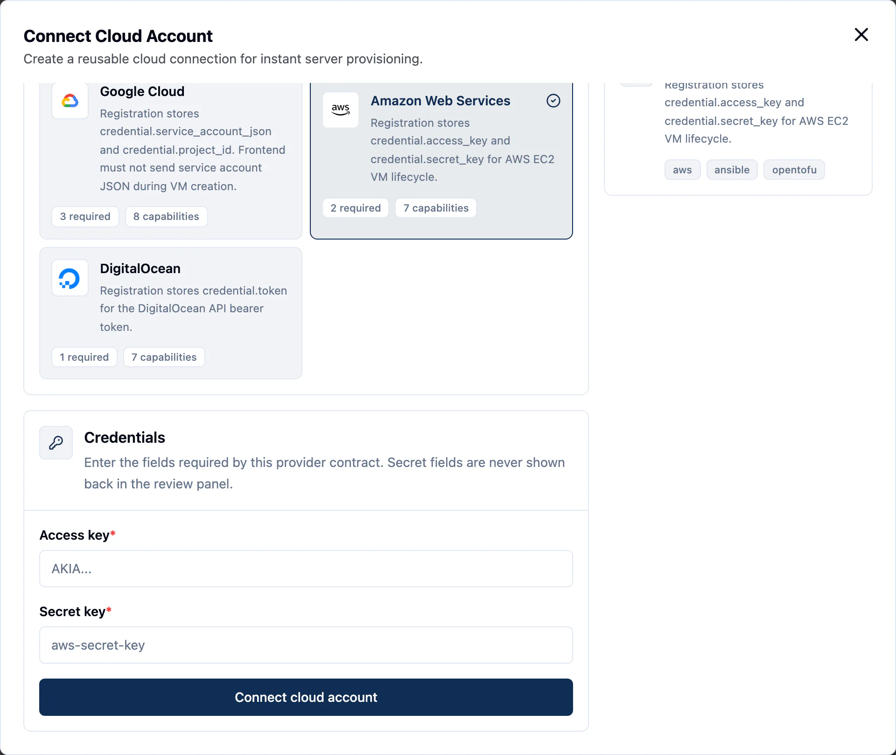
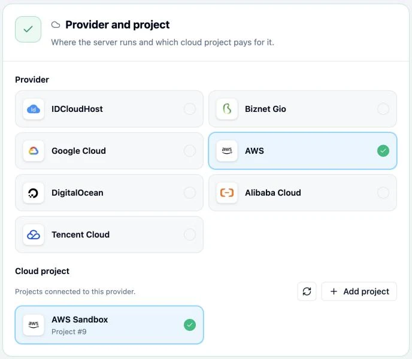

dPanel launches EC2 instances in your AWS account. It signs in with an IAM access key that you create for it.

## What you need first

- An AWS account with billing set up.
- Permission in that account to create IAM users and policies.
- An SSH key in dPanel. See [Before you start](../before-you-start.md).

## 1. Create a dedicated IAM user

Never give dPanel your root user's keys, or an administrator's.

1. Sign in to the AWS console as an administrator, and open **IAM**.
2. Go to **Policies**, then **Create policy**, and switch to the **JSON** editor.
3. Paste the [policy below](#minimum-iam-policy). Replace the regions in `aws:RequestedRegion` with the ones you will use.
4. Name it `dpanel-ec2`, and create it.
5. Go to **Users**, then **Create user**. Name it `dpanel`. Leave console access off.
6. On **Set permissions**, choose **Attach policies directly**, and tick `dpanel-ec2`.
7. Open the new user, go to **Security credentials**, then **Create access key**. Pick **Third-party service** as the use case.
8. Copy the **Access key** and the **Secret access key**. AWS shows the secret only once.

AWS guides: [Create an IAM user](https://docs.aws.amazon.com/IAM/latest/UserGuide/id_users_create.html), [Manage access keys](https://docs.aws.amazon.com/IAM/latest/UserGuide/id_credentials_access-keys.html), [Create a policy in JSON](https://docs.aws.amazon.com/IAM/latest/UserGuide/access_policies_create-console.html).

:::tip[Use a separate account if you can]
A dedicated AWS account for dPanel, inside AWS Organizations, keeps anything dPanel does away from your other workloads. Add a [budget alert](https://docs.aws.amazon.com/cost-management/latest/userguide/budgets-create.html) to it.
:::

## Minimum IAM policy

These are the EC2 calls dPanel makes, read from its code:

| Where                        | What it does                                          | Actions                                                                                                                                                                                                |
| ---------------------------- | ----------------------------------------------------- | ------------------------------------------------------------------------------------------------------------------------------------------------------------------------------------------------------ |
| dPanel API (discovery)       | Lists regions, instance types, images, subnets, VMs   | `DescribeRegions`, `DescribeInstanceTypes`, `DescribeImages`, `DescribeSubnets`, `DescribeInstances`                                                                                                   |
| Network, first launch only   | Creates `dpanel-network`: VPC, gateway, subnet, route | `CreateVpc`, `ModifyVpcAttribute`, `CreateInternetGateway`, `AttachInternetGateway`, `CreateSubnet`, `ModifySubnetAttribute`, `CreateRouteTable`, `CreateRoute`, `ReplaceRoute`, `AssociateRouteTable` |
| Security group, every launch | `dpanel-<server name>`, TCP 22, 80 and 443            | `CreateSecurityGroup`, `AuthorizeSecurityGroupIngress`, `RevokeSecurityGroupIngress`, `AuthorizeSecurityGroupEgress`, `RevokeSecurityGroupEgress`, `UpdateSecurityGroupRuleDescriptionsIngress`        |
| Instance                     | Launches, starts and terminates it                    | `RunInstances`, `StartInstances`, `TerminateInstances`, `CreateTags`                                                                                                                                   |
| Delete                       | Removes the server's security group                   | `DeleteSecurityGroup`                                                                                                                                                                                  |

dPanel needs no IAM, S3 or `iam:PassRole` permission. It attaches no instance profile, and it puts your SSH key on the server through cloud-init, so it doesn't need `ec2:ImportKeyPair` either.

Every resource dPanel creates is tagged `managed-by = dpanel`. The policy uses that tag so dPanel can only terminate instances and delete security groups that it created.

```json
{
  "Version": "2012-10-17",
  "Statement": [
    {
      "Sid": "DpanelDiscovery",
      "Effect": "Allow",
      "Action": [
        "ec2:DescribeRegions",
        "ec2:DescribeAvailabilityZones",
        "ec2:DescribeInstanceTypes",
        "ec2:DescribeImages",
        "ec2:DescribeInstances",
        "ec2:DescribeInstanceStatus",
        "ec2:DescribeInstanceAttribute",
        "ec2:DescribeVpcs",
        "ec2:DescribeVpcAttribute",
        "ec2:DescribeSubnets",
        "ec2:DescribeInternetGateways",
        "ec2:DescribeRouteTables",
        "ec2:DescribeSecurityGroups",
        "ec2:DescribeSecurityGroupRules",
        "ec2:DescribeTags"
      ],
      "Resource": "*"
    },
    {
      "Sid": "DpanelCreate",
      "Effect": "Allow",
      "Action": [
        "ec2:RunInstances",
        "ec2:CreateVpc",
        "ec2:ModifyVpcAttribute",
        "ec2:CreateInternetGateway",
        "ec2:AttachInternetGateway",
        "ec2:CreateSubnet",
        "ec2:ModifySubnetAttribute",
        "ec2:CreateRouteTable",
        "ec2:CreateRoute",
        "ec2:ReplaceRoute",
        "ec2:AssociateRouteTable",
        "ec2:CreateSecurityGroup",
        "ec2:AuthorizeSecurityGroupIngress",
        "ec2:RevokeSecurityGroupIngress",
        "ec2:AuthorizeSecurityGroupEgress",
        "ec2:RevokeSecurityGroupEgress",
        "ec2:UpdateSecurityGroupRuleDescriptionsIngress"
      ],
      "Resource": "*",
      "Condition": {
        "StringEquals": {
          "aws:RequestedRegion": ["ap-southeast-1", "ap-southeast-3"]
        }
      }
    },
    {
      "Sid": "DpanelTagOnlyItsOwnResources",
      "Effect": "Allow",
      "Action": "ec2:CreateTags",
      "Resource": "*",
      "Condition": {
        "StringEquals": { "aws:RequestTag/managed-by": "dpanel" }
      }
    },
    {
      "Sid": "DpanelTagOnCreate",
      "Effect": "Allow",
      "Action": "ec2:CreateTags",
      "Resource": "*",
      "Condition": {
        "StringEquals": {
          "ec2:CreateAction": [
            "RunInstances",
            "CreateVpc",
            "CreateInternetGateway",
            "CreateSubnet",
            "CreateRouteTable",
            "CreateSecurityGroup"
          ]
        }
      }
    },
    {
      "Sid": "DpanelManageOnlyItsOwnResources",
      "Effect": "Allow",
      "Action": [
        "ec2:StartInstances",
        "ec2:TerminateInstances",
        "ec2:DeleteSecurityGroup"
      ],
      "Resource": "*",
      "Condition": {
        "StringEquals": { "ec2:ResourceTag/managed-by": "dpanel" }
      }
    }
  ]
}
```

:::warning[Verify]
The calls in the first table come straight from dPanel's code. A few actions in the JSON, such as `DescribeInstanceStatus`, `DescribeTags` and `DescribeSecurityGroupRules`, are made inside the Ansible `amazon.aws` modules dPanel uses, not by dPanel itself. If a launch fails with `UnauthorizedOperation`, the error names the missing action. Add it and try again. Servers created before dPanel started tagging them may lack the `managed-by` tag; deleting one of those needs `TerminateInstances` without the tag condition.
:::

## 2. Connect it to dPanel

1. In the sidebar, open **Cloud Projects**. The page is titled **Cloud accounts**.
2. Press **Connect a cloud account**.
3. Fill in **Connection name**, for example `AWS production`.
4. Under **Cloud provider**, pick **AWS**.
5. Paste **Access key** and **Secret key**.
6. Press **Connect cloud account**.



dPanel saves the account as **Ready** straight away. It does not test the key on save. The first real test is the launch form: if **Region** stays empty or shows an error, the key or its policy is wrong.

## 3. AWS fields in the launch form



| Field              | What to pick                                                                    |
| ------------------ | ------------------------------------------------------------------------------- |
| **Region**         | Any region your key may use, such as `ap-southeast-1`.                          |
| **Instance Type**  | The size, such as `t3.small`. The list comes from your account for that region. |
| **Ubuntu release** | 24.04 LTS or 26.04 LTS. dPanel looks up the matching image in that region.      |
| **Network**        | `dpanel-network`. You don't choose it.                                          |

There is no **Access** step for AWS. dPanel signs in as `ubuntu`.

## 4. Launch

Follow [Create a cloud server](./create-a-cloud-server.md). Pick AWS in step 1.

## AWS gotchas

- **The network appears on first launch.** In each region, the first launch creates a VPC named `dpanel-network` (`10.88.0.0/16`), an internet gateway, a public subnet and a route table. Later launches reuse them. Deleting a server never removes them.
- **VPC quota.** AWS allows 5 VPCs per region by default. If the region is full, the first launch fails until you free one or raise the quota.
- **One security group per server**, named `dpanel-<server name>`, open to the internet on TCP 22, 80 and 443. dPanel deletes it with the server.
- **Public IP.** The instance gets an auto-assigned public IPv4 address. AWS bills public IPv4 addresses by the hour, and the address can change if you stop and start the instance outside dPanel.
- **Names must be unique.** dPanel refuses a server name that a running or stopped instance in the region already has.
- **Billing runs from launch.** You pay AWS for the instance, its EBS volume and its public IP while they exist, even while setup runs or fails.

## Security

- The key can create and destroy EC2 resources in the regions you allowed. With the policy above it can't touch IAM, S3, databases or instances it didn't tag.
- dPanel has no button to swap the key inside an existing cloud account. To rotate, see [Rotating a credential](./cloud-credentials-security.md#rotating-a-credential).
- To cut dPanel off, deactivate the access key in IAM. Running servers keep running. See [what happens when you revoke](./cloud-credentials-security.md#if-you-revoke-a-credential).
- More in [Cloud credentials and security](./cloud-credentials-security.md).
