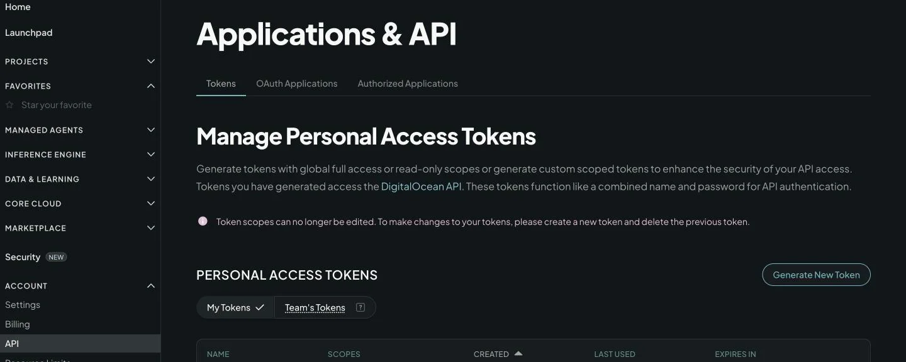
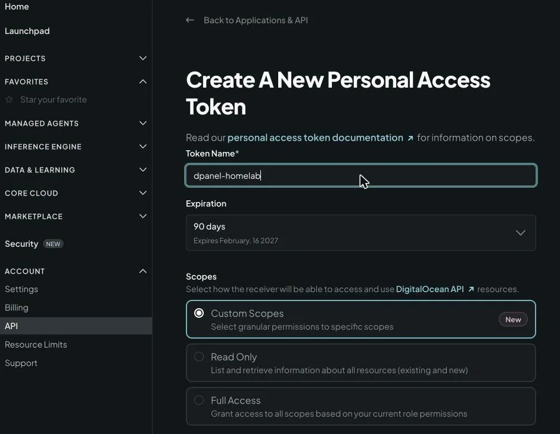
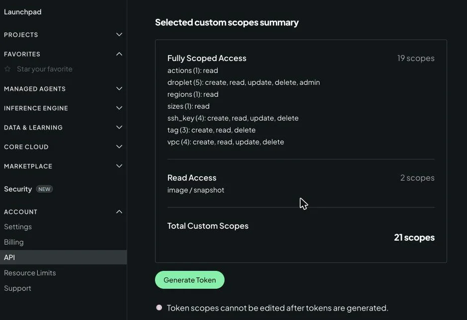
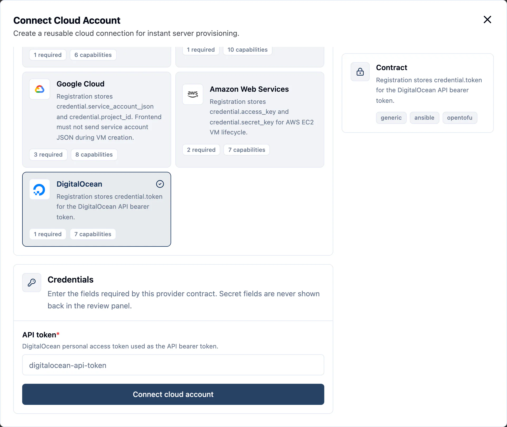
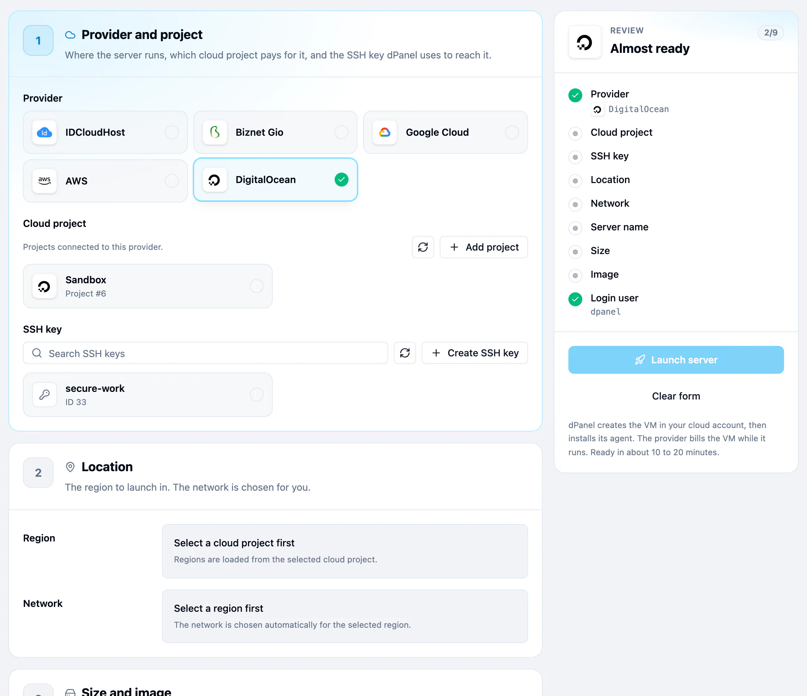

dPanel launches Ubuntu Droplets in your own DigitalOcean team. It signs in with a custom-scoped personal access token that you create for it, limited to Droplets and what a launch needs around them.

## What you need first

- A DigitalOcean team with billing set up. A separate team just for dPanel keeps its access contained.
- An SSH key in dPanel, only if the server should join over SSH. With the dPanel agent, the default, you need none. See [Before you start](../before-you-start.md).

## 1. Create a custom-scoped token

DigitalOcean lets you choose exactly what a token may do. Don't give dPanel a **Full Access** token. Don't pick **Read Only** either: dPanel can't launch a server with it.

1. Sign in to the [DigitalOcean control panel](https://cloud.digitalocean.com). In the left menu, under **Account**, open **API**. The page is called **Applications & API**; stay on its **Tokens** tab.
2. Press **Generate New Token**.

   

3. Under **Token Name**, type a name you will recognise later, such as `dpanel`.
4. Pick an **Expiration**. The default, 90 days, is a good balance; you will have to [rotate](./cloud-credentials-security.md#rotating-a-credential) the token when it ends.
5. Under **Scopes**, choose **Custom Scopes**.

   

   Type each resource type below into **Search by resource type**, and tick only these scopes, 21 in all:

| Resource type | Scopes to tick                                | What it is for                                                                                               |
| ------------- | --------------------------------------------- | ------------------------------------------------------------------------------------------------------------ |
| `droplet`     | `create`, `read`, `update`, `delete`, `admin` | Create the Droplet, wait until it is running and has an IP address, and delete it when you delete the server |
| `ssh_key`     | `create`, `read`, `update`, `delete`          | Import your dPanel SSH key, only when a server joins over SSH                                                |
| `regions`     | `read`                                        | The **Region** list                                                                                          |
| `sizes`       | `read`                                        | The **Size** sliders and the Droplet size list                                                               |
| `image`       | `read`                                        | The Ubuntu release list                                                                                      |
| `vpc`         | `create`, `read`, `update`, `delete`          | The **Network** list, and placing the Droplet in the network you pick                                        |
| `tag`         | `create`, `read`, `delete`                    | Part of the tested token; see the note below                                                                 |
| `actions`     | `read`                                        | Part of the tested token; see the note below                                                                 |
| `snapshot`    | `read`                                        | Part of the tested token; see the note below                                                                 |

6. Before you go on, scroll to the **Selected custom scopes summary**. It should say **21 scopes** in total: 19 under **Fully Scoped Access** and 2 (`image` and `snapshot`) under **Read Access**.

   

7. Press **Generate Token**. DigitalOcean shows the token only once: copy it with the copy icon next to it, and keep it somewhere safe until you paste it into dPanel in the next step.

DigitalOcean guides: [Create a personal access token](https://docs.digitalocean.com/reference/api/create-personal-access-token/), [Token scopes](https://docs.digitalocean.com/reference/api/scopes/).

:::note[Why 21 scopes]
This is the exact set dPanel is tested with: a token with these scopes launches a Droplet from start to finish. dPanel itself only asks DigitalOcean to list regions, sizes, Ubuntu images, networks and Droplets, to create and delete Droplets, and to add an SSH key. dPanel doesn't use the other scopes by name, but they belong to the tested token. A token with fewer scopes has not been tested, so it may fail halfway through a launch. If a launch fails with `403`, the error names the missing scope: add it to the token.
:::

## 2. Connect it to dPanel

1. In the sidebar, open **Cloud Projects**. The page is titled **Cloud accounts**.
2. Press **Connect a cloud account**.
3. Fill in **Connection name**, for example `DigitalOcean SGP`.
4. Under **Cloud provider**, pick **DigitalOcean**.
5. Paste the token into **API token**.
6. Press **Connect cloud account**.

dPanel saves the account as **Ready** straight away, without testing the token. To check it before you launch anything:

1. Press **Create a server**, then **Launch a cloud server**.
2. Pick **DigitalOcean**, then the cloud account you just connected.
3. Wait for the **Region** list. If it fills with DigitalOcean regions, such as `sgp1`, the token works. You can leave the form without launching.

If **Region** stays empty or shows an error, check that you pasted the whole token and ticked the scopes above.

## 3. DigitalOcean fields in the launch form

| Field              | What to pick                                                                                                                                                                           |
| ------------------ | -------------------------------------------------------------------------------------------------------------------------------------------------------------------------------------- |
| **Region**         | The datacenter, such as `sgp1`.                                                                                                                                                        |
| **Size**           | Move **CPU** and **RAM**. dPanel launches the cheapest Basic Droplet that fits, such as `s-1vcpu-2gb`; the disk comes with it. **Choose the instance type yourself** lists every size. |
| **Ubuntu release** | 24.04 LTS or 26.04 LTS.                                                                                                                                                                |
| **Network**        | The region's default VPC, unless you pick another.                                                                                                                                     |

DigitalOcean adds a step, **Access**, with **Default User**: the Linux user dPanel creates, and signs in as when the server joins over SSH. `dpanel` by default.

A Droplet always gets a public IP, so the form has no public IP switch for DigitalOcean.

## 4. Launch

Follow [Create a cloud server](./create-a-cloud-server.md). Pick DigitalOcean in step 1.

## DigitalOcean gotchas

- **An SSH key appears in your team, with SSH only.** Each launch that joins over SSH imports your dPanel public key as `dpanel-<server name>-key` under **Settings**, **Security**. Deleting the server does not remove it. With the dPanel agent, no key is imported.
- **No firewall from dPanel.** dPanel creates no Cloud Firewall. A new Droplet accepts traffic on every port until you add one. If you add a firewall, allow TCP 80 and 443 for your apps, and TCP 22 if the server joins over SSH or you log in over SSH yourself.
- **Droplet limit.** New teams can only run a few Droplets. A launch that fails with a limit error needs a higher limit from DigitalOcean.
- **No backups.** dPanel turns on neither DigitalOcean backups nor monitoring. Enable them in the control panel if you want them; backups cost extra.
- **Billing runs from launch.** You pay for the Droplet while it exists, even when it is powered off.

## Security

- With the custom scopes above, the token can manage Droplets, SSH keys, VPCs and tags, and read regions, sizes, images, snapshots and actions. It can't touch Spaces, databases, DNS or billing.
- With **Full Access**, it can do anything in the team, so don't.
- To rotate the token, create a new one in the same team and replace it with **Update credentials** on the cloud account. See [Rotating a credential](./cloud-credentials-security.md#rotating-a-credential).
- To cut dPanel off, delete the token under **Applications & API**, **Tokens**, and disconnect the cloud account in dPanel: on its row in **Cloud accounts**, open the ⋯ menu, choose **Delete**, and confirm **Disconnect cloud account**. Running servers keep running, and DigitalOcean keeps billing for them. See [what happens when you revoke](./cloud-credentials-security.md#if-you-revoke-a-credential).
- More in [Cloud credentials and security](./cloud-credentials-security.md).

## Frequently asked questions

### Who pays for the server?

DigitalOcean bills you directly, because the server runs in your own account. dPanel does not resell machines. Delete the server in dPanel when you are done, so the provider stops charging. See [Delete a server](../delete-a-server.md).

### Can I also use the dPanel firewall on this server?

Yes. The dPanel [firewall](../firewall.md) runs on the server itself, behind DigitalOcean's own network rules, so a port must be open in both to be reached.

### What happens to my servers if I revoke the credential?

They keep running, but dPanel can no longer launch or delete machines with it. See [Cloud credentials and security](./cloud-credentials-security.md#if-you-revoke-a-credential).
