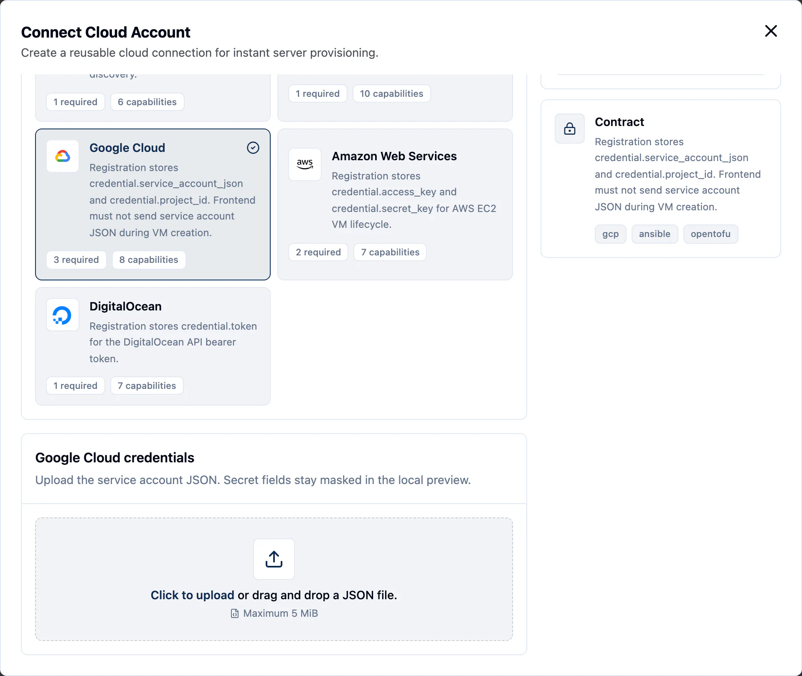
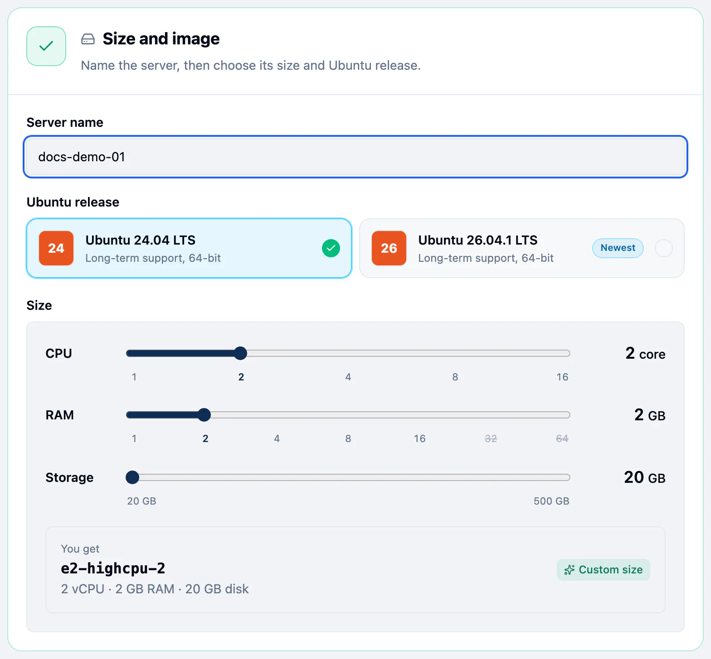

dPanel launches Compute Engine VMs in one of your Google Cloud projects. It signs in with a service account JSON key that you create for it.

## What you need first

- A Google Cloud project with billing linked. A new project just for dPanel is best.
- The **Compute Engine API** enabled in that project.
- Permission to create service accounts, custom roles and keys in that project.
- An SSH key in dPanel. See [Before you start](../before-you-start.md).

## 1. Create a dedicated project and service account

Run these with the [gcloud CLI](https://cloud.google.com/sdk/docs/install), signed in as a project owner. Replace `my-dpanel-project` and `BILLING_ACCOUNT_ID`.

```bash
# A project only dPanel uses
gcloud projects create my-dpanel-project
gcloud billing projects link my-dpanel-project --billing-account=BILLING_ACCOUNT_ID
gcloud services enable compute.googleapis.com --project=my-dpanel-project

# The custom role with only what dPanel calls (see the list below)
gcloud iam roles create dpanelCompute --project=my-dpanel-project \
  --title="dPanel Compute" \
  --permissions=compute.regions.list,compute.zones.list,compute.machineTypes.list,compute.machineTypes.get,compute.subnetworks.list,compute.subnetworks.use,compute.subnetworks.useExternalIp,compute.networks.get,compute.networks.create,compute.networks.updatePolicy,compute.firewalls.get,compute.firewalls.create,compute.firewalls.update,compute.firewalls.delete,compute.instances.list,compute.instances.get,compute.instances.create,compute.instances.delete,compute.instances.setMetadata,compute.instances.setTags,compute.instances.setLabels,compute.disks.create,compute.images.useReadOnly,compute.globalOperations.get,compute.zoneOperations.get

# The service account, with that role and nothing else
gcloud iam service-accounts create dpanel --project=my-dpanel-project \
  --display-name="dPanel"
# A new service account takes a few seconds to appear, and binding it too
# early fails with "does not exist". This retries for up to a minute.
for attempt in 1 2 3 4 5 6; do
  gcloud projects add-iam-policy-binding my-dpanel-project \
    --member="serviceAccount:dpanel@my-dpanel-project.iam.gserviceaccount.com" \
    --role="projects/my-dpanel-project/roles/dpanelCompute" \
    --condition=None && break
  sleep 10
done

# The JSON key you upload to dPanel
gcloud iam service-accounts keys create dpanel-key.json \
  --iam-account=dpanel@my-dpanel-project.iam.gserviceaccount.com
```

Keep `dpanel-key.json` safe, upload it, then delete your local copy.

Prefer the console? Google's guides: [Create a project](https://cloud.google.com/resource-manager/docs/creating-managing-projects), [Create a custom role](https://cloud.google.com/iam/docs/creating-custom-roles), [Create a service account](https://cloud.google.com/iam/docs/service-accounts-create), [Create a service account key](https://cloud.google.com/iam/docs/keys-create-delete).

:::info[Your organization may block keys]
Some organizations enforce the policy `iam.disableServiceAccountKeyCreation`. dPanel needs a JSON key, so an administrator has to allow it for this project.
:::

## Minimum permissions

Read from dPanel's code:

| Where                      | What it does                                             | Permissions                                                                                                                                                                                                                                                               |
| -------------------------- | -------------------------------------------------------- | ------------------------------------------------------------------------------------------------------------------------------------------------------------------------------------------------------------------------------------------------------------------------- |
| dPanel API (discovery)     | Lists regions, zones, machine types, subnets and VMs     | `compute.regions.list`, `compute.zones.list`, `compute.machineTypes.list`, `compute.subnetworks.list`, `compute.instances.list`, `compute.instances.get`                                                                                                                  |
| Network, first launch only | Creates `dpanel-network` (auto-mode VPC)                 | `compute.networks.get`, `compute.networks.create`                                                                                                                                                                                                                         |
| Firewall, every launch     | One ingress rule per server, TCP 22, 80, 443             | `compute.firewalls.get`, `compute.firewalls.create`, `compute.firewalls.update`, `compute.networks.updatePolicy`                                                                                                                                                          |
| Instance                   | Creates the VM with your SSH key, network tag and labels | `compute.instances.create`, `compute.instances.setMetadata`, `compute.instances.setTags`, `compute.instances.setLabels`, `compute.disks.create`, `compute.images.useReadOnly`, `compute.subnetworks.use`, `compute.subnetworks.useExternalIp`, `compute.machineTypes.get` |
| Delete                     | Removes the VM and its firewall rule                     | `compute.instances.delete`, `compute.firewalls.delete`                                                                                                                                                                                                                    |
| Waiting on operations      | Polls create and delete until they finish                | `compute.zoneOperations.get`, `compute.globalOperations.get`                                                                                                                                                                                                              |

dPanel attaches no service account to the VMs it creates, so you don't need `roles/iam.serviceAccountUser`.

If you'd rather use predefined roles, the closest set is `roles/compute.instanceAdmin.v1` plus `roles/compute.securityAdmin` (firewall rules) plus `roles/compute.networkAdmin` (the network, first launch only). Those roles grant far more than dPanel uses.

:::warning[Verify]
The discovery permissions come from dPanel's own API calls. The rest come from the Ansible `google.cloud` modules dPanel runs, and the exact set those modules check can vary by version. If a launch fails with `Required '…' permission`, add the named permission to the custom role with `gcloud iam roles update`.
:::

## 2. Connect it to dPanel

1. In the sidebar, open **Cloud Projects**. The page is titled **Cloud accounts**.
2. Press **Connect a cloud account**.
3. Fill in **Connection name**, for example `GCP production`.
4. Under **Cloud provider**, pick **Google Cloud**.
5. Upload `dpanel-key.json`. dPanel shows the **Project ID** and **Client Email** it found, and masks the **Private Key**.
6. Press **Connect cloud account**.



dPanel saves the account as **Ready** without testing it. The launch form is the first real test: if **Region** stays empty or errors, check the key and the role.

## 3. Google Cloud fields in the launch form


| Field              | What to pick                                                                  |
| ------------------ | ----------------------------------------------------------------------------- |
| **Region**         | Where the VM runs, such as `asia-southeast2`.                                 |
| **Zone**           | One zone in that region, such as `asia-southeast2-a`.                         |
| **Machine Type**   | The size, such as `e2-small`. The list comes from your project for that zone. |
| **Ubuntu release** | 24.04 LTS or 26.04 LTS, from Google's public Ubuntu image family.             |
| **Disk**           | Boot disk size in GB. 20 by default.                                          |
| **Network**        | `dpanel-network`. You don't choose it.                                        |

There is no **Access** step for Google Cloud. dPanel signs in as `ubuntu`.



## 4. Launch

Follow [Create a cloud server](./create-a-cloud-server.md). Pick Google Cloud in step 1.

## Google Cloud gotchas

- **Enable the API first.** Without the Compute Engine API, every list in the launch form fails.
- **The network appears on first launch.** The first launch creates an auto-mode VPC named `dpanel-network`, which has a subnet in every region. Later launches reuse it. Deleting a server never removes it.
- **One firewall rule per server**, named `dpanel-c-<cloud account ID>-m-<server ID>-ingress`, open to the internet on TCP 22, 80 and 443 for that server's network tag only. dPanel deletes it with the server.
- **Quotas.** New projects have low CPU and external IP quotas per region. A launch that fails with `QUOTA_EXCEEDED` needs a quota increase in the console.
- **Ephemeral IP.** The VM gets an ephemeral external IP. It can change if the VM is stopped and started outside dPanel.
- **Billing runs from launch.** You pay for the VM, its disk and its external IP while they exist.

## Security

- The key can create and delete VMs, disks and firewall rules in this one project. In a dedicated project, that's all it can reach.
- A service account key does not expire by default. To rotate it, create a new key for the same service account and replace it with **Update credentials** on the cloud account. The **Project ID** must stay the same. See [Rotating a credential](./cloud-credentials-security.md#rotating-a-credential).
- To cut dPanel off, delete the key or disable the service account. Running servers keep running. See [what happens when you revoke](./cloud-credentials-security.md#if-you-revoke-a-credential).
- More in [Cloud credentials and security](./cloud-credentials-security.md).
