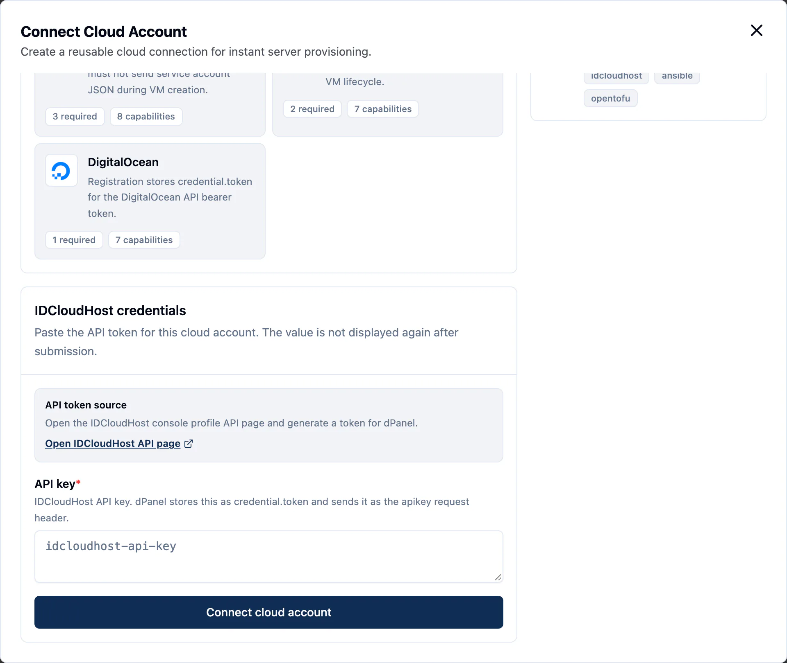
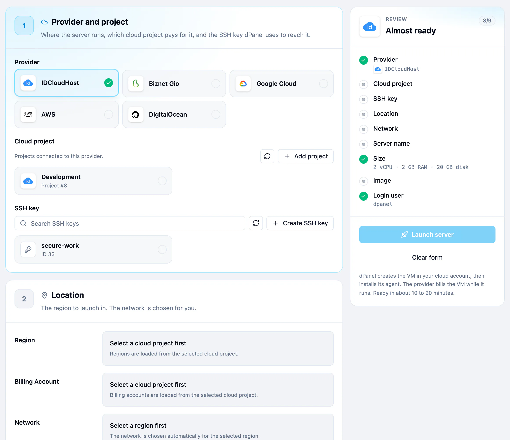

dPanel launches Ubuntu cloud VMs in Indonesia in your own IDCloudHost account. It signs in with an API key from your IDCloudHost profile and charges your IDCloudHost billing account.

## What you need first

- An IDCloudHost account with a billing account that has credit or a payment method.
- An SSH key in dPanel. See [Before you start](../before-you-start.md).

## 1. Create the API key

1. Sign in to the [IDCloudHost console](https://console.idcloudhost.com).
2. Open your profile, then the **API** page. The direct link is [console.idcloudhost.com/user-profile/api](https://console.idcloudhost.com/user-profile/api).
3. Create a new API key for dPanel, and give it a name you will recognise, such as `dpanel`.
4. Copy the key.

IDCloudHost's API reference: [api.idcloudhost.com](https://api.idcloudhost.com/).

:::warning[One key, full access]
dPanel uses a single API key, sent in the `apikey` header. Assume the key can do anything your user can do in the console, including spending credit. If your account has team or sub-user features, create the key under a user that can only manage cloud VMs.
:::

### What dPanel calls

| Purpose                     | IDCloudHost API                                            |
| --------------------------- | ---------------------------------------------------------- |
| List locations              | `GET /v1/config/locations`                                 |
| List Ubuntu templates       | `GET /v1/config/vm_images/plain_os`                        |
| List networks in a location | `GET /v1/{location}/network/networks`                      |
| List billing accounts       | `GET /v1/payment/billing_account/list`                     |
| Create, read and delete VMs | `POST`, `GET` and `DELETE /v1/{location}/user-resource/vm` |
| Read a VM's IP addresses    | `GET /v1/{location}/network/ip_addresses`                  |

## 2. Connect it to dPanel

1. In the sidebar, open **Cloud Projects**. The page is titled **Cloud accounts**.
2. Press **Connect a cloud account**.
3. Fill in **Connection name**, for example `IDCloudHost Jakarta`.
4. Under **Cloud provider**, pick **IDCloudHost**.
5. Paste the key into **API key**. The panel links to the IDCloudHost API page if you still need one.
6. Press **Connect cloud account**.

dPanel saves the account as **Ready** without testing it. The launch form is the first real test: if **Region** stays empty or errors, check the key.

## 3. IDCloudHost fields in the launch form

| Field               | What to pick                                                                                        |
| ------------------- | --------------------------------------------------------------------------------------------------- |
| **Region**          | The location, such as `jkt01`.                                                                      |
| **Billing Account** | Leave it on **Auto-select billing account** to use your default active account, or pick one.        |
| **Network**         | Chosen for you from the location's networks. If none exists, create one in the IDCloudHost console. |
| **Size**            | Move **CPU** (2 to 16 vCPU) and **RAM** (2 to 64 GB). IDCloudHost launches exactly that size.       |
| **Storage**         | 20 to 500 GB.                                                                                       |
| **Ubuntu release**  | 24.04 LTS or 26.04 LTS.                                                                             |

IDCloudHost adds a fourth step, **Access**:

- **Default User**: the first Linux user. `dpanel` by default, and dPanel signs in as this user.
- **Bootstrap Password**: that user's initial password. IDCloudHost requires one. dPanel still signs in with your SSH key.

## 4. Launch

Follow [Create a cloud server](./create-a-cloud-server.md). Pick IDCloudHost in step 1, and fill in **Access** before you press **Launch server**.

## IDCloudHost gotchas

- **Credit.** IDCloudHost charges the billing account. With no credit or payment method, creation fails at the provider.
- **Creation is asynchronous.** dPanel waits up to 10 minutes for the VM to appear before it gives up. A busy location can be slow.
- **No firewall from dPanel.** dPanel creates no firewall rules on IDCloudHost. Whatever the provider allows by default stays open, so check the VM's network settings in the console if you need to restrict ports.
- **A network must exist.** If the location has no network, the launch form says so. Create one in the IDCloudHost console, then refresh.
- **Billing runs from launch.** You pay for the VM while it exists.

## Security

- The key can do what your IDCloudHost user can do. Treat it like your console password.
- To rotate the key, create a new one for the same IDCloudHost account and replace it with **Update credentials** on the cloud account. See [Rotating a credential](./cloud-credentials-security.md#rotating-a-credential).
- To cut dPanel off, delete the key in the IDCloudHost API page. Running servers keep running. See [what happens when you revoke](./cloud-credentials-security.md#if-you-revoke-a-credential).
- More in [Cloud credentials and security](./cloud-credentials-security.md).

## Frequently asked questions

### Who pays for the server?

IDCloudHost bills you directly, because the server runs in your own account. dPanel does not resell machines. Delete the server in dPanel when you are done, so the provider stops charging. See [Delete a server](../delete-a-server.md).

### Can I also use the dPanel firewall on this server?

Yes. The dPanel [firewall](../firewall.md) runs on the server itself, behind IDCloudHost's own network rules, so a port must be open in both to be reached.

### What happens to my servers if I revoke the credential?

They keep running, but dPanel can no longer launch or delete machines with it. See [Cloud credentials and security](./cloud-credentials-security.md#if-you-revoke-a-credential).
