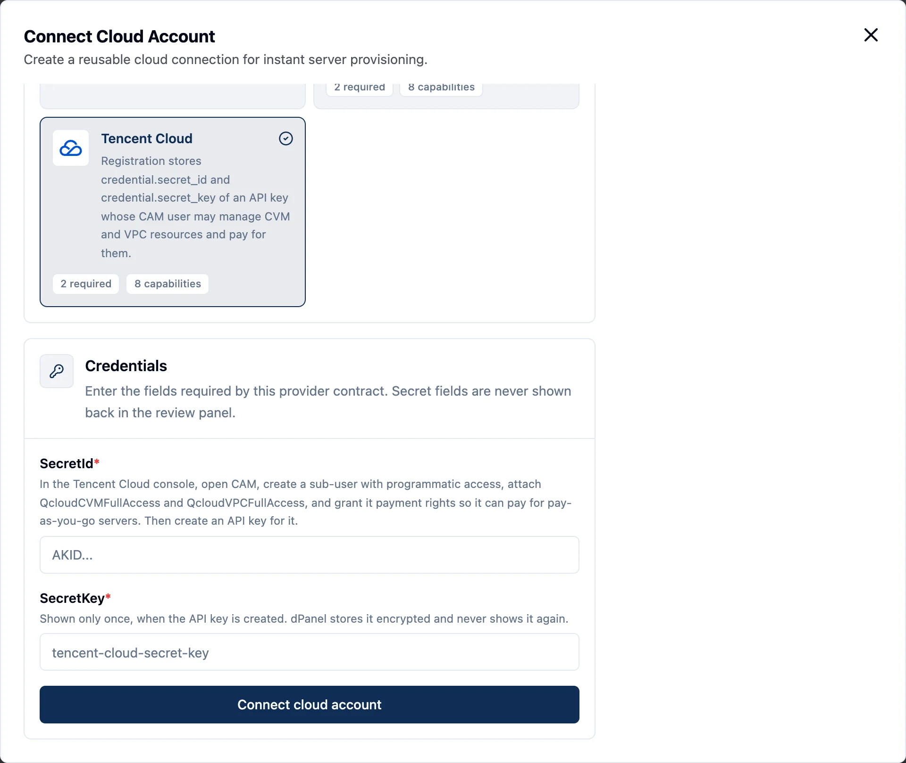
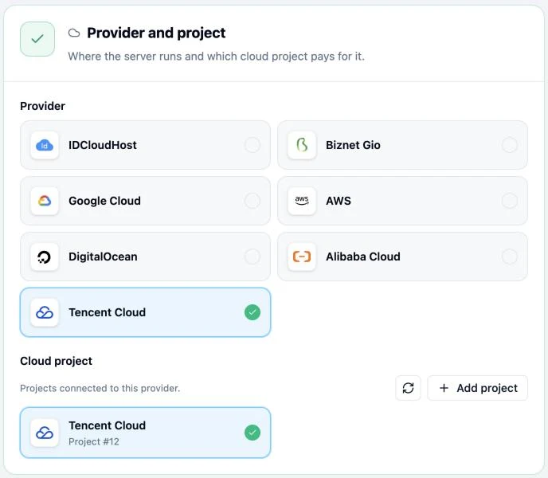

dPanel launches Ubuntu CVM instances in your own Tencent Cloud account. It signs in with an API key (a SecretId and a SecretKey) that belongs to a CAM sub-user you create for it, with only the permissions listed on this page.

## What you need first

- A Tencent Cloud account that can buy pay-as-you-go servers, with identity verification done and a balance or payment method.
- Permission in that account to create CAM sub-users and grant them payment rights.
- An SSH key in dPanel, only if the server should join over SSH. With the dPanel agent, the default, you need none. See [Before you start](../before-you-start.md).

## 1. Create a CAM sub-user for dPanel

Never give dPanel the API key of your root account.

1. Sign in to the Tencent Cloud console as the root account or an administrator, and open **CAM** (Cloud Access Management).
2. Go to **Users**, then **User List**, and create a **custom sub-user**. Name it `dpanel`.
3. Give it **Programmatic access** only. Leave console access off.
4. Attach the preset policies `QcloudCVMFullAccess` and `QcloudVPCFullAccess`.
5. Grant the sub-user **payment rights**, so it can pay for the pay-as-you-go servers it launches. See [the sub-user must be allowed to pay](#the-sub-user-must-be-allowed-to-pay).
6. Open the sub-user, go to **API key**, and create a key. Copy the **SecretId** and the **SecretKey**. Tencent Cloud shows the SecretKey only once.

Tencent Cloud guides: [Create a sub-user](https://www.tencentcloud.com/document/product/598/13674), [Manage API keys](https://www.tencentcloud.com/document/product/598/32675), [Grant permissions](https://www.tencentcloud.com/document/product/598/10602).

### What dPanel does with the key

| Where                      | What it does                                               | API actions                                                                                                                     |
| -------------------------- | ---------------------------------------------------------- | ------------------------------------------------------------------------------------------------------------------------------- |
| dPanel API (discovery)     | Lists regions, zones, instance types, images, subnets, VMs | `DescribeRegions`, `DescribeZones`, `DescribeZoneInstanceConfigInfos`, `DescribeImages`, `DescribeSubnets`, `DescribeInstances` |
| Network, first launch only | Creates `dpanel-network` and a subnet in the zone          | `CreateVpc`, `CreateSubnet`                                                                                                     |
| Every launch               | Opens TCP 22, 80 and 443, and with SSH imports your key    | `ImportKeyPair`, `CreateSecurityGroup`, `CreateSecurityGroupPolicies`                                                           |
| Instance                   | Launches it, pay-as-you-go, with or without a public IP    | `RunInstances`                                                                                                                  |
| Delete                     | Deletes the instance, its security group and its key pair  | `TerminateInstances`, `DeleteSecurityGroup`, `DeleteKeyPairs`                                                                   |

:::note[If a launch is refused]
The discovery calls are the ones dPanel makes itself. The launch and delete calls are made through the Tencent Cloud library dPanel uses, which may make a few more read calls. For a VM without a public IP, dPanel also creates and later deletes a NAT gateway (`CreateNatGateway`, `DeleteNatGateway`) and its route, which `QcloudVPCFullAccess` covers. The two preset policies above cover all of them. If you write a narrower custom policy and a launch fails, the error names the missing action.
:::

## 2. Connect it to dPanel

1. In the sidebar, open **Cloud Projects**. The page is titled **Cloud accounts**.
2. Press **Connect a cloud account**.
3. Fill in **Connection name**, for example `Tencent production`.
4. Under **Cloud provider**, pick **Tencent Cloud**.
5. Paste **SecretId** and **SecretKey**.
6. Press **Connect cloud account**.

dPanel saves the account as **Ready** straight away. It does not test the key on save. The first real test is the launch form: if **Region** stays empty or shows an error, the key or its permissions are wrong.

## 3. Tencent Cloud fields in the launch form

| Field              | What to pick                                                                                                                                                                        |
| ------------------ | ----------------------------------------------------------------------------------------------------------------------------------------------------------------------------------- |
| **Region**         | Where the server runs, such as `ap-jakarta`.                                                                                                                                        |
| **Zone**           | A zone inside the region, such as `ap-jakarta-1`.                                                                                                                                   |
| **Network**        | `dpanel-network`. You don't choose it.                                                                                                                                              |
| **Size**           | Move **CPU** and **RAM**. dPanel launches the cheapest `SA2`, `SA5` or `S5` type on sale in that zone. **Choose the instance type yourself** lists them all, such as `SA5.MEDIUM2`. |
| **Ubuntu release** | 24.04 LTS or 26.04 LTS. dPanel picks the current Tencent Cloud image for that release.                                                                                              |

There is no **Access** step for Tencent Cloud. With SSH, dPanel signs in as `ubuntu` with your SSH key; Tencent Cloud's Ubuntu images don't allow `root` to log in. With the dPanel agent, the VM installs the agent on first boot and no key goes on it.

## 4. Launch

Follow [Create a cloud server](./create-a-cloud-server.md). Pick Tencent Cloud in step 1.

## Tencent Cloud gotchas

### The sub-user must be allowed to pay

If the launch fails with `UnauthorizedOperation` and a message about **payment rights**, the sub-user may manage servers but not pay for them. This is not a key problem. Sign in as the root account, grant the `dpanel` sub-user payment rights (the finance permission for purchases) in CAM, and launch again. Check too that the account has a balance or a payment method.

### Other things to know

- **The network appears on first launch.** In each region, the first launch creates a VPC named `dpanel-network` (`10.88.0.0/16`). Each zone gets its own subnet, `dpanel-network-<zone>`, the first time a server lands there. Deleting a server never removes them.
- **One security group per server**, named `dpanel-<server name>`, open to the internet on TCP 22, 80 and 443, with outbound traffic allowed. dPanel deletes it with the server.
- **One key pair per server that joins over SSH**, named `dpanel_<environment>_<server ID>`, because Tencent Cloud allows only letters, numbers and underscores there. dPanel deletes it with the server, even when the launch failed.
- **Names are host names.** Use 2 to 63 letters, numbers or dashes, starting with a letter. dPanel refuses a name that another instance in the region already has.
- **Disk.** The system disk is the size and type Tencent Cloud picks for the image. The launch form has no storage slider for Tencent Cloud.
- **Public IP and bandwidth.** The instance gets a public IPv4 address, billed by traffic, capped at 100 Mbps, unless you turn **Give the VM a public IP** off.
- **A NAT gateway without a public IP.** A VM without a public IP on `dpanel-network` reaches the internet through a NAT gateway that dPanel adds. Tencent Cloud bills a NAT gateway for every hour it exists. dPanel deletes it with the last VM that uses it.
- **Billing runs from launch.** You pay Tencent Cloud for the instance, its disk and its traffic while they exist, even while setup runs or fails. Delete a server you no longer need.

## Security

- The key can create and destroy CVM and VPC resources in the account, and pay for them. Keep it on its own sub-user so you can revoke it without touching anything else.
- To rotate the key, create a new API key for the same sub-user and replace it with **Update credentials** on the cloud account. See [Rotating a credential](./cloud-credentials-security.md#rotating-a-credential).
- To cut dPanel off, disable or delete the API key in CAM. Running servers keep running. See [what happens when you revoke](./cloud-credentials-security.md#if-you-revoke-a-credential).
- More in [Cloud credentials and security](./cloud-credentials-security.md).

## Frequently asked questions

### Who pays for the server?

Tencent Cloud bills you directly, because the server runs in your own account. dPanel does not resell machines. Delete the server in dPanel when you are done, so the provider stops charging. See [Delete a server](../delete-a-server.md).

### Can I also use the dPanel firewall on this server?

Yes. The dPanel [firewall](../firewall.md) runs on the server itself, behind Tencent Cloud's own network rules, so a port must be open in both to be reached.

### What happens to my servers if I revoke the credential?

They keep running, but dPanel can no longer launch or delete machines with it. See [Cloud credentials and security](./cloud-credentials-security.md#if-you-revoke-a-credential).
