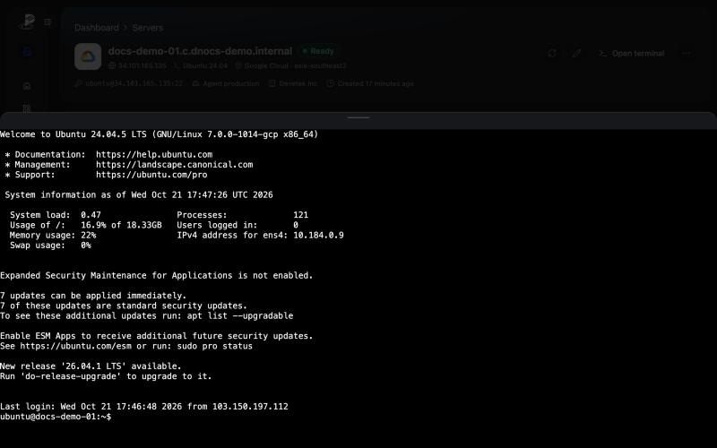

Most of the time you will not need a terminal: the tabs cover services, users, files and logs. When you do, press Open terminal at the top of the server page. dPanel signs in with the key it holds and drops you at a shell.



Nothing is installed on your computer and you do not need the private key. The session belongs to the login user dPanel set up, which is ubuntu on Google Cloud and AWS, and dpanel on DigitalOcean.

## From your own machine

If you prefer your own terminal, connect with any SSH client using the login shown in the server header.

```bash
ssh ubuntu@203.0.113.10
```

For that to work, your computer's own public key has to be on the server. The key dPanel generated stays inside dPanel, so add yours to the server's authorized_keys file, through the Files tab or the browser terminal above.

```bash
echo "ssh-ed25519 AAAA... you@example.com" >> ~/.ssh/authorized_keys
```

Paste your own public key in place of the example. On your machine it is usually at ~/.ssh/id_ed25519.pub.
