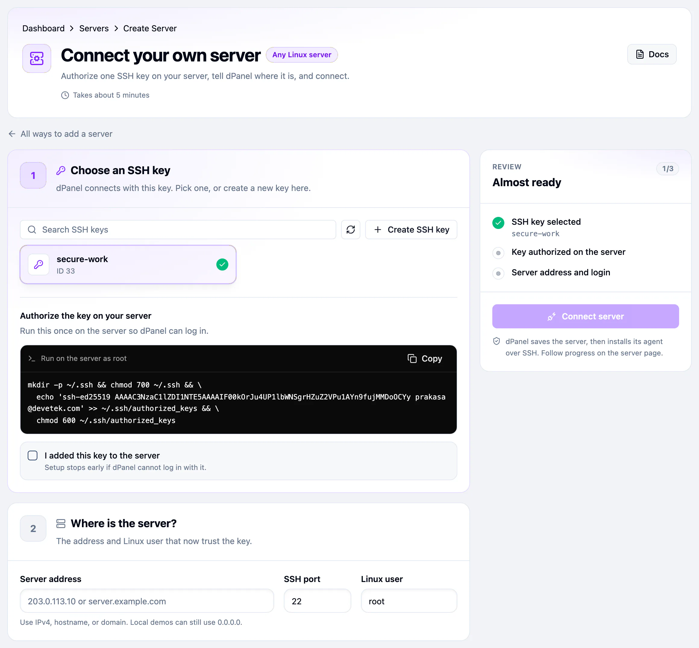

dPanel can look after a machine you already have. It signs in over SSH with one of your dPanel SSH keys, then installs its agent.

## What you need first

- A server running Ubuntu or Debian that dPanel can reach over SSH.
- A Linux user on it that can use `sudo`, or `root`.
- An SSH key in dPanel. You can also create one inside the form.

## Connect it

1. Open **Servers**, then **Create Server**, then **Connect a server**.
2. Under **Choose an SSH key**, pick a key, or press **Create SSH key**.
3. Copy the command under **Authorize the key on your server** and run it once on the server. It adds the key's public half to `~/.ssh/authorized_keys`.
4. Tick **I added this key to the server**.
5. Under **Where is the server?**, fill in **Server address** (an IPv4 address, hostname or domain), **SSH port** and **Linux user**.
6. When the **Review** panel reads 3/3, press **Connect server**.

:::warning[Run the command on the right machine]
Run the command as the same user you enter in **Linux user**. Setup stops early if dPanel cannot log in with the key.
:::

## What happens next

dPanel saves the server, then installs its agent over SSH. Follow the progress on the server page. It usually takes about 5 minutes.

When the badge reads **Ready**, the server works like any other. See [Your server page](./your-server-page.md).

:::info[Deleting a server you connected]
dPanel only forgets a server you connected yourself. Your machine keeps running. See [Delete a server](./delete-a-server.md).
:::
