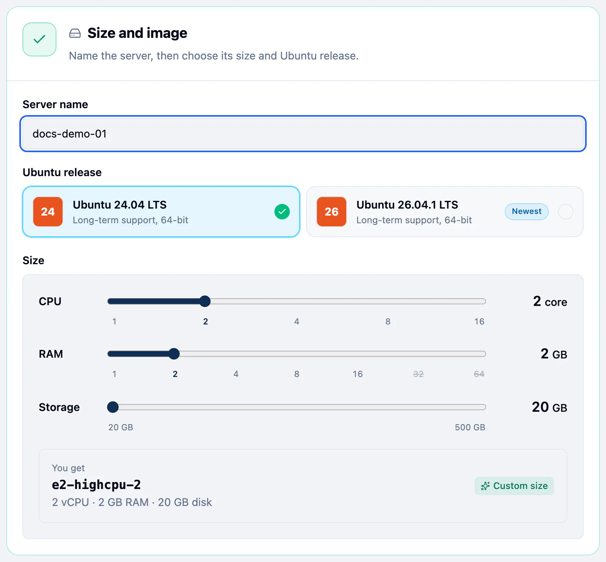

This walkthrough uses Google Cloud. The other providers ask the same questions in the same order. The differences are on [Cloud providers](./cloud-providers.md), with a page for each provider.

## What you need first

- An SSH key and a cloud account in dPanel. See [Before you start](./before-you-start.md).
- Enough quota at your provider for one more machine.

## Open the form

Open **Servers**, then **Create Server**, then **Launch a server**.

The form is one page with three numbered steps. The **Review** panel on the right fills in as you answer. Its counter, such as **3/9**, is how many answers dPanel has so far.

## Step 1: Provider and project

1. **Provider**: pick where the machine runs.
2. **Cloud project**: pick which of your cloud accounts pays for it. **Add project** connects another.
3. **SSH key**: pick the key dPanel uses to reach the machine. **Create SSH key** makes one here.

## Step 2: Location

- **Region** is the part of the world the machine runs in. Pick one close to your users.
- **Zone** is one data centre inside that region. Any of them is fine.
- **Network** is filled in for you. dPanel creates `dpanel-network` the first time it launches in a region, then reuses it. Only SSH, HTTP and HTTPS are open.

## Step 3: Size and image

- **Server name** is how the machine appears in dPanel and at your provider.
- **Machine Type** is how much CPU and memory it has. A small size, such as `e2-small`, is enough to try things out.
- **Ubuntu release**: 24.04 LTS is the safe default. LTS means years of security updates.
- **Disk** is the size in gigabytes.

## Launch

When the Review panel says **Ready to launch**, every answer is in.

1. Press **Launch server**.
2. In **Server setup started**, press **Open server** to watch it come up, or **Create another**.

**Clear form** starts over.

## What happens next

A blue banner says dPanel is setting the server up. Expect 10 to 20 minutes:

1. The provider creates the machine.
2. dPanel installs its agent and reads what is on the machine.
3. dPanel opens the ports it needs.

When the banner goes and the badge reads **Ready**, the server is yours to use.

:::warning[If setup fails]
A red banner says so and offers **See what happened**, with the reason the provider or the setup gave. The usual causes are a cloud account without enough quota, and credentials that have expired. To try again, use **Reinstall** on the server's **Settings** tab.
:::

:::tip[Your provider bills from now]
The machine is billed by your provider while it exists, even while setup runs. [Delete it](./delete-a-server.md) when you are done.
:::
