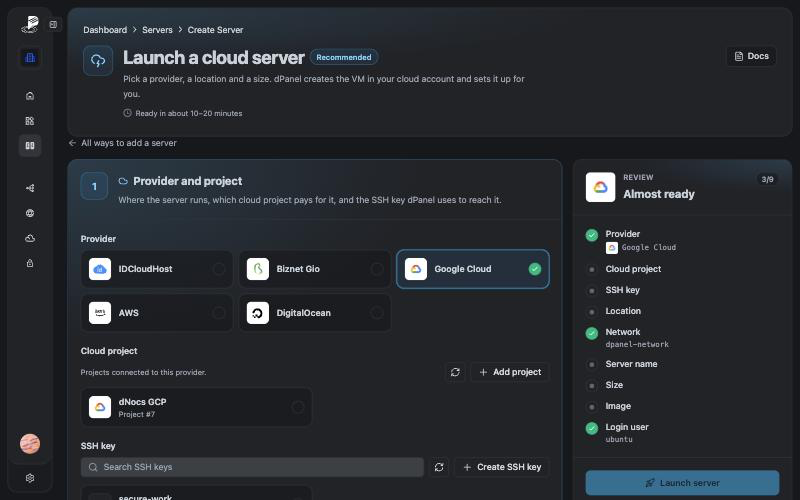
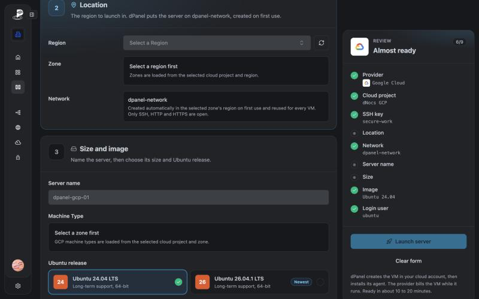
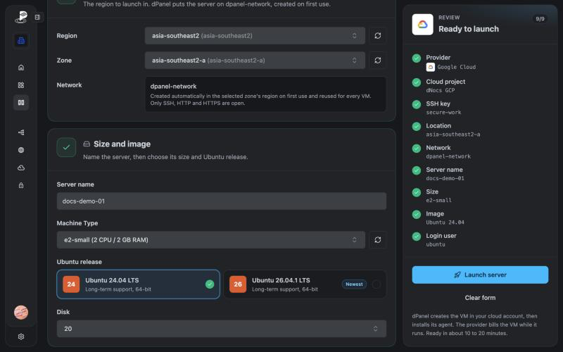

This walkthrough uses Google Cloud. AWS and DigitalOcean ask the same questions in the same order; the differences are on the providers page.

Open Servers, then Create Server, then Launch a server. The form is one page with three numbered steps and a review panel on the right that fills in as you answer. The counter at its top, such as 3/9, is how many answers dPanel has so far.

## Step 1, provider and project

- Provider: where the machine will run.
- Cloud project: which of your cloud accounts pays for it.
- SSH key: the key dPanel will use to reach the machine.

## Step 2, location

- Region is the part of the world the machine runs in. Choose one close to the people who will use it.
- Zone is one data centre inside that region. Any of them is fine.
- Network is filled in for you. dPanel creates a network called dpanel-network the first time it launches in a region and reuses it after that, with only SSH and the web ports open.

## Step 3, size and image

- Server name is how the machine appears in dPanel and at your provider.
- Machine type is how much processor and memory it has. A small size is enough to try things out.
- Ubuntu release: 24.04 LTS is the safe default, and LTS means years of security updates.
- Disk is the size in gigabytes.

## Launch

When the review panel says Ready to launch, every answer is in. Press Launch server.

A blue banner says dPanel is setting this server up while it works. Expect 10 to 20 minutes: the provider creates the machine, then dPanel installs its agent, reads what is on the machine and opens the ports it needs. When the banner goes and the badge reads Ready, the server is yours to use.

:::warning[If setup fails]
A red banner says so and offers See what happened, which shows the reason the provider or the setup gave. The usual causes are a cloud account without enough quota, and credentials that have expired.
:::
