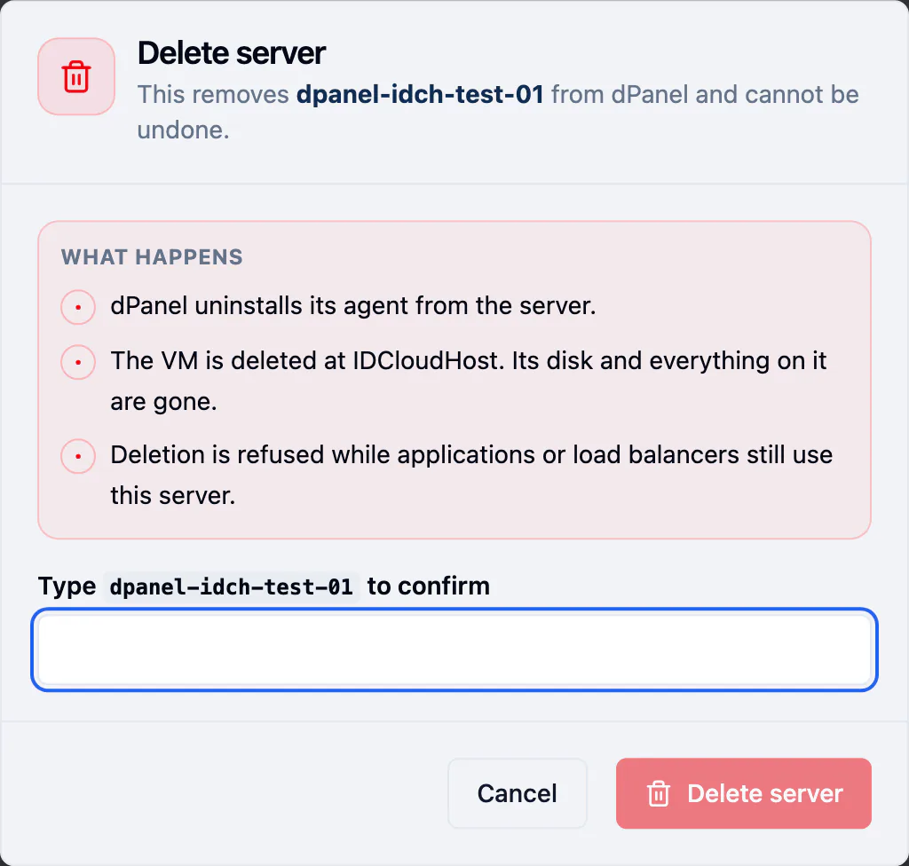

Your provider bills a cloud machine for as long as it exists, so remove one as soon as you are done with it.

## What you need first

Deletion is refused while applications or load balancers still use the server. Delete those first:

- [Delete an application](../applications/update-or-delete.md)
- [Load balancers](../networking/load-balancers.md)

## Delete it

1. Open the server and go to **Settings**.
2. In **Danger zone**, press **Delete server**.
3. Read **What happens**.
4. Type the server's name to confirm, then press **Delete server**.

:::danger[This cannot be undone]
For a server dPanel launched, deleting uninstalls the agent and destroys the machine at your cloud provider, with its disk and everything on it. For a server you connected yourself, dPanel only forgets it and your machine keeps running.
:::

## What happens next

The server shows **Deleting** while the provider tears the machine down, then reads **Deleted**.

Check two places:

1. The **Servers** list.
2. Your provider's own console. dPanel reports what the provider told it, so a delete that half fails at the provider shows up there.
