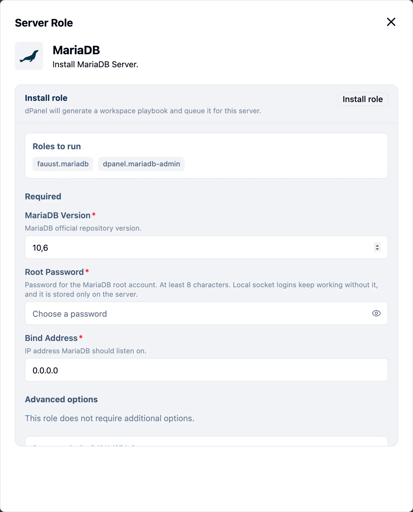
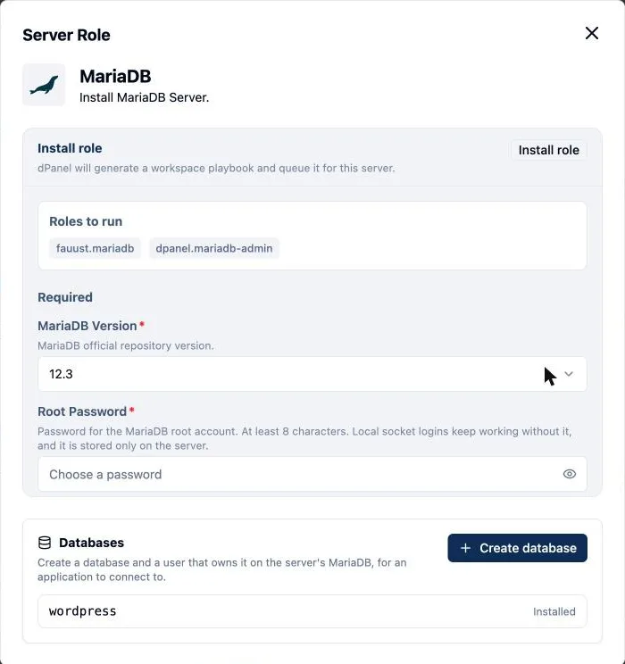
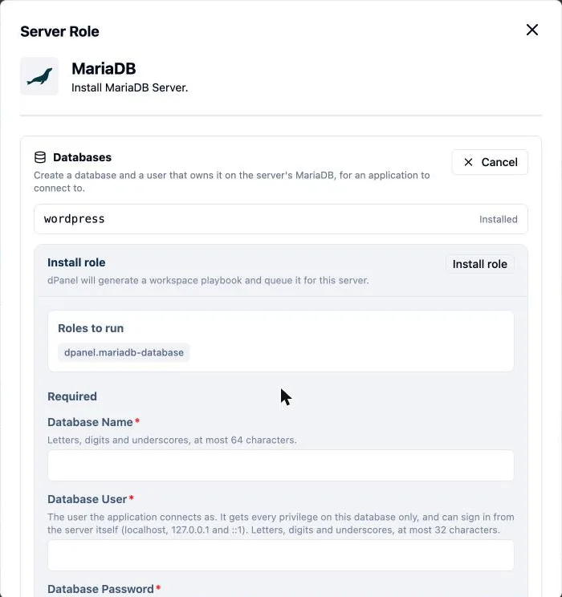

dPanel installs software on a server through modules: open the server's **Modules** tab, press **Add module**, pick one, and dPanel installs it for you. A module is a tested recipe for a database, a language runtime or a tool: you answer a few questions, and dPanel installs, configures and starts it on the server as a systemd service (a program Linux keeps running in the background), then keeps track of what it put there. You don't need SSH or `apt`. New to these words? See the [Glossary](../getting-started/glossary.md).

## Open the catalogue

1. Open the server and go to **Modules**.
2. Press **Add module**.

The **Module catalog** groups what is available. Filter by category or type in **Search modules**. Modules already on the server are marked **Installed**, with **Manage** instead of **Install**.

| Category                          | Examples                                                           |
| --------------------------------- | ------------------------------------------------------------------ |
| **Containers**                    | Docker, and k3s or RKE2 for a one-server Kubernetes                |
| **Databases**                     | MariaDB, PostgreSQL, MongoDB, Redis                                |
| **Infrastructure**                | Caddy Server, Apache APISIX and HAProxy, the load balancer engines |
| **Programming Languages Runtime** | Node.js, Bun, Go, PHP, Python, Ruby, UV                            |
| **Security**                      | Firewall, managed from the server's [Firewall](./firewall.md) view |
| **Utilities**                     | FFmpeg, FrankenPHP                                                 |


## Pick a version

Where a module installs a version of something, its version field is a list of the newest releases, newest first. Keep the first one unless your application needs an older one.

Need a release that is not listed? If the list ends with **Custom version…**, pick it and type the release, in the same format as the listed ones (for example `1.26.4`). dPanel checks the format before it installs.


## Programming languages

Node.js, Go, Python, Ruby, Bun, uv and PHP are installed **once per server** and shared by every user and every application on it. dPanel downloads them ready to run, so an install takes seconds to a couple of minutes and puts no compiler on your server. Several versions can live side by side; each application uses the version it asks for.

- **PHP** offers fixed versions only: 8.5, 8.4, 8.3, 8.2, 8.1, 8.0, 7.4, 7.3 and 5.6, each the newest release of its line. PHP-FPM, Composer and common extensions (OPcache, Redis, Imagick, Memcached, APCu, GD, intl, …) come with it. 8.0 and older are end of life: use them only for applications that cannot move yet. Add another extension with **PHP Extensions**.
- **Set As Default** makes a version the one you get when you type `node`, `php` or `python3` in the server's terminal. The first version you install is the default.
- Users of the server cannot download their own copies of a language: everything comes from the shared install, which keeps the server clean.

### Previous runtime

On a server that had languages before this change, those versions show a **Previous runtime** tag on the Modules tab. They keep working, and the applications on them stay on them. To move an application, open it, go to **Deployments**, and choose **Runtime** → **Move to the new runtime** on its deployment. dPanel installs the language on the new runtime if needed, rebuilds the application on it and restarts it. **Move back to the previous runtime** returns it the same way.

## Install a database

1. Press **Install** on the module you want, for example **MariaDB**.
2. The form lists the **Roles to run** and asks only for what it can't decide for you. For MariaDB that is **MariaDB Version**, **Root Password** and **Bind Address**. Set **Bind Address** to `127.0.0.1` unless another machine must connect directly: the default, `0.0.0.0`, makes MariaDB listen on every network address, and on DigitalOcean and IDCloudHost nothing blocks port 3306 until you add a firewall.
3. Press **Install role** and confirm.



:::warning[Choose the password yourself]
The root password is required and must be at least 8 characters. There is no default, because a database installed with a published default password is open to anyone who knows it. dPanel stores it only on the server and never shows it again, so keep your own copy somewhere safe.
:::

## What happens next

The module appears on the **Modules** tab as **Installing**. A database takes a few minutes. On a server connected with the [dPanel agent](./register-a-private-machine.md), the very first install takes a few minutes longer, because the agent prepares dPanel's installer on the machine once; the install then runs on the server itself. When it is done:

- The **Modules** tab shows it as **Installed**, with its version.
- The **Overview** tab lists it under **What runs here**.
- The **Services** tab shows its service running.

If it reads **Failed**, open the module to see why, fix the cause, and install it again.

## The Modules tab

The **Modules** tab lists one row per module with its versions and status (**Installed**, **Installing**, **Failed**, or **Mixed** when versions differ). The **Modules**, **Installed** and **Needs attention** counts include top-level modules only: databases you create on MariaDB or PostgreSQL appear inside that module's **Manage** view, not as their own rows.


- **Refresh inventory** asks the agent what is on the server now. A module the agent no longer reports, for example one you removed by hand, drops off the list.
- Select a version chip to see what dPanel recorded about that install. **Uninstall** there removes the record from dPanel only. The program, its data and its open port all stay on the server.
- **Open database** (MariaDB, PostgreSQL, MongoDB) and **Manage firewall** (Firewall) are shortcuts. See below and [Firewall](./firewall.md).

:::tip[Runtimes for applications]
You don't have to install a language runtime first. When you [create an application](../applications/create-an-application.md), you pick its runtime as a dependency, and dPanel installs it on the server.
:::

## Already have MariaDB on the server?

If MariaDB was installed before the server joined dPanel, you do not have to reinstall it, and you should not: installing could upgrade a production database. **Adopt** tells dPanel about the one that is already there.

1. On the **Modules** tab, press **Adopt existing MariaDB**.
2. Read the confirmation, which names the port dPanel found, and confirm.

The module now appears as **Installed outside dPanel (adopted)**. Nothing on the server changes: no package, no configuration, no restart. You can create databases on it and use **Open database**. From then on dPanel refuses to install, upgrade or remove it, so that stays in your hands.

Only MariaDB can be adopted. From the terminal, `--dry-run` shows what would be recorded:

```bash
dnocs module adopt mariadb --server-id 140 --dry-run
dnocs module adopt mariadb --server-id 140
```

## Manage the database

Once MariaDB, PostgreSQL or MongoDB reads **Installed**, its row on the **Modules** tab has **Open database**. It opens the database manager at `dbmanager.devetek.app` in a new tab, already signed in with your dPanel account and pointed at that server.

1. Press **Open database**. You can also open the module and press **Open database** there.
2. Check the engine, enter the database user (MariaDB uses `root`, PostgreSQL uses the admin user you chose, and MongoDB defaults to `RootAdmin`) and the password you set when you installed it.
3. Press **Connect**.

From there you can browse tables, run queries, and create databases and users with read-only or read-write access.

The database manager reaches the database through the dPanel agent, or through the server's SSH connection on a server connected over SSH, so the database never needs to be open to the internet. You can open it on servers you can edit: your own servers, and servers in a workspace where you have editor access or more.

## Create a database for an application

An application such as WordPress or Laravel needs its own database and a user that can only reach it. You create both from the database server's own module, without its administrator password:

1. On the **Modules** tab, press **Add module**, then **Manage** on **MariaDB** or **PostgreSQL**. It must already be **Installed**.
2. Under **Databases**, press **Create database**. The section lists the databases you created on this server.



3. Enter **Database Name** and **Database User**, and a **Database Password** of at least 8 characters. PostgreSQL names use lowercase letters, digits and underscores.
4. Press **Install role**.



dPanel creates the database and the user, gives the user every privilege on that database only, and lets it sign in from the server itself (`127.0.0.1`), which is how an application on the same server connects. Creating the same database name again with a new password changes the user's password.

Point the application at it with runtime variables: host `127.0.0.1`, port `3306` for MariaDB or `5432` for PostgreSQL, the database name, the user and the password. See [Environment variables](../applications/environment-variables.md).

You can also ask **Ask dPanel** to install a module or create an application database for you; it generates the password and shows it to you once. See [Prompt cookbook](../ai/prompt-cookbook.md).

## From the terminal

The `dnocs` CLI installs the same modules. Install it with [AI in the terminal](../ai/ai-in-the-terminal.md).

```bash
dnocs module list --server-id 140                      # the catalog for this server
dnocs module install nodejs --server-id 140 --var nodejs.nodejs_version=22
dnocs module install postgresql --server-id 140 --generate-secrets
dnocs module installed --server-id 140                 # what is installed, with IDs
```

`--generate-secrets` creates any required password, such as a database admin password, and saves it to a file only you can read; it prints the file's path, never the value.

## Many servers at once

A server group installs the same module on every member in one operation, and shows the result per server. Groups are under **Servers**, then **Server groups**. See [Generic server groups](../clusters/generic-groups.md).

## Frequently asked questions

### Do I need to install a runtime before I deploy an application?

No. When you [create an application](../applications/create-an-application.md), you pick its runtime as a dependency and dPanel installs it on the server.

### Why don't my application databases show on the Modules tab?

They belong to their database server. Open **Add module**, then **Manage** on MariaDB or PostgreSQL, and look under **Databases**.

### I removed software by hand. Why is it still listed?

dPanel shows what the agent last reported. Press **Refresh inventory**; modules the agent no longer finds drop off the list.

### Does Uninstall remove the software from my server?

For a programming language, yes: **Uninstall** removes that version from the server, and refuses while an application still uses it. For other software, no: **Uninstall** on a version chip removes dPanel's record only, and the package, its data and its service stay on the server.

### Can I install a version that is not in the list?

Yes, on modules that allow it: pick **Custom version…** and type the release, in the same format as the listed versions.
