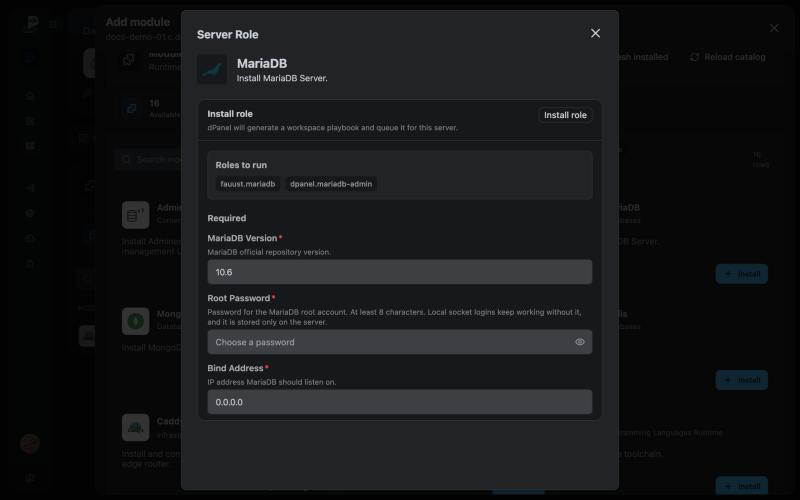

dPanel installs software through modules. A module is a tested recipe: you answer a couple of questions, dPanel does the installing, configuring and starting on the server, and then keeps track of what it put there.

Open the server, go to Modules, and press Add module. The catalogue groups what is available: databases, language runtimes, containers, content management and infrastructure.

## Installing a database

Press Install on the one you want. The form lists what the module will run and asks only for what it cannot decide for you: for a database that is the version, the password for its administrator account, and which addresses it should listen on.

:::warning[Choose the password yourself]
The administrator password is required and must be at least 8 characters. There is no default, because a database installed with a published default password is reachable by anyone who knows it. dPanel stores it encrypted on the server and never shows it again, so keep your own copy somewhere safe.
:::

Press Install role and confirm. The module appears as Installing, and a database takes a few minutes.

## Checking the result

- The Modules tab shows it as Installed, with the version.
- The Overview tab lists it under What runs here, as reported by the agent.
- The Services tab shows its service running.

If you manage a fleet, a server group installs the same module on every member in one operation and shows the result per server. Groups are under Servers, then Server groups.
