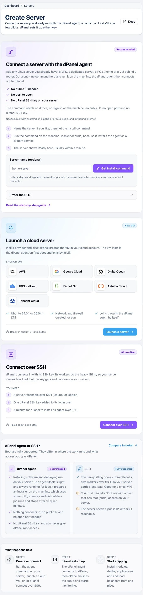

A server in dPanel is one Linux machine that the control panel looks after for you: a machine you already have (a home server, a homelab PC, a Raspberry Pi or a VPS) and connect with one command, or a VPS dPanel launched in your own cloud account (AWS EC2, Google Compute Engine, a DigitalOcean Droplet, IDCloudHost, Alibaba Cloud ECS or Tencent Cloud CVM).

A VPS (virtual private server) is a rented Linux computer in a data centre. On every server dPanel runs a small program, the **agent**, which reports the server's health and carries out the jobs you start. New to these words? See the [Glossary](../getting-started/glossary.md).

Once a server is in dPanel, you manage it from your browser. You don't need a terminal on your own computer.

- See whether it is healthy, and how much CPU, memory and disk it uses.
- Install software on it, such as a database or a language runtime, and open its databases in DB Manager.
- Start, stop and restart the services running on it.
- Manage its Linux user accounts.
- Browse its files and read its logs.
- Open a terminal on it.
- Choose which ports the internet can reach with its [firewall](./firewall.md).
- Deploy [applications](../applications/overview.md) to it, and put a [load balancer](../networking/load-balancers.md) with HTTPS in front of them.

The list opens as a table. Switch to **Card Grid View** to see live CPU, memory and disk on each server's card. The search box ignores letter case, and the owner column names the person who created each server.

## The three ways to add a server

Open **Servers**, then **Create Server**. The recommended way, for any server you already have, is to connect it with the dPanel agent: you run one command on the server, and the agent connects out to dPanel. dPanel never needs to log in to your server, so you don't have to trust it with an SSH key, open a port or even have a public IP. Start here: [Connect a server with the dPanel agent](./register-a-private-machine.md).

|              | Connect with the dPanel agent (recommended)           | Launch a cloud server                                                                  | Connect over SSH                     |
| ------------ | ----------------------------------------------------- | -------------------------------------------------------------------------------------- | ------------------------------------ |
| Who it suits | You already have a server: a VPS, a PC at home, a VM  | You want a new machine and have a cloud account                                        | You prefer dPanel to log in itself   |
| Providers    | Any Linux server with systemd                         | AWS, Google Cloud, DigitalOcean, IDCloudHost, Biznet Gio, Alibaba Cloud, Tencent Cloud | Any Ubuntu or Debian server over SSH |
| What happens | You run one command; the agent connects out to dPanel | dPanel creates the machine; it joins through the agent by itself, or over SSH          | dPanel logs in with its SSH key      |
| You need     | A terminal on the server with `sudo`                  | A cloud account in dPanel                                                              | An SSH key, and a public IP          |
| Time         | About a minute                                        | About 10 to 20 minutes                                                                 | About 5 minutes                      |

Every way, the server runs the dPanel agent and dPanel starts monitoring it. Servers dPanel launches run Ubuntu 24.04 LTS or 26.04 LTS. A new cloud server joins through the agent by default on AWS, Google Cloud, DigitalOcean, IDCloudHost and Tencent Cloud; you can choose SSH in the form instead. Biznet Gio and Alibaba Cloud join over SSH for now.

Not sure whether to use the agent or SSH? See [dPanel agent or SSH: which one?](./register-a-private-machine.md#dpanel-agent-or-ssh-which-one).

## Where to go next

- Bringing a server you already have, such as a home server or a VPS, the recommended way: [Connect a server with the dPanel agent](./register-a-private-machine.md).
- Sharing homelab machines with a team: [Share a homelab with your team](../tutorials/team-homelab.md).
- What to prepare for a cloud server or SSH: [Before you start](./before-you-start.md).
- Launching a machine: [Create a cloud server](./cloud-providers/create-a-cloud-server.md).
- Letting dPanel log in over SSH instead: [Connect your own server over SSH](./connect-your-own-server.md).
- Already have one: [Your server page](./your-server-page.md) explains every tab.
- Control which ports can be reached: [Firewall](./firewall.md).
- Many servers at once, or a Kubernetes cluster: [Server groups and clusters](../clusters/overview.md).

You can also ask **Ask dPanel** to check a server or install something on it; see [Prompt cookbook](../ai/prompt-cookbook.md).

## What dPanel puts on the machine

If you maintain servers, this is what setup changes:

| What              | Where                                                                     |
| ----------------- | ------------------------------------------------------------------------- |
| The agent program | `/opt/dpanel/bin/dpanel-agent`, run as the systemd service `dpanel-agent` |
| Its settings      | `/opt/dpanel/etc/environment`                                             |
| Its data          | `/opt/dpanel/var/lib/agent`                                               |
| A Linux user      | One for your dPanel account; on servers set up over SSH also `dpanel`, with passwordless `sudo` |

Applications live in a folder per application, shown as **Work directory** on the application's **Settings** tab, and run as systemd services.

## Frequently asked questions

### Does dPanel host the server?

No. A cloud server runs in your own account at the provider, which bills you directly. A server you connect stays wherever it already runs.

### Which operating system does a server need?

Servers dPanel launches run Ubuntu 24.04 LTS or 26.04 LTS. A server you connect with the dPanel agent can run any Linux with systemd, on Intel/AMD (`amd64`) or ARM (`arm64`). A server you connect over SSH must run Ubuntu or Debian.

### Can I manage servers from a terminal instead?

Yes. The `dnocs` CLI connects a machine (`sudo dnocs machine register`), launches cloud servers (`dnocs server create-cloud`), lists servers, runs setup again, installs modules and manages the firewall. See [AI in the terminal](../ai/ai-in-the-terminal.md).

### What is the agent and is it safe to remove?

The agent is dPanel's program on the server. It reports usage and runs the jobs you start. Without it, the server page goes blank and jobs fail; **Reinstall** on the **Settings** tab puts it back. When the agent stops reporting or an update is available, the server page tells you what to do. See [Agent notices](./your-server-page.md#agent-notices).

### Is it safe to connect my home server?

Yes. With the dPanel agent nothing connects in to your home network: the agent connects out to dPanel, and dPanel never gets your SSH access. Deleting the server in dPanel revokes the agent's access at once. See [Why the agent is the default](./register-a-private-machine.md#why-the-agent-is-the-default).
