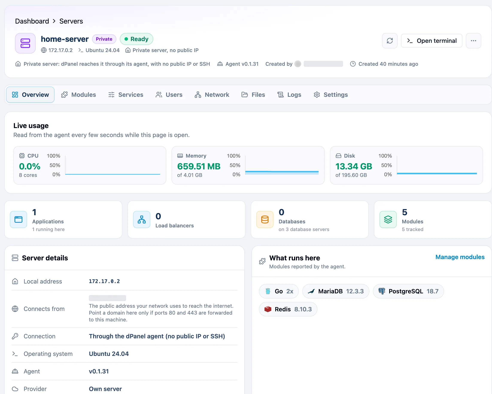
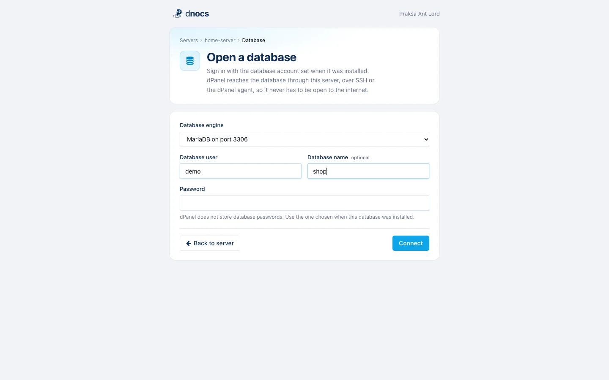
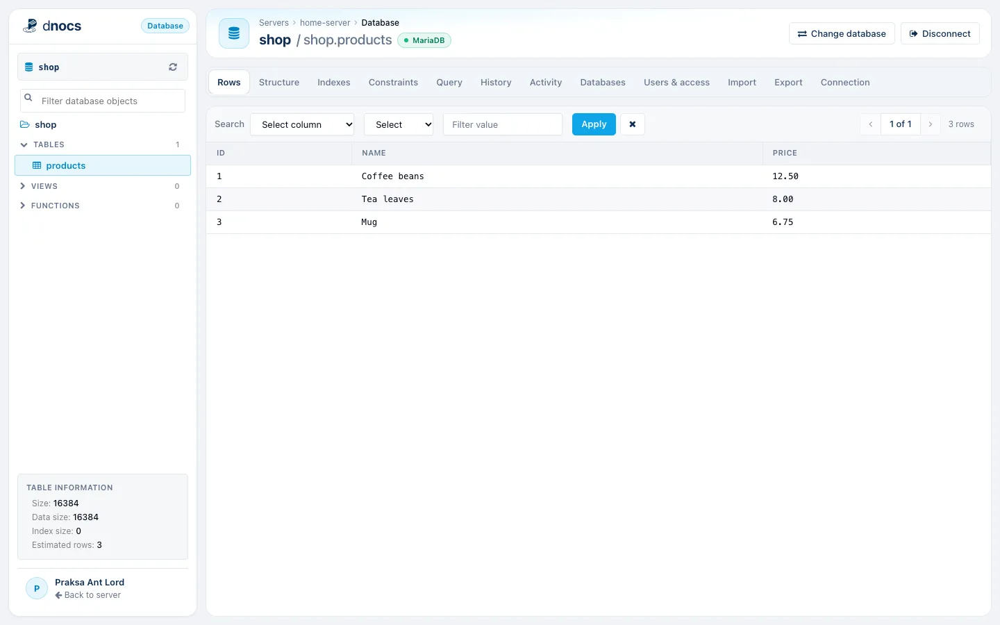

A private machine is a computer that nothing on the internet can reach: a PC, a home server, or a VM behind a router. dPanel never connects to it. Instead, you run one command on the machine, which installs the dPanel agent, and the agent keeps an outgoing connection to dPanel. Everything else (installing software, deploying apps, the terminal, opening databases) travels over that connection.

This guide walks through the whole thing with a real machine called `home-server`.

## What you need first

- A Linux machine with systemd, such as Ubuntu or Debian, on Intel/AMD (`amd64`) or ARM (`arm64`).
- A terminal on that machine where you can use `sudo`: registering needs root.
- Internet access from the machine. It only connects out, so no port forwarding is needed.

## Step 1: Register the machine

In dPanel, open **Servers**, then **Create Server**. The **Register a private machine** card shows the one command to run and links back to this guide.


On the machine:

1. Install the dnocs command line tool. Follow [Install dnocs](../ai/ai-in-the-terminal.md#install-dnocs).
2. Sign in, and pick the workspace the machine belongs to (skip this to keep it in your personal space):

   ```bash
   dnocs auth login -u <your username>
   dnocs workspace list
   dnocs workspace set --id <workspace id>
   ```

3. Register the machine:

   ```bash
   sudo dnocs machine register
   ```

dnocs asks you to confirm, creates a Linux user for your dPanel account, installs the agent and waits until the server is ready. That usually takes under a minute.

**Why `sudo`?** Registering changes the machine itself: it creates a Linux user, installs the agent as a system service and gives it its own credential, which only root may do. Run `dnocs auth login` and `dnocs workspace set` as your normal user, without `sudo`. `sudo dnocs machine register` then uses that sign-in. If it says `please login first using 'dnocs auth login'` although you signed in, your dnocs is older than v0.1.15: update it, or sign in with `sudo dnocs auth login -u <your username>` first.


The machine now appears on your servers page with a **Private** badge. Its address is its address on your own network.


## Step 2: Look around the server page

Open the server. A private server has the same tabs as any other server: live usage, modules, services, users, network, files, logs and settings. The details say how dPanel reaches it: **Local address**, **Public address** (the IP the agent connects to dPanel from, when it is public) and **Connection: Through the dPanel agent**, instead of an SSH login.



## Step 3: Install a database or other software

Open the **Modules** tab and choose **Add module**. Pick from the same catalog as any other server: databases such as MariaDB, PostgreSQL or Redis, language runtimes, Docker and more.


The first install takes a few minutes longer: the agent sets up dPanel's installer on the machine (Python and Ansible, about a minute and a half). After that the installer runs each job on the machine itself and stops again after 10 quiet minutes.

You can also install from the machine's terminal, for example `dnocs module install mariadb --server-id <id> --generate-secrets`, which saves the generated admin password to a file only you can read.


## Step 4: Open a database in the browser

Choose **Open database** next to MariaDB or PostgreSQL. dPanel's database manager opens. Sign in with a database account, such as the admin account set when the database was installed.



Browse tables, run queries, and use **Import** and **Export**. Exports and imports run the database's own tools on your machine, through the agent. The database never has to be open to the internet or even to your network.



## Step 5: Deploy an application

Create an application from your GitHub repository as usual (see [Create an application](../applications/create-an-application.md)). When you pick the server, private servers show their local address and **Private · through the agent**.

The build and the deploy run on the machine itself. Apps listen on the machine, so you open them on your own network at the machine's address and the app's port, for example `http://192.168.1.20:3000`.


## Step 6: Open a terminal

Choose **Open terminal** at the top of the server page. You get a root shell on the machine in your browser, relayed through the agent, with no SSH. From your computer, `dnocs server exec --id <id> --command '<command>'` runs a command the same way.


## What you can do with it

| You can                                                                         | Not available                                    |
| ------------------------------------------------------------------------------- | ------------------------------------------------ |
| See CPU, memory and disk usage                                                  | Kubernetes clusters with other servers           |
| Browse and edit files                                                           | Changing SSH connection details (there are none) |
| Start, stop and restart services, read logs                                     |                                                  |
| Manage Linux users                                                              |                                                  |
| Install modules such as MariaDB, PostgreSQL, Redis or Docker                    |                                                  |
| Open MariaDB and PostgreSQL in the database manager, with import and export     |                                                  |
| Build and deploy applications                                                   |                                                  |
| Open a terminal in the browser or with `dnocs server exec`                      |                                                  |
| Add load balancers and domains, when the machine is reachable from the internet |                                                  |

## Put a load balancer on it

A private machine can still be reachable from the internet: a VPS you registered from inside, a home server with ports 80 and 443 forwarded on the router, or a cloud VM in a VPC with a public IP. dPanel cannot tell which, so you can add a load balancer to any private server; it is set up through the agent like everything else.

- With a domain managed in dPanel, the DNS record points at the server's **Public address**. If dPanel knows none (the agent connects from a private network), use your own domain and point it at the server yourself.
- Make sure traffic on ports 80 and 443 reaches the machine, or the load balancer cannot get its HTTPS certificate.

If the machine is off or offline when you start an install or a deploy, the job waits and then fails; start it again once the machine is back.

## Share it with your team

A machine registered from your personal space is only yours. To give a team access, register it into a team workspace or move it there: see [Share a homelab with your team](../tutorials/team-homelab.md).

## Keep the agent up to date

When a newer agent is released, the server page shows **Agent update available** with an **Upgrade to** button, and **Agent stopped reporting** when the machine has gone quiet. See [Agent notices](./your-server-page.md#agent-notices).

You can also reinstall the agent yourself: open the server's **Settings** tab and press **Reinstall** under **Setup**. On a private machine this reinstalls only the agent, from the latest release; nothing else on the machine changes. If the agent already runs the latest release, nothing is done, unless you tick **Reinstall even if the agent is already current**. The connection drops for a few seconds, and if the new agent cannot reach dPanel, the previous one comes back by itself within 3 minutes.

## Register it again

Running `sudo dnocs machine register` again on the same machine keeps the same server in dPanel and gives its agent a new credential. A machine belongs to one workspace at a time, and a workspace can hold up to 10 private machines.

## Remove it

Delete the server in dPanel (from its page, or with `dnocs server delete --id <id>`). dPanel removes it at once, and the agent's credential stops working. If the machine is already gone, use **Remove from dPanel**; see [Delete a server](./delete-a-server.md#remove-a-server-dpanel-can-no-longer-reach). Then stop the agent on the machine:

```bash
sudo systemctl disable --now dpanel-agent
```
