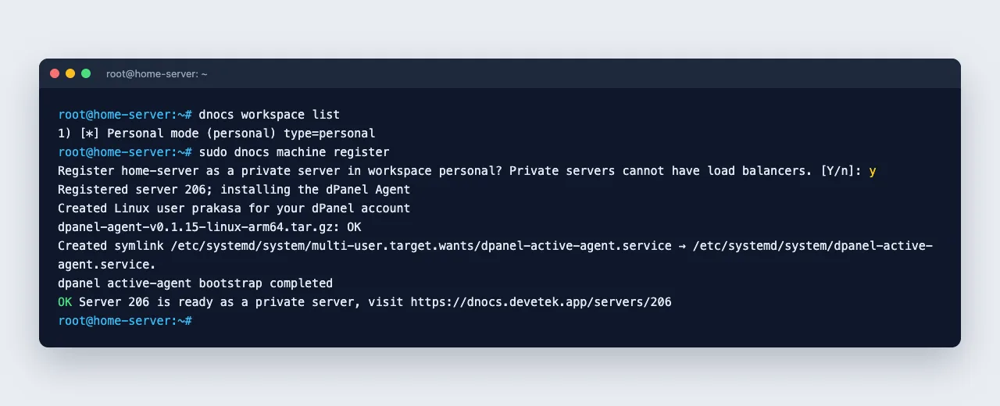
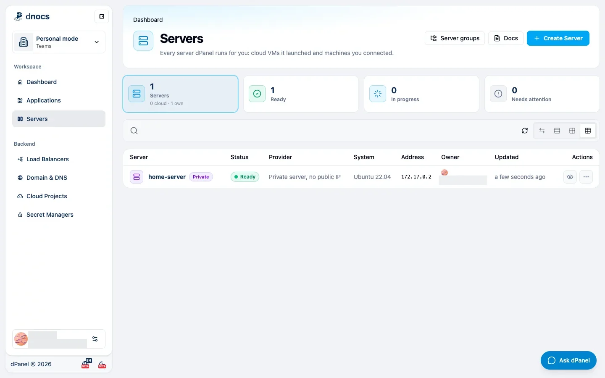
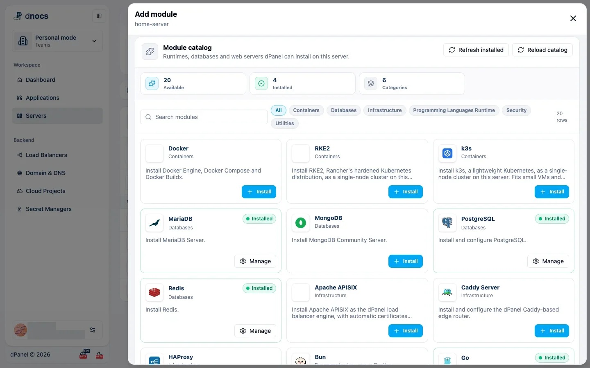
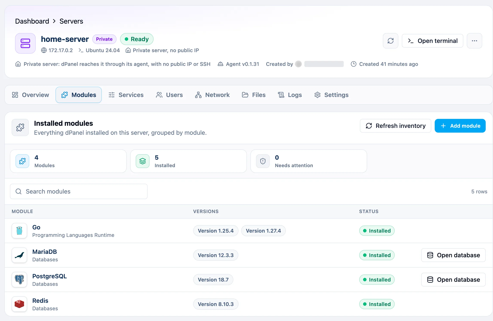
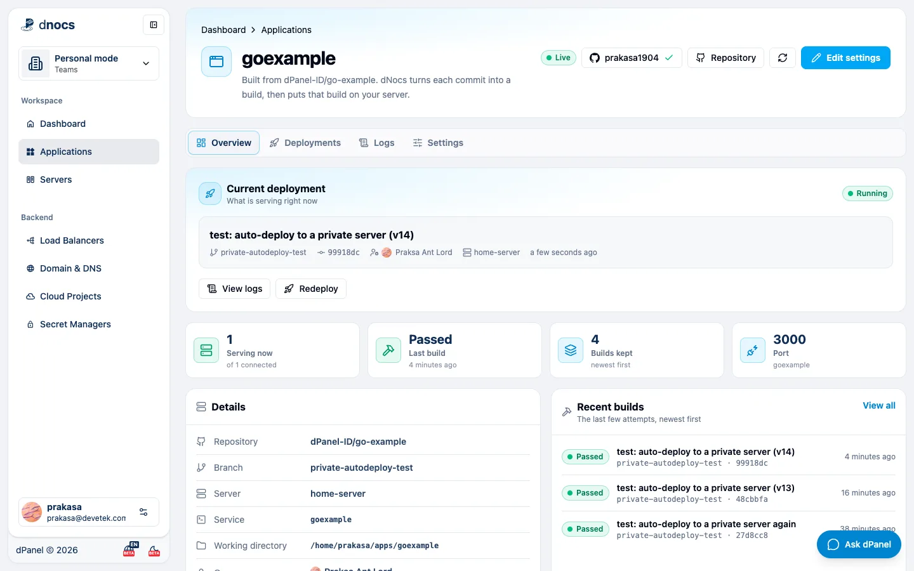
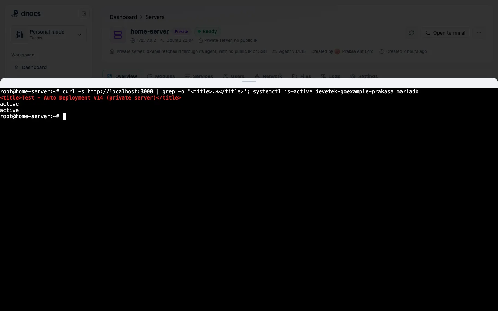

This is the recommended way to add a server you already have: a home server, a homelab PC, a Raspberry Pi, a VPS at any hosting company, a dedicated server, or a VM behind a router. You run one command on the machine. It installs the **dPanel agent**, a small program that connects out to dPanel and keeps that connection open. Everything you do in dPanel afterwards (installing software, deploying apps, the browser terminal, opening databases) travels over that connection.

Nothing connects in to your machine. You don't put a dPanel SSH key on it, you don't open or forward a port, and it doesn't need a public IP address.

This guide walks through the whole thing with a real machine called `home-server`. It takes about five minutes.

## What you need first

- A Linux machine with systemd, such as Ubuntu, Debian or Raspberry Pi OS, on Intel/AMD (`amd64`) or ARM (`arm64`).
- A terminal on that machine, sitting in front of it or through the login you already use, where you can run commands with `sudo` (as administrator).
- Internet access from the machine. It only connects out, so nothing has to be opened on your router.
- A dPanel account. You don't need an SSH key, a cloud account or dnocs on the machine.

## Step 1: Connect the machine

The easiest way is from the dPanel website. You copy one command and run it on the machine.

1. In dPanel, pick the workspace the machine should belong to, open **Servers**, then **Create Server**.
2. On the **Connect a server with the dPanel agent** card, type a name for the server if you like, for example `home-server`. Leave it empty and the server takes the machine's own name once it connects.
3. Choose **Get install command**. dPanel shows a one-line command in a dark box. Choose **Copy**.
4. On the machine, paste the command into the terminal and run it. It looks like this:

   ```bash
   curl -fsSL --data 'code=dpe_…' https://…/api/v2/agent/install | sudo bash
   ```

   It may ask for your password, because of `sudo`.

5. Back in dPanel, the card says **Waiting for the machine…** and changes to **Connected!** as soon as the agent connects, usually in under a minute. Choose **Open server**.


The command works **once, for 2 hours**. For another machine, choose **Get a new command**; each command adds a new server. You don't install dnocs or sign in on the machine, and nothing needs a public IP, an open port or a dPanel SSH key.

**What the command does.** It downloads dPanel's install script, sending its single-use code in the request body (never in a web address). The script creates a Linux user for your dPanel account, installs the agent as the system service `dpanel-agent`, and the agent connects out to dPanel.

**Why `sudo`?** Connecting changes the machine itself: it creates a Linux user and installs the agent as a system service, which only an administrator may do.

**Want to read it first?** Replace `| sudo bash` at the end of the command with `> install.sh`, read `install.sh`, then run `sudo bash install.sh`. The code is used up only when the agent connects, so saving the script first does not waste it.

### Prefer the command line? Use dnocs

If you already use dnocs, the dPanel command line tool, you can connect the machine with it instead. The card's **Prefer the CLI?** section shows the same command.

On the machine:

1. Install dnocs. Follow [Install dnocs](../ai/ai-in-the-terminal.md#install-dnocs).
2. Sign in as your normal user, without `sudo`:

   ```bash
   dnocs auth login -u <your username>
   ```

3. Optional: pick the workspace the machine belongs to. Skip this to keep it in your personal space.

   ```bash
   dnocs workspace list
   dnocs workspace set --id <workspace id>
   ```

4. Connect the machine:

   ```bash
   sudo dnocs machine register
   ```

   `sudo dnocs server register` does the same.

dnocs names the workspace and asks you to confirm. Then it creates a Linux user for your dPanel account, installs the agent as a system service and waits until the server is ready. That usually takes under a minute.



Sign in and pick the workspace as your normal user; `sudo dnocs machine register` then uses that sign-in. If it says `please login first using 'dnocs auth login'` although you signed in, update dnocs to the newest version, or sign in with `sudo dnocs auth login -u <your username>` first. `sudo dnocs machine register --print-only` prints the install script without running anything.

To get the one-line command of the website from a computer where you use dnocs, run `dnocs server agent-install --name home-server`. It prints the same command, valid once for 2 hours, to run on the machine.

The machine now appears on your **Servers** page with the status **Ready** and a **Private** badge, which means dPanel reaches it through its agent. Its address is its address on your own network.



## Why the agent is the default

- **Nothing connects in.** The agent dials out to dPanel over HTTPS, like a browser does. Your router and firewall stay closed.
- **No keys to hand over.** dPanel never needs your SSH access and never puts its SSH key on your machine.
- **You stay in control.** You can read the install script first, stop the agent at any time, and delete the server in dPanel, which revokes the agent's access at once.

## dPanel agent or SSH: which one?

dPanel can also connect to a server over SSH instead. Both are fully supported; the agent is the recommended default.

- **dPanel agent:** nothing connects in to your server; the agent connects out to dPanel. You need no public IP, no open port and no dPanel SSH key, and you never give dPanel administrator (root) access over SSH. The trade-off: the work runs **on your server**. Besides the agent itself, which is light and always running, installing software or deploying an app uses an installer that the agent prepares on the machine (Python and Ansible, set up once, which takes a few minutes the first time). It runs the job on the machine and stops again after 10 quiet minutes. So installs and deploys use some of your server's CPU, memory and disk while they run.
- **SSH:** dPanel puts its SSH key on your server for a user with administrator (`sudo`) rights and connects in from dPanel's own workers. Those workers do the heavy lifting of installing and configuring software from outside, so your server carries less load, which helps on a small VPS. The trade-off: you trust dPanel's SSH key with administrator access to your machine, and the server needs a public IP with SSH reachable from the internet.

|                                | dPanel agent (recommended)                                           | SSH                                               |
| ------------------------------ | -------------------------------------------------------------------- | ------------------------------------------------- |
| Where installs and deploys run | On your server                                                       | On dPanel's workers, which connect to your server |
| Load on your server            | A little more while a job runs                                       | Less                                              |
| Access you give dPanel         | None: the agent connects out                                         | dPanel's SSH key, with `sudo` rights              |
| Public IP needed               | No                                                                   | Yes                                               |
| Open port needed               | No                                                                   | Yes, SSH reachable from the internet              |
| Best for                       | Homelabs, PCs, servers behind a router, anyone who keeps SSH private | A small VPS with a public IP, if you prefer SSH   |

To connect over SSH instead, see [Connect your own server over SSH](./connect-your-own-server.md). New cloud servers make the same choice in their **How dPanel connects** step; see [Create a cloud server](./cloud-providers/create-a-cloud-server.md#step-3-how-dpanel-connects).

## Step 2: Look around the server page

Open the server. It has the same tabs as any other server: live usage, modules, services, users, network, files, logs and settings. The details say how dPanel reaches it: **Local address** (its address on your own network), **Connects from** (the public address your network uses to reach the internet, or **Unknown: the agent connects from a private network**) and **Connection**: **Through the dPanel agent (no public IP or SSH)**, instead of an SSH login.


## Step 3: Install a database or other software

Open the **Modules** tab and choose **Add module**. Pick from the same catalog as any other server: databases such as MariaDB, PostgreSQL or Redis, language runtimes, Docker and more.



The first install takes a few minutes longer, because the agent prepares dPanel's installer on the machine once. After that, each install starts right away.

You can also install from the machine's terminal, for example `dnocs module install mariadb --server-id <id> --generate-secrets`, which saves the generated admin password to a file only you can read.



## Step 4: Open a database in the browser

Choose **Open database** next to MariaDB or PostgreSQL. dPanel's database manager opens. Sign in with a database account, such as the admin account set when the database was installed.


Browse tables, run queries, and use **Import** and **Export**. Exports and imports run the database's own tools on your machine, through the agent. The database never has to be open to the internet or even to your network.


## Step 5: Deploy an application

Create an application from your GitHub repository as usual (see [Create an application](../applications/create-an-application.md)). When you pick the server, servers connected with the agent show their local address and **Private · through the agent**.

The build and the deploy run on the machine itself. Apps listen on the machine, so on your own network you open them at the machine's address and the app's port, for example `http://192.168.1.20:3000`. To publish one on a domain, add a load balancer (below).



## Step 6: Open a terminal

Choose **Open terminal** at the top of the server page. You get a root shell on the machine in your browser, relayed through the agent, with no SSH. From your computer, `dnocs server exec --id <id> --command '<command>'` runs a command the same way.



## What you can do with it

| You can                                                                                       | Not available                                    |
| --------------------------------------------------------------------------------------------- | ------------------------------------------------ |
| See CPU, memory and disk usage                                                                | Changing SSH connection details (there are none) |
| Browse and edit files                                                                         |                                                  |
| Start, stop and restart services, read logs                                                   |                                                  |
| Manage Linux users                                                                            |                                                  |
| Install modules such as MariaDB, PostgreSQL, Redis or Docker                                  |                                                  |
| Open MariaDB and PostgreSQL in the database manager, with import and export                   |                                                  |
| Build and deploy applications                                                                 |                                                  |
| Open a terminal in the browser or with `dnocs server exec`                                    |                                                  |
| Add load balancers and domains                                                                |                                                  |
| Join a [Kubernetes cluster](../clusters/overview.md) with servers on the same private network |                                                  |

## Put a load balancer on it

You can add a [load balancer](../networking/load-balancers.md) to a server connected with the agent; it is set up through the agent like everything else. Visitors still have to reach the machine on ports 80 and 443:

- **A VPS with a public IP:** nothing extra. A DNS record dPanel manages points at the server's public IP.
- **A home server or homelab PC:** a DNS record dPanel manages points at your router's public IP. Forward ports 80 and 443 on your router to the machine, or the site cannot be reached and the load balancer cannot get its HTTPS certificate.
- **A domain you manage yourself:** point it at the server's public address yourself.

If the server's **Connects from** reads **Unknown**, use your own domain and point it at the server yourself.

If the machine is off or offline when you start an install or a deploy, the job waits and then fails; start it again once the machine is back.

## Share it with your team

A machine connected from your personal space is only yours. To give a team access, connect it into a team workspace or move it there: see [Share a homelab with your team](../tutorials/team-homelab.md).

## Keep the agent up to date

When a newer agent is released, the server page shows **Agent update available** with an **Upgrade to** button, and **Agent stopped reporting** when the machine has gone quiet. See [Agent notices](./your-server-page.md#agent-notices).

You can also reinstall the agent yourself: open the server's **Settings** tab and press **Reinstall** under **Setup**. On a server connected with the agent this reinstalls only the agent, from the latest release; nothing else on the machine changes. If the agent already runs the latest release, nothing is done, unless you tick **Reinstall even if the agent is already current**. The connection drops for a few seconds, and if the new agent cannot reach dPanel, the previous one comes back by itself within 3 minutes.

## Connect it again

Running `sudo dnocs machine register` again on the same machine reconnects the same server in dPanel and gives its agent a new credential. A machine belongs to one workspace at a time. A command from **Get install command** always adds a new server; to repair the agent of a server you already have, use **Reinstall** (above).

A workspace can connect up to 10 machines this way. Cloud servers that dPanel creates for you don't count toward that limit.

## Remove it

Delete the server in dPanel (from its page, or with `dnocs server delete --id <id>`). dPanel removes it at once, and the agent's access is revoked. If the machine is already gone, use **Remove from dPanel**; see [Delete a server](./delete-a-server.md#remove-a-server-dpanel-can-no-longer-reach). Then stop the agent on the machine:

```bash
sudo systemctl disable --now dpanel-agent
```

## Frequently asked questions

### Does my home server need a public IP or port forwarding?

No, not to be managed by dPanel. The agent only connects out. You need ports 80 and 443 forwarded only if you want to publish a website from it on the internet.

### Can I use a Raspberry Pi?

Yes, a 64-bit (`arm64`) Linux with systemd, such as 64-bit Raspberry Pi OS or Ubuntu.

### The server says Waiting for agent. What does that mean?

dPanel has created the server and is waiting for you to run its install command on the machine. The command works for 2 hours. If nothing connects by then, the server shows **Failed** with a note that its install command expired. Delete that server (a server whose command never ran can be deleted at once), then choose **Get install command** again and run the new command on the machine.

### The command waits and the server never turns Ready. What do I check?

That the machine can reach the internet over HTTPS (port 443), and that `sudo systemctl status dpanel-agent` shows the agent running. `sudo journalctl -u dpanel-agent -n 50` shows its last messages.
