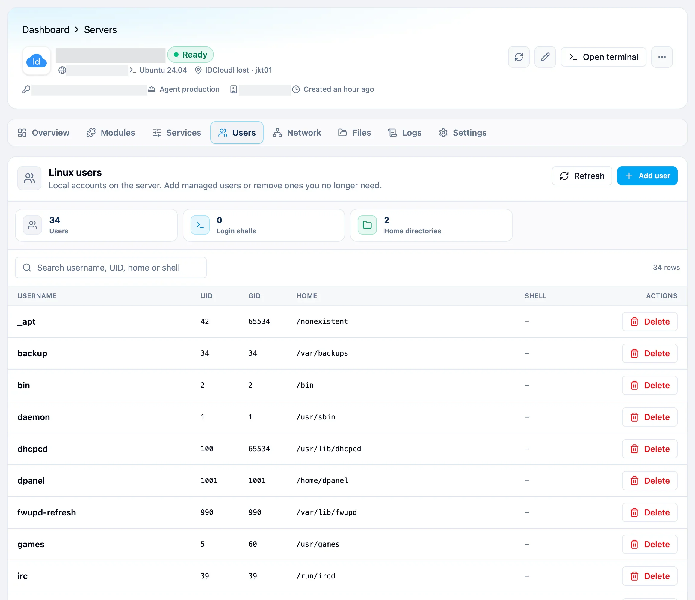
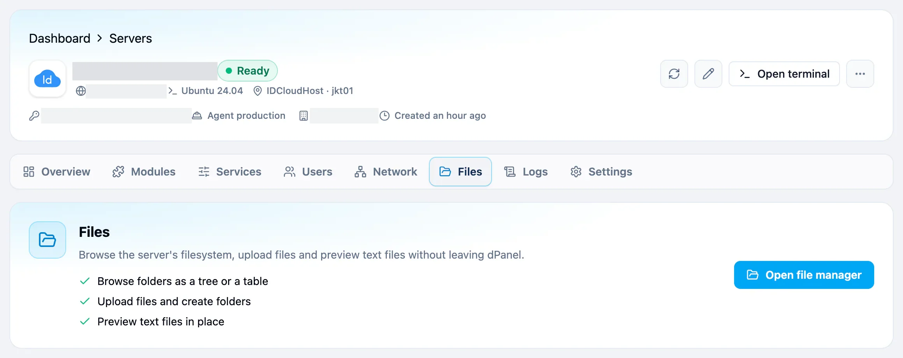

Every server in dPanel has one page, and everything you can do to that server is on it: live usage, installed modules, systemd services, Linux users, open ports, files, logs and settings. Open it from **Servers** by selecting the server's row.

## The header

The header shows the name, the status, the address, the Ubuntu release and where it runs, then a line of facts: the SSH login dPanel uses (such as `ubuntu@203.0.113.10:22`), the agent version, the workspace, who created the server and when.

| Control              | What it does                                                                              |
| -------------------- | ----------------------------------------------------------------------------------------- |
| Refresh (↻)          | Reads the server's status, usage, services and modules again.                             |
| **Edit server** (✎)  | Changes the address, SSH login and agent ports dPanel uses.                               |
| **Open terminal**    | Opens a shell in the browser. See [Connect over SSH](./connect-over-ssh.md).              |
| **More actions** (⋯) | **Reinstall server** runs setup again; **Delete server** removes it. See the table below. |

Select the status badge to see what the status means. While dPanel is setting a server up, a blue banner says so, with **Follow the logs**. If setup fails, a red **Setup did not finish** banner offers **See what happened**.

## Agent notices

The agent is dPanel's small program on the server. It reports usage and runs the jobs you start. When the agent needs your help, a notice appears under the header of the server page and on the server's card on **Servers**. It only appears on a server that is **Ready**.

| Notice                                                    | What it means                                                                                                                                                 | What to do                                                                                                      |
| --------------------------------------------------------- | ------------------------------------------------------------------------------------------------------------------------------------------------------------- | --------------------------------------------------------------------------------------------------------------- |
| **Agent stopped reporting**                               | dPanel has not heard from the agent for more than 5 minutes. Live usage, module lists, deployments and other jobs on this server wait until it reports again. | Sign in to the server and restart the agent: `sudo systemctl restart dpanel-agent`. **Copy command** copies it. |
| **Agent update available** (such as `v0.1.15 → v0.1.21`)  | A newer agent is released. New dPanel features may need it.                                                                                                   | Press **Upgrade to** the new version. The agent restarts and shows the new version within a few minutes.        |
| **Agent update available**, asking you to run setup again | The agent is an old build that cannot upgrade itself.                                                                                                         | Run setup again with **Reinstall** on the **Settings** tab.                                                     |

An upgrade is safe to try: the server keeps the previous agent, and if the new one cannot reach dPanel within 3 minutes, the previous one comes back by itself. The agent has to be running to upgrade, so restart a stopped agent first.

If a restart does not bring the agent back, check it on the server:

```bash
sudo systemctl status dpanel-agent
sudo journalctl -u dpanel-agent -n 50
```

Also make sure the server can reach the internet over HTTPS (port 443): the agent connects out to dPanel.

## Overview

**Live usage** reads CPU, memory and disk from the agent every few seconds while the page is open. Below it are counts of applications, load balancers, databases and modules, then **Server details** (address, SSH login, operating system, agent, provider, ownership, **Created by** and when it was added) and **What runs here**.


## Modules

Everything dPanel installed, one row per module, with its versions and status: **Installed**, **Installing**, **Failed**, or **Mixed**. **Add module** opens the catalogue. **Refresh inventory** asks the agent again and drops modules it no longer reports. The counts include top-level modules only; databases you create on MariaDB or PostgreSQL live inside that module's **Manage** view.

Some rows have a shortcut: **Open database** on MariaDB and PostgreSQL opens DB Manager, a database tool in your browser, already pointed at this server; **Manage firewall** on the Firewall module opens the [Firewall](./firewall.md) view. See [Install software](./install-software.md).


## Services

Every systemd unit the agent can see. A service is a program Linux keeps running in the background, such as a database or a web server. Use the row's actions to start, stop, restart or reload one.

Most servers have well over a hundred units, and many sit in **Dead** or **Exited** on purpose. A **Needs attention** count on a fresh machine is normal.


## Users

The Linux accounts on the machine, with their UID, home directory and login shell. **Add user** creates a managed account. Most entries on a fresh server belong to the system, so leave them alone.



## Network

Three tiles switch the view:

- **Active ports**: which ports are open, which process holds each one, where connections come from (**Allow from**), their state, and a **Firewall** column that says whether a firewall rule lets the outside reach each port. An application listening on its port shows up here as **LISTEN**. Check this view when something can't be reached.
- **Interfaces**: the server's network cards and their IPv4 and IPv6 addresses.
- **Firewall**: whether the firewall is **On** or **Off**, its rules, and **Review and apply**. See [Firewall](./firewall.md).


## Files

**Open file manager** lets you browse folders as a tree or a table, upload files, create folders and preview text files.



## Logs

The newest lines of one log file, parsed into time, level, source and message.

1. Pick a file in the log source picker. **Auth** is first.
2. Pick how many lines to read: 20, 50, 100, 200 or 500.
3. Type in **Filter log lines** to narrow them.
4. Select a line to open the **Log entry** panel, with the full message and **Copy raw line**.

**Refresh** reads the file again. The menu beside it turns on **Auto-refresh**: off by default, or every 30 seconds, minute or 5 minutes.


:::note[Server logs have no time range]
This tab reads the newest lines of a file. The time range, paging and download are on application and load balancer logs. See [Reading logs](../logs/reading-logs.md).
:::

## Settings

The changes you rarely need, each saying what it does.

| Card        | Button              | What it does                                                                                                                                                                                                                 |
| ----------- | ------------------- | ---------------------------------------------------------------------------------------------------------------------------------------------------------------------------------------------------------------------------- |
| Connection  | **Edit connection** | Changes the address, SSH login and agent ports dPanel uses.                                                                                                                                                                  |
| Setup       | **Reinstall**       | Runs server setup again: reconnects over SSH, reinstalls the agent and refreshes the inventory. Installed modules and your data stay. On a [private machine](./register-a-private-machine.md), it reinstalls only the agent. |
| Danger zone | **Delete server**   | Removes the server. See [Delete a server](./delete-a-server.md).                                                                                                                                                             |

**Setup** is hidden while a server is being set up or deleted, and on a deleted server, because there is nothing to reinstall then. A server stays in the workspace it was created in; it cannot be moved to another one.

From the terminal, `dnocs server setup --id 140` does the same as **Reinstall**. Add `--force` to run it even while the server still reads in progress, for example when a setup hung. See [AI in the terminal](../ai/ai-in-the-terminal.md) to install `dnocs`.


## Frequently asked questions

### How do I find a server quickly?

Type in the search box on **Servers**. The search ignores letter case, so `WEB` finds `web-01`.

### Why does the header show a person's name?

**Created by** names the person who added the server, so a team can see who to ask. Select the name to open their public profile.

### What does Reinstall change on my server?

It reconnects over SSH, reinstalls the dPanel agent and refreshes the inventory. Installed modules, applications and data stay as they are.

### What do I do when the agent stopped reporting?

Sign in to the server and run `sudo systemctl restart dpanel-agent`. If the server is off or unreachable, start it at your provider first. See [Agent notices](#agent-notices).

### Do I have to upgrade the agent?

Your server keeps working on an older agent, but new dPanel features may need the newer one. Press **Upgrade to** on the notice; the previous agent comes back by itself if the new one fails.

### Where do I open a database that runs on this server?

On the **Modules** tab, press **Open database** on the MariaDB or PostgreSQL row. See [Install software](./install-software.md#manage-the-database).

### Why does a port I opened not work from outside?

Check the **Firewall** column on **Network → Active ports**. **No allow rule** means the firewall blocks it; add a rule in [Firewall](./firewall.md). Also check that the program listens on `0.0.0.0` rather than `127.0.0.1`.
