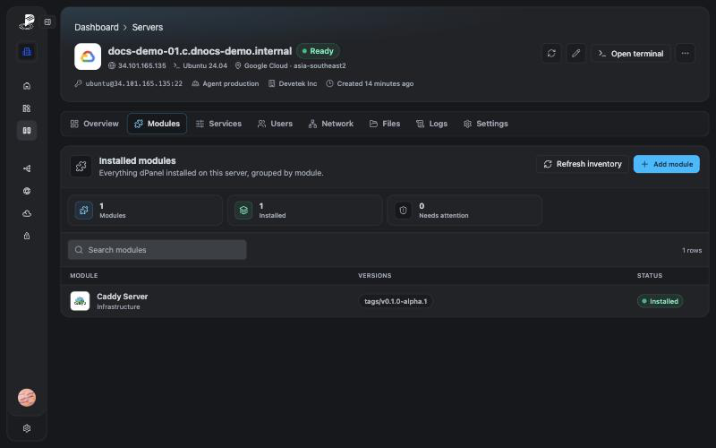
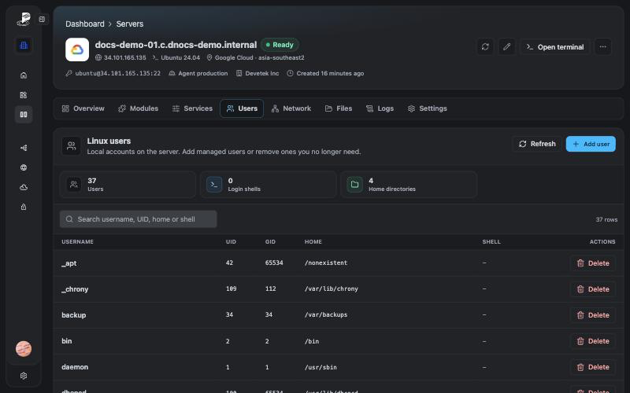
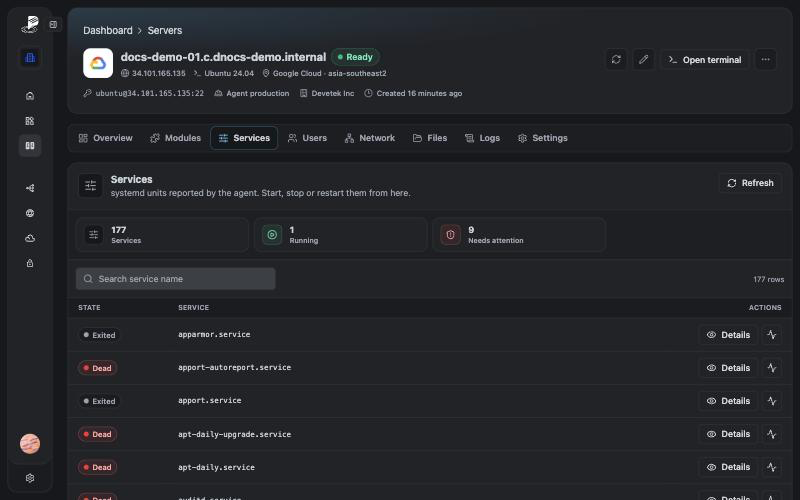
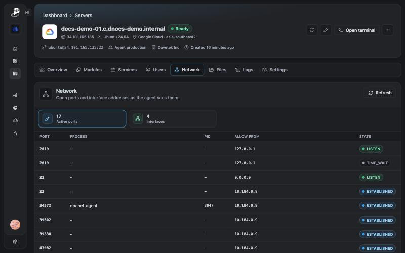
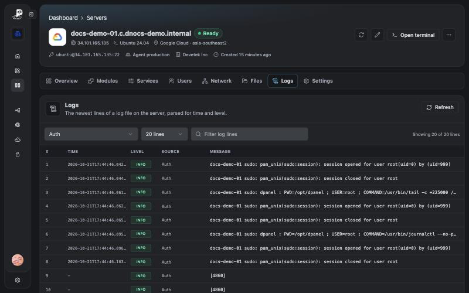
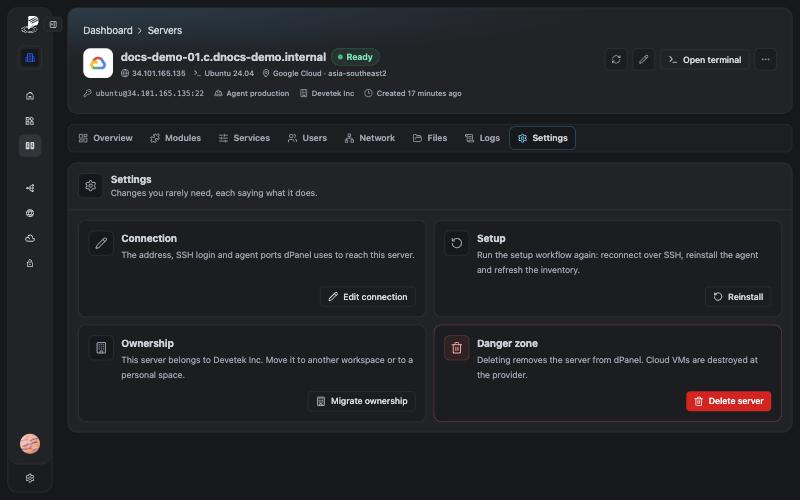

Every server has one page, and everything you can do to that server is on it. The header shows the name, whether it is ready, its address, its Ubuntu release, where it runs, the login dPanel uses, the agent version and when it was created.

## Modules

Everything dPanel has installed, with its version and whether it is healthy. Add module opens the catalogue.

## Services

Every systemd unit the agent can see. A service is a program Linux keeps running in the background, such as a database or a web server. Start, stop, restart or reload one from the menu at the end of its row.

Most servers have well over a hundred of these, and many sit in Dead or Exited on purpose, so the Needs attention count on a fresh machine is normal.

## Users

The Linux accounts on the machine, with their home directory and login shell. Most entries on a fresh server belong to the system and should be left alone.

## Network

Which ports are open, which process holds each one, and where connections are allowed from. This is the page to check when something cannot be reached.

## Files and Logs

Files opens a file manager for browsing, uploading and previewing text files. Logs shows the newest lines of a log file on the server, parsed into time, level and message, with a filter.

## Settings

The changes you rarely need, each saying what it does: edit the connection details, run setup again, move the server to another workspace, and the danger zone that deletes it.

