This tutorial takes you from an empty dPanel account to a Laravel application answering on your own domain with HTTPS. You launch an Ubuntu server, install PostgreSQL and Redis on it, create the application from GitHub, and put a load balancer in front of it. Then you learn the everyday tasks: changing a setting, deploying again, rolling back and reading the logs.

Every screenshot on this page comes from one real run of these steps with the [dPanel-ID/laravel-example](https://github.com/dPanel-ID/laravel-example) repository, published at `laravel.terpusat.me`. It takes about 30 minutes, most of it waiting for installs. Everything happens in the dPanel web app; you never need SSH.

:::tip[New to servers?]
Read [How a website runs on your server](./how-a-website-runs.md) first. It explains the words this page uses, such as module, build, port and load balancer, in a few minutes. The [Glossary](../getting-started/glossary.md) has the rest.
:::

## What dPanel does for a Laravel app

dPanel recognises a Laravel repository by its `artisan` file and fills in the settings for you. This is called the **Laravel preset**. You check it and change anything you like. Four things are worth knowing before you start:

- **Two runtimes.** A runtime is the program that runs your code. The build runs Composer with **PHP**, then `npm` with **Node.js** to build the front end, so the app uses both. **FrankenPHP**, a web server made for PHP, answers the website's requests.
- **Release commands.** After the build and before the new version goes live, dPanel runs `php artisan migrate --force` and the other release commands with your **runtime variables** (the settings the running app reads, such as the database password). If one fails, the version already running keeps serving.
- **Release folders.** Each deploy goes into a new folder on the server. Your site switches to it only after the release commands and the health check pass, so a failed deploy never takes the site down, and you can roll back in one click.
- **The application key.** Laravel encrypts sessions and cookies with `APP_KEY`. dPanel creates it when the app is created and keeps it, so you never set it yourself.

## What you need first

- A dPanel account, signed in, in the workspace you want to use. See [Sign in](../getting-started/sign-in.md).
- GitHub connected, with access to the repository you deploy. To follow along exactly, fork **dPanel-ID/laravel-example** into your own account. See [Connect GitHub](../getting-started/connect-github.md).
- A cloud account in dPanel to launch a server (see [Before you start](../servers/before-you-start.md)), or a server you already have with a public IP, connected with the [dPanel agent](../servers/register-a-private-machine.md). Then skip step 1.
- A domain in **Domain & DNS**, so dPanel can create the DNS record for you. See [Domains and DNS](../networking/domains-and-dns.md).

## Step 1: Launch a server

1. Open **Servers** and press **Create Server**.
2. On the **Launch a cloud server** card, pick your provider, for example **AWS**.

   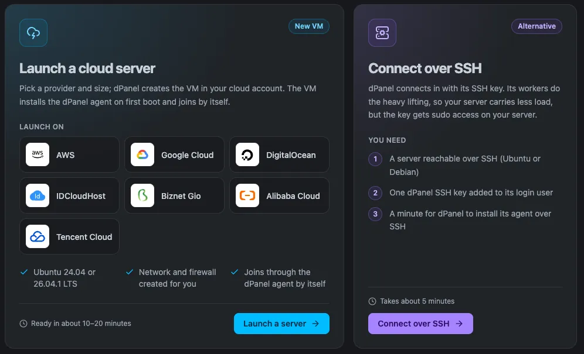

3. **Provider and project**: your provider is selected. Under **Cloud project**, pick the project that pays for the server. Under **Location**, pick a **Region** close to your visitors. The **Network** is created for you.

   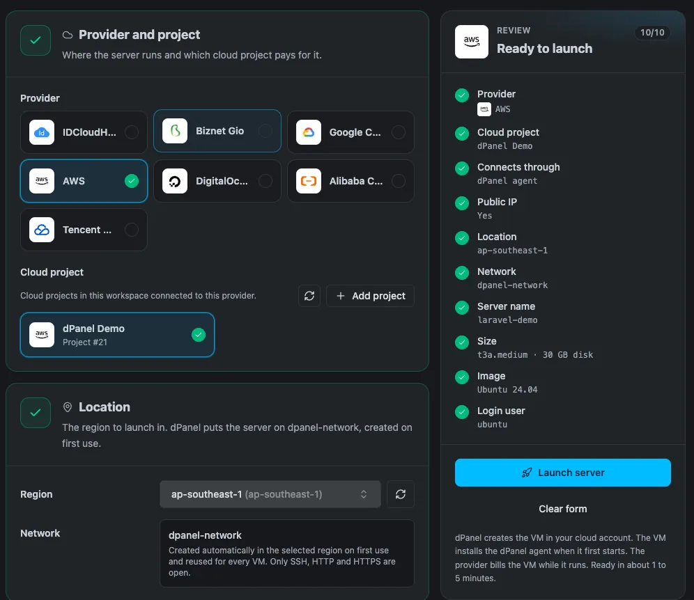

4. **How dPanel connects**: keep **dPanel agent** and keep **Give the VM a public IP** on. Visitors reach the site through that public IP.
5. **Size and image**: type a **Server name**, for example `laravel-demo`, keep **Ubuntu 24.04 LTS**, and move **RAM** to **4 GB** and **Storage** to **30 GB**. dPanel shows the cheapest matching size, here `t3a.medium` (2 vCPU, 4 GB). 2 GB works for a small app, but the front-end build is faster with 4 GB.

   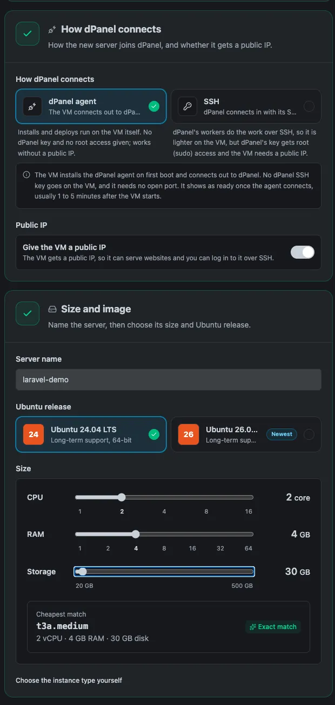

6. The **Review** panel on the right turns into **Ready to launch**. Press **Launch server**.

   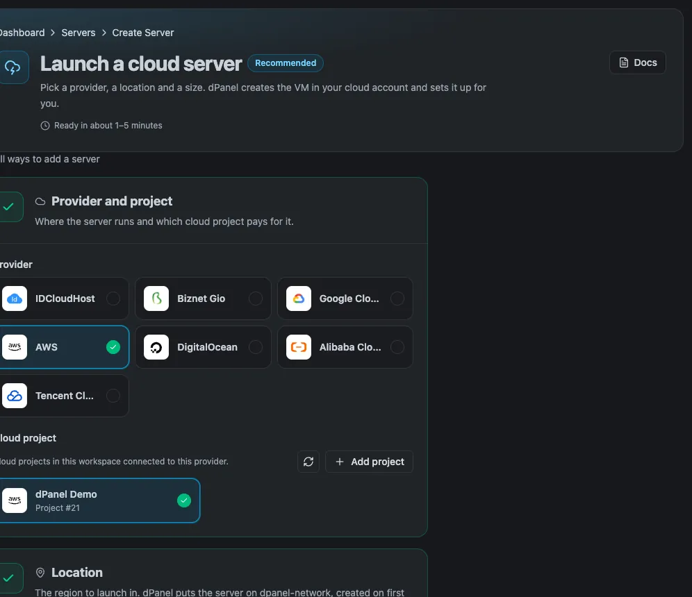

7. dPanel says **Your server is booting**. Press **Open server**.

   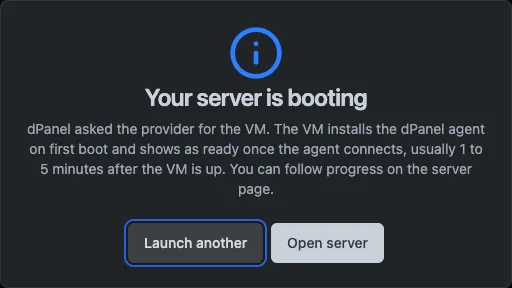

The server turns **Ready** when its agent connects, usually within 5 minutes. The page shows its live CPU, memory and disk use.

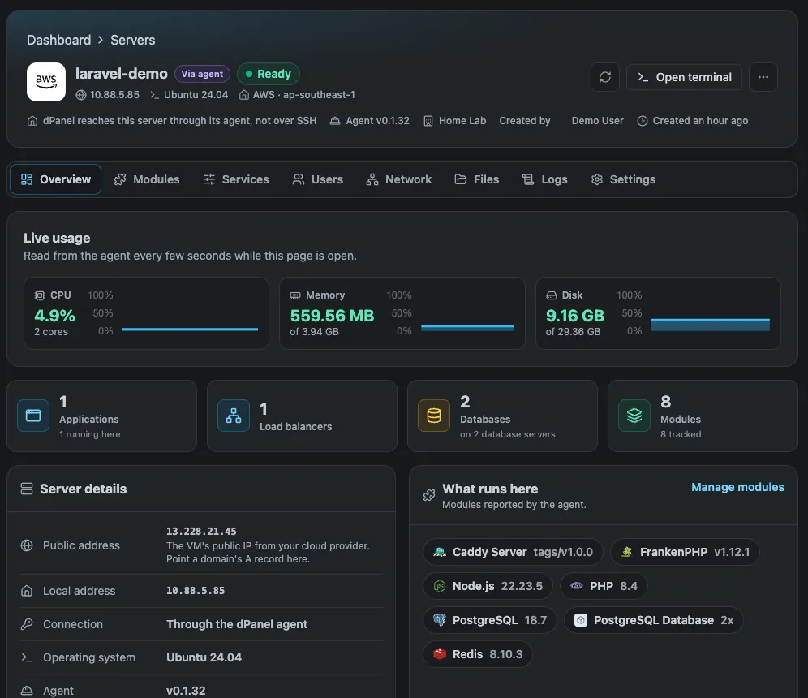

**You should see:** the server with a green **Ready** badge.

:::note[Prefer the command line?]
`dnocs server create-cloud` launches the same server from your terminal. It asks for the cloud project, region and size, or takes them as flags. See [Create a cloud server](../servers/cloud-providers/create-a-cloud-server.md).
:::

## Step 2: Install PostgreSQL and Redis

A **module** is software dPanel installs on your server. The database is one: **PostgreSQL** keeps your data. **Redis** is optional: a fast store for Laravel's cache, queued jobs and sessions.

You do not install PHP, Node.js and FrankenPHP here: the application form adds them in step 3, with the versions your repository asks for.

1. On the server page, open the **Modules** tab and press **Add module**.

   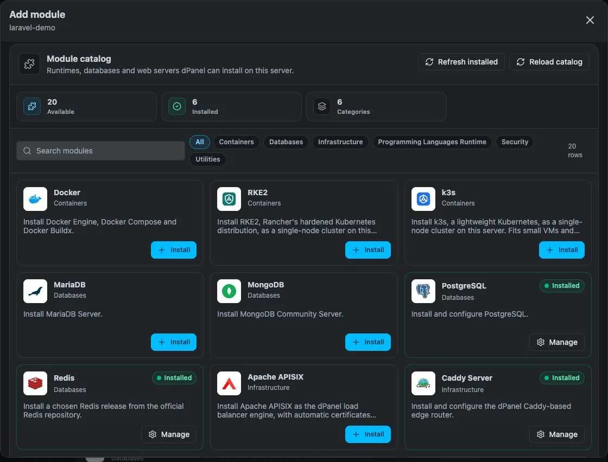

2. Press **Install** on **PostgreSQL**. Keep **PostgreSQL Version** (the newest) and the other fields. For **Administrator Password**, press **Generate**, then copy the password somewhere safe: dPanel shows it only once. Your app does not use it; it gets its own database user in step 3.
3. Press **Install role**, then **Yes**.

   

4. Optional: press **Install** on **Redis**, keep **Bind Interface** `127.0.0.1` (only apps on this server can reach it, so it needs no password), press **Install role**, then **Yes**.

Each install takes a minute or two. The **Modules** tab shows **Installing**, then **Installed**.

**You should see:** PostgreSQL and Redis marked **Installed**. After step 3, PHP, Node.js and FrankenPHP join them.

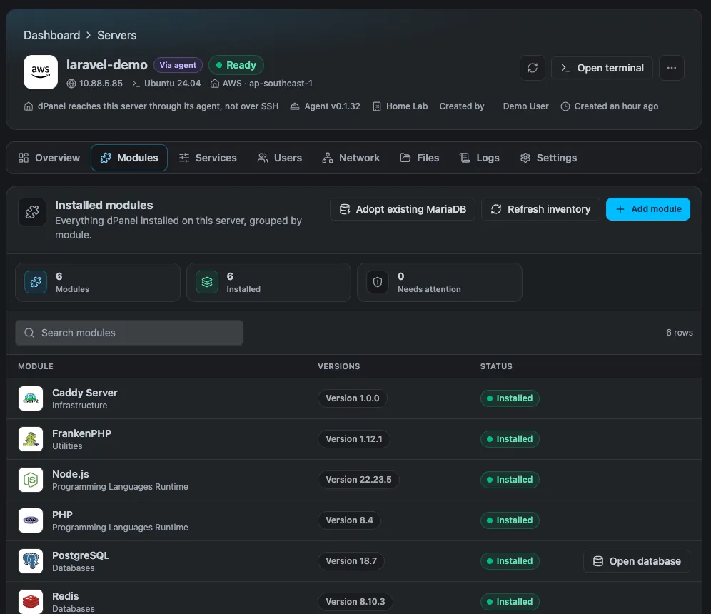

:::note[Prefer the command line?]
`dnocs module install postgresql --server-id <server ID> --generate-secrets` and `dnocs module install redis --server-id <server ID>`. See [Install software](../servers/install-software.md).
:::

## Step 3: Create the application with the Laravel preset

Open **Applications** and press **Create Application**. The form has five steps: **Repository**, **Server & modules**, **App setup**, **Environment** and **Preview**.

### Repository

1. Pick your GitHub account or organization in the first list, search for `laravel`, and select **laravel-example**. Keep the **main** branch.
2. A **Laravel detected** panel appears. dPanel read the repository and shows what it found: the Laravel version, the PHP version it asks for, the web server (Octane on FrankenPHP for this repository), the front-end build and the health check. Its notes tell you that dPanel manages `APP_KEY` and that `APP_URL` is still missing (you add it in **Environment**).
3. Press **Continue**.

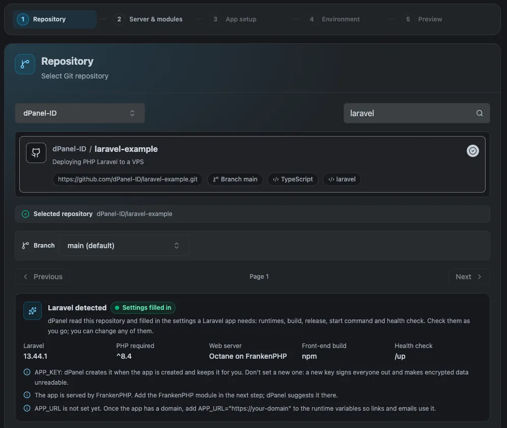

### Server & modules

1. Select your server.
2. **What this Laravel app needs** lists **PHP 8.4**, **Node.js 22** and **FrankenPHP**. Press **Add** on each one (or **Use … on this server** when that version is already installed). Nothing is added until you press a button.
3. Under **Installed on selected server**, press **PostgreSQL** and **Redis** so the app lists them as what it uses.
4. Press **Continue**.

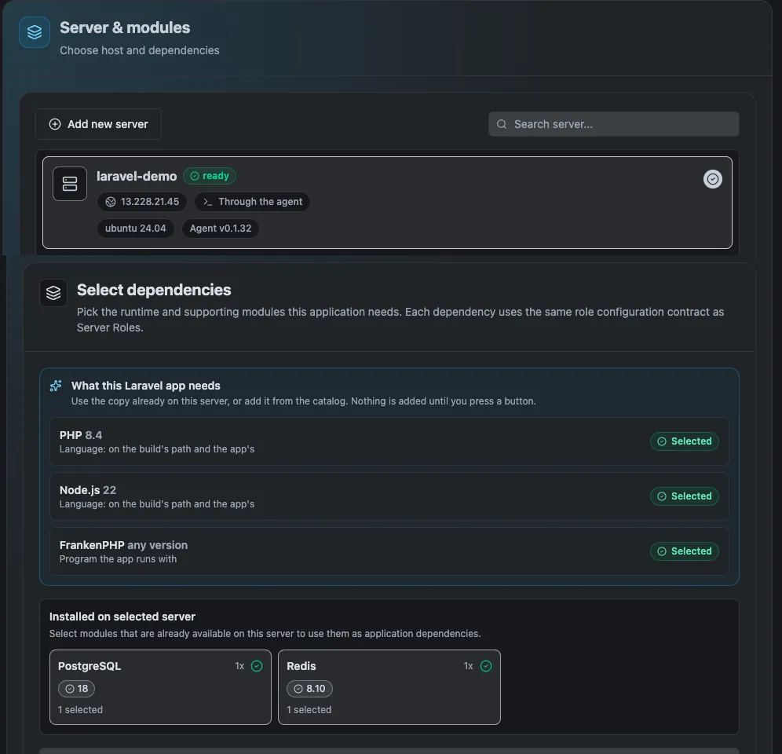

### App setup

The form is filled in. Check it:

1. **Application name**: type `Laravel` (letters, numbers and spaces only).
2. **Required binaries**: **PHP** and **Node.js** are both selected. **Other dependencies** lists FrankenPHP, PostgreSQL and Redis.

   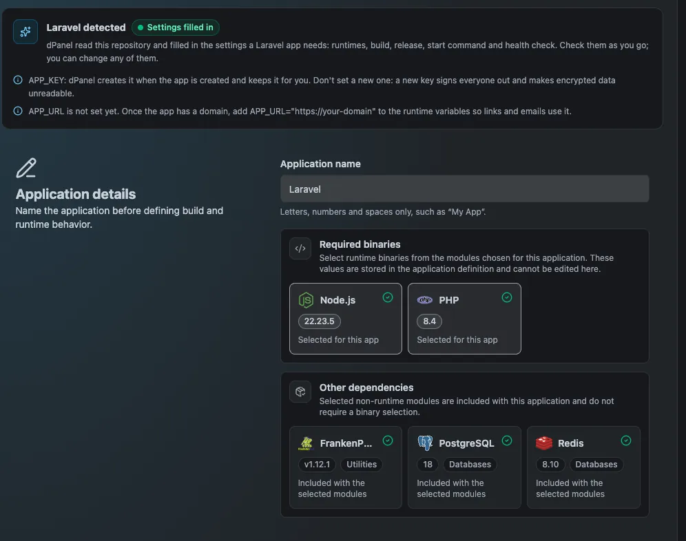

3. **Build steps**: `composer install --no-dev --optimize-autoloader --no-interaction --prefer-dist`, then `npm ci && npm run build`. The build needs no database and no `APP_KEY`.
4. **Runtime command**: Laravel Octane on FrankenPHP, because this repository uses Octane. An app without Octane gets FrankenPHP's classic mode (`frankenphp php-server`), which needs no change to your code.
5. **Application port**: keep the free port dPanel suggests. Your app listens on it on the server; visitors never see it.

   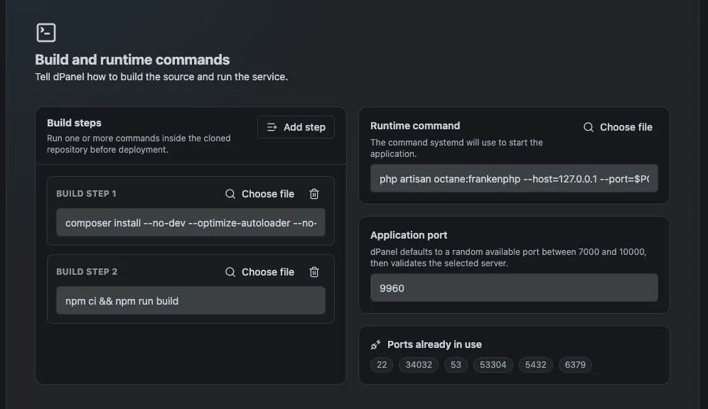

6. **Release and processes**:
   - **Release commands**: `php artisan storage:link --force`, `php artisan migrate --force` and `php artisan optimize`.
   - **After the restart**: `php artisan reload`, which restarts the queue worker, the scheduler and Octane on the new code.
   - **Health check**: `/up`. dPanel asks the app for this page after each restart and marks the deploy failed if it does not answer `200`.
   - **Release folders**: on. `storage`, `.env` and `database/database.sqlite` are kept between releases, and the last 3 releases stay on the server.

   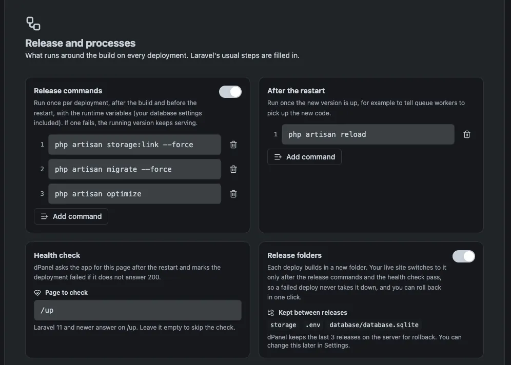

7. **Worker and scheduler**: turn on **Queue worker** (it runs queued jobs, such as emails) and **Scheduler** (it runs `php artisan schedule:run` every minute). The example app has a demo for both. Each uses some memory, so for your own app turn on only what it needs.

   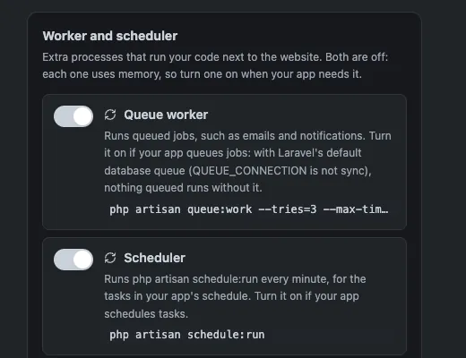

8. Press **Continue**.

### Environment

This step holds the **runtime variables**, the settings the running app reads.

1. Under **Database for this app**, press **Create database**. Keep **Laravel (DB\_\*)**. dPanel suggests a database name and user from the application's name; keep them or type your own (this run used `laravel_app`). Press **Create database**, then **Yes**. dPanel creates the database and its user on your server's PostgreSQL with a strong password, and writes `DB_CONNECTION`, `DB_HOST`, `DB_PORT`, `DB_DATABASE`, `DB_USERNAME` and `DB_PASSWORD` into the runtime variables. You never type or see the password.

   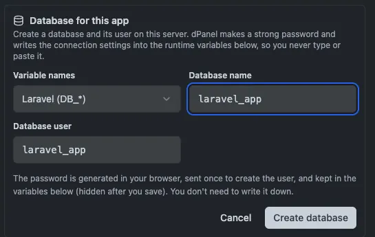

2. Optional, if you installed Redis: under **Redis for this app**, press **Connect Redis**. Keep the **Key prefix** and the three boxes (cache, queued jobs and sessions), and press **Fill in variables**. See [Connect Redis](../applications/environment-variables.md#connect-redis).

   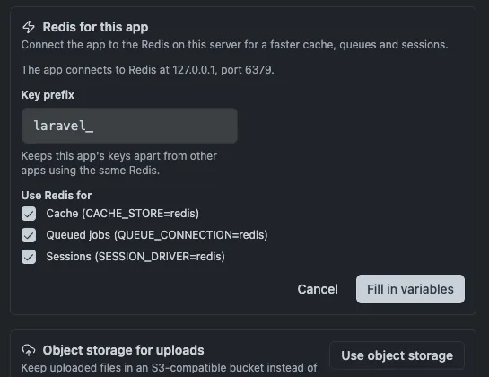

3. In **Runtime variables**, add your site's address on a new line, with your own domain:

   ```dotenv
   APP_URL="https://laravel.example.com"
   ```

   Laravel uses it for links and emails.

4. Leave **Build-time variables** empty, and do not add `APP_KEY`: dPanel creates it.
5. Press **Continue**.


### Preview

Check the summary. **Pre-flight checks** compares what the repository asks for (the PHP version and extensions, the Node.js version) with what you chose, and should say **All good**. An error, such as a PHP version the app does not support, holds the button until you fix it. Press **Deploy application**, then **OK**.

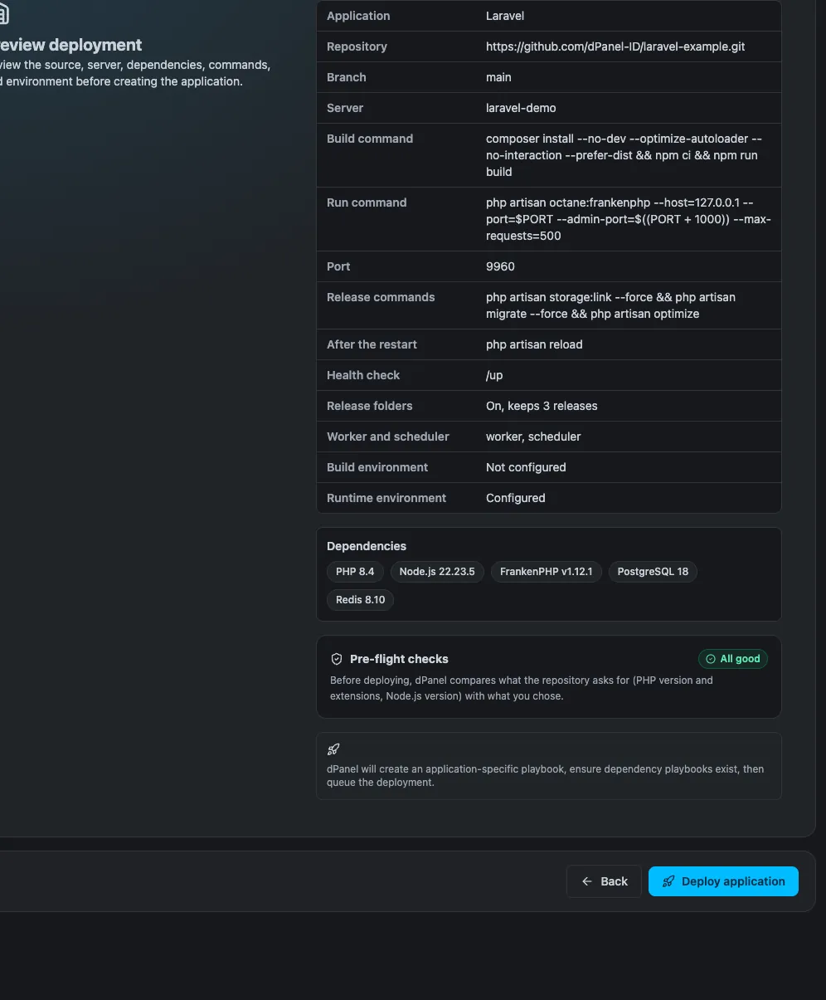

The first deploy takes about 5 minutes, because dPanel installs PHP, Node.js and FrankenPHP first. Open **Applications**, then **Laravel**, to follow it. It shows **Releasing**, then **Running**.

**You should see:** the application marked **Running**, with **1 Serving now**.

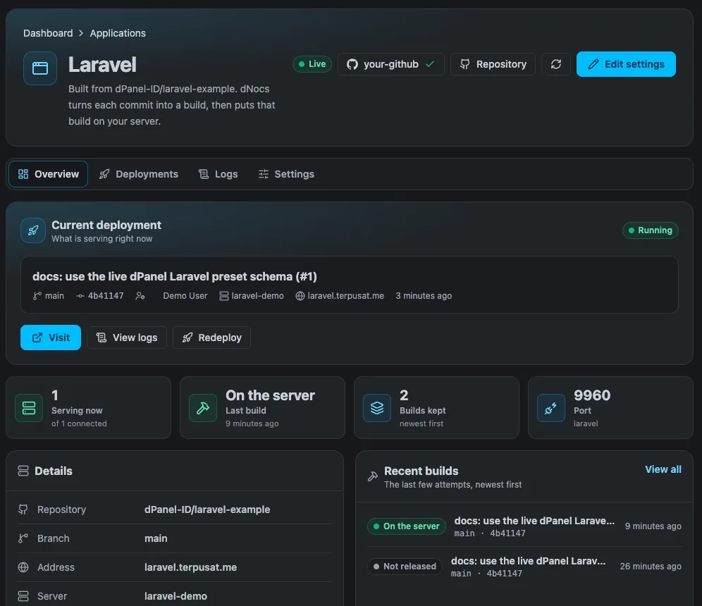

It is not on the internet yet: that is the next step.

:::note[Prefer the command line?]
`dnocs application create` registers the repository; dPanel recognises Laravel the same way and creates `APP_KEY`. Then `dnocs application deploy --id <app ID> --server-id <server ID>`. See [Create an application](../applications/create-an-application.md).
:::

## Step 4: Publish it on your domain with HTTPS

A **load balancer** is the front door of your site: it answers visitors on ports 80 and 443, handles HTTPS, and passes each request to your app.

1. Open **Load Balancers** and press **Create a load balancer**. The form has four steps: **Gateway**, **Domain**, **Routing** and **Review**.
2. **Gateway**: under **Gateway server**, select your server. Under **Install an engine**, press **Install** on **Caddy Server**, then **Install role** and **Yes**. After about a minute it shows **Installed**; select it and press **Continue**.

   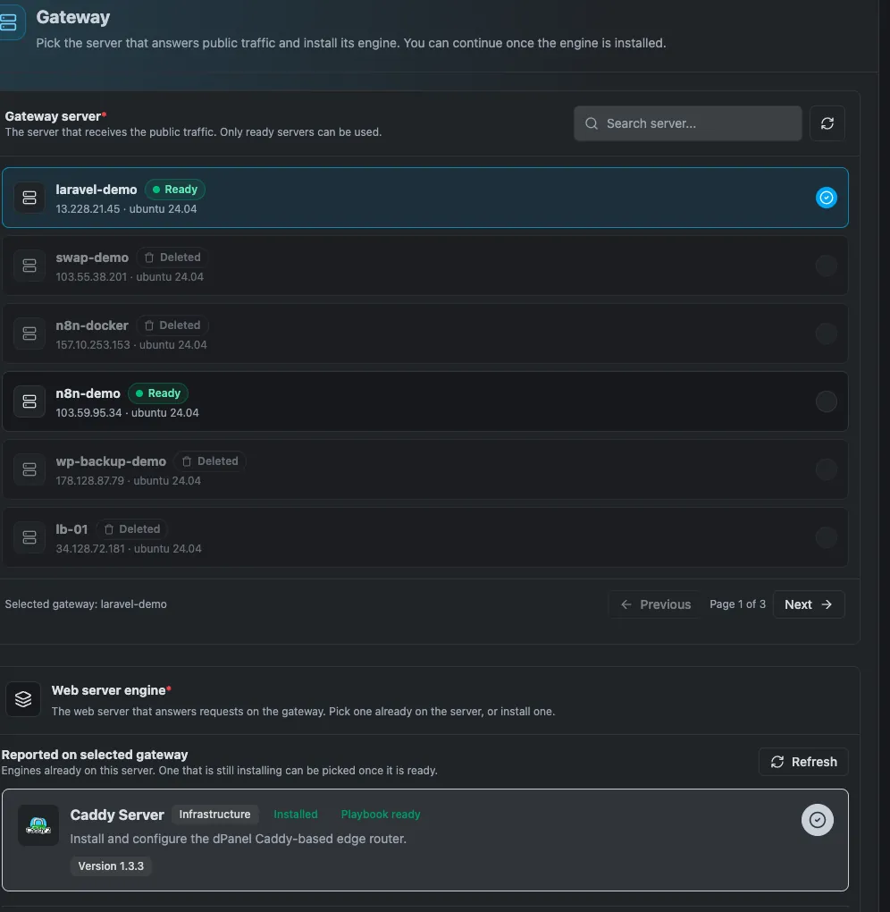

3. **Domain**: choose **Managed**, type the subdomain (`laravel`), and pick your domain. dPanel shows the DNS record it creates, an **A** record pointing at your server's public IP. Keep **Proxy through Cloudflare** off unless you want it. Press **Continue**.

   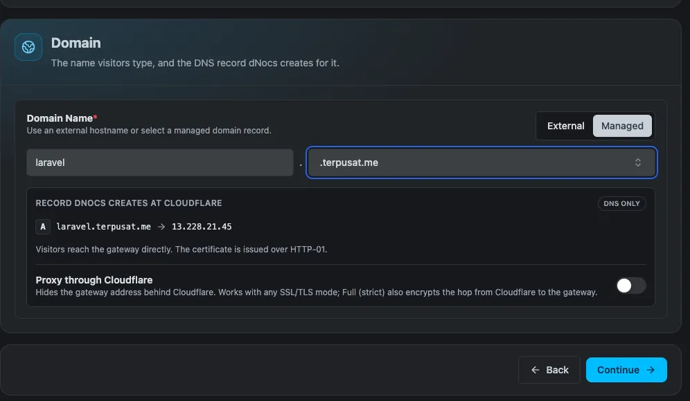

4. **Routing**: keep **L7**. In **Rule #01**, set **Type** to **Application**, **Matching Path** to `/*`, and select **Laravel**. Because the app runs on the same server, dPanel reaches it on `localhost`. Keep **HTTPS** on. Press **Continue**.

   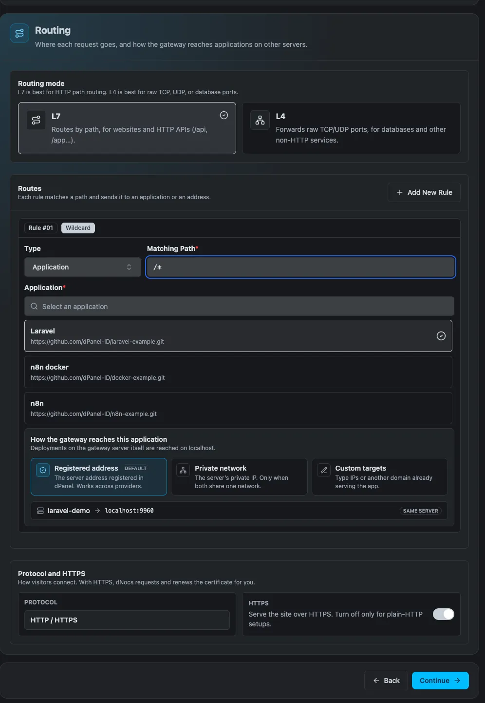

5. **Review**: press **Create load balancer**.

   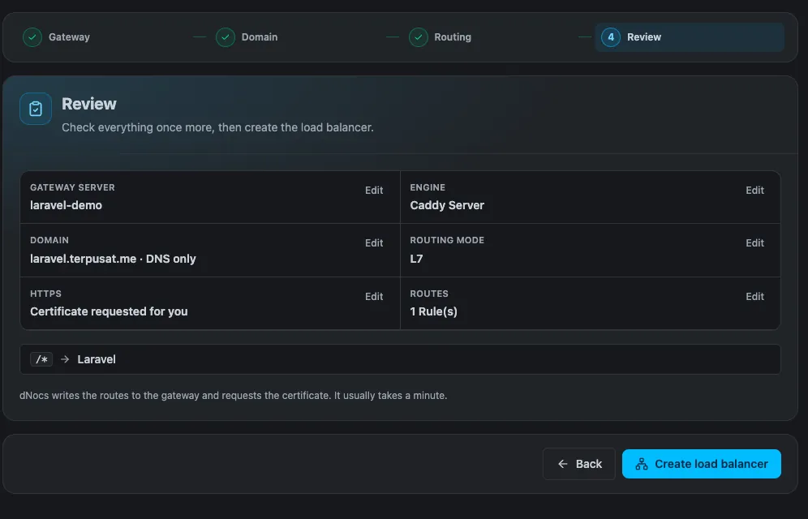

The DNS record and the certificate are ready in about a minute. See [Load balancers](../networking/load-balancers.md).

## Step 5: Check your site

1. Open `https://laravel.example.com/up` (with your domain). It shows a short **Application up** page: this is the health check dPanel uses.
2. Open `https://laravel.example.com/`. The Laravel welcome page appears, served over HTTPS.

   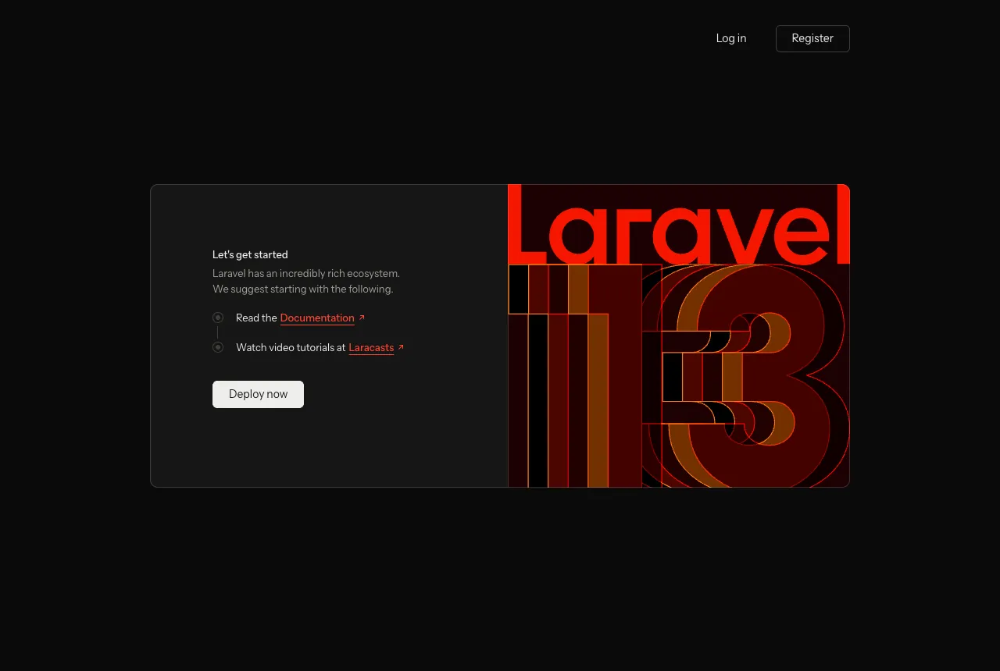

3. Press **Register** and create an account. The example app asks you to confirm your email address before it opens the dashboard; until you set up email sending, that message only goes to the application log. You do not need it for the demo: open `/background-demo`, press the button to queue a job, and the queue worker runs it within a few seconds. The scheduler writes `scheduler alive` to the log every minute.

**You should see:** the page loads with a lock icon in the address bar, and the demo job appears as processed.

## Day 2: Change a setting and deploy again

Variables are read when the app starts, so a change takes effect on the next deploy.

1. Open the application, then **Settings**. Under **Run**, press **Edit** next to **Environment variables**. Values are hidden; ones you leave alone keep their saved value.
2. Press **Add Variable** and type, for example, `APP_NAME` and `Laravel on dPanel`. Press **Save**.

   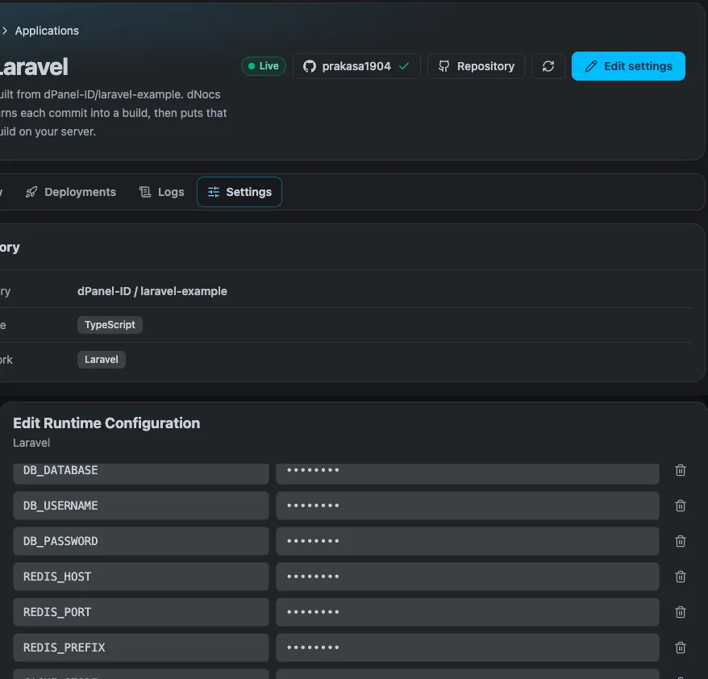

3. Open **Overview** and press **Redeploy**. The **New Artifact** panel starts on your branch (`main`) and your server. Press **Save**.

   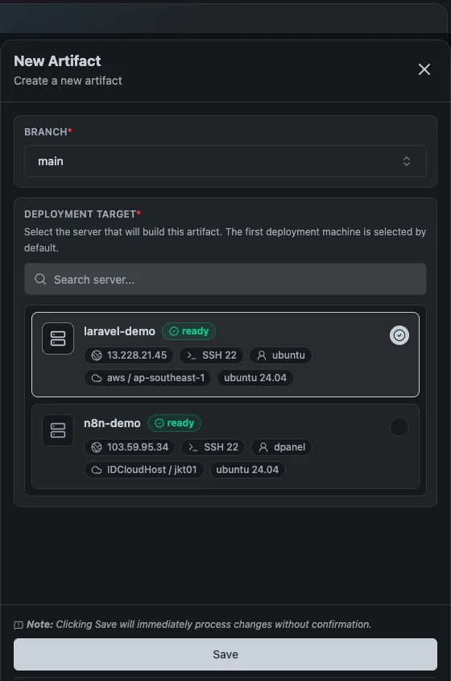

The deploy takes about 2 minutes. Your site keeps answering the whole time: the new release goes live only after its release commands and health check pass.

**You should see:** the browser tab of your site now reads **Laravel on dPanel**.

:::note[Prefer the command line?]
`dnocs application env set --id <app ID> APP_NAME="Laravel on dPanel"`, then `dnocs application deploy --id <app ID> --server-id <server ID>`. See [Environment variables](../applications/environment-variables.md).
:::

## Day 2: Roll back a bad deploy

1. Open the application, then **Deployments**, and switch to **On servers**.
2. **Releases on this server** lists the last 3 releases. The one serving now is marked **Live**. Press **Roll back** on the release you want.

   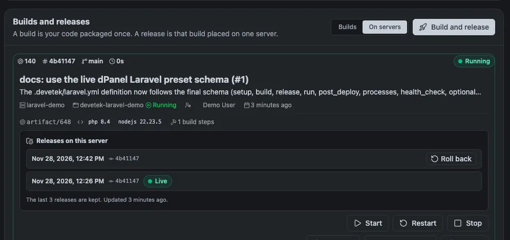

3. Read the dialog and press **Roll back**. Only the code switches: your variables stay, and database migrations are not undone.

   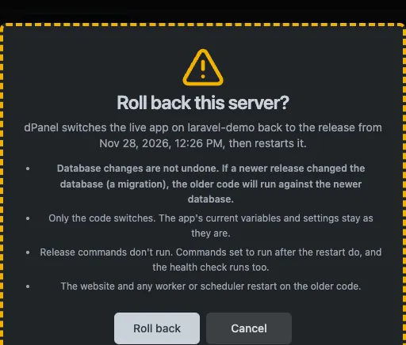

It takes about a minute. The worker and the scheduler restart on the older code too. See [Roll back to an earlier release](../applications/deployments-and-rollback.md#roll-back-to-an-earlier-release).

**You should see:** the older release marked **Live**.

:::note[Prefer the command line?]
`dnocs application rollback --id <app ID> --list` shows the releases; `dnocs application rollback --id <app ID>` switches to the one before the live release.
:::

## Day 2: Read the logs

Open the application, then **Logs**. **Runtime** shows what the app, the worker and the scheduler print, newest first, with filters for the level and the time. The queued job and the `scheduler alive` lines appear here. **Load balancer** shows each visitor request with its status.

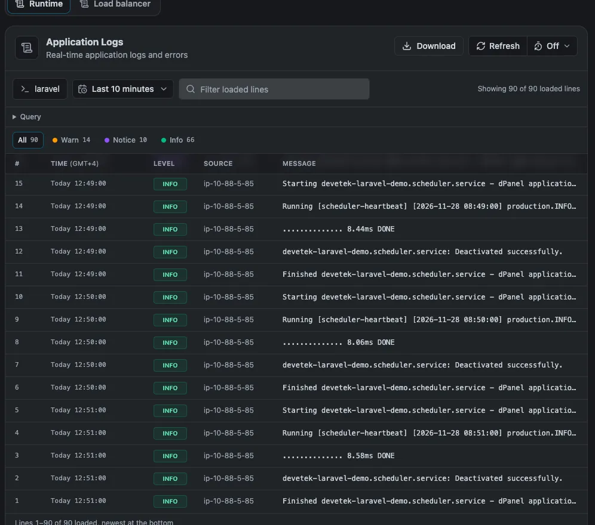

See [Application logs](../applications/application-logs.md). From the terminal: `dnocs application logs --id <app ID> --since 1h`.

## When something does not work

| What you see                                       | What to check                                                                                                                                                         |
| -------------------------------------------------- | --------------------------------------------------------------------------------------------------------------------------------------------------------------------- |
| **Pre-flight checks** shows an error               | Read it: it names the problem, such as a PHP version your `composer.json` does not allow. Pick the version it asks for in **Server & modules**.                       |
| **Redis for this app** says to install Redis first | Redis is still installing. Wait until the **Modules** tab shows it **Installed**; the step updates by itself.                                                         |
| `npm: command not found` in the build log          | Node.js is not on the application. Open **Settings**, edit the **Language** under **Build**, add **Node.js**, and deploy again.                                       |
| A release command fails                            | The deploy log shows the command and its output, and the previous version keeps serving. For `php artisan migrate`, check the `DB_*` runtime variables.               |
| The deploy fails at the health check               | The log shows the last answer of `/up` and the app's last lines. A `500` often means a missing variable; read the [runtime log](../applications/application-logs.md). |
| `MissingAppKeyException`                           | `APP_KEY` was removed from the variables. Deploy again: dPanel creates one when it is missing. Visitors are signed out.                                               |
| The domain does not answer                         | Wait a few minutes for DNS and the certificate, then open the load balancer's page and its logs.                                                                      |
| Queued jobs never run                              | Turn on the **Queue worker** in **Settings**, under **Release and processes**, and deploy again.                                                                      |
| Anything else                                      | See [Common problems and fixes](../troubleshooting/faq.md).                                                                                                           |

## Prefer to chat? Do the same with Ask dPanel

[Ask dPanel](../ai/overview.md) can prepare every step for you to approve, for example:

> Create an application named Laravel from github.com/my-org/laravel-example on server laravel-demo.

dPanel creates `APP_KEY` for a Laravel repository whichever way you create the application. More ready-made requests are in the [Prompt cookbook](../ai/prompt-cookbook.md).

## Clean up

Delete in this order: the load balancer, the application, then the server. See [Load balancers](../networking/load-balancers.md#delete-a-load-balancer), [Update or delete an application](../applications/update-or-delete.md) and [Delete a server](../servers/delete-a-server.md).

## Frequently asked questions

### Why does the application need Node.js if Laravel is PHP?

The build runs `npm` to bundle the front end with Vite. dPanel puts only the runtimes the application declares on the build's path, so Node.js is declared next to PHP. PHP stays the application's main language.

### Do the database variables go in the build-time variables too?

No. The build only installs packages and builds the front end. Migrations run as a release command with the runtime variables, so the `DB_*` settings belong there only.

### Octane or classic FrankenPHP: which one do I get?

Octane when your app requires `laravel/octane`, as this example does: the app stays loaded in memory and answers faster. Every other Laravel app gets FrankenPHP's classic mode, which runs `public/index.php` for each request like PHP-FPM and needs no change to your code. Both work with release folders and rollback.

### Can I use MariaDB instead of PostgreSQL?

Yes. Install **MariaDB** in step 2. In **Database for this app**, the helper creates the database on MariaDB and writes the matching `DB_*` settings.

### Can I change the preset?

Yes. Every field the preset fills in stays editable in the form and later under the application's **Settings**. dPanel applies the preset once, when you pick the repository and branch.

### Can I add the queue worker or the scheduler later?

Yes. Open **Settings**, press **Edit** on **Release and processes**, turn them on, and deploy again.

### Where do uploaded files go?

Into `storage`, which release folders keep between deploys, and `php artisan storage:link` makes `storage/app/public` reachable at `/storage`. To keep uploads in a bucket instead, use **Use object storage** in the **Environment** step. See [Use object storage for uploads](../applications/environment-variables.md#use-object-storage-for-uploads).
