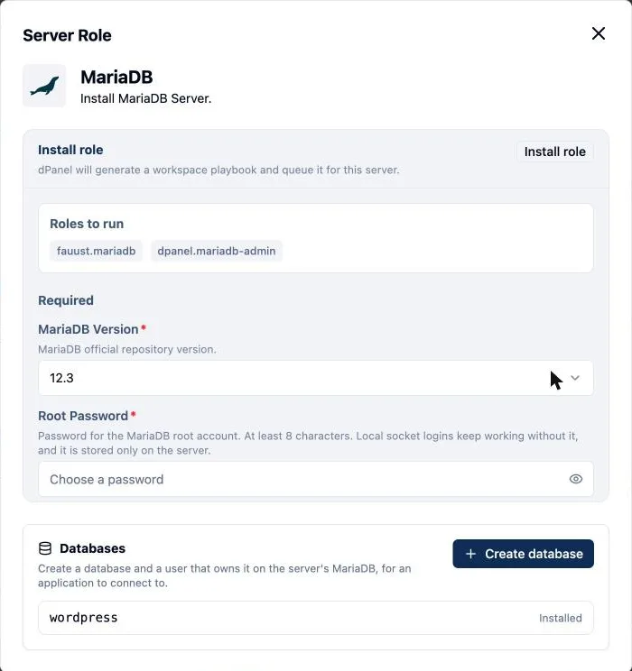

This tutorial takes you from an empty dPanel account to a Laravel application answering on your own domain with HTTPS. You launch an Ubuntu server, install PostgreSQL, PHP, FrankenPHP and Node.js on it, create a database, deploy the [dPanel-ID/laravel-example](https://github.com/dPanel-ID/laravel-example) repository, and put a load balancer in front of it.

Laravel differs from WordPress in two ways that matter here:

- **It needs two runtimes.** The build runs Composer with PHP, then `npm` to build the front end with Vite. The application declares both PHP and Node.js, and dPanel puts only declared runtimes on the build's path.
- **The build talks to the database.** It runs the migrations, so the database variables are needed while building as well as while running.

It takes about 45 minutes, most of it waiting for the server and the installs. Every step happens in the dPanel web app; you never need SSH.

:::tip[New to servers?]
Read [How a website runs on your server](./how-a-website-runs.md) first. It explains every word this page uses, such as module, build, port and load balancer, in a few minutes. The [Glossary](../getting-started/glossary.md) has the rest.
:::

## What you need first

- A dPanel account, signed in, in the workspace you want to use. See [Sign in](../getting-started/sign-in.md).
- GitHub connected, with access to the repository you deploy. To follow along exactly, fork **dPanel-ID/laravel-example** into your own account. See [Connect GitHub](../getting-started/connect-github.md).
- An SSH key and a cloud account in dPanel, or a server of your own. See [Before you start](../servers/before-you-start.md).
- A domain in **Domain & DNS**, so dPanel can create the DNS record for you. See [Domains and DNS](../networking/domains-and-dns.md).

## Step 1: Launch a server

1. Open **Servers**, press **Create Server**, then **Launch a server**.
2. Pick your **Provider**, **Cloud project** and **SSH key**, then a **Region** near your users.
3. Set **Server name**, for example `laravel-1`, keep **Ubuntu release** 24.04 LTS, and move the sliders to at least **2 vCPU** and **4 GB** RAM. 30 GB of storage is enough.
4. When the Review panel says **Ready to launch**, press **Launch server**.

Wait until the server's status is **Ready**, usually 10 to 20 minutes. See [Create a cloud server](../servers/cloud-providers/create-a-cloud-server.md), or [connect your own server](../servers/connect-your-own-server.md) instead.

**You should see:** the server listed under **Servers** with the status **Ready**.

## Step 2: Install PostgreSQL, PHP, FrankenPHP and Node.js

1. Open the server and go to **Modules**. Press **Add module**.
2. Press **Install** on **PostgreSQL**. Note the administrator user and set its password, or keep the one suggested, and copy it somewhere safe. Press **Install role** and confirm.
3. When PostgreSQL shows **Installed**, install **PHP** with **PHP Version** `8.5`.
4. Then install **FrankenPHP**, which serves the application through Laravel Octane.
5. Then install **Node.js**. Note the version it installs, for example `26.13.0`: the application declares the same version in step 4.


Install one module at a time and let each finish. See [Install software](../servers/install-software.md).

**You should see:** PostgreSQL, PHP, FrankenPHP and Node.js on the **Modules** tab, each marked **Installed**.

## Step 3: Create the Laravel database

1. On **Modules**, press **Add module**, then **Manage** on **PostgreSQL**.
2. Under **Databases**, press **Create database**.
3. Enter **Database Name** `laravel`, **Database User** `laravel`, and a **Database Password** of at least 8 characters. Copy the password: you need it in step 4. PostgreSQL names use lowercase letters, digits and underscores.
4. Press **Install role**.



**You should see:** `laravel` listed under **Databases**, and the password saved somewhere safe.

## Step 4: Create and deploy the application

1. Open **Applications** and press **Create Application**.
2. **Repository**: pick your GitHub account, search for `laravel-example`, select it, keep the **main** branch, and press **Continue**.
3. **Server & modules**: select your server. Under **Installed on selected server**, select **PHP**, **FrankenPHP** and **Node.js** so they are reused, not installed again. Press **Continue**.
4. **App setup**:
   - **Application name**: `Laravel` (letters, numbers and spaces only).
   - **Required binaries**: check that **both** PHP 8.5 and Node.js are selected. dPanel selects every language module you picked in step 2 and stores all of them on the application, which is what puts `npm` on the build's path. FrankenPHP appears under **Other dependencies**.
   - **Build steps**: `./scripts/build.sh`. It installs the Composer and npm packages, builds the front end, generates the application key and runs the migrations.
   - **Runtime command**: `./scripts/start.sh`. It starts Laravel Octane on FrankenPHP, on the port dPanel gives it.
   - **Application port**: keep the free port dPanel suggests.
5. **Environment**: paste the database list into **both** **Build-time variables** and **Runtime variables**, with your password and your domain:

   ```text
   APP_ENV=production
   APP_DEBUG=false
   APP_URL=https://app.example.com
   DB_CONNECTION=pgsql
   DB_HOST=127.0.0.1
   DB_PORT=5432
   DB_DATABASE=laravel
   DB_USERNAME=laravel
   DB_PASSWORD=the-password-from-step-3
   ```

   Then add these to **Runtime variables** only:

   ```text
   OCTANE_SERVER=frankenphp
   OCTANE_DISABLE_CADDY_ADMIN=true
   LOG_CHANNEL=stderr
   ```

6. **Preview**: check the summary and press **Deploy application**.


The first build takes 3 to 6 minutes. Open the application to follow it; it shows **Running** when the release is live. See [Create an application](../applications/create-an-application.md) and [Environment variables](../applications/environment-variables.md).

:::warning[npm: command not found]
If the build log stops at `npm: command not found`, Node.js is not declared on the application. Open the application's settings, add **nodejs** with the installed version under the additional languages, save, and deploy again.
:::

**You should see:** the application marked **Running**. It is not on the internet yet: that is the next step.

## Step 5: Publish it on your domain with HTTPS

1. Open **Load Balancers** and press **Create a load balancer**. The form has four steps: **Gateway**, **Domain**, **Routing** and **Review**.
2. **Gateway**: under **Gateway server**, select the same server. Under **Web server engine**, pick **Caddy Server** and press **Install** if it is not installed yet.
3. **Domain**: under **Domain Name**, choose **Managed**, type the **Subdomain** (for example `app`), and **Select domain**.
4. **Routing**: keep **L7** under **Routing mode**, and **HTTP / HTTPS** with **HTTPS** on under **Protocol and HTTPS**. In the first rule, set **Type** to **Application**, **Matching Path** to `/*`, and pick the **Laravel** application.
5. **Review**: when the review panel reads **Ready to create**, press **Create load balancer**.

After a minute or two, open `https://app.example.com/`: the Laravel welcome page appears. See [Load balancers](../networking/load-balancers.md).

## When something does not work

| What you see                              | What to check                                                                                                                                                                |
| ----------------------------------------- | ---------------------------------------------------------------------------------------------------------------------------------------------------------------------------- |
| `npm: command not found` in the build log | Declare Node.js on the application, as in the warning above.                                                                                                                 |
| The build fails at `php artisan migrate`  | The `DB_*` variables must also be in **Build-time variables**, and match the database from step 3.                                                                           |
| The application starts, then stops        | Read its runtime log. See [Application logs](../applications/application-logs.md).                                                                                           |
| The domain does not answer                | Wait a few minutes for DNS and the certificate, then check the load balancer's detail page and logs. A red **Load balancer change failed** banner has **See why it failed**. |
| Anything else                             | See [Common problems and fixes](../troubleshooting/faq.md).                                                                                                                  |

A variable change applies from the next release: deploy again after changing one.

## Prefer to chat? Do the same with Ask dPanel

[Ask dPanel](../ai/overview.md) can prepare every step for you to approve. Name both runtimes when you ask it to create the application, for example:

> Create an application named Laravel from github.com/my-org/laravel-example on server laravel-1. Language PHP 8.5 with Node.js as an extra runtime, build command ./scripts/build.sh, start command ./scripts/start.sh.

It asks for `DB_PASSWORD` as a field on the approval card, so the password never goes into the chat. More ready-made requests are in the [Prompt cookbook](../ai/prompt-cookbook.md).

## Clean up

Delete in this order: the load balancer, the application, then the server. See [Load balancers](../networking/load-balancers.md#delete-a-load-balancer), [Update or delete an application](../applications/update-or-delete.md) and [Delete a server](../servers/delete-a-server.md).

## Frequently asked questions

### Why does the application need Node.js if Laravel is PHP?

The build runs `npm` to bundle the front end with Vite. dPanel puts only the runtimes declared on the application on the build's path, so Node.js must be declared next to PHP.

### Why do the database variables go in both lists?

The build runs the migrations, so it needs the database while building. The running application needs it too. **Build-time variables** reach only the build; **Runtime variables** reach only the running service.

### Can I use MariaDB instead of PostgreSQL?

Yes. Install **MariaDB**, create the database from its **Manage** page, and set `DB_CONNECTION=mysql` and `DB_PORT=3306`.
