This tutorial takes you from an empty dPanel account to a WordPress site answering on your own domain with HTTPS. You launch an Ubuntu server, install MariaDB, PHP and FrankenPHP on it, create a database, deploy WordPress from a GitHub repository, and put a load balancer in front of it.

Every screenshot on this page comes from one real run of these steps, publishing WordPress at a subdomain such as `blog.example.com`. It takes about 30 minutes, most of it waiting for the server and the installs. Everything happens in the dPanel web app; you never need SSH.

:::tip[New to servers?]
Read [How a website runs on your server](./how-a-website-runs.md) first. It explains every word this page uses, such as module, build, port and load balancer, in a few minutes. The [Glossary](../getting-started/glossary.md) has the rest.
:::

## The repository this tutorial deploys

**[github.com/dPanel-ID/wordpress-example](https://github.com/dPanel-ID/wordpress-example)**

This is the code dPanel puts on your server. It is a normal WordPress install with three things added so it runs well behind dPanel:

| File               | What it does                                                                                                                                                                                                                                                                             |
| ------------------ | ---------------------------------------------------------------------------------------------------------------------------------------------------------------------------------------------------------------------------------------------------------------------------------------- |
| `wp-config.php`    | Reads the database settings and the site address from environment variables (`WORDPRESS_DB_HOST`, `WORDPRESS_HOME` and so on), so no password is stored in the repository. It also trusts the load balancer's `X-Forwarded-Proto` header, so WordPress knows visitors arrive over HTTPS. |
| `scripts/build.sh` | The **build step**. It writes a FrankenPHP configuration that serves WordPress on the port dPanel gives the app, and blocks requests for `.env`, `.git`, `.sql`, `.sh` files and PHP files inside `wp-content/uploads`.                                                                  |
| `scripts/start.sh` | The **runtime command**. It starts FrankenPHP with that configuration. dPanel runs it as a service and restarts it if it stops.                                                                                                                                                          |

`.env.example` lists every variable WordPress reads, and `docker-compose.yml` starts a MariaDB if you want to try the site on your own computer first; dPanel uses neither.

**Fork it before you start.** dPanel can only deploy repositories your GitHub connection can see, so press **Fork** on the repository page to copy it into your own GitHub account or organisation. Your fork is also where your own theme and plugin changes go later.

## What you need first

- A dPanel account, signed in, in the workspace you want to use. See [Sign in](../getting-started/sign-in.md).
- GitHub connected, and your fork of **wordpress-example**. See [Connect GitHub](../getting-started/connect-github.md).
- A server: a cloud account in dPanel to launch one, or a server of your own (a VPS with a public IP, so visitors can reach it) connected with the [dPanel agent](../servers/register-a-private-machine.md). See [Before you start](../servers/before-you-start.md).
- A domain in **Domain & DNS**, so dPanel can create the DNS record for you. See [Domains and DNS](../networking/domains-and-dns.md). This tutorial uses a subdomain, such as `blog.example.com`, and leaves the domain itself alone.

## Step 1: Launch a server

1. Open **Servers**, press **Create Server**, then **Launch a server**.
2. Pick your **Provider**, **Cloud project** and a **Region** near your visitors.
3. Under **How dPanel connects**, keep **dPanel agent**. Under **Public IP**, keep **Give the VM a public IP** on: visitors reach the site through it.

   

4. Set **Server name**, for example `wordpress-1`, keep **Ubuntu 24.04 LTS**, and set the size to at least **2** CPU cores and **4 GB** RAM. **20 GB** of storage is enough to start.

   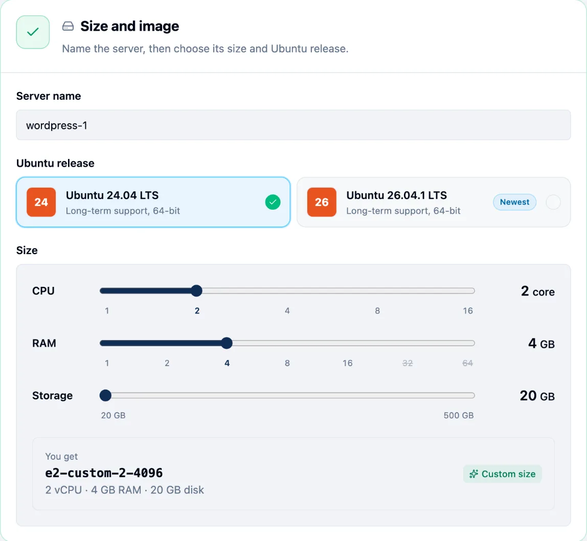

5. When the review panel says **Ready to launch**, press **Launch server**.

The server appears in the list. Wait until its status is **Ready**, usually 5 to 15 minutes. The full form is described in [Create a cloud server](../servers/cloud-providers/create-a-cloud-server.md). Already have a machine? [Connect it with the dPanel agent](../servers/register-a-private-machine.md) instead, and skip this step.

**You should see:** the server listed under **Servers** with the status **Ready**.

## Step 2: Install MariaDB, PHP and FrankenPHP

WordPress needs three pieces of software, which dPanel calls **modules**: a database (MariaDB), the PHP language, and a web server that runs PHP (FrankenPHP).

1. Open the server and go to its **Modules** tab. Press **Add module**.
2. Press **Install** on **MariaDB**. In the form:
   - **MariaDB Version**: keep the default.
   - **Root Password**: at least 8 characters. Save it in your password manager; dPanel does not show it again, and WordPress does not use it.
   - **Bind Address**: change it to `127.0.0.1`, so the database answers only to programs on this server and is never open to the internet.

   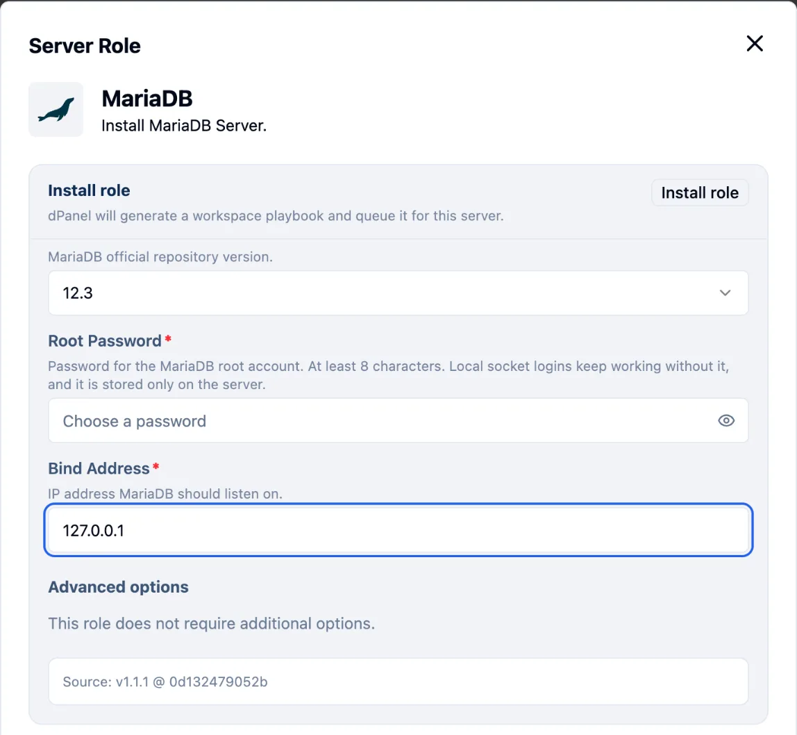

   Press **Install role** and confirm. It takes about 3 minutes.

3. When MariaDB shows **Installed**, press **Add module** again and install **PHP** with **PHP Version** `8.5`. About 2 minutes.
4. Then install **FrankenPHP**, keeping its default version. Under a minute.

Install one module at a time and let each finish: dPanel runs a server's installs one after another, and the **Modules** tab shows each one moving from **Installing** to **Installed**. See [Install software](../servers/install-software.md).

**You should see:** MariaDB, PHP and FrankenPHP on the **Modules** tab, each marked **Installed**.

## Step 3: Create the WordPress database

WordPress keeps posts, pages, users and settings in its own database, reached with its own user, so it never needs the root password.

1. On **Modules**, press **Add module**, then **Manage** on **MariaDB**.
2. Under **Databases**, press **Create database**.
3. Enter **Database Name** `wordpress`, **Database User** `wp`, and a **Database Password** of at least 8 characters. Copy the password: you need it in step 4.

   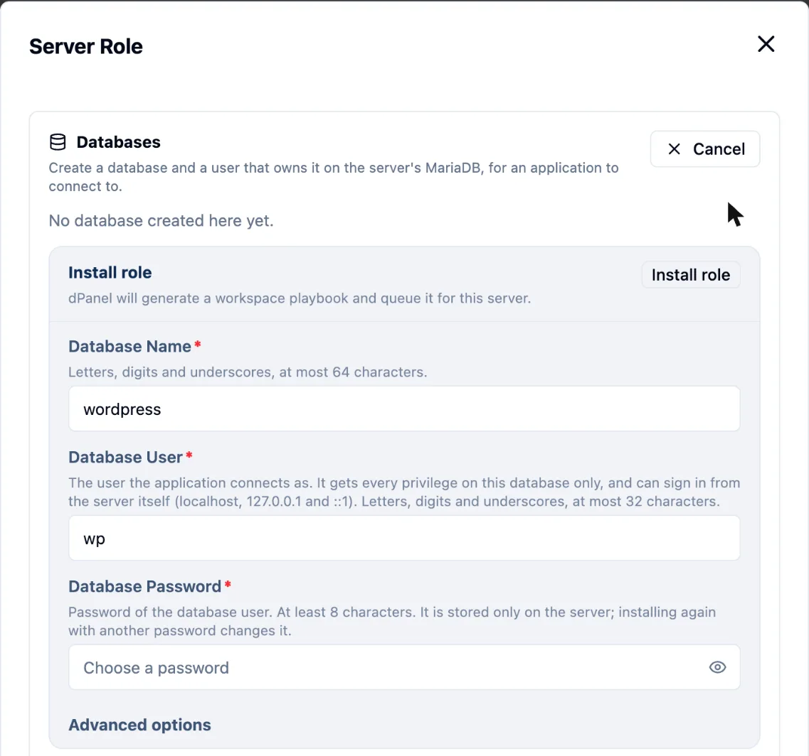

4. Press **Install role** and confirm.

The user `wp` gets every privilege on the `wordpress` database and nothing else, and can sign in only from the server itself, which is exactly how WordPress connects.

**You should see:** `wordpress` listed under **Databases**, and the password saved somewhere safe.

## Step 4: Create and deploy the application

1. Open **Applications** and press **Create Application**. The form has five steps.
2. **Repository**: pick the GitHub account that holds your fork, search for `wordpress`, select **wordpress-example**, and keep the **main** branch. Press **Continue**.

   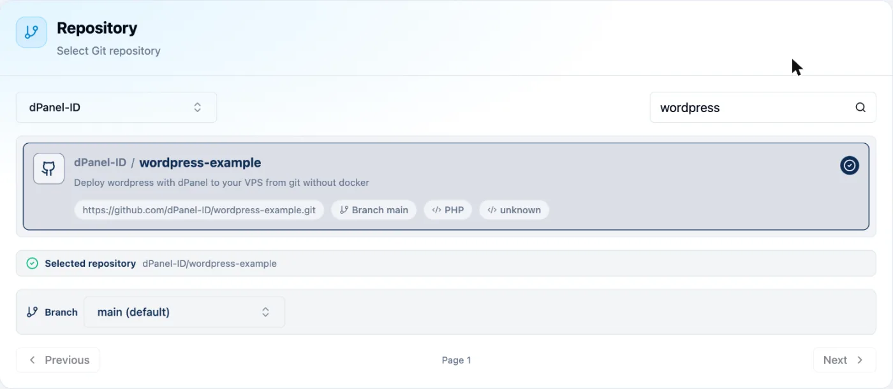

3. **Server & modules**: select your server. Under **Installed on selected server**, select **PHP** and **FrankenPHP** so the app uses them. Leave **MariaDB** unselected: the app talks to the database, but does not run inside it. Press **Continue**.

   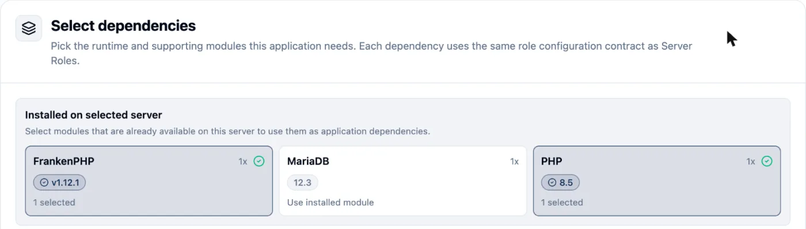

4. **App setup**:
   - **Application name**: `WordPress` (letters, numbers and spaces only).
   - **Required binaries** shows **PHP 8.5**, and **Other dependencies** shows **FrankenPHP**, from the step before.
   - **Build steps**: `./scripts/build.sh`.
   - **Runtime command**: `./scripts/start.sh`.
   - **Application port**: keep the free port dPanel suggests. **Ports already in use** lists the ports to avoid.

   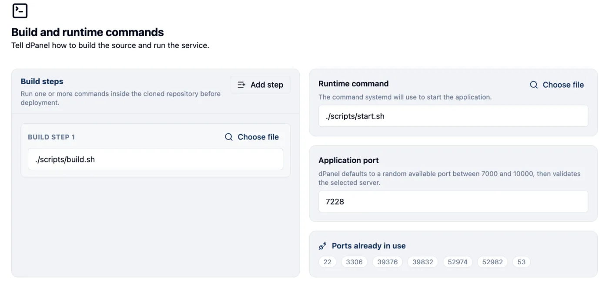

5. **Environment**: leave **Build-time variables** empty. Under **Runtime variables**, paste the list below, then replace the password with the one from step 3 and both addresses with the domain you will publish in step 5.

   ```text
   WORDPRESS_DB_HOST=127.0.0.1:3306
   WORDPRESS_DB_NAME=wordpress
   WORDPRESS_DB_USER=wp
   WORDPRESS_DB_PASSWORD=the-password-from-step-3
   WORDPRESS_TABLE_PREFIX=wp_
   WORDPRESS_HOME=https://blog.example.com
   WORDPRESS_SITEURL=https://blog.example.com
   WORDPRESS_MEMORY_LIMIT=256M
   ```

   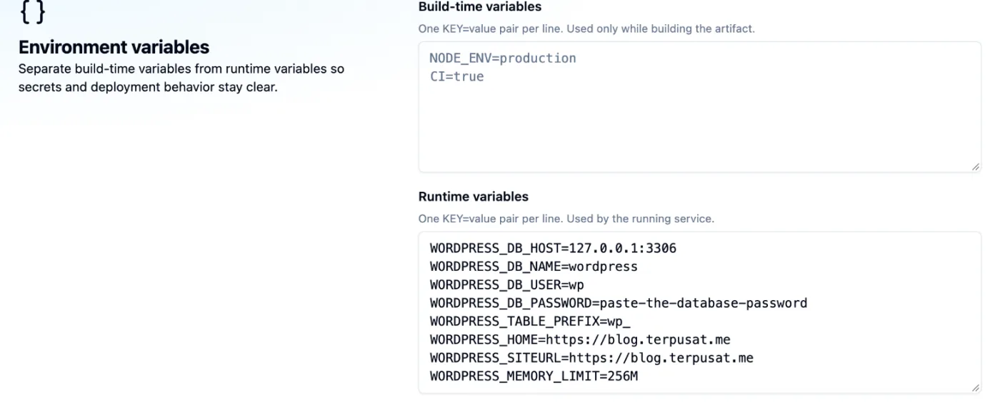

6. **Preview**: check the summary and press **Deploy application**.

dPanel copies your repository to the server, runs `./scripts/build.sh`, and starts WordPress as a service. Open the application to follow the build; the release is live in about 2 minutes. See [Create an application](../applications/create-an-application.md) and [Environment variables](../applications/environment-variables.md).

**You should see:** the application's current deployment marked ready, with **1** under **Serving now**. It is not on the internet yet: that is the next step.

## Step 5: Publish it on your domain with HTTPS

A load balancer is the front door: it answers visitors on your domain, handles HTTPS, and passes each request to WordPress.

1. Open **Load Balancers** and press **Create a load balancer**. The form has four steps: **Gateway**, **Domain**, **Routing** and **Review**.
2. **Gateway**: under **Gateway server**, select the same server. Under **Web server engine**, press **Install** on **Caddy Server**, keep the defaults, press **Install role** and confirm. After about a minute, press **Refresh** and select **Caddy Server**. Press **Continue**.

   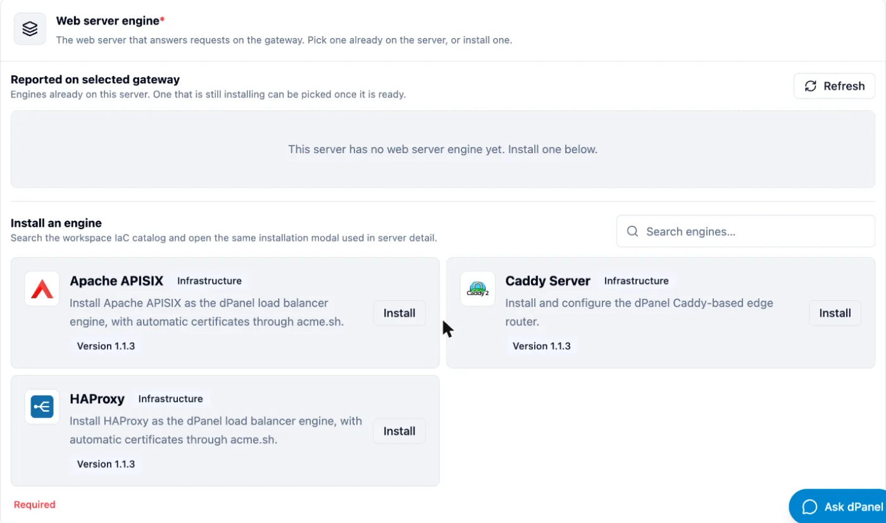

3. **Domain**: choose **Managed**, type the subdomain, for example `blog`, and pick your domain under **Select domain**. The form shows the DNS record dPanel will create. Leave **Proxy through Cloudflare** off. Press **Continue**.

   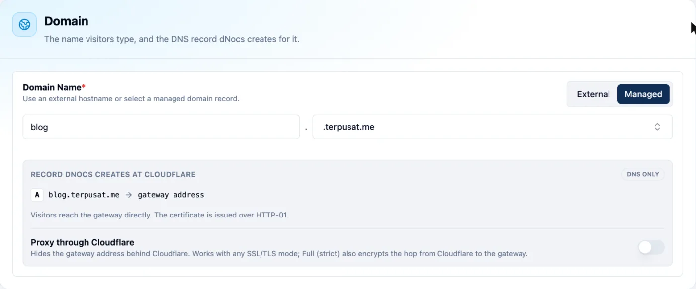

   If your domain's DNS is not at Cloudflare or DigitalOcean, choose **External** instead, type the full hostname, and add the record the form shows at your DNS provider.

4. **Routing**: keep **L7**. In **Rule #01**, set **Type** to **Application**, keep **Matching Path** `/*`, and select **WordPress**. Under **How the gateway reaches this application**, **Registered address** shows `localhost` and the app's port, marked **Same server**. Keep **HTTPS** switched on. Press **Continue**.

   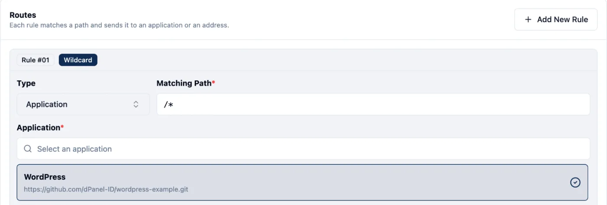

5. **Review**: check the summary and press **Create load balancer**.

dPanel creates the DNS record, writes the route to Caddy, and requests a free Let's Encrypt certificate. The load balancer turns **Ready** in a minute or two. See [Load balancers](../networking/load-balancers.md).

## Step 6: Finish the WordPress install

Open your address, for example `https://blog.example.com`. WordPress shows its installer, which proves the database connection works.

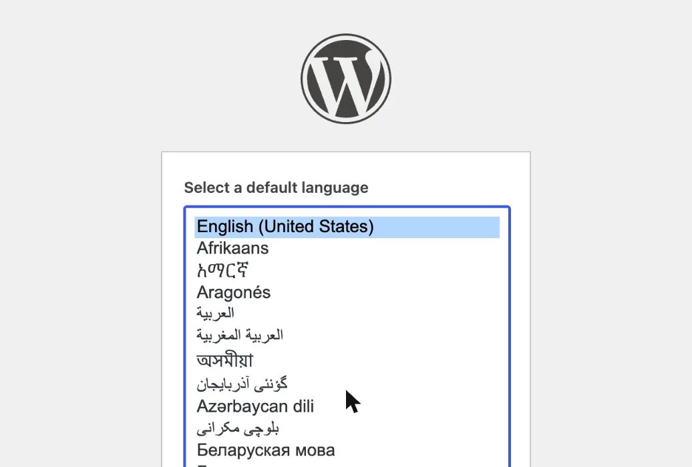

Pick the language, then enter the site title and your admin username, password and email. Press **Install WordPress**, and sign in at `/wp-admin`. Your site is live.

## Your uploads, plugins and themes

WordPress keeps two kinds of files, and a new release treats them differently:

- **Files that are in your repository** go back to the repository's version on every release and rollback. An edit made in the wp-admin theme editor is lost if that file is in the repository, so make the change in your fork instead.
- **Files that are not in your repository**, such as `wp-content/uploads`, or plugins and themes you installed from wp-admin, stay where they are. A release or rollback does not touch them.

Your posts and settings live in the database, which a release does not touch either. Deleting the application deletes its folder and everything in it, so back up `wp-content` and the database first.

## When something does not work

| What you see                                 | What to check                                                                                                                                                                                                               |
| -------------------------------------------- | --------------------------------------------------------------------------------------------------------------------------------------------------------------------------------------------------------------------------- |
| A module stays in installing, or fails       | Open the server's **Logs**, or ask the assistant why the job failed. Install the module again after fixing the cause.                                                                                                       |
| `wordpress-example` is missing from the list | Pick the GitHub account that holds your fork. If you did not fork it, do so, then search again.                                                                                                                             |
| The build fails                              | Open the application and read the build log of the failed release. See [Application logs](../applications/application-logs.md).                                                                                             |
| "Error establishing a database connection"   | The four `WORDPRESS_DB_*` variables must match the database from step 3. Fix them under the application's **Settings**, then deploy again: a changed variable reaches the server with the next release, not with a restart. |
| The site redirects to the wrong address      | `WORDPRESS_HOME` and `WORDPRESS_SITEURL` must be exactly the address visitors use, with `https://`. Fix them and deploy again.                                                                                              |
| The domain does not answer                   | Wait a few minutes for DNS and the certificate. Check the load balancer's detail page and its logs. A red **Load balancer change failed** banner has **See why it failed**.                                                 |
| Anything else                                | See [Common problems and fixes](../troubleshooting/faq.md).                                                                                                                                                                 |

## The same steps from the terminal

The [dnocs CLI](../ai/ai-in-the-terminal.md) does steps 2 and 3 without the web forms, and creates the passwords for you without printing them:

```bash
dnocs module install mariadb --server-id 304 --var mariadb.mariadb_bind_address=127.0.0.1 --generate-secrets
dnocs module install php frankenphp --server-id 304 --var php.php_version=8.5
dnocs module install mariadb-database --server-id 304 --var mariadb-database.database_name=wordpress --var mariadb-database.database_user=wp --generate-secrets
```

Replace `304` with your server's ID and, below, `97` with your application's ID (`dnocs server list` and `dnocs application list` show them). `--generate-secrets` saves each password to a file under `~/.devetek/module-secrets/` that only you can read. To give the database password to the application without typing it, pipe it in with `--value-stdin`, then deploy so the server gets it:

```bash
dnocs application env set --id 97 WORDPRESS_DB_PASSWORD --value-stdin < password.txt
dnocs application deploy --id 97 --server-id 304 --branch main
```

## Prefer to chat? Do the same with Ask dPanel

[Ask dPanel](../ai/overview.md), the assistant at the bottom right of every page, can prepare each step above for you to approve, for example:

> On server wordpress-1, create a MariaDB database named wordpress with a user named wp.

It generates the database password and shows it once, on the approval card. When it creates the application, it asks for `WORDPRESS_DB_PASSWORD` as a field on the approval card, so the password never goes into the chat. More ready-made requests are in the [Prompt cookbook](../ai/prompt-cookbook.md).

## Clean up

To remove the demo, delete in this order: the load balancer, the application, then the server. See [Load balancers](../networking/load-balancers.md#delete-a-load-balancer), [Update or delete an application](../applications/update-or-delete.md) and [Delete a server](../servers/delete-a-server.md). Deleting a cloud server also stops its cost at your provider.

## Frequently asked questions

### Do I have to fork the repository?

Yes. dPanel deploys from repositories your GitHub connection can see, and a fork is also the place for your own themes and plugins. The original stays as it is.

### Can I use my own WordPress repository instead of the example?

Yes, if it has a build script and a start script that serve WordPress on the port dPanel gives it, and a `wp-config.php` that reads its settings from environment variables. Copy `scripts/` and `wp-config.php` from the example to get there quickly.

### Do I need a domain to try this?

You need one for step 5, where the load balancer publishes the site with HTTPS. Steps 1 to 4 work without one.

### Why set the bind address to 127.0.0.1?

WordPress runs on the same server as MariaDB, so the database never needs to listen to the internet. With `127.0.0.1`, only programs on the server can reach it, which closes a common way in for attackers.

### Why install one module at a time?

dPanel runs a server's installs one after another anyway. Waiting for each to show **Installed** makes it easy to see which one failed, if any.
