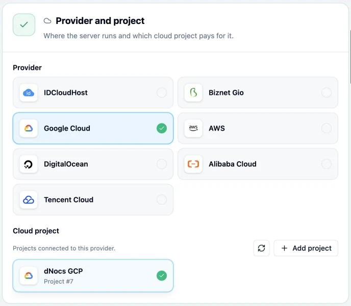
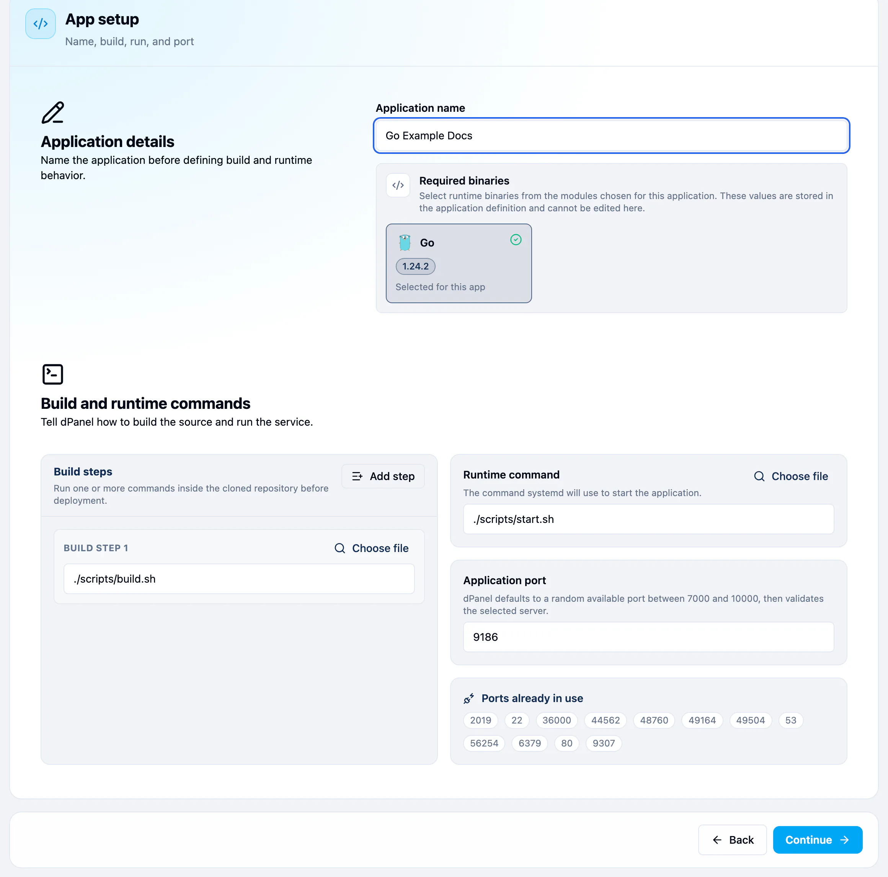

This tutorial takes you from an empty dPanel account to a WordPress site answering on your own domain with HTTPS. You launch an Ubuntu server, install MariaDB, PHP and FrankenPHP on it, create a database for WordPress, deploy the [dPanel-ID/wordpress-example](https://github.com/dPanel-ID/wordpress-example) repository, and put a load balancer in front of it.

It takes about 40 minutes, most of it waiting for the server and the installs. Every step happens in the dPanel web app; you never need SSH.

:::tip[New to servers?]
Read [How a website runs on your server](./how-a-website-runs.md) first. It explains every word this page uses, such as module, build, port and load balancer, in a few minutes. The [Glossary](../getting-started/glossary.md) has the rest.
:::

## What you need first

- A dPanel account, signed in, in the workspace you want to use. See [Sign in](../getting-started/sign-in.md).
- GitHub connected, with access to the repository you deploy. To follow along exactly, fork **dPanel-ID/wordpress-example** into your own account. See [Connect GitHub](../getting-started/connect-github.md).
- An SSH key and a cloud account in dPanel, or a server of your own. See [Before you start](../servers/before-you-start.md).
- A domain in **Domain & DNS**, so dPanel can create the DNS record for you. See [Domains and DNS](../networking/domains-and-dns.md).

## Step 1: Launch a server

1. Open **Servers**, press **Create Server**, then **Launch a server**.
2. Pick your **Provider**, **Cloud project** and **SSH key**.
3. Pick a **Region** near your visitors.
4. Set **Server name**, for example `wordpress-1`, keep **Ubuntu release** 24.04 LTS, and move the sliders to at least **2 vCPU** and **4 GB** RAM. 30 GB of storage is enough.
5. When the Review panel says **Ready to launch**, press **Launch server**.



The server appears in the list. Wait until its status is **Ready**, usually 10 to 20 minutes. The full form is described in [Create a cloud server](../servers/cloud-providers/create-a-cloud-server.md). Already have a machine? [Connect your own server](../servers/connect-your-own-server.md) instead.

**You should see:** the server listed under **Servers** with the status **Ready**.

## Step 2: Install MariaDB, PHP and FrankenPHP

WordPress needs a database (MariaDB), the PHP language, and a web server that runs PHP (FrankenPHP).

1. Open the server and go to **Modules**. Press **Add module**.
2. Press **Install** on **MariaDB**. Set a **Root Password** you will remember, or keep the one suggested, and copy it somewhere safe. Press **Install role** and confirm.
3. Wait until MariaDB shows **Installed**. Then install **PHP** with **PHP Version** `8.5`.
4. When PHP is installed, install **FrankenPHP**.


Install one module at a time and let each finish: dPanel queues installs, and the **Modules** tab shows each one moving from installing to **Installed**. See [Install software](../servers/install-software.md).

**You should see:** MariaDB, PHP and FrankenPHP on the **Modules** tab, each marked **Installed**.

## Step 3: Create the WordPress database

1. On **Modules**, press **Add module**, then **Manage** on **MariaDB**.
2. Under **Databases**, press **Create database**.
3. Enter **Database Name** `wordpress`, **Database User** `wp`, and a **Database Password** of at least 8 characters. Copy the password: you need it in step 4.
4. Press **Install role**.


When it finishes, `wordpress` is listed under **Databases**. The user `wp` can reach only this database, from the server itself, which is how WordPress connects.

**You should see:** `wordpress` listed under **Databases**, and the password saved somewhere safe.

## Step 4: Create and deploy the application

1. Open **Applications** and press **Create Application**.
2. **Repository**: pick your GitHub account, search for `wordpress-example`, select it, keep the **main** branch, and press **Continue**.
3. **Server & modules**: select your server. Under **Installed on selected server**, select **PHP** and **FrankenPHP** so they are reused, not installed again. Press **Continue**.
4. **App setup**:
   - **Application name**: `WordPress` (letters, numbers and spaces only).
   - **Required binaries**: **php 8.5**.
   - **Build steps**: `./scripts/build.sh`.
   - **Runtime command**: `./scripts/start.sh`.
   - **Application port**: keep the free port dPanel suggests.
5. **Environment**: under **Runtime variables**, paste the list below. Replace the password with the one from step 3 and the address with the domain you will publish in step 5.

   ```text
   WORDPRESS_DB_HOST=127.0.0.1:3306
   WORDPRESS_DB_NAME=wordpress
   WORDPRESS_DB_USER=wp
   WORDPRESS_DB_PASSWORD=the-password-from-step-3
   WORDPRESS_TABLE_PREFIX=wp_
   WORDPRESS_HOME=https://blog.example.com
   WORDPRESS_SITEURL=https://blog.example.com
   WORDPRESS_MEMORY_LIMIT=256M
   ```

6. **Preview**: check the summary and press **Deploy application**.



dPanel clones the repository on the server, runs the build and starts WordPress as a service. Open the application to follow the build; it shows **Running** when the release is live, usually in 2 to 5 minutes. See [Create an application](../applications/create-an-application.md) and [Environment variables](../applications/environment-variables.md).

**You should see:** the application marked **Running**. It is not on the internet yet: that is the next step.

## Step 5: Publish it on your domain with HTTPS

1. Open **Load Balancers** and press **Create a load balancer**. The form has four steps: **Gateway**, **Domain**, **Routing** and **Review**.
2. **Gateway**: under **Gateway server**, select the same server. Under **Web server engine**, pick **Caddy Server** and press **Install** if it is not installed yet.
3. **Domain**: under **Domain Name**, choose **Managed**, type the **Subdomain** (for example `blog`), and **Select domain**.
4. **Routing**: keep **L7** under **Routing mode**, and **HTTP / HTTPS** with **HTTPS** on under **Protocol and HTTPS**. In the first rule, set **Type** to **Application**, **Matching Path** to `/*`, and pick the **WordPress** application.
5. **Review**: when the review panel reads **Ready to create**, press **Create load balancer**.


dPanel creates the DNS record, configures the gateway and requests a free Let's Encrypt certificate. After a minute or two, open `https://blog.example.com/wp-admin/install.php`: the WordPress installer appears. Choose the language, the site title and your admin account, and your site is live. See [Load balancers](../networking/load-balancers.md).

## When something does not work

| What you see                               | What to check                                                                                                                                                                  |
| ------------------------------------------ | ------------------------------------------------------------------------------------------------------------------------------------------------------------------------------ |
| A module stays in installing, or fails     | Open the server's **Logs**, or ask the assistant why the job failed. Install the module again after fixing the cause.                                                          |
| The build fails                            | Open the application and read the build log of the failed release. See [Application logs](../applications/application-logs.md).                                                |
| "Error establishing a database connection" | The four `WORDPRESS_DB_*` variables must match the database from step 3. Fix them under the application's settings, then deploy again: a change applies from the next release. |
| The domain does not answer                 | Wait a few minutes for DNS and the certificate. Check the load balancer's detail page and its logs. A red **Load balancer change failed** banner has **See why it failed**.    |
| Anything else                              | See [Common problems and fixes](../troubleshooting/faq.md).                                                                                                                    |

## Prefer to chat? Do the same with Ask dPanel

[Ask dPanel](../ai/overview.md), the assistant at the bottom right of every page, can prepare each step above for you to approve, for example:

> On server wordpress-1, create a MariaDB database named wordpress with a user named wp.

It generates the database password and shows it once, on the approval card. When it creates the application, it asks for `WORDPRESS_DB_PASSWORD` as a field on the approval card, so the password never goes into the chat. More ready-made requests are in the [Prompt cookbook](../ai/prompt-cookbook.md).

## Clean up

To remove the demo, delete in this order: the load balancer, the application, then the server. See [Load balancers](../networking/load-balancers.md#delete-a-load-balancer), [Update or delete an application](../applications/update-or-delete.md) and [Delete a server](../servers/delete-a-server.md). Deleting a cloud server also stops its cost at your provider.

## Frequently asked questions

### Can I use my own WordPress repository instead of the example?

Yes, if it has a build script and a start script that serve WordPress on the port dPanel gives it. The example's `scripts/` folder shows what dPanel needs.

### Do I need a domain to try this?

You need one for step 5, where the load balancer publishes the site with HTTPS. Steps 1 to 4 work without one.

### Why install one module at a time?

dPanel queues installs on a server and runs them one after another. Waiting for each to show **Installed** makes it easy to see which one failed, if any.
