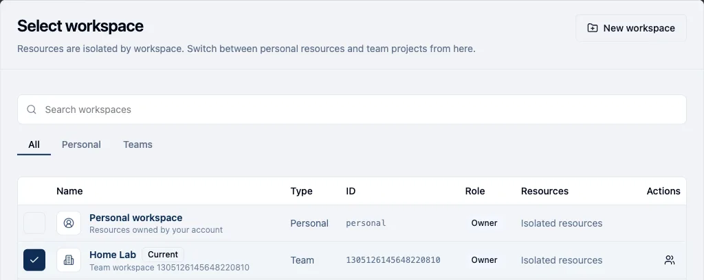
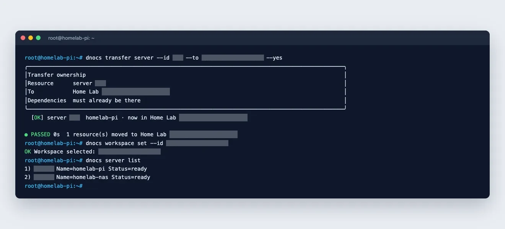
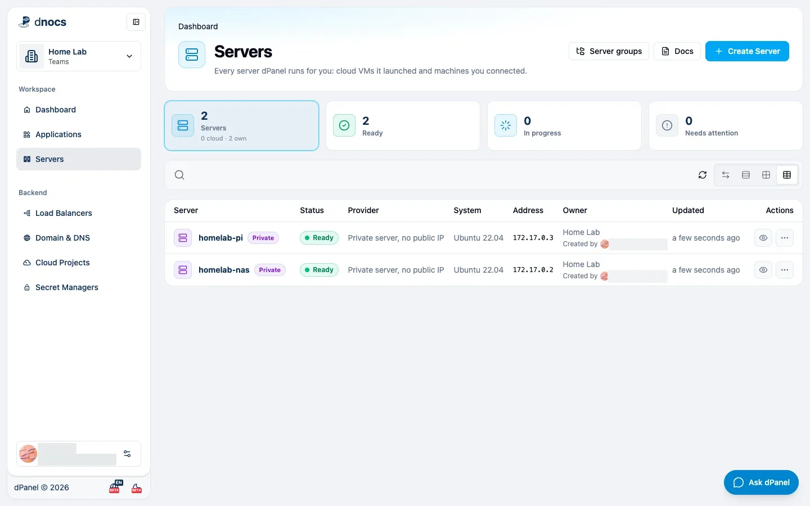
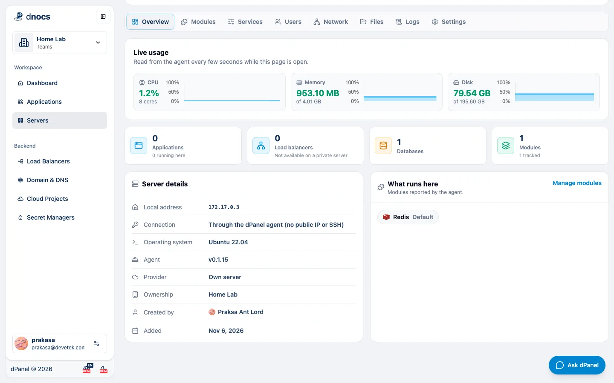
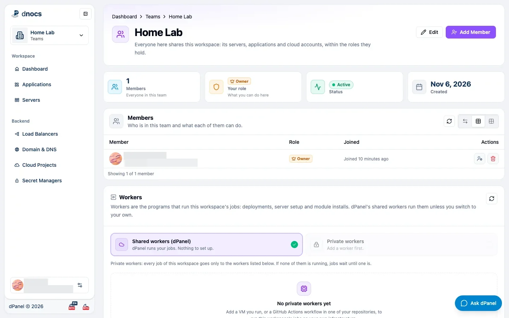
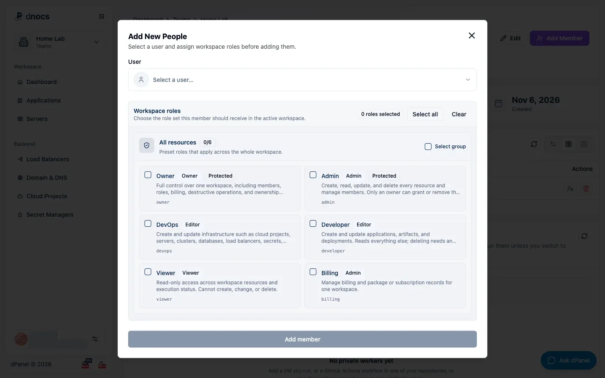

Homelab machines join dPanel with the dPanel agent: you run one command on each machine, and the agent connects out to dPanel. You don't need SSH, a public IP or port forwarding on your router. Never connected a machine before? Follow [Connect a server with the dPanel agent](../servers/register-a-private-machine.md) first; it explains every step for a single machine.

A machine you connect lands in the workspace you picked: the one selected in dPanel when you choose **Get install command**, or the one your dnocs is pointed at when you use `sudo dnocs machine register`. If that is your personal space, only you can see it. This tutorial puts homelab machines in a **team workspace** instead, so the whole team shares them: each member opens the same servers, installs software and deploys apps, within the role you give them.

We use a workspace called **Home Lab** with two machines:

- `homelab-nas`, connected straight into the workspace (Part 2).
- `homelab-pi`, which was already connected in a personal space and is moved into the workspace (Part 3).

Both have no public IP and no open port. They reach dPanel through the agent, as explained in [Connect a server with the dPanel agent](../servers/register-a-private-machine.md).

## What you need first

- A team workspace, and a role that can add servers to it: Owner, Admin or DevOps. Create one from the workspace picker with **New workspace** (see [Workspaces](../getting-started/workspaces.md)).
- The workspace ID. You find it in the workspace picker, or with `dnocs workspace list`.
- On each machine: Linux with systemd on Intel/AMD (`amd64`) or ARM (`arm64`), `sudo` and internet access. dnocs is needed only for the command line way and for moving a machine (Part 3): [Install dnocs](../ai/ai-in-the-terminal.md#install-dnocs).

## Part 1: Pick the team workspace

In dPanel, open the workspace picker at the top left. Personal resources and team workspaces are kept apart; the ID column shows each workspace's ID.



## Part 2: Connect a machine straight into the workspace

From the website:

1. Switch dPanel to the **Home Lab** workspace in the workspace picker.
2. Open **Servers**, then **Create Server**.
3. On the **Connect a server with the dPanel agent** card, type `homelab-nas` as the server name and choose **Get install command**.
4. Choose **Copy**, then paste the command into a terminal on the machine and run it. It asks for `sudo`.
5. The card says **Connected!** once the agent connects, usually in under a minute. The server is created in the Home Lab workspace.

The command works once, for 2 hours; get a new one for each machine. The machine needs no dnocs and no sign-in.

**Prefer the command line?** On the machine, sign in as your normal user, point dnocs at the team workspace, then connect it:

```bash
dnocs auth login -u <your username>
dnocs workspace set --id <workspace id>
sudo dnocs machine register
```

dnocs names the workspace in its question, so you can check you picked the right one before you confirm. It then creates a Linux user for your dPanel account, installs the agent and waits until the server is ready, usually in under a minute. The server is created in that workspace. To read the install script before running it, use `sudo dnocs machine register --print-only`.


## Part 3: Move a machine from your personal space

A machine you connected earlier in your personal space can move to the team with `dnocs transfer`. It keeps its server ID, its agent, its installed software and its apps:

```bash
dnocs transfer server --id <server id> --to "<workspace name or id>"
```

dnocs shows what moves and asks you to confirm (`--yes` skips the question). A move is one way: once a server is in a workspace, it cannot go back to a personal space or on to another workspace.



Running `sudo dnocs machine register` again on a moved machine works only from the workspace it now belongs to; from your personal space dnocs refuses, so a machine cannot be pulled out of the team by accident.

## Part 4: Check the servers in the workspace

Switch dPanel to the team workspace and open **Servers**. Both machines are there with a **Private** badge, owned by the workspace, with who added them.



Each server page shows the workspace as its **Ownership**. Everything from the [dPanel agent guide](../servers/register-a-private-machine.md) works the same here: modules, apps, the terminal, files, logs, the database manager and load balancers. Jobs for these servers still run on the machines themselves, whatever workers the workspace uses.



## Part 5: Invite your team

Open **Teams**, then the workspace, to see its members and the workspace's workers.



Choose **Add Member**, pick the person and the roles they get. The role decides what they can do with the homelab:



| Role | With the homelab servers |
| --- | --- |
| Owner, Admin | Everything, including adding and removing servers and members |
| DevOps | Add and manage servers, install modules, open the terminal and databases; cannot delete |
| Developer | Deploy and manage applications on the servers; sees the servers but cannot change them or open their terminal; cannot delete |
| Viewer | Look only: servers, usage, logs and jobs |

See [Members and roles](../teams/members-and-roles.md) for every role in detail.

## Good to know

- A workspace can connect up to 10 machines this way (cloud servers dPanel creates don't count), and a machine belongs to one workspace at a time.
- To publish a website from a homelab machine, add a load balancer and forward ports 80 and 443 on your router to the machine. See [Put a load balancer on it](../servers/register-a-private-machine.md#put-a-load-balancer-on-it).
- Removing a person from the workspace takes their access to its servers away at once; the machines keep running.
- Deleting a server in dPanel removes it at once and revokes its agent. Stop the agent on the machine afterwards with `sudo systemctl disable --now dpanel-agent`.
