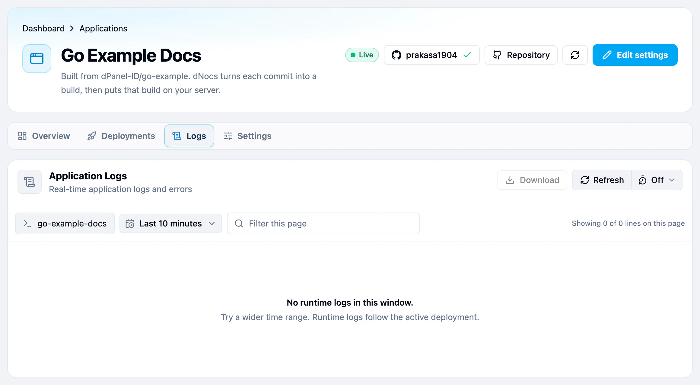
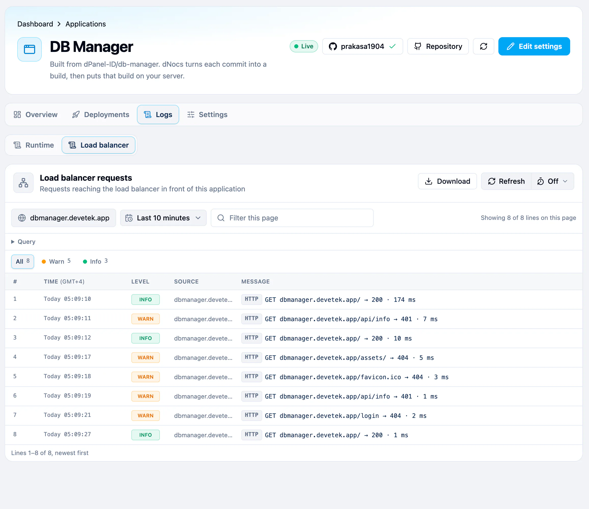

Buka aplikasinya dan masuk ke **Log**, atau tekan **Lihat log** di tab Ringkasan.

## Dua sumber log

| Sumber        | Isinya                                                                                                        |
| ------------- | ------------------------------------------------------------------------------------------------------------- |
| Runtime       | Apa yang ditulis layanan ke keluarannya selama berjalan. Judul tabelnya **Log Aplikasi**.                     |
| Load balancer | Setiap permintaan yang masuk ke load balancer di depan aplikasi. Judul tabelnya **Permintaan load balancer**. |

Pilihan **Load balancer** hanya muncul jika aplikasi ini dilayani load balancer. Tanpa itu, tab langsung menampilkan log runtime.

Log runtime mengikuti rilis yang aktif. Jika aplikasi belum punya perintah run atau server, tab ini memberi tahu bahwa belum ada log runtime.

## Menemukan yang Anda cari

1. Pilih **Rentang waktu**. Tab terbuka pada **10 menit terakhir**; Anda bisa mundur hingga 10 hari.
2. Ketik di **Saring halaman ini** untuk menyisakan baris yang memuat teks Anda.
3. Pilih chip level, misalnya **error**, untuk menyisakan level itu saja.
4. Pilih satu baris untuk membukanya lengkap di panel **Entri log**.

Kontrolnya sama di semua tampilan log. Lihat [Rentang waktu dan pembaruan](../logs/time-range-and-refresh.md) dan [Mengunduh log](../logs/download-logs.md).

## Log build ada di tempat lain

Keluaran build, misalnya kompilasi yang gagal, tidak ada di tab ini. Buka **Rilis**, cari build-nya, lalu tekan **Log**. Lihat [Rilis dan rollback](./deployments-and-rollback.md#membaca-log-build).

:::tip[Tidak ada apa-apa?]
**Tidak ada log runtime pada rentang ini.** berarti tidak ada yang dicetak pada periode itu. Coba rentang waktu yang lebih lebar dulu. Jika tetap kosong, pastikan layanannya berjalan di tab **Rilis**, bagian **Di server**.
:::
