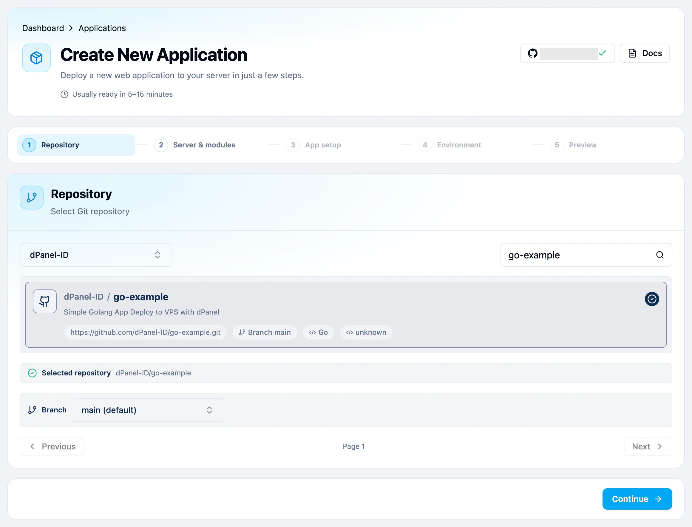
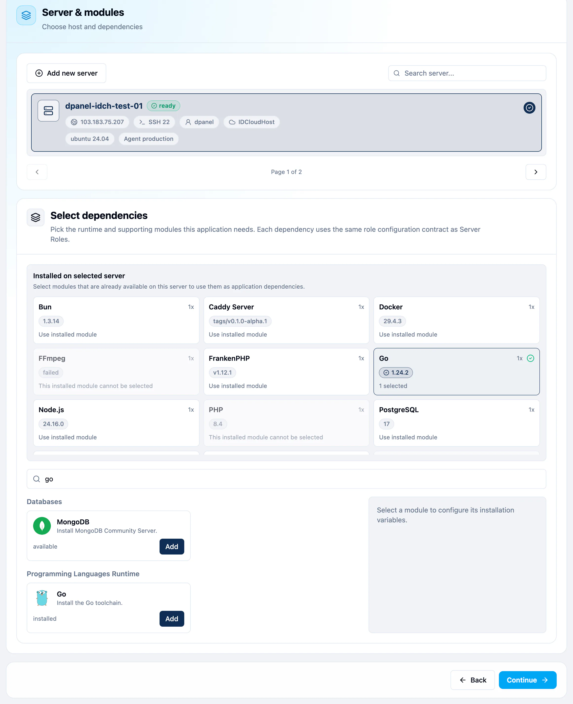
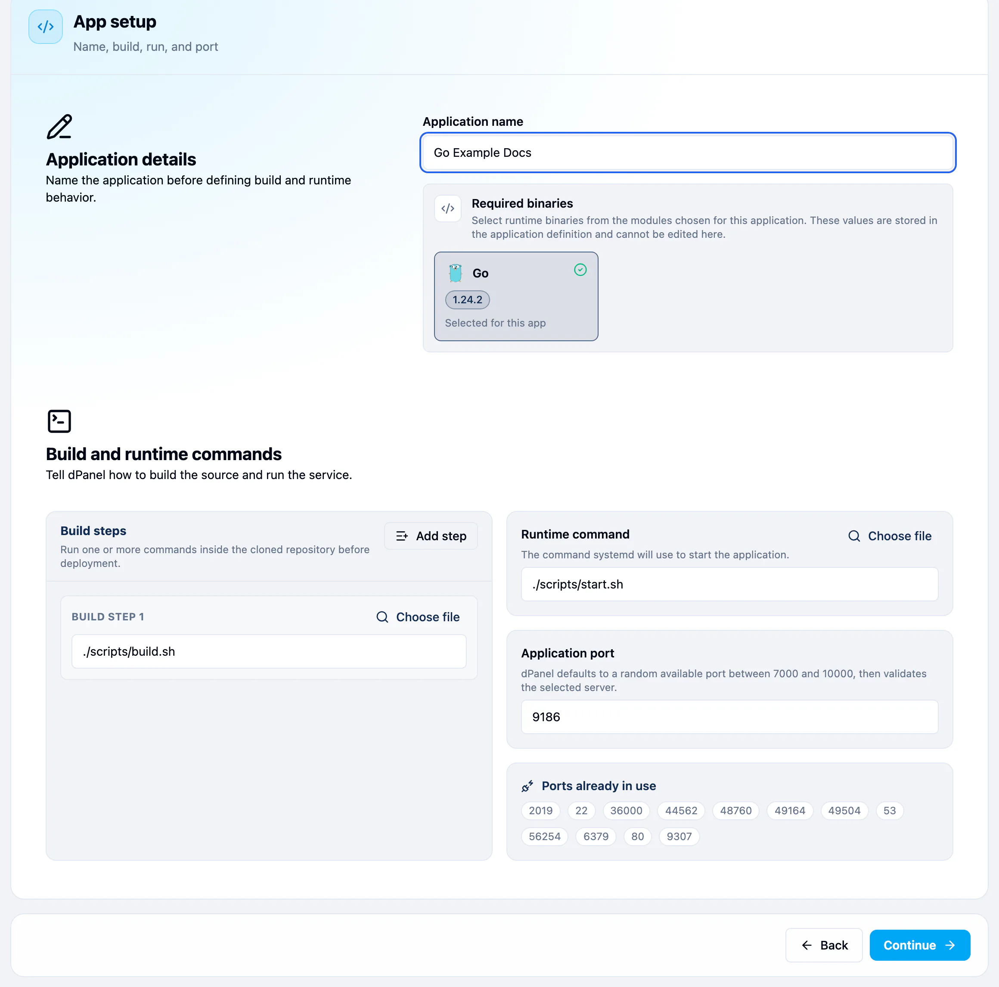
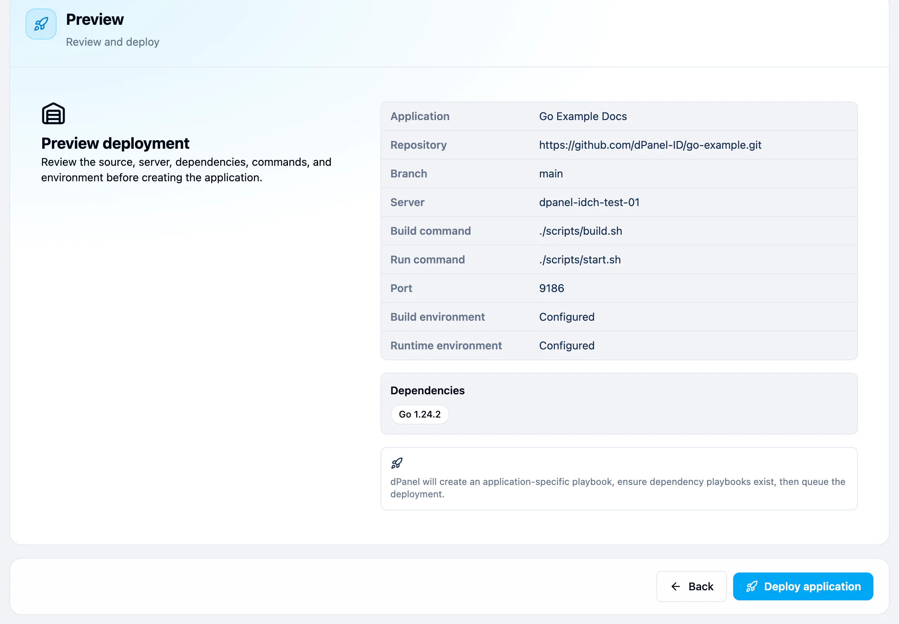

Untuk men-deploy aplikasi dari GitHub dengan dPanel, Anda mengisi formulir lima langkah: repositori dan branch, server dan runtime, perintah build dan perintah jalan, environment, lalu pratinjau akhir. Setelah itu dPanel meng-clone, membangun, dan menjalankan kode Anda sebagai layanan systemd di server Anda.

Panduan ini merilis [dPanel-ID/go-example](https://github.com/dPanel-ID/go-example), layanan web Go yang kecil. Repositori lain caranya sama. Prosesnya sekitar 5 sampai 15 menit, sebagian besar untuk build pertama.

## Yang perlu disiapkan

- Server berstatus **Ready** di workspace ini.
- GitHub sudah terhubung. Tombol GitHub di atas halaman menampilkan login Anda dengan tanda centang.
- Perintah untuk membangun dan menjalankan kode Anda. Untuk go-example, perintahnya `./scripts/build.sh` dan `./scripts/start.sh`.

Buka **Aplikasi**, lalu tekan **Buat Aplikasi**. Formulirnya punya lima langkah. Penanda langkah di atas mencentang langkah yang sudah selesai, dan bilah di bawah memberi tahu apa yang masih kurang sebelum tombol **Lanjut** aktif.

## Langkah 1: Repositori

1. Buka **Tim GitHub** dan pilih akun atau organisasi pemilik repositori. **Tambah akun GitHub** di ujung daftar menghubungkan akun lain.
2. Ketik di **Cari repositori**, lalu tekan Enter.
3. Pilih repositorinya. dPanel membaca detailnya dan menampilkannya di **Repositori terpilih**.
4. Periksa **Branch**. Isinya otomatis branch default repositori.
5. Tekan **Lanjut**.

## Langkah 2: Server & modul

1. Di **Pilih Server**, pilih server yang akan menjalankan aplikasi. Hanya server berstatus **Ready** yang ditampilkan; pakai **Cari server...** jika server Anda banyak. Jika belum ada yang siap, daftarnya bertuliskan **Tidak ada server yang siap**: tambahkan server, atau tunggu sampai salah satunya selesai disiapkan.
2. Di **Pilih dependency**, tambahkan apa yang dibutuhkan aplikasi untuk dibangun dan dijalankan. Ketik di **Cari modul**, lalu tekan **Tambah** pada modulnya. Untuk go-example, modulnya **Go**.
3. Opsi modul terbuka di samping daftar. Kolom wajib diberi tanda. Periksa, lalu tekan **Simpan opsi**.
4. Tekan **Lanjut**.

Jika modul sudah terpasang di server, modul itu muncul di **Terinstal di server terpilih**. Pilih dari sana agar dipakai ulang, bukan dipasang lagi.

## Langkah 3: Setup aplikasi

1. **Nama aplikasi**: nama yang tampil di dPanel. Gunakan huruf, angka, dan spasi saja.
2. **Binary yang dibutuhkan**: runtime bahasa dari modul yang Anda pilih. Sudah terpilih otomatis.
3. **Langkah build**: satu atau beberapa perintah yang dijalankan di dalam repositori hasil clone. **Pilih file** memilih skrip dari repositori; **Tambah langkah** menambah perintah lain.
4. **Perintah runtime**: perintah yang dipakai systemd untuk menjalankan aplikasi.
5. **Port aplikasi**: dPanel menyarankan port kosong antara 7000 dan 10000. **Port yang sudah digunakan** menampilkan port yang tidak bisa dipakai.
6. Tekan **Lanjut**.

:::warning[Huruf, angka, dan spasi]
dPanel menolak nama yang memakai tanda hubung atau simbol lain, seperti `go-example`. Kolomnya menjadi merah dan menjelaskan alasannya, dan alur belum dianggap lengkap sampai nama diperbaiki. Pakai nama seperti `Go Example`.
:::

:::tip
Formulir sudah terisi `./scripts/build.sh` sebagai langkah build dan `./scripts/start.sh` sebagai perintah runtime. Ganti jika repositori Anda memakai perintah lain.
:::

## Langkah 4: Environment

Tambahkan variabel yang dibutuhkan build atau layanan, satu pasangan `KEY=value` per baris. **Variabel build-time** hanya dipakai saat build; **Variabel runtime** diberikan ke layanan yang berjalan. Keduanya boleh kosong. Lihat [Variabel environment](./environment-variables.md).

## Langkah 5: Pratinjau

Periksa ringkasannya: aplikasi, repositori, branch, server, perintah, port, dan apakah tiap environment sudah **Diatur**. Tekan **Rilis aplikasi**.

## Setelah itu

Muncul dialog **Successfully created your app!**. Tekan **OK** untuk kembali ke daftar. Lalu dPanel:

1. Membuat playbook untuk aplikasi ini dan memasang modul yang Anda pilih.
2. Meng-clone branch di server dan menjalankan langkah build.
3. Memasang hasilnya dan menjalankannya sebagai layanan.

Aplikasi berstatus **Sedang dibangun** sampai rilis selesai, lalu **Berjalan**. Buka aplikasinya untuk mengikuti build, dan baca [Rilis dan rollback](./deployments-and-rollback.md).

:::note[Beri alamat publik]
Aplikasi baru mendengarkan di port-nya di server. Untuk menyajikannya di domain dengan HTTPS, pasang load balancer di depannya. Lihat [Load balancer](../networking/load-balancers.md).
:::

## Pertanyaan yang sering diajukan

### Bahasa dan framework apa saja yang bisa saya deploy?

Apa saja yang berjalan di Ubuntu. Anda memilih runtime, misalnya Go, sebagai modul di langkah 2, lalu memberikan perintah untuk membangun dan menjalankan kode Anda di langkah 3. dPanel menjalankannya persis seperti yang Anda tulis.

### Mengapa formulir menolak nama aplikasi saya?

Nama hanya boleh berisi huruf, angka, dan spasi. `my-app` atau `my_app` ditolak; pakai `My App` sebagai gantinya.

### Mengapa server saya tidak ada di daftar?

Hanya server berstatus **Ready** yang bisa menjalankan aplikasi. Server yang masih disiapkan, gagal disiapkan, atau sudah dihapus tidak ditampilkan. Lihat [Halaman server Anda](../servers/your-server-page.md).

### Bisakah saya men-deploy dari organisasi GitHub?

Bisa. Pasang GitHub App dnocs-id di organisasi itu lewat **Tambah akun GitHub**, lalu organisasinya muncul di **Tim GitHub**. Lihat [Menghubungkan GitHub](../getting-started/connect-github.md#menambahkan-organisasi-github).

### Bagaimana cara memberi aplikasi domain dengan HTTPS?

Buat [load balancer](../networking/load-balancers.md) yang merutekan domain Anda ke aplikasi itu. dPanel menambahkan record DNS dan sertifikat Let's Encrypt-nya.
