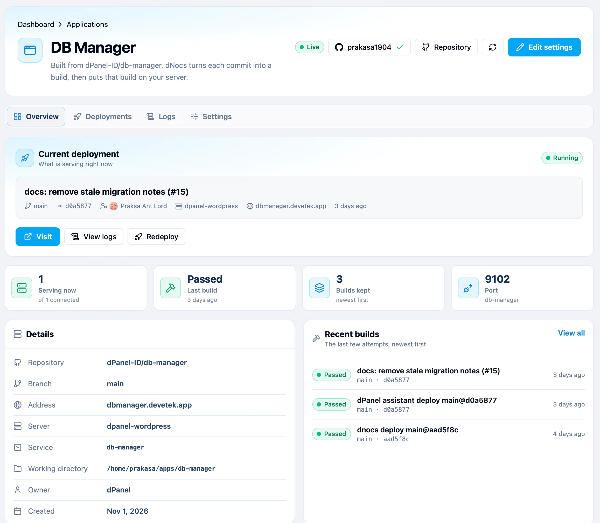
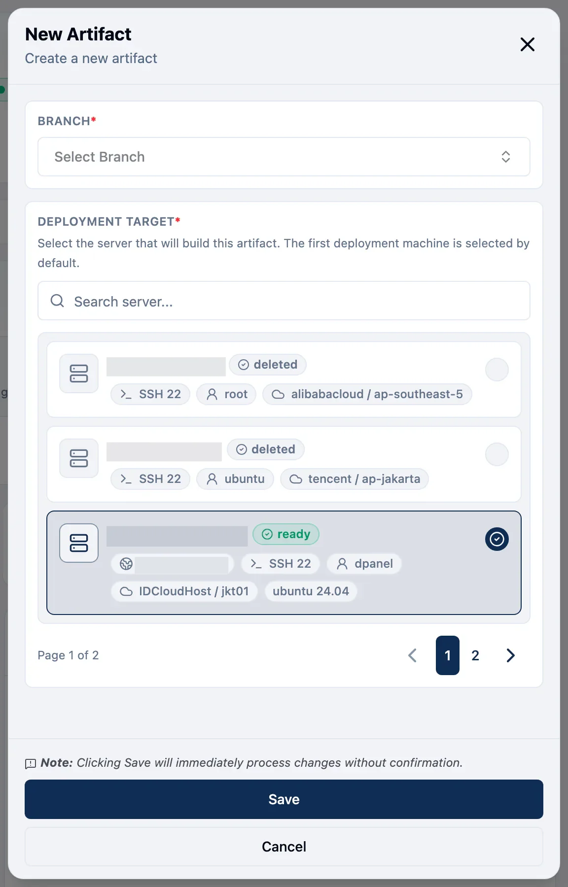
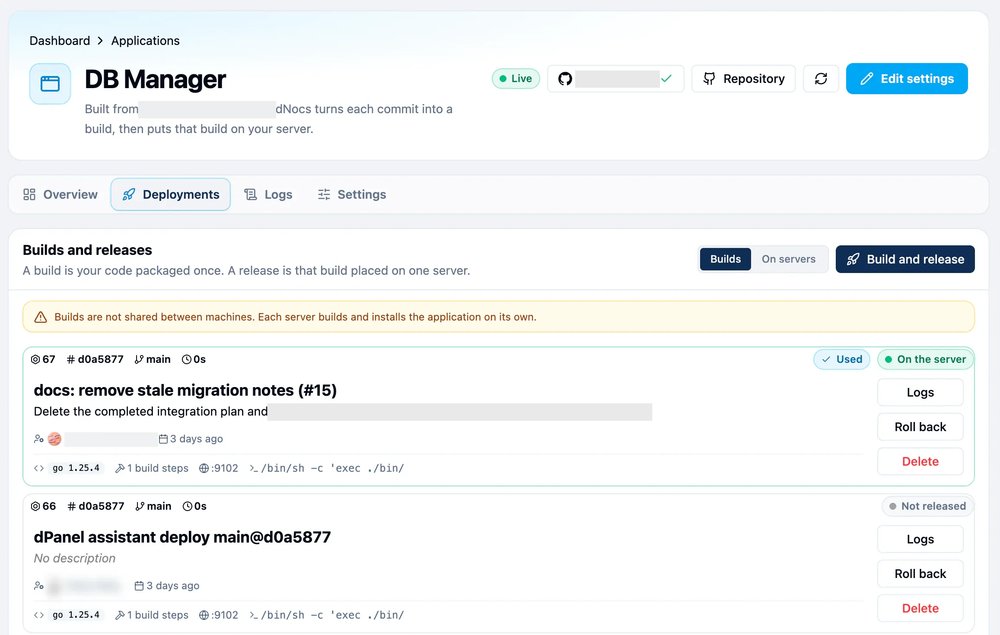
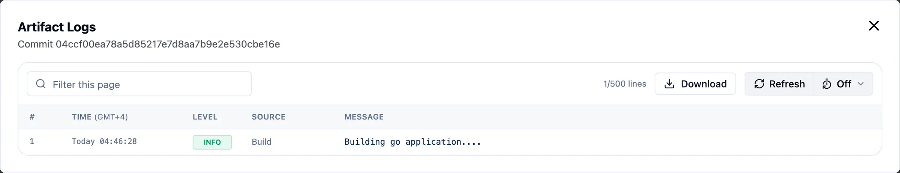

Di dPanel, setiap push yang ingin Anda kirim menjadi sebuah build, dan setiap build disimpan, jadi Anda bisa merilis commit terbaru atau rollback ke build sebelumnya dalam satu langkah. Ada dua istilah penting. **Build** adalah kode Anda yang dikemas sekali, dari satu commit. **Rilis** adalah build itu yang dipasang di satu server.

## Apa yang sedang berjalan

Buka aplikasinya. Tab **Ringkasan** diawali **Rilis yang aktif**: commit, branch, dan server yang sedang melayani, beserta status rilisnya.

| Tombol      | Fungsinya                                       |
| ----------- | ----------------------------------------------- |
| Kunjungi    | Membuka alamat publik aplikasi, jika sudah ada. |
| Lihat log   | Membuka tab **Log**.                            |
| Rilis ulang | Membangun dan merilis lagi.                     |

Di bawahnya, **Sedang melayani**, **Build terakhir**, **Build tersimpan**, dan **Port** merangkum kondisi aplikasi, dan **Build terbaru** menampilkan beberapa percobaan terakhir.

## Membangun dan merilis versi baru

Lakukan ini setelah Anda push commit, atau setelah mengubah pengaturan.

1. Tekan **Rilis ulang** di tab Ringkasan, atau **Bangun dan rilis** di tab Rilis.
2. Di panel **Buat Artefak**, pilih **Branch**. dPanel membangun commit terbarunya.
3. Di **Target deployment**, periksa servernya. Server pertama sudah terpilih.
4. Tekan **Simpan**.

Build baru muncul di urutan teratas dengan status **Membangun**, lalu **Berhasil** atau **Gagal**. Build yang berhasil dirilis ke server, dan status rilisnya menjadi **Sudah di server**.

## Tab Rilis

**Build dan rilis** punya dua tampilan.

- **Build**: semua build, terbaru lebih dulu, dengan ID build, commit, branch, dan lama build-nya. Build yang sudah dirilis ke server diberi lencana **Digunakan**, dan build yang sedang dirilis diberi lencana **Dalam Proses**.
- **Di server**: setiap server tempat aplikasi dirilis, beserta status layanannya.

Pindah tampilan dengan tombol **Build** dan **Di server** di samping **Bangun dan rilis**.

### Membaca log build

Tekan **Log** pada sebuah build. **Log Artefak** terbuka dengan keluaran build itu: clone, setiap langkah build, dan saat layanan dijalankan. Lihat [Membaca log](../logs/reading-logs.md#log-build).

### Rollback

1. Cari build yang ingin Anda pakai lagi, lalu tekan **Kembalikan**.
2. Di jendela **Rollback Deployment**, centang server yang ingin dikembalikan.
3. Tekan **Rollback**.

dPanel merilis ulang build itu di server-server tersebut. Tidak ada yang dibangun ulang.

### Mengelola rilis di server

Di **Di server**, setiap rilis punya tombol **Mulai**, **Restart**, dan **Hentikan** untuk layanannya, serta **Hapus**. Rilis yang sudah dihapus bisa dikembalikan dengan **Pulihkan**, atau dihapus selamanya dengan **Hapus permanen**.

### Menghapus build

Tekan **Hapus** pada sebuah build untuk mengeluarkannya dari daftar. dPanel meminta konfirmasi lebih dulu.

## Status

| Build      | Rilis           | Artinya                                 |
| ---------- | --------------- | --------------------------------------- |
| Membangun  | Merilis         | Sedang dikerjakan.                      |
| Berhasil   | Sudah di server | Sudah dibangun dan berjalan.            |
| Gagal      | Gagal           | Ada yang menghentikannya. Baca log-nya. |
| Dibatalkan | Dibatalkan      | Dihentikan sebelum selesai.             |

Jika build gagal, mulailah dari **Log**-nya. Baris-baris terakhir biasanya menyebut langkah dan galatnya. Lihat juga [Pemecahan masalah](../troubleshooting/faq.md).
