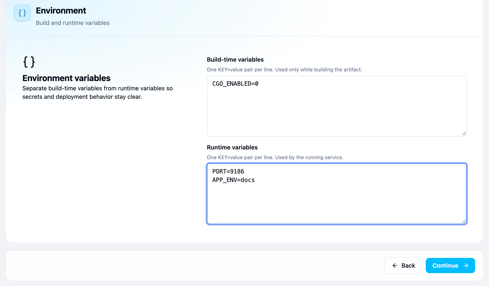

dPanel meneruskan variabel environment ke aplikasi Anda dari dua daftar terpisah, jadi pengaturan yang hanya dibutuhkan build tidak pernah sampai ke layanan yang berjalan, dan rahasia seperti API key tidak perlu ada di repositori Git Anda.

**Variabel environment** adalah pengaturan bernama, misalnya `PORT=9307`, yang dibaca program Anda saat mulai berjalan, sehingga nilainya tidak perlu ditulis di dalam kode. Lihat [Glosarium](../getting-started/glossary.md).

| Daftar              | Dipakai                             | Contoh isi                             |
| ------------------- | ----------------------------------- | -------------------------------------- |
| Variabel build-time | Hanya selama langkah build berjalan | `CGO_ENABLED=0`, `NODE_ENV=production` |
| Variabel runtime    | Oleh layanan yang berjalan          | Port, alamat database, API key         |

## Mengisinya saat membuat aplikasi

Di langkah 4, **Environment**, ketik satu pasangan `KEY=value` per baris di **Variabel build-time** atau **Variabel runtime**.



```bash
PORT=9307
APP_ENV=production
```

:::tip[Samakan port-nya]
Jika kode Anda membaca port dari variabel, seperti go-example membaca `PORT`, isi dengan nilai yang sama dengan **Port aplikasi** di langkah 3. Kalau tidak, dPanel dan layanan Anda akan mengharapkan port yang berbeda.
:::

## Mengubahnya nanti

1. Buka aplikasinya, lalu masuk ke **Pengaturan**.
2. Di bagian **Build** atau **Jalan**, cari **Variabel lingkungan** dan tekan **Ubah**.
3. Tambah, ubah, atau hapus variabel, lalu tekan **Simpan**. Nilai yang tidak Anda sentuh tetap memakai nilai tersimpan, meskipun sedang disembunyikan.
4. Rilis lagi dengan **Bangun dan rilis** atau **Rilis ulang**, agar layanan berjalan dengan nilai yang baru. Lihat [Rilis dan rollback](./deployments-and-rollback.md).

Kedua daftar juga bisa diubah lewat **Ubah pengaturan**, yaitu formulir lengkapnya. Lihat [Mengubah atau menghapus aplikasi](./update-or-delete.md).

Anda juga bisa meminta **Ask dPanel** mengerjakannya untuk Anda; lihat [Kumpulan prompt](../ai/prompt-cookbook.md). Nilai rahasia tidak pernah diketik di chat: kartu persetujuan yang memintanya, dan asisten hanya melihat namanya.

:::note[Restart saja tidak cukup]
**Restart** pada sebuah rilis menjalankan ulang layanan dengan nilai yang sudah ada di server. Hanya rilis (**Bangun dan rilis**, **Rilis ulang**, atau rollback) yang menulis nilai baru ke server.
:::

## Melihat nilai yang tersimpan

dPanel menyembunyikan setiap nilai setelah disimpan: aplikasi web dan API menampilkan `••••••••` sebagai gantinya, dan `dnocs` hanya menampilkan namanya. Kalau Anda perlu melihat nilainya lagi, Anda bisa menampilkannya atas permintaan.

1. Buka **Pengaturan**, lalu tekan **Ubah** di samping **Variabel lingkungan** pada bagian **Jalan**. Panelnya bertuliskan **Values are hidden. Unchanged ones keep their stored value.**
2. Tekan **Show values**. Nilai aslinya mengisi kolom yang disembunyikan; apa pun yang sudah Anda ketik tetap seperti adanya.
3. Setelah selesai, tekan **Hide values**, terutama sebelum Anda membagikan layar.

Nilai build-time ditampilkan dengan cara yang sama di **Ubah pengaturan**, pada langkah **Environment**, lewat tombol **Tampilkan nilai** dan **Sembunyikan nilai**.

Hanya orang yang boleh mengubah aplikasi yang bisa menampilkan nilai; orang yang hanya bisa melihat aplikasi tidak bisa. Setiap kali nilai ditampilkan, dPanel mencatat siapa yang melakukannya dan untuk aplikasi mana, tanpa pernah mencatat nilainya.

## Dari terminal

[dnocs CLI](../ai/ai-in-the-terminal.md) bekerja pada variabel runtime:

```bash
dnocs application env list --id 76                 # hanya nama
dnocs application env list --id 76 --show-values   # nama dan nilai
dnocs application env set --id 76 APP_ENV=production LOG_LEVEL=warning
printf %s "$TOKEN" | dnocs application env set --id 76 API_TOKEN --value-stdin
dnocs application env unset --id 76 APP_DEBUG
```

`set` dan `unset` hanya mengubah variabel yang Anda sebut. `--value-stdin` membaca rahasia dari standard input, sehingga tidak tersimpan di riwayat shell. Perubahan sampai ke server pada rilis berikutnya, misalnya `dnocs application deploy --id 76 --server-id <ID server>`.

## Lokasi nilai di server

Untuk para ahli, inilah yang dilakukan dPanel dengan nilai-nilai itu di server Anda:

| Variabel | Di server                                                                                                                                                                                                                 |
| -------- | ------------------------------------------------------------------------------------------------------------------------------------------------------------------------------------------------------------------------- |
| Runtime  | Ditulis ke `/etc/dpanel/apps/<nama layanan>.env`, milik root dengan mode `0600` (direktori `0700`). Unit systemd aplikasi hanya merujuk ke file ini. Menghapus rilis juga menghapus file ini.                             |
| Build    | Ditulis ke file yang hanya bisa dibaca pengguna build (mode `0600`), dibaca setiap langkah build, lalu dihapus setelah build selesai, bahkan jika ada langkah yang gagal. Nilainya tidak pernah muncul di baris perintah. |

Log build hanya mencantumkan nama variabel, tidak pernah nilainya. Nilai sampai ke program Anda persis seperti yang Anda ketik, termasuk spasi, tanda kutip, `$`, dan `%`.

Aplikasi yang dibuat sebelum tata letak ini pindah ke sana pada rilis berikutnya.

## Menjaga rahasia tetap aman

- Nilai disembunyikan di mana pun sampai orang yang boleh mengubah aplikasi meminta untuk menampilkannya.
- Simpan rahasia di **Variabel runtime**, kecuali build benar-benar membutuhkannya.
- Jangan commit rahasia ke repositori. dPanel yang meneruskan variabel ini untuk Anda.
- Password modul yang dipasang bersama aplikasi, misalnya password administrator database, tidak ikut disimpan di file pengaturan yang disimpan dPanel untuk workspace Anda.

## Pertanyaan yang sering diajukan

### Apakah saya perlu merilis ulang setelah mengubah variabel?

Ya. Layanan yang berjalan tetap memakai nilai saat ia dimulai, dan **Restart** tidak mengubahnya. Rilis lagi dengan **Bangun dan rilis** atau **Rilis ulang** agar layanan mulai dengan nilai baru.

### Bisakah saya melihat rahasia setelah disimpan?

Bisa, jika Anda boleh mengubah aplikasinya. Tekan **Show values** di panel **Jalan**, atau **Tampilkan nilai** di **Ubah pengaturan** untuk nilai build-time, atau jalankan `dnocs application env list --id <ID aplikasi> --show-values`. Setiap kali dicatat. Lihat [Melihat nilai yang tersimpan](#melihat-nilai-yang-tersimpan).

### Password database sebaiknya variabel build-time atau runtime?

Runtime. Hanya layanan yang berjalan yang terhubung ke database, jadi build tidak membutuhkannya. Pengecualiannya adalah build yang menjalankan migrasi database, seperti build Laravel: build itu juga membutuhkannya.

### Bolehkah saya menaruh variabel di file .env di repositori?

Boleh, tetapi apa pun yang di-commit ke Git bisa bocor. Simpan rahasia di **Variabel runtime** dPanel saja.

### Bisakah pengguna lain di server membaca variabel saya?

Tidak. File runtime hanya bisa dibaca root, dan nilai build berada di file yang hanya bisa dibaca pengguna build, lalu dihapus setelah build selesai.
