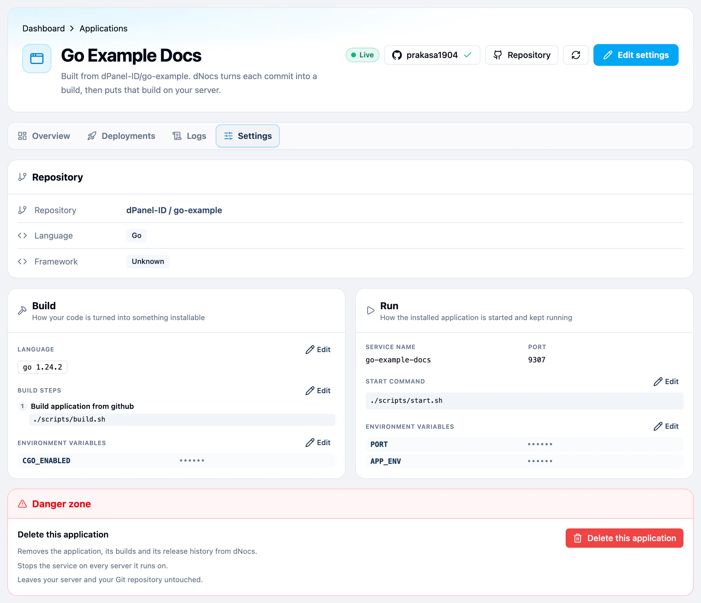

## Meninjau pengaturannya

Buka aplikasinya dan masuk ke **Pengaturan**. **Cara aplikasi ini disiapkan** menampilkan tiga bagian.

| Bagian     | Isinya                                                                     |
| ---------- | -------------------------------------------------------------------------- |
| Repositori | Repositori, bahasa, dan framework-nya.                                     |
| Build      | Runtime bahasa, langkah build, dan variabel environment saat build.        |
| Jalan      | Nama layanan, port, perintah jalan, dan variabel environment saat runtime. |

## Perubahan cepat

Setiap item yang punya tombol **Ubah** membuka panel khusus untuk bagian itu saja.

| Ubah di samping                             | Panel yang terbuka         | Yang bisa diubah                       |
| ------------------------------------------- | -------------------------- | -------------------------------------- |
| Bahasa                                      | Edit Setup Configuration   | Bahasa dan versinya.                   |
| Langkah build, Variabel lingkungan (Build)  | Edit Build Configuration   | Langkah build dan variabel build-time. |
| Perintah jalan, Variabel lingkungan (Jalan) | Edit Runtime Configuration | Perintah jalan dan variabel runtime.   |

Tekan **Simpan** di panel. Perubahan berlaku mulai rilis berikutnya, jadi rilis lagi dengan **Bangun dan rilis** atau **Rilis ulang**.

## Mengubah semuanya sekaligus

**Ubah pengaturan** di bagian atas aplikasi membuka **Update Aplikasi**. Isinya formulir lima langkah yang sama dengan saat membuat aplikasi, sudah terisi nilai saat ini: server dan modul, nama, perintah, port, dan environment.

1. Tekan **Ubah pengaturan**.
2. Telusuri langkah-langkahnya dan ubah yang perlu.
3. Di **Pratinjau**, centang **Jalankan playbook bootstrap** jika Anda mengubah modul atau dependency server perlu dipasang ulang.
4. Tekan **Simpan perubahan**.

dPanel memperbarui definisi aplikasi dan mengirim input playbook untuknya.

## Menghapus aplikasi

**Zona berbahaya** ada di bagian bawah **Pengaturan**.

1. Tekan **Hapus aplikasi ini**.
2. Konfirmasi di dialog **Delete Application**.

:::danger[Tidak bisa dibatalkan]
Menghapus aplikasi akan menghapus aplikasi, build, dan riwayat rilisnya dari dPanel, serta menghentikan layanannya di setiap server tempatnya berjalan. Server dan repositori Git Anda tidak diubah.
:::
