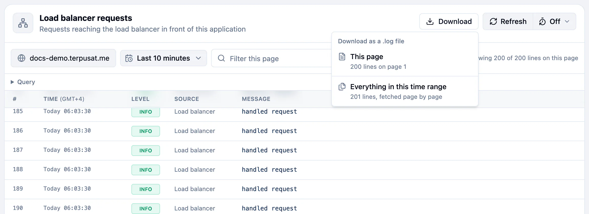

dPanel mengunduh log aplikasi dan load balancer sebagai file `.log` biasa, baik halaman yang sedang dibuka maupun semua baris di rentang waktu, hingga 100.000 baris. Unduh log saat Anda perlu mencarinya dengan alat sendiri, atau melampirkannya ke permintaan bantuan.

## Log aplikasi dan load balancer

1. Atur rentang waktu yang Anda inginkan. Lihat [Rentang waktu dan pembaruan](./time-range-and-refresh.md).
2. Tekan **Unduh**. Menunya bertuliskan **Unduh sebagai file .log**.
3. Pilih yang ingin disimpan:
   - **Halaman ini**: baris di halaman yang sedang dibuka.
   - **Semua di rentang waktu ini**: semua halaman, diambil satu per satu.

Nama file menjelaskan isinya: nama log dan jendela waktunya, misalnya `db-manager_2026-11-05T01-00Z_to_2026-11-05T01-10Z.log`, ditambah `_page-2` untuk satu halaman. Baris disimpan dari yang terlama, sebagai teks biasa yang bisa dibuka di editor apa pun. Setiap baris berisi waktu dalam UTC, level, dan baris aslinya persis seperti ditulis.

:::note[Detail request tidak ada di file]
Load balancer menulis setiap request sebagai pesan pendek `handled request`, sedangkan metode, path, dan status disimpan sebagai field terpisah. Unduhan menyimpan pesan itu, bukan baris `GET … → 200` yang mudah dibaca. Untuk menyimpan detail request, gunakan `dnocs load-balancer log --id <ID load balancer> --json`.
:::

Unduhan yang panjang menampilkan progresnya, misalnya **Mengunduh 12.000 / 40.000 baris**. Tekan **Batalkan unduhan** untuk menghentikannya.

:::warning[Maksimal 100.000 baris sekali unduh]
**Semua di rentang waktu ini** dibatasi 100.000 baris. Untuk rentang yang lebih besar, opsinya bertuliskan **Lebih dari 100.000 baris** dan tidak bisa dipilih. Persempit rentang waktunya, atau unduh per halaman.
:::

## Log build

Di **Log Artefak**, tekan **Unduh**. Nama file-nya mengikuti commit, misalnya `build-04ccf00a1b2c.log`, dan berisi baris yang tampil, hingga 500 baris terbaru.

## Sebelum membagikan log

Log bisa berisi apa saja yang dicetak kode Anda, termasuk token atau data pribadi. Baca dulu sebelum mengirimkannya ke mana pun.

## Pertanyaan yang sering diajukan

### Berapa banyak baris yang bisa diunduh?

Hingga 100.000 baris sekaligus dengan **Semua di rentang waktu ini**. Untuk lebih banyak, persempit rentang waktu atau unduh per halaman.

### Bisakah saya mengunduh log server?

Tidak sebagai file. Log server menampilkan 20 sampai 500 baris terbaru dari satu file. Pilih sebuah baris lalu gunakan **Salin baris mentah**, atau baca lewat SSH. Lihat [Terhubung lewat SSH](../servers/connect-over-ssh.md).

### Format filenya apa?

Teks biasa berekstensi `.log`, satu baris per entri log, dari yang terlama.
