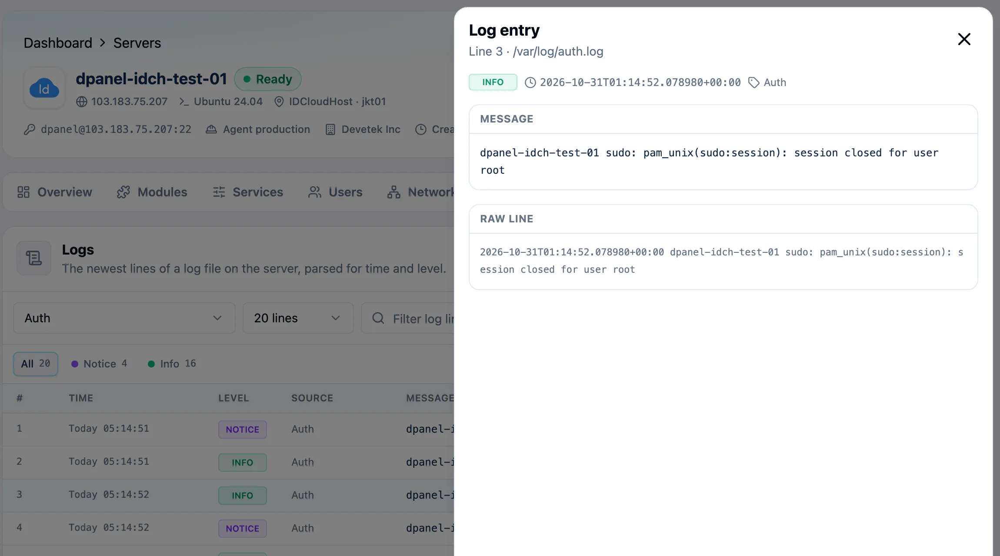
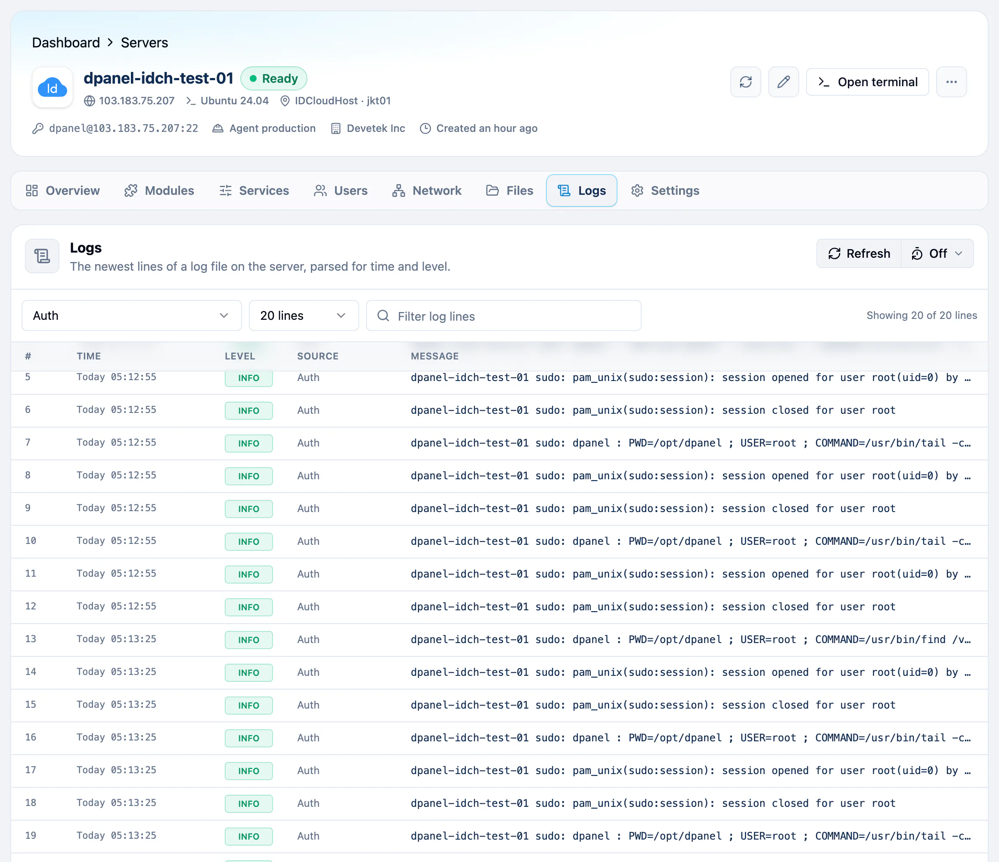

dPanel menampilkan empat jenis log. Semuanya memakai tabel yang sama, jadi begitu Anda bisa membaca satu, Anda bisa membaca semuanya.

## Letak setiap log

| Log                  | Tempatnya                                                                                    | Isinya                                                                          |
| -------------------- | -------------------------------------------------------------------------------------------- | ------------------------------------------------------------------------------- |
| Log server           | Halaman server, tab **Log**                                                                  | File log di mesin: sistem, keamanan, provisioning, agen dPanel, dan web server. |
| Log runtime aplikasi | Halaman aplikasi, tab **Log**, **Runtime**                                                   | Apa yang dicetak layanan Anda selama berjalan.                                  |
| Log load balancer    | Halaman aplikasi, tab **Log**, **Load balancer**; atau tab **Logs** di halaman load balancer | Permintaan yang masuk ke load balancer.                                         |
| Log build            | Halaman aplikasi, **Rilis**, tombol **Log** pada sebuah build                                | Keluaran satu build: clone, langkah build, dan saat layanan dijalankan.         |

## Tabel log

Setiap baris tabel adalah satu baris log, dengan kolom berikut:

| Kolom  | Isinya                                                                   |
| ------ | ------------------------------------------------------------------------ |
| #      | Urutan baris di halaman ini.                                             |
| Waktu  | Kapan baris ditulis, dalam zona waktu Anda.                              |
| Level  | debug, info, notice, warn, error, atau fatal, jika barisnya menyebutkan. |
| Sumber | File, layanan, atau domain asal baris.                                   |
| Pesan  | Teksnya. Lencana **JSON** berarti baris itu membawa data terstruktur.    |

Baris terbaru tampil paling atas.

## Mempersempit tampilan

- **Saring halaman ini** menyisakan baris yang memuat teks Anda. Pencariannya hanya di baris yang sudah dimuat, bukan seluruh rentang waktu.
- **Chip level** ada di atas tabel, satu untuk setiap level yang muncul, lengkap dengan jumlahnya. Pilih **error** untuk melihat galat saja; pilih **Semua** untuk kembali. Chip disembunyikan jika semua baris punya level yang sama.
- Jika tidak ada yang cocok, **Hapus pencarian** menghapus kedua saringan.

## Membuka satu entri

Pilih sebuah baris, atau tombol **Buka entri**-nya. Panel **Entri log** terbuka di samping tabel, berisi:

- **Pesan**: teks lengkap, tanpa terpotong.
- **Payload terstruktur**: JSON di baris itu, dirapikan.
- **Konteks**: waktu, level, dan sumber.
- **Baris mentah**: persis seperti yang ditulis. **Salin baris mentah** menyalinnya.

## Log server

Tab **Log** di halaman server membaca baris-baris terbaru dari satu file log.

1. Buka servernya, lalu masuk ke **Log**.
2. Pilih file di **Sumber log**. File dikelompokkan menjadi Overview, System, Security, Provisioning, dPanel, dan Network. **Auth** terpilih lebih dulu; **All VM logs** membaca semuanya sekaligus.
3. Pilih berapa baris yang dibaca: 20, 50, 100, 200, atau 500.

:::note[Log server tidak punya rentang waktu]
Log server membaca baris terbaru dari sebuah file, bukan jendela waktu. Rentang waktu, halaman, dan unduhan di [Rentang waktu dan pembaruan](./time-range-and-refresh.md) berlaku untuk log aplikasi dan log load balancer.
:::

## Log build

**Log Artefak** terbuka di atas halaman dengan 500 baris terbaru dari build itu. Di sana ada **Saring halaman ini**, chip level, **Unduh**, serta **Segarkan** dengan **Muat ulang otomatis**, yang berguna selama build masih berjalan. Pilih sebuah baris untuk membukanya di tempat.
