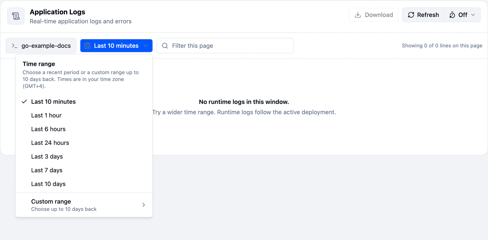
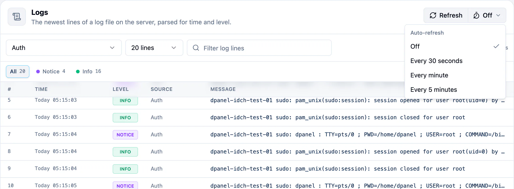

Di dPanel Anda bisa membaca log aplikasi dan load balancer mulai dari 10 menit terakhir hingga 3 hari ke belakang, menggulir ke atas untuk baris yang lebih lama, dan memperbaruinya secara manual atau otomatis. Kontrol ini ada di log runtime aplikasi dan log load balancer; lihat [Membaca log](./reading-logs.md) untuk letak setiap log.

## Memilih rentang waktu

Tampilan dibuka pada **10 menit terakhir**.

1. Buka menu rentang waktu, di sebelah kiri **Saring baris yang dimuat**.
2. Pilih salah satu: **10 menit terakhir**, **1 jam terakhir**, **6 jam terakhir**, **24 jam terakhir**, atau **3 hari terakhir**.

### Rentang khusus

1. Di menu yang sama, pilih **Rentang khusus**.
2. Isi **Dari** dan **Sampai**. Waktunya dalam zona waktu Anda, ditampilkan sebagai selisih seperti UTC+07:00.
3. Tekan **Terapkan**.

Formulir memberi tahu apa yang salah sebelum pencarian dijalankan:

| Pesan                                     | Cara memperbaiki                                |
| ----------------------------------------- | ----------------------------------------------- |
| Isi waktu mulai dan selesai.              | Isi kedua kolom.                                |
| Waktu mulai harus sebelum waktu selesai.  | Tukar keduanya.                                 |
| Log hanya disimpan untuk 3 hari terakhir. | Majukan waktu mulainya.                         |
| Waktu selesai tidak boleh di masa depan.  | Atur waktu selesai ke sekarang atau lebih awal. |

:::info[Hingga 3 hari ke belakang]
Log bisa dibaca hingga 3 hari ke belakang, karena selama itulah log disimpan. Untuk baris yang lebih lama, unduh log mentah dari server. Lihat [Mengunduh log](./download-logs.md#log-mentah-dari-server).
:::

## Menggulir ke atas untuk baris yang lebih lama

Log runtime dan log load balancer dibaca seperti terminal. Daftar terbuka pada baris terbaru, di bagian bawah rentang waktu yang dipilih.

- **Gulir ke atas** untuk memuat baris yang lebih lama. Baris datang 200 sekaligus, sebelum Anda sampai di atas, dan baris yang sedang dibaca tetap di tempatnya.
- Daftar berakhir di **Awal rentang waktu**. Untuk membaca lebih jauh, pilih rentang waktu yang lebih panjang.
- Setelah menggulir ke atas, **Ke baris terbaru** membawa Anda kembali ke baris terbaru.

Bagian bawah menyebutkan yang sudah dimuat, misalnya **Baris 1–200 dari 1.250 dimuat, terbaru di bawah**. Baris 1 adalah baris terbaru.

**Saring baris yang dimuat** dan chip level bekerja pada baris yang sedang dimuat. Untuk mencari lebih jauh, gulir ke atas untuk memuat lebih banyak baris, atau atur **Rentang khusus** di sekitar waktu yang Anda perlukan.

:::info[Semua server dalam satu daftar]
Log runtime aplikasi yang berjalan di beberapa server menggabungkan semua server dalam satu daftar. Daftar itu bisa digulir mundur hingga 5.000 baris. Untuk baris yang lebih lama, persempit rentang waktu atau pilih satu server di menu **Server**.
:::

## Segarkan

Tekan **Segarkan** untuk memuat baris terbaru. Tabel tetap menampilkan baris yang ada selama pemuatan.

## Muat ulang otomatis

Tombol di sebelah **Segarkan** mengatur **Muat ulang otomatis**. Bawaannya **Mati**.

1. Buka menu di sebelah **Segarkan**.
2. Pilih **Setiap 30 detik**, **Setiap menit**, atau **Setiap 5 menit**. Tombolnya lalu menampilkan intervalnya, misalnya **30s**.
3. Pilih **Mati** untuk menghentikannya.

Muat ulang otomatis hanya berjalan selama Anda berada di bagian bawah daftar, mengikuti baris terbaru. Setelah Anda menggulir ke atas, fitur ini berhenti sementara, supaya baris tidak bergeser saat dibaca. Fitur ini aktif lagi saat Anda kembali ke bawah atau menekan **Ke baris terbaru**.

Tab **Log** di halaman server dan tab **Keluaran log** di **Log Artefak** juga punya kontrol **Segarkan** dan **Muat ulang otomatis** yang sama.

## Pertanyaan yang sering diajukan

### Mengapa baris yang lebih lama tidak ada?

dPanel menyimpan log aplikasi dan load balancer selama 3 hari. Yang lebih lama sudah hilang. Unduh yang perlu Anda simpan. Lihat [Mengunduh log](./download-logs.md).

### Mengapa baris terbaru ada di paling bawah?

Log dibaca seperti terminal, sesuai urutan penulisannya. Daftar terbuka di bagian bawah, jadi baris terbaru langsung terlihat, dan baris yang lebih lama ada di atasnya.

### Apakah sesi yang lama membuat browser saya melambat?

Tidak. Daftar menyimpan paling banyak 1.000 baris di layar, selama apa pun Anda memantau atau menggulir. Baris yang jauh dilepas dan dimuat lagi saat Anda menggulir ke sana.

### Waktunya memakai zona waktu apa?

Zona waktu Anda, dari browser. Judul kolomnya menampilkan selisihnya, misalnya **Waktu (GMT+4)**.

### Apakah muat ulang otomatis menimbulkan biaya?

Tidak. Fitur ini hanya membaca log lagi sesuai interval yang Anda pilih.
