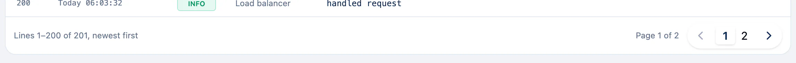

Di dPanel Anda bisa membaca log aplikasi dan load balancer mulai dari 10 menit terakhir hingga 10 hari ke belakang, 200 baris per halaman, dan memperbaruinya secara manual atau otomatis. Kontrol ini ada di log runtime aplikasi dan log load balancer; lihat [Membaca log](./reading-logs.md) untuk letak setiap log.

## Memilih rentang waktu

Tampilan dibuka pada **10 menit terakhir**.

1. Buka menu rentang waktu, di sebelah kiri **Saring halaman ini**.
2. Pilih salah satu: **10 menit terakhir**, **1 jam terakhir**, **6 jam terakhir**, **24 jam terakhir**, **3 hari terakhir**, **7 hari terakhir**, atau **10 hari terakhir**.

### Rentang khusus

1. Di menu yang sama, pilih **Rentang khusus**.
2. Isi **Dari** dan **Sampai**. Waktunya dalam zona waktu Anda, ditampilkan sebagai selisih seperti UTC+07:00.
3. Tekan **Terapkan**.

Formulir memberi tahu apa yang salah sebelum pencarian dijalankan:

| Pesan                                      | Cara memperbaiki                                |
| ------------------------------------------ | ----------------------------------------------- |
| Isi waktu mulai dan selesai.               | Isi kedua kolom.                                |
| Waktu mulai harus sebelum waktu selesai.   | Tukar keduanya.                                 |
| Log hanya disimpan untuk 10 hari terakhir. | Majukan waktu mulainya.                         |
| Waktu selesai tidak boleh di masa depan.   | Atur waktu selesai ke sekarang atau lebih awal. |

:::info[Hingga 10 hari ke belakang]
Log bisa dibaca hingga 10 hari ke belakang. dPanel menahan setiap rentang dalam batas itu, jadi waktu mulai yang lebih lama akan dimajukan ke tepi jendela.
:::

## Menelusuri baris yang lebih lama

Satu halaman berisi 200 baris. Halaman 1 berisi 200 baris terbaru; halaman 2 berisi 200 baris sebelumnya, dan seterusnya. Di dalam satu halaman, baris tersusun sesuai urutan waktu, yang terbaru di paling bawah. Bagian bawah menunjukkan posisi Anda, misalnya **Baris 1–200 dari 1.250, terbaru dulu**.

- Jika totalnya diketahui, pakai nomor halaman.
- Jika tidak, pakai **Lebih baru** dan **Lebih lama**.

**Saring halaman ini** dan chip level bekerja di halaman yang sedang dibuka. Untuk mencari lebih jauh ke belakang, buka halaman yang lebih lama atau persempit rentang waktunya.

## Segarkan

Tekan **Segarkan** untuk memuat baris terbaru. Tabel tetap menampilkan baris yang ada selama pemuatan.

## Muat ulang otomatis

Tombol di sebelah **Segarkan** mengatur **Muat ulang otomatis**. Bawaannya **Mati**.

1. Buka menu di sebelah **Segarkan**.
2. Pilih **Setiap 30 detik**, **Setiap menit**, atau **Setiap 5 menit**. Tombolnya lalu menampilkan intervalnya, misalnya **30s**.
3. Pilih **Mati** untuk menghentikannya.

Muat ulang otomatis berhenti sementara selama Anda berada di halaman yang lebih lama, supaya baris tidak bergeser saat dibaca. Fitur ini aktif lagi saat Anda kembali ke halaman pertama.

Tab **Log** di halaman server dan **Log Artefak** juga punya kontrol **Segarkan** dan **Muat ulang otomatis** yang sama.

## Pertanyaan yang sering diajukan

### Mengapa baris yang lebih lama tidak ada?

dPanel menyimpan log aplikasi dan load balancer selama 10 hari. Yang lebih lama sudah hilang. Unduh yang perlu Anda simpan. Lihat [Mengunduh log](./download-logs.md).

### Mengapa baris terbaru ada di paling bawah?

Di dalam satu halaman, baris dibaca seperti buku, sesuai urutan penulisannya. Tabel menggulir ke bawah untuk Anda, jadi baris terbaru langsung terlihat.

### Waktunya memakai zona waktu apa?

Zona waktu Anda, dari browser. Judul kolomnya menampilkan selisihnya, misalnya **Waktu (GMT+4)**.

### Apakah muat ulang otomatis menimbulkan biaya?

Tidak. Fitur ini hanya membaca log lagi sesuai interval yang Anda pilih.
